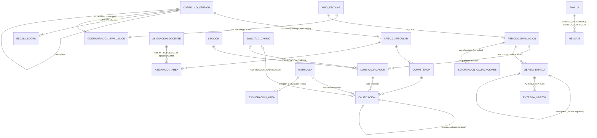

# Sprint 10 · Notas por competencias, libretas y SIAGIE: diseño de arquitectura

> Diseño del agente `arquitecto-software`, 23 de octubre de 2026. Rama `claude/sprint-10-notas-libretas-siagie`, que parte
> de `main` en 694b9e3 (sprints 0 a 9 y el rediseño): última migración **V34**, **99 triggers y 11 funciones en `03`**
> (14 funciones con huella con las 3 de `02`: **113 huellas**). Sprint del 11 de enero al 12 de febrero de 2027 (hito H7).
> Paquete base `pe.edu.virgenmaria.cuentasclaras`; los textos visibles dicen **Cuotaria** (`CC_MARCA_NOMBRE`).
> **Sin dependencias nuevas:** la libreta en PDF se genera con Apache PDFBox 3.0.8, que ya está en el `pom.xml` (sección 3.9).
>
> **Cómo se verificó (y qué NO se verificó)**
> - **Leído:** `CLAUDE.md` («Método por sprint»), la skill `contexto-colegio`, `plan-de-desarrollo.md` (sprint 10 y D12),
>   `sprint-9-asistencia-comunicados.md` (secciones 1 a 7, 16 y las tres «Implementación»), `sprint-9/tanda-2.md`,
>   `sprint-9/correcciones.md`, V5, V25, V32, V33 y V34, el encabezado y las funciones de `03-triggers.sql`, los bloques del
>   sprint 9 de `02-permisos-tablas.sql`, `TipoSolicitud`, `LogosColegio`, `FuentesDelJar` y la regla
>   `pdfboxSoloEnElAnalizador` de `ReglasArquitecturaTest`.
> - **Normativa leída en su texto (fuentes al final):** la RVM 094-2020-MINEDU completa (72 páginas) y la RVM 048-2024-MINEDU
>   completa (copia auténtica firmada). Las dos se leyeron desde copias del mismo PDF oficial porque `gob.pe` respondió
>   403 y 418 a la descarga directa.
> - **NO probado:** V35, V36 y V37, los GRANT, los 13 triggers nuevos, las versiones nuevas de `trg_mensaje_nace` y
>   `trg_asignacion_docente_estado` y las 2 funciones nuevas **no se ejecutaron** en H2 ni en MySQL 8. El primer paso de cada tanda es aplicarlos sobre V1–V34
>   reales en las dos bases (hallazgo 1 del sprint 3).
> - **La D12 sigue sin confirmar con el colegio.** Lo que no se pudo confirmar va marcado **«supuesto pendiente de D12»**
>   (sección 2.3), con su valor por defecto configurable por colegio o versionado en el catálogo.
> - **Auditoría en papel sobre 0b30c57** (1 crítico, 5 altos, 6 medios y 3 bajos): incorporada en la **sección 3.13, que
>   prevalece** sobre el texto y el SQL anteriores donde difieran.

## 1. Resumen
- **La nota es un libro de solo inserción, como el pago y la asistencia.** Cada calificación (AD, A, B o C por competencia,
  con su conclusión descriptiva) es una fila que nadie edita ni borra. Mientras el periodo está ABIERTO, el docente del área
  la reemplaza con otra fila; **cuando Dirección cierra el periodo, cambiarla exige una solicitud aprobada y firmada por
  otra persona** (ni quien la pide ni quien puso la nota), queda en la bitácora y **la familia recibe la libreta corregida
  con el aviso de qué cambió**: el padre vuelve a ser el auditor.
- **Catálogo nacional versionado que el colegio no edita.** Áreas, competencias y escalas del Currículo Nacional (CNEB 2016,
  con la RVM 094-2020 y la RVM 048-2024) en tablas sin `colegio_id` que solo escribe la migración. Corregirlo es agregar una
  **versión nueva** (filas nuevas); las notas siguen apuntando a la versión con que se registraron. El colegio elige la
  versión y el tipo de periodo de cada año, y quedan fijos desde que abre el primer periodo.
- **Libreta (informe de progreso) en PDF generada en el servidor** con PDFBox, sin parsear nada, desde una **foto inmutable**
  (las notas y la asistencia hasta una marca de agua) con su huella de contenido y un código de verificación impreso. **Nunca
  se retiene por deuda:** el módulo `academico` no puede leer cobranza (ArchUnit), la emisión es para toda matrícula activa y
  una prueba demuestra que una familia con deuda vencida descarga la misma libreta que una al día.
- **SIAGIE:** un `.xlsx` por sección y periodo, una hoja por área, con un perfil de columnas versionado y la etiqueta
  PROVISIONAL hasta tener una plantilla real (igual que la nómina del sprint 9). Sale de la **misma foto** que la libreta.
- **Tres tandas:** (1) currículo, periodos y escalas (V35, 104 triggers, 119 huellas); (2) registro de notas, cierre y
  correcciones (V36, 108 triggers, 124 huellas); (3) libretas en PDF y exportación para el SIAGIE (V37, 112 triggers, 128
  huellas).


## 2. Normativa vigente a octubre de 2026 (investigación del 23-oct-2026)

### 2.1 Confirmado en el texto de la norma
| Tema | Qué dice | Fuente |
|---|---|---|
| Norma de evaluación | **RVM 094-2020-MINEDU** («Norma que regula la evaluación de las competencias de los estudiantes de la Educación Básica», 26-abr-2020), **modificada por la RVM 048-2024-MINEDU** (30-abr-2024). No encontré modificación ni derogación posterior (búsquedas en gob.pe, El Peruano y documentos de UGEL de 2025 y 2026, que siguen citando «094-2020 y su modificatoria 048-2024») | F1, F2, F3 |
| Escala | **Una sola escala en toda la Educación Básica:** AD (logro destacado), A (logro esperado), B (en proceso), C (en inicio), con las descripciones del CNEB (p. 181), citadas en el numeral 5.1.1.3.6 | F1 |
| Secundaria | **Literal, como Primaria.** La RVM 048-2024 trae el cuadro de promoción de Secundaria en niveles de logro («B» en la mitad o más de las competencias…), sin escala vigesimal. **No hay notas numéricas en EBR.** La única conversión numérica (C = 1, B = 2.5, A = 3, AD = 4; calificativo de área de 2.5 a 10) es del Anexo 9, «información requerida por otros agentes», y **la calcula el propio SIAGIE** | F2 |
| Nivel por área | «No se asignará un nivel de logro a cada área curricular»: solo por competencia (5.1.1.3.12) | F1 |
| Conclusión descriptiva | **Inicial ciclo II:** obligatoria con A, B o C (con AD, opcional). **Primaria:** obligatoria con B o C. **Secundaria:** obligatoria con C. Siempre «deben incluir recomendaciones personalizadas»; con C en dos o más periodos consecutivos, el docente sustenta por qué no hay avance; para estudiantes con barreras educativas, incluye los apoyos y ajustes razonables | F2 (modifica 5.1.1.3.7, 5.1.2.1 b y 5.1.2.2) |
| Inicial ciclo I (0 a 2 años) | Solo conclusiones descriptivas. **No aplica:** Cuotaria solo tiene `INICIAL_3` a `INICIAL_5` (ciclo II) | F1 |
| Periodos | «La IE o programa educativo al inicio del año escolar debe configurar en el SIAGIE cómo se dividirá el periodo lectivo (**bimestre, trimestre o semestre**)». Al término de cada periodo se informa el nivel de las competencias desarrolladas y evaluadas **hasta ese momento**; al final del año todas deben tener nivel. **El último nivel registrado de cada competencia es el anual** | F2 (5.1.1.3.1 a 3) |
| Competencias transversales | Dos: «Se desenvuelve en entornos virtuales generados por las TIC» y «Gestiona su aprendizaje de manera autónoma». Van en el informe y en el SIAGIE; **cada IE decide cómo se asigna su nivel**. No cuentan para la promoción. En Inicial, **solo a los 5 años** | F1 (5.1.1.3.8, 5.1.3.9 y Anexo 02) |
| Informe de progreso | Comunica, al final de cada periodo, el nivel de cada competencia y las conclusiones; se entrega a las familias (en Inicial, en una entrevista). **El formato lo puede diseñar la IE**; el SIAGIE no adapta formatos. Los anexos 02 a 04 traen: DRE, UGEL, nivel, código modular, insignia, IE, grado, sección, código de estudiante o DNI, apellidos y nombres, docente o tutor; por área y competencia, nivel y conclusión de cada periodo y el **nivel al finalizar el periodo lectivo**; transversales; **resumen de asistencia** (inasistencias y tardanzas, justificadas e injustificadas, por periodo); situación final (PRO, PER o RR); firmas del docente o tutor y del director | F1 (5.1.2.1 b; anexos 02, 03 y 04) |
| Registro en el SIAGIE | Públicos y privados registran **por periodo** el nivel de cada competencia desarrollada y las conclusiones exigidas; Comunicación en lengua materna, segunda lengua e Inglés van como tres áreas | F1, F2 (5.1.2.2) |
| Exoneración | Educación Religiosa y Educación Física: la pide el padre (si el estudiante es menor) y la **autoriza el director** | F1 (5.2.3.2 y 5.2.3.3) |
| Competencias propias | La IE puede agregar competencias de su PCI (por ejemplo, un tercer idioma) | F1 (5.1.1.3.10) |
| Currículo | Sigue vigente el **CNEB de 2016** (RM 281-2016-MINEDU). La **RM 393-2026-MINEDU** (julio de 2026) creó una comisión que supervisa su **actualización, con vigencia hasta el 31-dic-2027**. Es la razón más fuerte para el catálogo versionado | F4 |
| Año escolar 2026 | Norma técnica del año escolar 2026 para IE públicas y privadas, emitida el 7-nov-2025 (un buscador la da como RM 501-2025-MINEDU; el PDF es una imagen escaneada y no pude leer el número): bimestre, trimestre u otra organización la define la DRE, la UGEL o la IE | F5 |
| SIAGIE, carga desde Excel | Guía oficial: «Evaluación > Registro de Calificaciones > Periodo por Excel»; se elige periodo, grado y sección y se pulsa **Generar Excel**; el archivo se guarda **sin cambiar el nombre**; **cada área es una hoja**; se sube con «Cargar notas» y se revisa en «Miscelánea > Procesos». La guía es de 2013 y todavía dice «vigesimales en Secundaria» (es anterior a la RVM 094-2020) | F6 |
| INDECOPI | Ley 29571, art. 73: no se condiciona la evaluación al pago. INDECOPI sigue multando en 2026 (Resolución Final 206-2026/INDECOPI-JUN, por impedir un examen por falta de pago) | F8 |

### 2.2 Lo que NO se pudo confirmar
- **Las columnas, el orden y los códigos de la plantilla de calificaciones del SIAGIE vigente** (por competencias). Solo hay
  la guía de 2013 y una presentación de terceros de 2023 («se registran las competencias que se trabaja»; «con C, debe
  registrar la conclusión descriptiva»). Como con la nómina del sprint 9, hace falta una plantilla real descargada por la
  Dirección de un colegio piloto.
- **El largo máximo de la conclusión descriptiva en el SIAGIE.**
- **La norma técnica del año escolar 2027** (suele salir en noviembre): puede cambiar fechas o periodos.
- **El estado del proyecto de ley que restituye el sistema vigesimal** (presentado en junio de 2025, para colegios
  públicos): no encontré que se haya aprobado. Si se aprobara, sería otra versión del catálogo con otra escala (3.2).
- **El número exacto de la RM del año escolar 2026** (PDF escaneado).

### 2.3 Supuestos pendientes de D12 (con su valor por defecto)
| # | Supuesto | Por defecto | Dónde se cambia |
|---|---|---|---|
| S1 | Tipo de periodo del Virgen María | **BIMESTRE (4)** | `configuracion_evaluacion.tipo_periodo` por colegio y año (BIMESTRE, TRIMESTRE o SEMESTRE) |
| S2 | Quién califica las dos transversales | **El TUTOR de la sección** | Decisión 175 (la norma deja que la IE decida) |
| S3 | Largo máximo de la conclusión | **500 caracteres** | `configuracion_evaluacion.conclusion_max` (100 a 1000) |
| S4 | Textos del catálogo | Los del CNEB 2016 como los transcriben los anexos 02 a 04 de la RVM 094-2020 (sección 3.2) | Versión nueva del catálogo |
| S5 | Plantilla del SIAGIE | Perfil `SIAGIE_CALIFICACIONES_PROVISIONAL`: una hoja por área, como la guía oficial | `src/main/resources/siagie/perfiles/` (entrega revisada) |
| S6 | Formato de la libreta | Basado en los anexos 02 a 04 (la norma deja que la IE lo diseñe) | Plantilla en el código; logo y datos, por colegio |
| S7 | Notas numéricas | **Ninguna.** La conversión del Anexo 9 la hace el SIAGIE | — |
| S8 | Tardanzas en el resumen de asistencia | **Todas injustificadas** (el sprint 9 no justifica tardanzas, decisión 150) | Cuando se justifiquen tardanzas |
| S9 | Cierre anticipado | Dirección puede cerrar **desde 7 días antes del fin** del periodo | `configuracion_evaluacion.dias_cierre_anticipado` (0 a 15) |
| S10 | Áreas que se dictan | Las que alguien tiene asignadas en la sección; Castellano como segunda lengua solo si se asigna | Asignaciones (3.4) |
| S11 | Nombre de la lengua materna | «Castellano» | `configuracion_evaluacion.lengua_materna` |

## 3. Hallazgos al leer el código y decisiones de diseño

### 3.1 Hallazgos (leer antes de implementar)
1. **H1. `asignacion_docente.areas` es texto libre** (V32). Sin el área del catálogo no se sabe quién califica qué. Se agrega
   `asignacion_area` (3.4); las asignaciones vigentes del sprint 9 se vuelven a proponer con sus áreas.
2. **H2. No hay periodos** en el esquema: solo `anio_escolar` con `inicio_clases` y `fin_clases`.
3. **H3. `firma_operacion` tiene `UNIQUE (colegio_id, clave)`:** una clave de firma se usa una vez. El docente guarda notas
   muchas veces en un periodo: cada guardado es un **lote** con secuencia y la clave la lleva
   (`lote_calificacion:{periodo}:{seccion}:{area}:{secuencia}`), como `configuracion_academica` lleva su versión.
4. **H4. La regla `pdfboxSoloEnElAnalizador`** permite PDFBox solo en `comunicados.analizador` (el proceso hijo). Generar la
   libreta exige una excepción acotada a `academico.libreta.pdf`, **solo con la API de escritura** (3.9).
5. **H5. `familias` depende de `caja` y `cobranza`.** El portal de libretas no crece ahí: lo sirve `academico.web`
   (`/familia/libretas/**`, módulo FAMILIA), como la asistencia del sprint 9. Es la base técnica de la regla de INDECOPI.
6. **H6. `colegio` no tiene DRE ni UGEL,** que la libreta lleva en su cabecera: van en `configuracion_evaluacion` (por año,
   opcionales). El código modular por nivel ya existe (V34).
7. **H7. `acceso_dato_personal` tiene CHECK con tipos fijos:** V35 los recrea **una sola vez** con `NOTAS_SECCION`, `LIBRETA`
   y `CALIFICACIONES_SIAGIE` (lección del sprint 9).
8. **H8. `consentimiento_aviso.finalidad` (`VARCHAR(12)`) solo admite ASISTENCIA y COMUNICADOS:** V37 agrega `LIBRETAS`.
9. **H9. `solicitud_cambio` no restringe tipos** y tiene un UNIQUE de pendientes por `(tipo, entidad, entidad_id)`: una
   corrección pendiente por nota (entidad `calificacion`) y un registro tardío pendiente por asignación de área.
10. **H10. `trg_solicitud_cambio_*` no sabe de roles:** quién puede aprobar una corrección de nota lo exige el trigger de la
    nota que se inserta, como en `CORRECCION_ASISTENCIA`.

### 3.2 Catálogo nacional versionado (tanda 1)
- **Cuatro tablas sin `colegio_id`:** `curriculo_version`, `area_curricular`, `competencia` y `escala_logro`. Son el
  equivalente del enum `Grado`: datos de referencia nacionales, no de negocio. **La aplicación no las escribe:** `cc_negocio`
  solo tiene el SELECT que ya tiene sobre `cuentasclaras.*`; las filas las inserta la migración con `cc_migrador`. Un INSERT
  con `cc_app` o `cc_sistema` da 1142.
- **Corregir sin migrar datos:** una corrección es una **versión nueva** (otra migración que solo inserta filas, con
  `reemplaza_id` a la anterior). Las notas guardan el `competencia_id` de su versión: **ninguna nota se toca** al corregir el
  catálogo. Cada colegio y año elige su versión en `configuracion_evaluacion`, que **queda fija desde que abre el primer
  periodo** (trigger). Un error de tipeo se corrige en la versión del año siguiente; un cambio de fondo a mitad de año es una
  decisión del usuario (riesgo R2).
- **Integridad:** `VerificadorCatalogoCurriculo` calcula al arrancar el SHA-256 de las filas de cada versión (orden y columnas
  fijos) y lo compara con `src/main/resources/curriculo/{codigo}.sha256`. Si un DBA altera una competencia, **prod no
  arranca** (como con los triggers); en dev y pruebas, avisa. La cadena exacta de la huella está en el brief de la tanda 1
  (`sprint-10/tanda-1.md`, sección 6).
- **Versión inicial `CNEB-2016.1`:** 29 áreas (7 de Inicial, 10 de Primaria y 12 de Secundaria, contando «Competencias
  transversales» como un área marcada `transversal`), **75 competencias** (14 + 30 + 31) y 12 valores de escala (4 por
  nivel). Lo que solo aplica a 5 años de Inicial lleva `solo_grados = 'INICIAL_5'`.

| Nivel | Área (código) | Competencias (código: nombre) |
|---|---|---|
| INICIAL | Personal Social (PS) | INI-PS-1 Construye su identidad · INI-PS-2 Convive y participa democráticamente en la búsqueda del bien común · INI-PS-3 Construye su identidad como persona humana, amada por Dios, digna, libre y trascendente, comprendiendo la doctrina de su propia religión, abierto al diálogo con las que le son cercanas |
| INICIAL | Psicomotriz (PSI) | INI-PSI-1 Se desenvuelve de manera autónoma a través de su motricidad |
| INICIAL | Comunicación (COM) | INI-COM-1 Se comunica oralmente en su lengua materna · INI-COM-2 Lee diversos tipos de textos escritos en su lengua materna · INI-COM-3 Escribe diversos tipos de textos en su lengua materna · INI-COM-4 Crea proyectos desde los lenguajes artísticos |
| INICIAL | Castellano como segunda lengua (C2L) | INI-C2L-1 Se comunica oralmente en castellano como segunda lengua (solo INICIAL_5) |
| INICIAL | Matemática (MAT) | INI-MAT-1 Resuelve problemas de cantidad · INI-MAT-2 Resuelve problemas de forma, movimiento y localización |
| INICIAL | Ciencia y Tecnología (CYT) | INI-CYT-1 Indaga mediante métodos científicos para construir sus conocimientos |
| INICIAL | Competencias transversales (TRV) | INI-TRV-1 Se desenvuelve en entornos virtuales generados por las TIC · INI-TRV-2 Gestiona su aprendizaje de manera autónoma (las dos, solo INICIAL_5) |
| PRIMARIA | Personal Social (PS) | PRI-PS-1 Construye su identidad · PRI-PS-2 Convive y participa democráticamente en la búsqueda del bien común · PRI-PS-3 Construye interpretaciones históricas · PRI-PS-4 Gestiona responsablemente el espacio y el ambiente · PRI-PS-5 Gestiona responsablemente los recursos económicos |
| PRIMARIA | Educación Física (EF, exonerable) | PRI-EF-1 Se desenvuelve de manera autónoma a través de su motricidad · PRI-EF-2 Asume una vida saludable · PRI-EF-3 Interactúa a través de sus habilidades sociomotrices |
| PRIMARIA | Comunicación (COM) | PRI-COM-1 Se comunica oralmente en su lengua materna · PRI-COM-2 Lee diversos tipos de textos escritos en su lengua materna · PRI-COM-3 Escribe diversos tipos de textos en su lengua materna |
| PRIMARIA | Arte y Cultura (AYC) | PRI-AYC-1 Aprecia de manera crítica manifestaciones artístico-culturales · PRI-AYC-2 Crea proyectos desde los lenguajes artísticos |
| PRIMARIA | Castellano como segunda lengua (C2L) | PRI-C2L-1 Se comunica oralmente en castellano como segunda lengua · PRI-C2L-2 Lee diversos tipos de textos escritos en castellano como segunda lengua · PRI-C2L-3 Escribe diversos tipos de textos en castellano como segunda lengua |
| PRIMARIA | Inglés como lengua extranjera (ING) | PRI-ING-1 Se comunica oralmente en inglés como lengua extranjera · PRI-ING-2 Lee diversos tipos de textos escritos en inglés como lengua extranjera · PRI-ING-3 Escribe diversos tipos de textos en inglés como lengua extranjera |
| PRIMARIA | Matemática (MAT) | PRI-MAT-1 Resuelve problemas de cantidad · PRI-MAT-2 Resuelve problemas de regularidad, equivalencia y cambio · PRI-MAT-3 Resuelve problemas de forma, movimiento y localización · PRI-MAT-4 Resuelve problemas de gestión de datos e incertidumbre |
| PRIMARIA | Ciencia y Tecnología (CYT) | PRI-CYT-1 Indaga mediante métodos científicos para construir sus conocimientos · PRI-CYT-2 Explica el mundo físico basándose en conocimientos sobre los seres vivos, materia y energía, biodiversidad, Tierra y universo · PRI-CYT-3 Diseña y construye soluciones tecnológicas para resolver problemas de su entorno |
| PRIMARIA | Educación Religiosa (REL, exonerable) | PRI-REL-1 Construye su identidad como persona humana, amada por Dios, digna, libre y trascendente, comprendiendo la doctrina de su propia religión, abierto al diálogo con las que le son cercanas · PRI-REL-2 Asume la experiencia del encuentro personal y comunitario con Dios en su proyecto de vida en coherencia con su creencia religiosa |
| PRIMARIA | Competencias transversales (TRV) | PRI-TRV-1 Se desenvuelve en entornos virtuales generados por las TIC · PRI-TRV-2 Gestiona su aprendizaje de manera autónoma |
| SECUNDARIA | Desarrollo Personal, Ciudadanía y Cívica (DPCC) | SEC-DPCC-1 Construye su identidad · SEC-DPCC-2 Convive y participa democráticamente en la búsqueda del bien común |
| SECUNDARIA | Ciencias Sociales (CCSS) | SEC-CCSS-1 Construye interpretaciones históricas · SEC-CCSS-2 Gestiona responsablemente el espacio y el ambiente · SEC-CCSS-3 Gestiona responsablemente los recursos económicos |
| SECUNDARIA | Educación para el Trabajo (EPT) | SEC-EPT-1 Gestiona proyectos de emprendimiento económico o social |
| SECUNDARIA | EF (exonerable), COM, AYC, C2L, ING, MAT, CYT, REL (exonerable) y TRV | SEC-EF-1 a 3, SEC-COM-1 a 3, SEC-AYC-1 y 2, SEC-C2L-1 a 3, SEC-ING-1 a 3, SEC-MAT-1 a 4, SEC-CYT-1 a 3, SEC-REL-1 y 2 y SEC-TRV-1 y 2, con los mismos nombres que en Primaria |

- **Escala `escala_logro`** (los mismos 4 valores en los tres niveles; cambia `exige_conclusion`):

| Valor | Nombre | INICIAL exige conclusión | PRIMARIA | SECUNDARIA |
|---|---|---|---|---|
| AD | Logro destacado | No | No | No |
| A | Logro esperado | **Sí** | No | No |
| B | En proceso | **Sí** | **Sí** | No |
| C | En inicio | **Sí** | **Sí** | **Sí** |

  Las descripciones son las del CNEB citadas en la RVM 094-2020 (5.1.1.3.6). El colegio **puede exigir más** (siempre la
  conclusión: `conclusion_siempre`), **nunca menos**: el trigger exige el mínimo del catálogo.
- **Si vuelve el sistema vigesimal** (riesgo R3): es otra versión con otros valores en `escala_logro` y el CHECK de
  `calificacion.nivel_logro` ampliado en una migración nueva. El modelo no cambia.

### 3.3 Configuración por colegio y año, y periodos (tanda 1)
- **`configuracion_evaluacion`** (una por colegio y año): versión del currículo, tipo de periodo (BIMESTRE = 4, TRIMESTRE = 3,
  SEMESTRE = 2), `conclusion_max`, `conclusion_siempre`, `dias_cierre_anticipado`, `lengua_materna`, DRE y UGEL. **Solo
  Dirección, con su firma** (`configuracion_evaluacion:{anio}:GUARDADA:{version}`), como `configuracion_academica` del
  sprint 9. **La versión, el tipo de periodo y los días de cierre anticipado no cambian desde que un periodo de ese año está ABIERTO**
  (M7).
- **`periodo_evaluacion`** (uno por número dentro del año): nombre («I bimestre»), inicio y fin dentro de
  `inicio_clases`-`fin_clases`, sin solaparse y en orden. Estados:

```
PROGRAMADO --(sistema.academico el día de inicio, o Dirección con su firma antes)--> ABIERTO
ABIERTO --(Dirección con su firma, desde fin - dias_cierre_anticipado, con el periodo anterior CERRADO)--> CERRADO
CERRADO: final. No se reabre: lo que cambie después va por solicitud, nota por nota.
```
  - Pueden estar ABIERTOS dos periodos seguidos (el docente termina el I bimestre en la semana de gestión mientras empieza el
    II). Un periodo no abre si el anterior sigue PROGRAMADO.
  - Las fechas cambian en PROGRAMADO; en ABIERTO el fin **solo se extiende** (nunca se adelanta, M7), con firma; el número y el año nunca (1143).
  - **Cerrar es publicar:** al cerrar, `sistema.libretas` emite las libretas (tanda 3). La pantalla de cierre muestra, por
    sección y área, las competencias asignadas sin nota («3.° B · Matemática: 2 de 4 competencias sin nota») y pide
    confirmar: según la norma, una competencia no trabajada en el periodo **se deja sin nota**.
  - `AperturaPeriodos` (cc_sistema, diario a las 06:00) abre los periodos cuyo inicio llegó.

### 3.4 Quién califica qué: áreas de cada asignación (tanda 1)
- **`asignacion_area`** (solo inserción): las áreas del catálogo de una asignación TUTOR o DOCENTE. **Se agregan solo mientras
  la asignación está PROPUESTA y por quien la propuso**, así que se aprueban con ella (la bandeja muestra «Docente de
  Matemática y Ciencia y Tecnología en 3.° B»): **dar a alguien el poder de poner notas lo deciden dos personas**, como dar
  acceso a la sección (sprint 9).
- **Cambiar las áreas** de una asignación VIGENTE es proponer otra igual con las áreas nuevas; al aprobarla, el manejador
  termina la anterior con la firma de quien aprueba y deja VIGENTE la nueva en la misma transacción (el trigger de estado del
  sprint 9 ya lo permite). Las vigentes del sprint 9 con áreas en texto salen en «Asignaciones sin áreas del catálogo»: hasta
  re-proponerlas, ese docente marca asistencia pero no califica.
- **El área es del nivel de la sección y de la versión del año** (trigger). Una cobertura (`hasta` con fecha) **no lleva
  áreas**: quien cubre unos días marca asistencia, no califica. El AUXILIAR nunca califica.
- **Las transversales no se asignan:** las califica el **TUTOR** (S2). En Inicial y Primaria la propuesta del tutor ofrece
  «Todas las áreas del grado».
- **Áreas que se dictan:** sin tabla aparte; un área se dicta en una sección si alguien la tiene asignada (S10). La libreta y
  el SIAGIE salen con esas áreas y las transversales.

### 3.5 Registro de notas (tanda 2)
- **Pantalla del docente** `/academico/notas/{seccion}/{area}?periodo=`: alumnos (solo nombres, decisión 142) en filas y las
  competencias del área en columnas; un toque elige AD, A, B o C, y la conclusión se abre debajo **cuando la norma la exige**
  («En Primaria, con B o C la conclusión es obligatoria e incluye una recomendación»). Con C también en el periodo anterior,
  el aviso pide sustentar por qué no hay avance (RVM 048-2024). Un botón «Guardar» por área: **un POST, un lote, una firma**.
- **`lote_calificacion`** (solo inserción): periodo, sección, área, secuencia, sesión y quién. Firma
  `lote_calificacion:{periodo}:{seccion}:{area}:{secuencia}` (H3).
- **`calificacion`** (solo inserción, cadena lineal como `marca_asistencia`): una fila por alumno y competencia en cada
  guardado **que cambia algo**. `reemplaza_id` apunta a la vigente y un UNIQUE impide dos sucesoras; la vigente es la que
  nadie reemplaza. Orígenes:

| Origen | Cuándo | Quién | Cómo |
|---|---|---|---|
| `REGISTRO` | Periodo ABIERTO, primera nota de esa competencia | El docente con esa área asignada (el tutor, en transversales) | Lote firmado |
| `CAMBIO_ABIERTO` | Periodo ABIERTO, reemplaza la vigente | Igual | Lote firmado. Puede dejar la competencia **sin nota** (`nivel_logro` NULL: «no se trabajó en este periodo») |
| `REGISTRO_TARDIO` | Periodo CERRADO, competencia sin nota, con `CALIFICACION_TARDIA` aprobada | El docente que la pidió, dentro de 48 h | Lote firmado con la solicitud |
| `CORRECCION_APROBADA` | Periodo CERRADO, reemplaza la vigente | El manejador, al aprobar `CORRECCION_CALIFICACION` | Solicitud aprobada y firmada; nivel y huella de la conclusión, los de la solicitud |

- **Matrícula del momento:** la nota es de un alumno con matrícula **ACTIVA o RESERVADA** (C1: la RESERVADA, impaga, recibe nota igual) en esa sección al insertarse; un cambio de sección no
  mueve las notas anteriores (cada fila guarda su sección y matrícula, como la asistencia).
- **Exoneración** (`exoneracion_area`, solo inserción): Religión o Educación Física; la registra **Dirección con su firma**,
  con el código del documento que presentó el padre. Desde ese momento no se califica esa área para ese alumno (trigger) y la
  libreta dice «Exonerado».
- **Lo que ve cada uno** (Ley 29733, acceso mínimo):

| Dato | Docente | Tutor | Dirección | Promotoría | Familia |
|---|---|---|---|---|---|
| Notas y conclusiones | Las de sus áreas y secciones | Toda su sección (lectura) | Todas | Solo las de una solicitud que aprueba | Solo en la libreta, al cierre |
| Avance de registro (cuántas faltan) | Lo suyo | Su sección | Todo | Todo (sin alumnos) | — |
| DNI, contactos, deudas, pagos | **Nunca** | **Nunca** | Como hoy | Como hoy | Lo suyo |

  Cada consulta de las notas de una sección queda en `acceso_dato_personal` (`NOTAS_SECCION`, con la cantidad). Las
  conclusiones pueden tener **datos sensibles** (apoyos y ajustes razonables por discapacidad, que la norma pide consignar):
  nunca van a logs, a WhatsApp ni a la bitácora (la bitácora guarda su SHA-256, no el texto).

### 3.6 Cierre y correcciones después del cierre: el antifraude de las notas (tanda 2)
**El fraude que se quiere impedir:** cambiar en silencio una nota ya informada (por favor, por presión de una familia, por
un docente o por alguien con acceso a la base). Es la regla del dinero: nada se edita en silencio.

1. **Después del cierre, la base rechaza todo cambio directo:** `trg_calificacion_nace` solo acepta `REGISTRO` y
   `CAMBIO_ABIERTO` con el periodo ABIERTO. Con la clave de `cc_app` tampoco se puede (1644); UPDATE y DELETE no tienen
   GRANT (1142).
2. **Corrección = solicitud `CORRECCION_CALIFICACION`** (entidad `calificacion`, la vigente; datos: `nivel` nuevo o `null`,
   `borrador_id` y `conclusion_sha256` del borrador de la conclusión nueva, y motivo de al menos 20 caracteres). **El texto va
   en `borrador_conclusion`** (M8), nunca en `datos` ni en la bitácora; el aprobador lo lee ahí.
 La pide **el docente con esa área en la
   sección** o Dirección.
3. **La aprueba otra persona** activa de Dirección o Promotoría, con su firma, que **no es quien la pidió ni quien registró la
   nota que se reemplaza** (un director que también enseña no corrige su propia nota). Lo exige el trigger con
   `cc_solicitud_firmada` y los roles reales.
4. **Entra lo aprobado:** el trigger compara el nivel y la huella de la conclusión con `solicitud_cambio.datos`
   (`JSON_EXTRACT`), y una solicitud produce una sola fila (`UNIQUE (colegio_id, solicitud_id)`).
5. **Queda en la bitácora** (`CALIFICACION_CORREGIDA`: nivel anterior y nuevo, quién pidió, quién aprobó y la huella de las dos
   conclusiones) y **la familia se entera:** `sistema.libretas` emite la versión siguiente de la libreta con el aviso «Se
   corrigió la libreta del I bimestre de Ana: Matemática · Resuelve problemas de cantidad: B → A» (tanda 3).
6. **Registro tardío** (`CALIFICACION_TARDIA`, entidad `asignacion_area`, datos: periodo y motivo): para una competencia que
   quedó sin nota y sí se trabajó. Mismo circuito de aprobación; con ella, el docente guarda un lote `REGISTRO_TARDIO` en las
   48 horas siguientes, solo para competencias sin nota.
7. **Vigilancia:** Dirección ve «Correcciones de notas del periodo» (quién pidió, quién aprobó, de qué a qué). Promotoría
   recibe la alerta `CORRECCIONES_NOTAS` **siempre que una corrección suba el nivel o deje la competencia sin nota** (A5), y
   además si una persona aprueba más de 5 en un periodo (decisión 186).

### 3.7 Libreta (informe de progreso) (tanda 3)
- **Se emite al cerrar el periodo, para toda matrícula ACTIVA o RESERVADA** (C1) de las secciones del año: `EmisionLibretas` (`sistema.libretas`,
  cc_sistema) recorre los periodos CERRADOS sin libretas y crea una `libreta_emitida` por alumno. No recibe ni puede leer nada
  de cobranza (ArchUnit): **no hay forma de saltarse a quien debe**. `IntegridadLibretas` compara después las libretas
  emitidas con las matrículas activas y alerta a Promotoría si falta alguna.
- **Foto inmutable, no archivo guardado** (decisión 170): `libreta_emitida` guarda `hasta_calificacion_id` y `hasta_marca_id`
  (marcas de agua, como QA-S9-8) y la **huella del contenido** (SHA-256 de una cadena canónica: alumno, periodo, cada
  competencia con su nivel y la huella de su conclusión, exoneraciones y el resumen de asistencia). Como notas y marcas son de
  solo inserción, la libreta se regenera igual siempre; al descargar, la aplicación recalcula la huella y, **si no coincide,
  no entrega el PDF y alerta a Promotoría** (alguien tocó la base). Sin blobs: los respaldos no crecen y una actualización de
  PDFBox no da falsas alarmas (la huella es del contenido, no del archivo).
- **Versiones:** una corrección o un registro tardío aprobados crean la versión siguiente (`reemplaza_id`), con aviso a la
  familia. **El portal muestra todas las versiones**, con su fecha y qué cambió: nada desaparece.
- **Contenido** (anexos 02 a 04, supuesto S6): logo del colegio (el PNG ya saneado del sprint 8), DRE, UGEL, nivel, código
  modular, nombre del colegio, grado, sección, código de estudiante o DNI, apellidos y nombres, tutor; por área y competencia,
  el nivel y la conclusión de **cada periodo cerrado hasta este** y, en la del último periodo, el nivel anual (el último
  registrado); transversales; «Exonerado» donde corresponda; resumen de asistencia por periodo (FALTA_JUSTIFICADA =
  inasistencia justificada, FALTA = injustificada, TARDE = tardanza injustificada, S8); leyenda de la escala; nombres del tutor
  y de quien cerró el periodo; «Situación al finalizar el periodo lectivo: se informa al cierre del año» (decisión 178);
  **código de verificación** `LIB-{id}-{16 primeros caracteres de la huella}` (A4) y «Emitida el … · versión N». **Nada de pagos,
  deudas ni pensiones** (`LibretaSinCobranzaTest` lee el texto del PDF en la prueba).
- **Quién la descarga:** los apoderados activos de la familia, desde `/familia/libretas` con su sesión; Dirección (una, o la
  sección completa para imprimir); y **el tutor, las de su sección para imprimirlas** (M9, decisión 177 revisada). La libreta
  muestra el **código de estudiante**, y el DNI solo si no hay código. En Inicial se entrega en la entrevista con la familia
  (canal `ENTREVISTA`). Cada entrega queda en `entrega_libreta` (canal PORTAL, IMPRESA o ENTREVISTA, quién y con qué sesión)
: es la
  constancia de que el colegio **entregó** la libreta, útil ante un reclamo en INDECOPI.
- **Verificación:** `/academico/libretas/verificar?codigo=` (Dirección) dice si un papel corresponde a una libreta emitida y si
  es la versión vigente, y **muestra los niveles de esa versión** por competencia (sin conclusiones) para compararlos con el
  papel (A4).
- **Aviso:** `LIBRETA_DISPONIBLE` (uno por familia y periodo, con los hermanos juntos) y `LIBRETA_CORREGIDA`, por WhatsApp con
  el consentimiento de la finalidad nueva `LIBRETAS` y, sin él, por correo. El aviso solo dice que la libreta está en el
  portal; nunca lleva notas ni conclusiones.

### 3.8 INDECOPI y la Ley 29571: la libreta nunca se retiene por deuda (tanda 3)
1. **Separación de código:** `academico` (con `academico.curriculo`, `academico.notas` y `academico.libreta`) no depende de
   `cobranza`, `caja`, `comprobantes`, `pasarela`, `recaudacion`, `conciliacion`, `panel` ni `familias` (la regla ArchUnit que
   ya existe, ampliada a los paquetes nuevos). `PortalLibretasController` está en `academico.web`.
2. **Sin configuración que retenga:** `ConfiguracionEvaluacion` no tiene ningún campo de deuda, pago ni bloqueo
   (`ConfiguracionSinDeudaTest`, por reflexión), y ningún filtro ni interceptor del portal lee deudas en `/familia/libretas/**`
   (`PortalSinFiltroDeDeudaTest` recorre los `HandlerInterceptor`, los filtros, los `@ControllerAdvice`, los `@ModelAttribute`,
   los fragmentos del layout de familias y la redirección después del login, B14).
3. **La prueba que lo demuestra** (`LibretaConDeudaTest`, obligatoria, en H2 y en MySQL real): tres familias de la misma
   sección, una con cuotas VENCIDAS, otra al día y **otra con la matrícula RESERVADA (impaga, C1)**; se cierra el periodo; las
   tres tienen notas y su libreta emitida,
 reciben el mismo
   aviso y la descargan con 200; el texto del PDF y la huella de contenido son los de sus notas, sin diferencia que dependa del
   pago. La versión de MySQL corre en el job `mysql` con `cc_app` y `cc_sistema`.
4. **Mensajes sin cobranza:** `LIBRETA_*` pasan por la regla de cobranza de `trg_mensaje_nace` (los dos niveles del sprint 9).
5. **Lo que sí podría retener el colegio** (certificados oficiales de periodos no pagados, según la Ley 27665 y sus
   modificatorias) **no es la libreta** y no está en este sistema; lo confirma el asesor legal (D11 del plan).

### 3.9 La librería del PDF: PDFBox 3.0.8, solo para escribir
| Criterio | PDFBox directo (`PDPageContentStream`) | openhtmltopdf 1.1.x (HTML + CSS a PDF) |
|---|---|---|
| Dependencias | **Ninguna nueva** (3.0.8 ya está, Apache 2.0, seguida por Dependabot y OSV-Scanner) | Nuevas: `openhtmltopdf-core` y `-pdfbox` (1.1.65, julio de 2026), con xmlgraphics-commons y, para SVG, Batik |
| Superficie de ataque | Solo escribe: no parsea HTML, CSS, XML ni URL | Parsea HTML y CSS; carga recursos por URL (SSRF si no se cierra el `UserAgentCallback`); XML (XXE si no se endurece); SVG con Batik |
| Esfuerzo | Más código de maquetación (tabla con salto de página y texto que se ajusta): unas 500 líneas | Plantilla Thymeleaf; menos código |
| Mantenimiento | Apache, activo | Fork comunitario del original (sin versiones desde 2021) |

**Por defecto (decisión 169): PDFBox directo.** La libreta es un formato fijo de 2 a 4 páginas: no justifica abrir un parser
de HTML y CSS. Controles:
1. **Solo `academico.libreta.pdf` genera, y solo con la API de escritura:** `PDDocument` nuevo, `PDPage`,
   `PDPageContentStream`, `PDType0Font`, `LosslessFactory`. **Fuera de `comunicados.analizador` quedan prohibidos**
   `org.apache.pdfbox.Loader`, `org.apache.pdfbox.pdfparser..`, `PDFTextStripper` y toda carga de un PDF. La regla
   `pdfboxSoloEnElAnalizador` se divide en `pdfboxParseaSoloElAnalizador` y `pdfboxEscribeSoloLaLibreta`, que es una **lista
   blanca de clases** (M11, sección 3.13). Las pruebas quedan excluidas de forma explícita y sí leen el PDF generado.
2. **Entradas propias:** solo datos de la base (nombres, niveles, conclusiones de hasta `conclusion_max`) y el logo PNG que el
   sprint 8 ya validó, reescaló a 400 px y volvió a codificar (`LogosColegio`). El texto **se sanea**: sin caracteres de
   control (salvo el salto de línea) ni de formato (`\p{Cf}`), y todo carácter sin glifo en la fuente pasa a «?» (con un
   emoji, PDFBox lanzaría una excepción).
3. **Fuente incrustada del jar:** la Liberation Sans que trae PDFBox (licencia SIL OFL), como `FuentesDelJar`; nunca las del
   sistema (no se crea la caché de fuentes en el directorio del usuario).
4. **Límites:** executor propio de 2 hilos con cola de 8 y `AbortPolicy` («intente en unos minutos»); una libreta, 6 páginas
   como máximo; la de una sección completa, hasta 45 alumnos por archivo y una a la vez por colegio; memoria con
   `MemoryUsageSetting.setupMixed(32 MB, 64 MB)` en el `/tmp` en tmpfs que ya existe.
5. **Salida:** sin JavaScript, acciones, formularios ni enlaces; metadatos mínimos (título, «Cuotaria» como productor y la
   fecha de emisión, no la de descarga); descarga con `Content-Disposition: attachment; filename="libreta-{id}-v{n}.pdf"`,
   `X-Content-Type-Options: nosniff`, `Content-Security-Policy: sandbox; default-src 'none'` y `Cache-Control: private,
   no-store`, como el adjunto del sprint 9.
6. **Pruebas:** conclusión con emoji, texto de derecha a izquierda, `\u0000` y 1000 caracteres; 45 libretas de una sección en
   menos de 10 s en el CI; la cola llena responde «intente en unos minutos»; `VersionPdfBoxTest` sigue exigiendo 3.0.7 o más.

### 3.10 Exportación para el SIAGIE (tanda 3)
- **`/academico/siagie/calificaciones?seccion=&periodo=`** (solo Dirección): un `.xlsx` por sección y periodo **CERRADO**,
  **una hoja por área** (como la plantilla del SIAGIE, F6) y una de transversales. Por fila: número de orden, DNI o código de
  estudiante, apellidos y nombres y, por competencia, el nivel y la conclusión (o «EXO»). Orden del sprint 9 (Collator
  es-PE); `EscritorXlsxSeguro` (todo como texto, sin fórmulas).
- **Perfil versionado** `SIAGIE_CALIFICACIONES_PROVISIONAL` en `src/main/resources/siagie/perfiles/` (S5), con «PROVISIONAL»,
  el usuario y la fecha en la primera fila y en el nombre del archivo. La secretaria **copia las columnas en la plantilla que
  generó el SIAGIE**. Llenar directamente el `.xls` del SIAGIE (decisión 181) exige parsear un archivo subido: si se hace, va
  en un proceso hijo como el analizador de PDF del sprint 9, y después de tener una plantilla real.
- **Misma foto que la libreta:** el archivo usa la marca de agua de las libretas vigentes del periodo e imprime el código de la
  exportación. Si después se aprueba una corrección, la pantalla dice «Exportación desactualizada: 2 correcciones posteriores»
  y las lista: al SIAGIE se carga lo mismo que recibieron las familias.
- **Rastro:** `exportacion_calificaciones` (solo inserción; Dirección con su sesión; código y SHA-256, sin datos de alumnos),
  bitácora `CALIFICACIONES_SIAGIE_EXPORTADAS` y `acceso_dato_personal` (`CALIFICACIONES_SIAGIE`, con la cantidad). Alerta a
  Promotoría si una persona exporta más de 10 secciones en un día, como con la nómina.

### 3.11 Módulos y dependencias (ArchUnit, sin ciclos)
| Paquete | Qué tiene | Depende de | No depende de |
|---|---|---|---|
| `academico.curriculo` (nuevo) | Catálogo (solo lectura), configuración de evaluación, periodos, `VerificadorCatalogoCurriculo`, `AperturaPeriodos` | `colegio`, `seguridad`, `auditoria`, `comun` | Todo lo del dinero, `familias`, `comunicacion`, `comunicados` |
| `academico.notas` (nuevo) | Lotes, calificaciones, exoneraciones, manejadores de solicitudes, avance de registro | `academico` (asignaciones, matrículas de la sección), `academico.curriculo`, `aprobaciones`, `seguridad`, `auditoria`, `privacidad` | Igual |
| `academico.libreta` (nuevo) | Emisión, foto y huella, `pdf` (generador), portal, verificación, integridad | `academico.notas`, `academico` (asistencia), `colegio` (logo y códigos modulares) | Igual |
| `academico.siagie` (existe) | Gana `CalificacionesSiagie` | `academico.notas`, `academico.libreta` | Igual |
| `comunicacion` (existe) | Gana `proceso.AvisosLibretas` | `academico.api.LibretasPorAvisar` (solo lectura) | — |

- **Actor de sistema nuevo:** `sistema.libretas` (emite libretas y crea sus avisos). `sistema.academico` abre los periodos.
- **Orden de bloqueos** (extiende el del sprint 9): solicitud → asignacion_docente → periodo_evaluacion → lote_calificacion →
  calificacion → libreta_emitida → mensaje → bitácora. Ninguna transacción toca tablas de dinero.
- **Sin SQL nativo, sin `delete*` ni `@Modifying`** en los repositorios nuevos. Entidades de solo inserción con
  `updatable = false`; las del catálogo con `@Immutable` y repositorios sin `save`.

### 3.12 Multi-colegio y demo
- **`colegio_id` en toda tabla de negocio nueva** (todas salvo las 4 del catálogo), `UNIQUE (id, colegio_id)` y FK compuestas
  a año, periodo, sección, matrícula, alumno, asignación, sesión y solicitud del **mismo** colegio. Las entidades llevan
  `@TenantId`. `RutasIdorTest` agrega las rutas nuevas con los 3 colegios y un docente de otra área de la misma sección.
- **Colegio en preparación:** se puede configurar, abrir periodos y calificar (para practicar); las libretas se emiten pero
  **no se avisan** (S8-M2 en `trg_mensaje_nace`).
- **Demo** (`DatosDemoColegio`): 4 bimestres con el I CERRADO y el II ABIERTO; notas de 3.° B de Primaria (con conclusiones
  ficticias); una corrección aprobada con su libreta versión 2; la familia de `xxxx.apoderado` con su libreta por descargar;
  la exportación con «DEMO · DATOS FICTICIOS». El recorrido `/demo/guia` gana «Pon las notas de Matemática de 3.° B» y
  «Descarga la libreta como familia».

### 3.13 Auditoría en papel del diseño (sobre 0b30c57): 15 hallazgos incorporados
Revisión de `auditor-seguridad-antifraude` antes de implementar. **Esta sección prevalece** sobre el texto y el SQL de las
secciones 3 a 9 donde difieran. Conteos nuevos: tanda 1, **104 triggers, 15 funciones y 119 huellas** (sin cambio: A2 es una
versión nueva); tanda 2, **108, 16 y 124** (+`trg_borrador_conclusion_nace`); tanda 3, **112, 16 y 128**
(+`trg_delegacion_siagie_nace`).

| # | Nivel | Hallazgo | Resolución | Tanda | Prueba |
|---|---|---|---|---|---|
| C1 | Crítico | La matrícula RESERVADA (impaga) quedaba sin nota y sin libreta: retención por deuda de hecho | En `trg_calificacion_nace`, `trg_exoneracion_area_nace`, `trg_libreta_emitida_nace`, `EmisionLibretas`, `IntegridadLibretas` y la exportación, la matrícula vale si está **ACTIVA o RESERVADA** | 2 y 3 | `LibretaConDeudaTest` con **una tercera familia con matrícula RESERVADA** (H2 y MySQL); MySQL `c1NotaAMatriculaReservadaPasa` |
| A2 | Alto | Las áreas se podían agregar a la propuesta después de crear la solicitud y antes de aprobarla, sin que el aprobador las viera | Las áreas se insertan **en la misma transacción** de la propuesta, antes de enlazar la solicitud (`trg_asignacion_area_nace` exige `asignacion_docente.solicitud_id` NULL); `solicitud_cambio.datos` de `ASIGNACION_DOCENTE` lleva `"areas": "12,15"` (ids ordenados); **versión nueva de `trg_asignacion_docente_estado`**: al pasar a VIGENTE compara esa lista con `GROUP_CONCAT(area_id ORDER BY area_id)` de `asignacion_area` | 1 | MySQL `a2AreaDespuesDeLaSolicitudFalla`, `a2AreasDistintasALasAprobadasFallan` |
| A3 | Alto | Una exoneración retroactiva borraba notas ya informadas; la cabecera de la libreta podía cambiar sin cambiar la huella; con huella distinta la familia quedaba sin libreta | `exoneracion_area.desde_periodo_id` (un periodo ABIERTO; rige desde ahí; las notas anteriores quedan) y `libreta_emitida.hasta_exoneracion_id`; la **cabecera se guarda en la foto** (`alumno_nombre`, `alumno_codigo`, `tipo_codigo`, `dre`, `ugel`, `tutor_nombre`, `director_nombre`, `codigo_modular`) y entra en la huella; con huella distinta: alerta a Promotoría, el portal dice «en revisión, se la entrega el colegio a más tardar el {fecha}» (2 días hábiles) y Dirección pide `REEMISION_LIBRETA` (aprueba Promotoría) para que `sistema.libretas` emita la versión siguiente con motivo `REEMISION`. **Nunca «sin libreta»** | 2 y 3 | MySQL `a3ExoneracionEnPeriodoCerradoFalla`, `a3ReemisionSinSolicitudFalla`; H2 `FotoLibretaTest.cabeceraEnLaHuella`, `.huellaDistintaDaPlazoYReemision` |
| A4 | Alto | `/verificar` solo decía «válida»; 8 caracteres de huella se podían adivinar o forzar | `/verificar` **muestra los niveles de esa versión** (sin conclusiones); el código lleva **16 caracteres** de la huella: `LIB-{id}-{16 hex}` | 3 | H2 `VerificacionLibretaTest.muestraLosNiveles`, `.codigoDe16` |
| A5 | Alto | La alerta de correcciones dependía de umbrales y de si la familia ya había descargado | Alerta a Promotoría **siempre** que una corrección suba el nivel o deje la competencia sin nota (decisión 186 revisada) | 2 | H2 `AlertasNotasTest.subirElNivelSiempreAlerta`, `.dejarSinNotaAlerta` |
| A6 | Alto | La exportación usaba una marca de agua del periodo, no la libreta de cada alumno, y podía salir con correcciones aún no informadas | Sale de **la foto de la libreta vigente de cada matrícula**; `exportacion_calificaciones.hasta_calificacion_id` pasa a `huella_libretas` (SHA-256 de los ids y huellas de las libretas usadas); **se rechaza** si hay una `CORRECCION_APROBADA` o `REGISTRO_TARDIO` sin libreta nueva; hoja **«Control»** con los conteos de AD, A, B, C, sin nota y EXO por competencia para comparar después de la carga | 3 | H2 `CalificacionesSiagieTest.saleDeLaLibretaVigente`, `.correccionSinLibretaRechaza`, `.hojaDeControl` |
| M7 | Medio | En ABIERTO se podía adelantar el `fin` (y con él el cierre) y bajar los días de cierre anticipado | Con el periodo ABIERTO el `fin` **solo se extiende**; `dias_cierre_anticipado` fijo desde que abre el primer periodo (los dos triggers de la tanda 1; SQL ya corregido en 6.3) | 1 | MySQL `m7FinAdelantadoFalla`, `m7DiasDeCierreFijos` |
| M8 | Medio | La conclusión propuesta viajaba en `solicitud_cambio.datos` (visible en la bandeja y copiada a la bitácora) | Tabla **`borrador_conclusion`** (solo inserción): `calificacion_id`, `texto`, `sha256`, `sesion_id`, `creado_por`; la escribe el docente del área o Dirección con su sesión (`trg_borrador_conclusion_nace`, que recalcula el SHA-256); la leen solo quien la escribió y Dirección o Promotoría al aprobar (con registro en `acceso_dato_personal`); `datos` lleva `borrador_id` y el SHA-256; `trg_calificacion_nace` exige que `NEW.conclusion` sea el texto del borrador | 2 | MySQL `m8ConclusionDistintaAlBorradorFalla`; H2 `BitacoraSinConclusionesTest`, `BorradorConclusionTest.soloLoVenQuienLoEscribeYQuienAprueba` |
| M9 | Medio | Revisar la decisión 177: sin el tutor, imprimir las libretas recaía en Dirección, y el DNI no hacía falta | La libreta muestra el **código de estudiante**, y el DNI solo si no hay código; **el tutor imprime las de su sección** (`entrega_libreta` IMPRESA a su nombre: `trg_entrega_libreta_nace` acepta al TUTOR VIGENTE de la sección); en Inicial, canal **`ENTREVISTA`** (tutor o Dirección) | 3 | MySQL `m9TutorImprimeSoloSuSeccion`; H2 `LibretaPdfTest.codigoAntesQueDni` |
| M10 | Medio | El verificador solo miraba las versiones del jar: una versión metida en la base sin archivo pasaba | **Las dos direcciones:** cada versión de la base tiene su `.sha256` y cada `.sha256` su versión; además del arranque, `RevisionCatalogo` diaria (05:00) con alerta `INTEGRIDAD_CATALOGO` a Promotoría | 1 | H2 `VerificadorCatalogoCurriculoTest.versionSinArchivoFalla`, `.archivoSinVersionFalla`, `RevisionCatalogoTest` |
| M11 | Medio | La regla de PDFBox por paquetes dejaba usar en la libreta cualquier clase (imágenes desde archivos, unir PDF, formularios) | `pdfboxEscribeSoloLaLibreta` es una **lista blanca**: `PDDocument` (constructor sin argumentos, `addPage`, `save`, `close`, `getDocumentInformation`), `PDPage`, `PDRectangle`, `PDPageContentStream`, `PDType0Font.load(PDDocument, InputStream, boolean)`, `PDFont`, `LosslessFactory.createFromImage`, `PDImageXObject` (solo como tipo), `PDDocumentInformation`, `MemoryUsageSetting` y `RandomAccessStreamCache`. **Prohibidos expresamente:** `PDImageXObject.createFrom*`, `PDFMergerUtility`, `importPage`, `PDAcroForm`, los paquetes `interactive.action` e `interactive.annotation` y `Loader`. Pruebas excluidas de forma explícita (`ImportOption.DoNotIncludeTests`) | 3 | H2 `ReglasArquitecturaTest.pdfboxEscribeSoloLaLibreta` (una clase de prueba por prohibición) |
| M12 | Medio | La secretaria que carga en el SIAGIE no tenía acceso propio: usaría la cuenta de Dirección | Tabla **`delegacion_siagie`** (solo inserción): Dirección delega con su firma a una cuenta activa del personal (ADMINISTRACION o CAJA, no DOCENTE) por hasta 15 días (`trg_delegacion_siagie_nace`); `trg_exportacion_calificaciones_nace` acepta DIRECTOR o la delegada vigente, con su sesión; cada descarga, en `acceso_dato_personal` (`CALIFICACIONES_SIAGIE`) | 3 | MySQL `m12SinDelegacionFalla`, `m12DelegacionVencidaFalla`; H2 `DelegacionSiagieTest` |
| B13 | Bajo | Una barra vertical o un salto de línea en un texto del catálogo alteraba la cadena de la huella | CHECK en `area_curricular.nombre`, `competencia.nombre`, `escala_logro.nombre` y `descripcion`: `INSTR(x, CHAR(124)) = 0 AND INSTR(x, CHAR(10)) = 0 AND INSTR(x, CHAR(13)) = 0` (H2 y MySQL) | 1 | MySQL `b13SeparadorEnElCatalogoFalla` (como `cc_migrador`, 3819) |
| B14 | Bajo | `PortalSinFiltroDeDeudaTest` solo miraba interceptores y filtros | Cubre también `@ControllerAdvice`, `@ModelAttribute`, los fragmentos del layout de familias y la redirección después del login | 3 | H2 `PortalSinFiltroDeDeudaTest` (4 casos nuevos) |
| B15 | Bajo | Al verificador de la tanda 1 le faltaban casos | 1142 en `DELETE FROM asignacion_area`, `DELETE FROM configuracion_evaluacion`, `INSERT` y `UPDATE` en `curriculo_version` y `area_curricular` | 1 | `VerificadorPermisosBaseDatosTest`; paso `comprobar` |

**Cambios de SQL que prevalecen sobre la sección 5 y 6.3:**
```sql
-- V35 (A2, B13). En trg_asignacion_area_nace, además: la asignación todavía no tiene su solicitud enlazada.
--     IF NOT (v_solicitud <=> NULL) THEN SIGNAL ... 'las areas van en la misma transaccion de la propuesta';
-- En area_curricular, competencia y escala_logro, un CHECK por texto (CHAR(124) es la barra vertical):
CONSTRAINT ck_competencia_texto CHECK (INSTR(nombre, CHAR(124)) = 0 AND INSTR(nombre, CHAR(10)) = 0
    AND INSTR(nombre, CHAR(13)) = 0)

-- 03, versión nueva de trg_asignacion_docente_estado (A2), en PROPUESTA -> VIGENTE, además de lo de hoy:
IF NOT (COALESCE(JSON_UNQUOTE(JSON_EXTRACT((SELECT s.datos FROM solicitud_cambio s WHERE s.id = NEW.solicitud_id
            AND s.colegio_id = NEW.colegio_id), '$.areas')), '')
        <=> COALESCE((SELECT GROUP_CONCAT(x.area_id ORDER BY x.area_id SEPARATOR ',') FROM asignacion_area x
            WHERE x.asignacion_id = NEW.id), '')) THEN
    SIGNAL SQLSTATE '45000' SET MESSAGE_TEXT = 'cuentasclaras: las areas no son las que se aprobaron';
END IF;

-- V36 (A3): la exoneración rige desde un periodo ABIERTO (trg_exoneracion_area_nace lo exige).
ALTER TABLE exoneracion_area ADD COLUMN desde_periodo_id BIGINT NOT NULL;   -- (en el CREATE TABLE de V36, no en un ALTER)
--   CONSTRAINT fk_exoneracion_area_periodo FOREIGN KEY (desde_periodo_id, colegio_id) REFERENCES periodo_evaluacion (id, colegio_id)
-- trg_calificacion_nace: hay exoneración solo si su desde_periodo tiene numero <= el del periodo de la nota.

-- V36 (M8): borrador de la conclusión de una corrección. SOLO INSERCIÓN. El texto nunca va en datos ni en la bitácora.
CREATE TABLE borrador_conclusion (
    id               BIGINT        NOT NULL AUTO_INCREMENT PRIMARY KEY,
    colegio_id       BIGINT        NOT NULL,
    calificacion_id  BIGINT        NOT NULL,   -- la vigente que se quiere corregir
    texto            VARCHAR(1000) NOT NULL,
    sha256           VARCHAR(64)   NOT NULL,   -- trg_borrador_conclusion_nace lo recalcula con SHA2(texto, 256)
    sesion_id        BIGINT        NOT NULL,
    creado_en        DATETIME(6)   NOT NULL,
    creado_por       VARCHAR(60)   NOT NULL,
    actualizado_en   DATETIME(6)   NOT NULL,
    version          BIGINT        NOT NULL DEFAULT 0,
    CONSTRAINT uk_borrador_conclusion_id_colegio UNIQUE (id, colegio_id),
    CONSTRAINT fk_borrador_conclusion_colegio FOREIGN KEY (colegio_id) REFERENCES colegio (id),
    CONSTRAINT fk_borrador_conclusion_calificacion FOREIGN KEY (calificacion_id, colegio_id) REFERENCES calificacion (id, colegio_id),
    CONSTRAINT fk_borrador_conclusion_sesion FOREIGN KEY (sesion_id, colegio_id) REFERENCES sesion_usuario (id, colegio_id),
    CONSTRAINT ck_borrador_conclusion_valores CHECK (CHAR_LENGTH(TRIM(texto)) >= 10
        AND REGEXP_LIKE(sha256, '^[0-9a-f]{64}$', 'c') AND creado_por NOT LIKE 'sistema%')
);
-- trg_borrador_conclusion_nace: creado_por es docente del área de esa calificación en su sección (cc_docente_de_area) o
-- DIRECTOR (cc_rol_activo), con cc_sesion_abierta; SET NEW.sha256 = SHA2(NEW.texto, 256).
-- trg_calificacion_nace, CORRECCION_APROBADA: si datos trae borrador_id, NEW.conclusion = borrador.texto del MISMO
-- calificacion_id que NEW.reemplaza_id.
```
```sql
-- V37 (A3, A4, M9). libreta_emitida, columnas nuevas (en su CREATE TABLE), todas dentro de la huella del contenido:
    hasta_exoneracion_id   BIGINT        NOT NULL,   -- marca de agua de las exoneraciones (0 si no hay)
    alumno_nombre          VARCHAR(190)  NOT NULL,   -- cabecera congelada en la foto
    alumno_codigo          VARCHAR(20)   NOT NULL,   -- código de estudiante; el DNI solo si no hay código (M9)
    tipo_codigo            VARCHAR(18)   NOT NULL,   -- CODIGO_ESTUDIANTE | DNI | CE | PASAPORTE
    codigo_modular         VARCHAR(9),
    dre                    VARCHAR(80),
    ugel                   VARCHAR(80),
    tutor_nombre           VARCHAR(190),
    director_nombre        VARCHAR(190)  NOT NULL,
    solicitud_id           BIGINT,                   -- REEMISION_LIBRETA aprobada por Promotoría
--  motivo IN ('CIERRE', 'CORRECCION', 'REEMISION'); REEMISION exige solicitud_id, cambios = 'Reemitida tras una revision
--  de integridad' y, en trg_libreta_emitida_nace, cc_solicitud_firmada con resuelto_por PROMOTOR activo.
--  Código impreso: LIB-{id}-{16 primeros caracteres de huella_contenido} (A4).

-- entrega_libreta (M9): canal IN ('PORTAL', 'IMPRESA', 'ENTREVISTA'); apoderado_id solo en PORTAL.
--  trg_entrega_libreta_nace: IMPRESA por DIRECTOR o por el TUTOR VIGENTE de la sección de la libreta; ENTREVISTA, igual y
--  solo en Inicial.

-- exportacion_calificaciones (A6): hasta_calificacion_id se reemplaza por
    huella_libretas        VARCHAR(64)   NOT NULL,   -- SHA2 de los «id:huella» de las libretas vigentes usadas, en orden
--  y la aplicación rechaza la exportación si hay una CORRECCION_APROBADA o un REGISTRO_TARDIO de la sección y el periodo
--  con id mayor que el hasta_calificacion_id de la libreta vigente de esa matrícula.

-- V37 (M12): delegación de la exportación para el SIAGIE. SOLO INSERCIÓN; vence sola (sin revocación: desactivar la cuenta
-- la corta, porque cc_rol_activo exige la cuenta activa).
CREATE TABLE delegacion_siagie (
    id               BIGINT        NOT NULL AUTO_INCREMENT PRIMARY KEY,
    colegio_id       BIGINT        NOT NULL,
    usuario_id       BIGINT        NOT NULL,   -- la persona delegada
    desde            DATE          NOT NULL,
    hasta            DATE          NOT NULL,
    autorizado_por   VARCHAR(60)   NOT NULL,
    creado_en        DATETIME(6)   NOT NULL,
    creado_por       VARCHAR(60)   NOT NULL,
    actualizado_en   DATETIME(6)   NOT NULL,
    version          BIGINT        NOT NULL DEFAULT 0,
    CONSTRAINT fk_delegacion_siagie_colegio FOREIGN KEY (colegio_id) REFERENCES colegio (id),
    CONSTRAINT fk_delegacion_siagie_usuario FOREIGN KEY (usuario_id, colegio_id) REFERENCES usuario (id, colegio_id),
    CONSTRAINT ck_delegacion_siagie_valores CHECK (desde <= hasta AND creado_por = autorizado_por
        AND creado_por NOT LIKE 'sistema%')
);
-- trg_delegacion_siagie_nace: DIRECTOR con firma delegacion_siagie:{usuario}:{desde}:DELEGADA; hasta <= desde + 15 días;
-- desde >= cc_hoy_lima(); la cuenta delegada está activa, sin apoderado, con ADMINISTRACION o CAJA y sin DOCENTE.
-- trg_exportacion_calificaciones_nace: DIRECTOR, o una delegación con cc_hoy_lima() BETWEEN desde AND hasta.
```
- **GRANT nuevos:** `INSERT` en `borrador_conclusion` (tanda 2) y en `delegacion_siagie` (tanda 3) para `cc_negocio`.
- **`TipoSolicitud`** gana `REEMISION_LIBRETA` (tanda 3). **`TipoAviso`** gana `INTEGRIDAD_CATALOGO` (tanda 1).
- **`respaldar.sh` y `tablas-vigiladas.txt`** suman `borrador_conclusion` y `delegacion_siagie`.
- **Verificador** (tanda 2 y 3): 1142 en `UPDATE borrador_conclusion` y `UPDATE delegacion_siagie`.

## 4. Modelo


**Invariantes.** «(base)» = CHECK, UNIQUE o FK; «(MySQL)» = trigger; «(1142/1143)» = sin GRANT.
- **Catálogo** (tanda 1): solo lo inserta la migración (1142 para `cc_negocio`); códigos únicos por versión; la competencia es
  de un área de la misma versión (base, FK compuesta); su huella la verifica la aplicación al arrancar.
- **`configuracion_evaluacion`** (tanda 1): una por colegio y año; tipo y número de periodos coherentes; plazos en rango (base);
  la crea y la cambia una persona activa con rol DIRECTOR, con su firma y la versión de a una (MySQL); versión del currículo y
  tipo de periodo fijos desde que un periodo del año está ABIERTO (MySQL); colegio y año no cambian (1143).
- **`periodo_evaluacion`** (tanda 1): uno por número en el año, número dentro del tipo de periodo, fechas dentro del año y sin
  solaparse, en orden (base y MySQL); nace PROGRAMADO por DIRECTOR con firma (MySQL); PROGRAMADO → ABIERTO por
  `sistema.academico` en su fecha o por DIRECTOR con firma, con el anterior al menos ABIERTO; ABIERTO → CERRADO por DIRECTOR
  con firma, desde `fin − dias_cierre_anticipado` en hora de Lima de la base, con el anterior CERRADO; CERRADO no cambia
  (MySQL); número y año no cambian (1143).
- **`asignacion_area`** (tanda 1): solo inserción (1142); una por asignación y área (base); la asignación está PROPUESTA, la
  inserta quien la propuso, es TUTOR o DOCENTE y sin `hasta`, y el área es del nivel de la sección, de la versión del año y no
  transversal (MySQL).
- **`lote_calificacion`** (tanda 2): solo inserción (1142); secuencia siguiente por periodo, sección y área (base y MySQL);
  periodo ABIERTO, o CERRADO con su `CALIFICACION_TARDIA` aprobada y firmada de hace 48 h o menos, pedida por el mismo docente
  (MySQL); quien guarda es docente de esa área en la sección (`cc_docente_de_area`), con su sesión abierta y la firma del lote
  (MySQL).
- **`calificacion`** (tanda 2): solo inserción (1142); una inicial por periodo, matrícula y competencia; una sola sucesora por
  fila; una fila por solicitud (base); nivel AD, A, B o C, o NULL solo en un cambio (base); la competencia es de la versión y
  del nivel del año, del área del lote (o del área de la solicitud) y aplica al grado; la matrícula está ACTIVA o RESERVADA en esa sección (C1);
  sin exoneración del área; conclusión cuando la escala o el colegio la exigen y de hasta `conclusion_max` (MySQL); por origen,
  las reglas de 3.5 y 3.6 (MySQL); `registrado_bd` lo pone la base (MySQL).
- **`exoneracion_area`** (tanda 2): solo inserción (1142); una por matrícula y área; área exonerable (base y MySQL); la registra
  DIRECTOR con su firma (MySQL).
- **`libreta_emitida`** (tanda 3): solo inserción y **solo `cc_sistema`** (sin GRANT para `cc_negocio`); una por periodo,
  matrícula y versión; versión 1 sin reemplazo, siguientes con reemplazo de la anterior (base); periodo CERRADO; matrícula
  activa en el periodo; versión siguiente solo si hay una calificación `CORRECCION_APROBADA` o `REGISTRO_TARDIO` de esa
  matrícula y periodo entre la marca de agua anterior y la nueva (MySQL).
- **`entrega_libreta`** (tanda 3): solo inserción (1142); PORTAL por la cuenta de un apoderado activo de la familia del alumno,
  con su sesión; IMPRESA por DIRECTOR con su sesión (MySQL).
- **`exportacion_calificaciones`** (tanda 3): solo inserción (1142); DIRECTOR con su sesión; periodo CERRADO (MySQL).
- **`mensaje`** (versión nueva de `trg_mensaje_nace`, tanda 3): los tipos `LIBRETA_*` los crea solo `sistema.libretas`
  (`cc_sistema`), a un apoderado, con una plantilla de su familia, sin montos ni palabras de cobranza; por WhatsApp, con el
  último consentimiento `LIBRETAS` otorgado (MySQL).

## 5. Migraciones Flyway (NO probadas: aplicar sobre V1–V34 en H2 2.4.240 MODE=MySQL y en MySQL 8.4 antes de seguir)
Lección de V32 a V34: **un CHECK que evalúa NULL pasa**; toda columna que admite NULL se compara con `IS NOT NULL` explícito, y
cada CHECK con NULL tiene su prueba en MySQL.

### `V35__curriculo_periodos_y_escalas.sql` (tanda 1)
```sql
-- Sprint 10 · tanda 1 (docs/arquitectura/sprint-10-notas-libretas-siagie.md, secciones 3.2 a 3.4 y 5). Catálogo nacional
-- versionado (CNEB 2016 con la RVM 094-2020 y la RVM 048-2024): sin colegio_id, solo lo escribe la migración. Corregirlo es
-- una versión NUEVA; ninguna nota se toca. Configuración de evaluación y periodos por colegio y año; áreas de cada
-- asignación docente (se aprueban con la asignación). Nada se borra. Compatible con MySQL 8 y con H2 en modo MySQL.

CREATE TABLE curriculo_version (
    id              BIGINT        NOT NULL AUTO_INCREMENT PRIMARY KEY,
    codigo          VARCHAR(40)   NOT NULL,
    nombre          VARCHAR(200)  NOT NULL,
    normas          VARCHAR(500)  NOT NULL,   -- «RM 281-2016-MINEDU; RVM 094-2020-MINEDU, mod. RVM 048-2024-MINEDU»
    vigente_desde   DATE          NOT NULL,
    reemplaza_id    BIGINT,
    nota            VARCHAR(500),
    creado_en       DATETIME(6)   NOT NULL,
    CONSTRAINT uk_curriculo_version_codigo UNIQUE (codigo),
    CONSTRAINT uk_curriculo_version_reemplaza UNIQUE (reemplaza_id),
    CONSTRAINT fk_curriculo_version_reemplaza FOREIGN KEY (reemplaza_id) REFERENCES curriculo_version (id),
    CONSTRAINT ck_curriculo_version_codigo CHECK (REGEXP_LIKE(codigo, '^[A-Z0-9.-]{4,40}$', 'c'))
);

CREATE TABLE area_curricular (
    id           BIGINT        NOT NULL AUTO_INCREMENT PRIMARY KEY,
    version_id   BIGINT        NOT NULL,
    nivel        VARCHAR(12)   NOT NULL,
    codigo       VARCHAR(8)    NOT NULL,
    nombre       VARCHAR(80)   NOT NULL,
    orden        INT           NOT NULL,
    transversal  BOOLEAN       NOT NULL DEFAULT FALSE,
    exonerable   BOOLEAN       NOT NULL DEFAULT FALSE,
    CONSTRAINT uk_area_curricular_codigo UNIQUE (version_id, nivel, codigo),
    CONSTRAINT uk_area_curricular_id_version UNIQUE (id, version_id),
    CONSTRAINT fk_area_curricular_version FOREIGN KEY (version_id) REFERENCES curriculo_version (id),
    CONSTRAINT ck_area_curricular_valores CHECK (nivel IN ('INICIAL', 'PRIMARIA', 'SECUNDARIA')
        AND REGEXP_LIKE(codigo, '^[A-Z0-9]{2,8}$', 'c') AND orden BETWEEN 1 AND 99
        AND NOT (transversal AND exonerable))
);

CREATE TABLE competencia (
    id           BIGINT        NOT NULL AUTO_INCREMENT PRIMARY KEY,
    version_id   BIGINT        NOT NULL,
    area_id      BIGINT        NOT NULL,
    codigo       VARCHAR(16)   NOT NULL,   -- PRI-MAT-1
    nombre       VARCHAR(300)  NOT NULL,
    orden        INT           NOT NULL,
    solo_grados  VARCHAR(60),              -- NULL: todos los grados del nivel; si no, lista: 'INICIAL_5'
    CONSTRAINT uk_competencia_codigo UNIQUE (version_id, codigo),
    CONSTRAINT uk_competencia_id_version UNIQUE (id, version_id),
    CONSTRAINT fk_competencia_area FOREIGN KEY (area_id, version_id) REFERENCES area_curricular (id, version_id),
    CONSTRAINT ck_competencia_valores CHECK (REGEXP_LIKE(codigo, '^(INI|PRI|SEC)-[A-Z0-9]{2,8}-[0-9]{1,2}$', 'c')
        AND orden BETWEEN 1 AND 99
        AND (solo_grados IS NULL OR REGEXP_LIKE(solo_grados,
            '^(INICIAL_[3-5]|PRIMARIA_[1-6]|SECUNDARIA_[1-5])(,(INICIAL_[3-5]|PRIMARIA_[1-6]|SECUNDARIA_[1-5]))*$', 'c')))
);

CREATE TABLE escala_logro (
    id                BIGINT        NOT NULL AUTO_INCREMENT PRIMARY KEY,
    version_id        BIGINT        NOT NULL,
    nivel             VARCHAR(12)   NOT NULL,
    valor             VARCHAR(2)    NOT NULL,
    nombre            VARCHAR(40)   NOT NULL,
    descripcion       VARCHAR(400)  NOT NULL,
    orden             INT           NOT NULL,
    exige_conclusion  BOOLEAN       NOT NULL,
    CONSTRAINT uk_escala_logro UNIQUE (version_id, nivel, valor),
    CONSTRAINT fk_escala_logro_version FOREIGN KEY (version_id) REFERENCES curriculo_version (id),
    CONSTRAINT ck_escala_logro_valores CHECK (nivel IN ('INICIAL', 'PRIMARIA', 'SECUNDARIA')
        AND valor IN ('AD', 'A', 'B', 'C') AND orden BETWEEN 1 AND 9)
);
```

```sql
-- Semilla de la versión CNEB-2016.1 (29 áreas, 75 competencias y 12 valores de escala; listas completas en la sección 3.2).
-- Un INSERT ... SELECT por fila, con el id de la versión por su código (H2 y MySQL). Ejemplo de cada tabla:
INSERT INTO curriculo_version (codigo, nombre, normas, vigente_desde, creado_en)
VALUES ('CNEB-2016.1', 'Currículo Nacional de la Educación Básica 2016',
        'RM 281-2016-MINEDU; RVM 094-2020-MINEDU, modificada por RVM 048-2024-MINEDU', '2027-01-01', CURRENT_TIMESTAMP(6));
INSERT INTO area_curricular (version_id, nivel, codigo, nombre, orden, transversal, exonerable)
SELECT v.id, 'PRIMARIA', 'MAT', 'Matemática', 7, FALSE, FALSE FROM curriculo_version v WHERE v.codigo = 'CNEB-2016.1';
INSERT INTO competencia (version_id, area_id, codigo, nombre, orden, solo_grados)
SELECT a.version_id, a.id, 'PRI-MAT-1', 'Resuelve problemas de cantidad', 1, NULL
FROM area_curricular a JOIN curriculo_version v ON v.id = a.version_id
WHERE v.codigo = 'CNEB-2016.1' AND a.nivel = 'PRIMARIA' AND a.codigo = 'MAT';
INSERT INTO escala_logro (version_id, nivel, valor, nombre, descripcion, orden, exige_conclusion)
SELECT v.id, 'PRIMARIA', 'B', 'En proceso', 'Cuando el estudiante está próximo o cerca al nivel esperado respecto a la competencia, para lo cual requiere acompañamiento durante un tiempo razonable para lograrlo.', 3, TRUE
FROM curriculo_version v WHERE v.codigo = 'CNEB-2016.1';
-- Nada de || para concatenar (en MySQL es OR): cada texto va en un solo literal.

-- Configuración de evaluación de un año (solo Dirección, con firma: trg_configuracion_evaluacion_*).
CREATE TABLE configuracion_evaluacion (
    id                      BIGINT        NOT NULL AUTO_INCREMENT PRIMARY KEY,
    colegio_id              BIGINT        NOT NULL,
    anio_escolar_id         BIGINT        NOT NULL,
    curriculo_version_id    BIGINT        NOT NULL,
    tipo_periodo            VARCHAR(10)   NOT NULL DEFAULT 'BIMESTRE',
    numero_periodos         INT           NOT NULL DEFAULT 4,
    conclusion_max          INT           NOT NULL DEFAULT 500,
    conclusion_siempre      BOOLEAN       NOT NULL DEFAULT FALSE,
    dias_cierre_anticipado  INT           NOT NULL DEFAULT 7,
    lengua_materna          VARCHAR(30)   NOT NULL DEFAULT 'Castellano',
    dre                     VARCHAR(80),
    ugel                    VARCHAR(80),
    actualizado_por         VARCHAR(60)   NOT NULL,
    creado_en               DATETIME(6)   NOT NULL,
    creado_por              VARCHAR(60)   NOT NULL,
    actualizado_en          DATETIME(6)   NOT NULL,
    version                 BIGINT        NOT NULL DEFAULT 0,
    CONSTRAINT uk_configuracion_evaluacion_anio UNIQUE (colegio_id, anio_escolar_id),
    CONSTRAINT uk_configuracion_evaluacion_id_colegio UNIQUE (id, colegio_id),
    CONSTRAINT fk_configuracion_evaluacion_colegio FOREIGN KEY (colegio_id) REFERENCES colegio (id),
    CONSTRAINT fk_configuracion_evaluacion_anio FOREIGN KEY (anio_escolar_id, colegio_id)
        REFERENCES anio_escolar (id, colegio_id),
    CONSTRAINT fk_configuracion_evaluacion_version FOREIGN KEY (curriculo_version_id) REFERENCES curriculo_version (id),
    CONSTRAINT ck_configuracion_evaluacion_periodos CHECK ((tipo_periodo = 'BIMESTRE' AND numero_periodos = 4)
        OR (tipo_periodo = 'TRIMESTRE' AND numero_periodos = 3) OR (tipo_periodo = 'SEMESTRE' AND numero_periodos = 2)),
    CONSTRAINT ck_configuracion_evaluacion_valores CHECK (conclusion_max BETWEEN 100 AND 1000
        AND dias_cierre_anticipado BETWEEN 0 AND 15 AND CHAR_LENGTH(TRIM(lengua_materna)) >= 3),
    CONSTRAINT ck_configuracion_evaluacion_actor CHECK (actualizado_por NOT LIKE 'sistema%' AND creado_por NOT LIKE 'sistema%')
);

-- Periodos del año. Las transiciones y quién las hace: trg_periodo_evaluacion_* (sección 3.3). CERRADO no se reabre.
CREATE TABLE periodo_evaluacion (
    id               BIGINT        NOT NULL AUTO_INCREMENT PRIMARY KEY,
    colegio_id       BIGINT        NOT NULL,
    anio_escolar_id  BIGINT        NOT NULL,
    numero           INT           NOT NULL,
    nombre           VARCHAR(30)   NOT NULL,   -- «I bimestre»
    inicio           DATE          NOT NULL,
    fin              DATE          NOT NULL,
    estado           VARCHAR(10)   NOT NULL,   -- PROGRAMADO | ABIERTO | CERRADO
    abierto_por      VARCHAR(60),
    abierto_en       DATETIME(6),
    cerrado_por      VARCHAR(60),
    cerrado_en       DATETIME(6),
    actualizado_por  VARCHAR(60)   NOT NULL,
    creado_en        DATETIME(6)   NOT NULL,
    creado_por       VARCHAR(60)   NOT NULL,
    actualizado_en   DATETIME(6)   NOT NULL,
    version          BIGINT        NOT NULL DEFAULT 0,
    CONSTRAINT uk_periodo_evaluacion_numero UNIQUE (colegio_id, anio_escolar_id, numero),
    CONSTRAINT uk_periodo_evaluacion_id_colegio UNIQUE (id, colegio_id),
    CONSTRAINT uk_periodo_evaluacion_id_anio UNIQUE (id, anio_escolar_id),
    CONSTRAINT fk_periodo_evaluacion_colegio FOREIGN KEY (colegio_id) REFERENCES colegio (id),
    CONSTRAINT fk_periodo_evaluacion_anio FOREIGN KEY (anio_escolar_id, colegio_id) REFERENCES anio_escolar (id, colegio_id),
    CONSTRAINT ck_periodo_evaluacion_valores CHECK (numero BETWEEN 1 AND 4 AND inicio < fin
        AND CHAR_LENGTH(TRIM(nombre)) >= 3),
    CONSTRAINT ck_periodo_evaluacion_estado CHECK (estado IN ('PROGRAMADO', 'ABIERTO', 'CERRADO')
        AND ((estado = 'PROGRAMADO' AND abierto_por IS NULL AND abierto_en IS NULL)
            OR (estado <> 'PROGRAMADO' AND abierto_por IS NOT NULL AND abierto_en IS NOT NULL))
        AND ((estado = 'CERRADO' AND cerrado_por IS NOT NULL AND cerrado_en IS NOT NULL AND cerrado_por NOT LIKE 'sistema%')
            OR (estado <> 'CERRADO' AND cerrado_por IS NULL AND cerrado_en IS NULL))),
    CONSTRAINT ck_periodo_evaluacion_actor CHECK (creado_por NOT LIKE 'sistema%')
);
CREATE INDEX ix_periodo_evaluacion_estado ON periodo_evaluacion (colegio_id, estado, inicio);

-- Áreas del catálogo de una asignación TUTOR o DOCENTE. SOLO INSERCIÓN y solo mientras la asignación está PROPUESTA, por
-- quien la propuso: se aprueban junto con ella (trg_asignacion_area_nace). Valen mientras la asignación esté VIGENTE.
CREATE TABLE asignacion_area (
    id               BIGINT        NOT NULL AUTO_INCREMENT PRIMARY KEY,
    colegio_id       BIGINT        NOT NULL,
    asignacion_id    BIGINT        NOT NULL,
    area_id          BIGINT        NOT NULL,
    creado_en        DATETIME(6)   NOT NULL,
    creado_por       VARCHAR(60)   NOT NULL,
    actualizado_en   DATETIME(6)   NOT NULL,
    version          BIGINT        NOT NULL DEFAULT 0,
    CONSTRAINT uk_asignacion_area UNIQUE (asignacion_id, area_id),
    CONSTRAINT uk_asignacion_area_id_colegio UNIQUE (id, colegio_id),
    CONSTRAINT fk_asignacion_area_colegio FOREIGN KEY (colegio_id) REFERENCES colegio (id),
    CONSTRAINT fk_asignacion_area_asignacion FOREIGN KEY (asignacion_id, colegio_id)
        REFERENCES asignacion_docente (id, colegio_id),
    CONSTRAINT fk_asignacion_area_area FOREIGN KEY (area_id) REFERENCES area_curricular (id),
    CONSTRAINT ck_asignacion_area_actor CHECK (creado_por NOT LIKE 'sistema%')
);
CREATE INDEX ix_asignacion_area_area ON asignacion_area (colegio_id, area_id);

-- Ley 29733 (H7): quién vio las notas de una sección, una libreta o la exportación para el SIAGIE. Los tres tipos de una vez.
ALTER TABLE acceso_dato_personal DROP CONSTRAINT ck_acceso_dato_tipo;
ALTER TABLE acceso_dato_personal ADD CONSTRAINT ck_acceso_dato_tipo CHECK (tipo IN ('FICHA_FAMILIA', 'FICHA_ALUMNO',
    'BUSQUEDA', 'MOROSOS', 'LLAMADA_CONTROL', 'IMPORTACION', 'APROBACION_CONTACTO', 'COBRO', 'LISTA_SECCION',
    'REPORTE_ASISTENCIA', 'NOMINA_SIAGIE', 'NOTAS_SECCION', 'LIBRETA', 'CALIFICACIONES_SIAGIE'));
ALTER TABLE acceso_dato_personal DROP CONSTRAINT ck_acceso_dato_objeto;
ALTER TABLE acceso_dato_personal ADD CONSTRAINT ck_acceso_dato_objeto CHECK (
    (tipo IN ('FICHA_FAMILIA', 'APROBACION_CONTACTO', 'LLAMADA_CONTROL', 'COBRO') AND familia_id IS NOT NULL)
    OR (tipo IN ('FICHA_ALUMNO', 'LIBRETA') AND alumno_id IS NOT NULL)
    OR tipo IN ('BUSQUEDA', 'MOROSOS', 'IMPORTACION', 'LISTA_SECCION', 'REPORTE_ASISTENCIA', 'NOMINA_SIAGIE',
        'NOTAS_SECCION', 'CALIFICACIONES_SIAGIE'));
```
> Copiar las listas de `ck_acceso_dato_tipo` y `ck_acceso_dato_objeto` de **la última versión publicada** (V32) antes de
> agregar los tipos nuevos; comprobar que ninguna migración posterior las cambió.

### `V36__calificaciones_y_cierre.sql` (tanda 2)
```sql
-- Sprint 10 · tanda 2 (secciones 3.5 y 3.6). Notas por competencia en un libro de SOLO INSERCIÓN: cambiar es agregar una
-- fila que reemplaza a la vigente. Después del cierre, solo con una solicitud aprobada por otra persona. Nada se borra.

-- Un guardado del docente (un POST, una firma). secuencia: 1, 2, 3… por periodo, sección y área (H3).
CREATE TABLE lote_calificacion (
    id               BIGINT        NOT NULL AUTO_INCREMENT PRIMARY KEY,
    colegio_id       BIGINT        NOT NULL,
    periodo_id       BIGINT        NOT NULL,
    seccion_id       BIGINT        NOT NULL,
    area_id          BIGINT        NOT NULL,
    secuencia        INT           NOT NULL,
    solicitud_id     BIGINT,                   -- CALIFICACION_TARDIA (periodo CERRADO)
    sesion_id        BIGINT        NOT NULL,
    filas            INT           NOT NULL,
    registrado_bd    DATETIME(6),              -- lo pone el trigger
    creado_en        DATETIME(6)   NOT NULL,
    creado_por       VARCHAR(60)   NOT NULL,
    actualizado_en   DATETIME(6)   NOT NULL,
    version          BIGINT        NOT NULL DEFAULT 0,
    CONSTRAINT uk_lote_calificacion_secuencia UNIQUE (periodo_id, seccion_id, area_id, secuencia),
    CONSTRAINT uk_lote_calificacion_id_colegio UNIQUE (id, colegio_id),
    CONSTRAINT uk_lote_calificacion_solicitud UNIQUE (colegio_id, solicitud_id),
    CONSTRAINT fk_lote_calificacion_colegio FOREIGN KEY (colegio_id) REFERENCES colegio (id),
    CONSTRAINT fk_lote_calificacion_periodo FOREIGN KEY (periodo_id, colegio_id) REFERENCES periodo_evaluacion (id, colegio_id),
    CONSTRAINT fk_lote_calificacion_seccion FOREIGN KEY (seccion_id, colegio_id) REFERENCES seccion (id, colegio_id),
    CONSTRAINT fk_lote_calificacion_area FOREIGN KEY (area_id) REFERENCES area_curricular (id),
    CONSTRAINT fk_lote_calificacion_solicitud FOREIGN KEY (solicitud_id, colegio_id) REFERENCES solicitud_cambio (id, colegio_id),
    CONSTRAINT fk_lote_calificacion_sesion FOREIGN KEY (sesion_id, colegio_id) REFERENCES sesion_usuario (id, colegio_id),
    CONSTRAINT ck_lote_calificacion_valores CHECK (secuencia BETWEEN 1 AND 100000 AND filas BETWEEN 1 AND 2000),
    CONSTRAINT ck_lote_calificacion_actor CHECK (creado_por NOT LIKE 'sistema%')
);

-- Una nota. SOLO INSERCIÓN. inicial: TRUE en la primera de la cadena (reemplaza_id NULL), si no NULL (UNIQUE de la inicial).
CREATE TABLE calificacion (
    id               BIGINT        NOT NULL AUTO_INCREMENT PRIMARY KEY,
    colegio_id       BIGINT        NOT NULL,
    anio_escolar_id  BIGINT        NOT NULL,
    periodo_id       BIGINT        NOT NULL,
    seccion_id       BIGINT        NOT NULL,
    matricula_id     BIGINT        NOT NULL,
    alumno_id        BIGINT        NOT NULL,
    competencia_id   BIGINT        NOT NULL,
    nivel_logro      VARCHAR(2),               -- AD | A | B | C; NULL = «sin nota en este periodo» (solo en un cambio)
    conclusion       VARCHAR(1000),
    conclusion_sha256 VARCHAR(64),             -- SHA2 de la conclusión (la bitácora y la solicitud guardan esto, no el texto)
    origen           VARCHAR(20)   NOT NULL,   -- REGISTRO | CAMBIO_ABIERTO | REGISTRO_TARDIO | CORRECCION_APROBADA
    inicial          BOOLEAN,
    reemplaza_id     BIGINT,
    lote_id          BIGINT,
    solicitud_id     BIGINT,
    registrado_bd    DATETIME(6),
    creado_en        DATETIME(6)   NOT NULL,
    creado_por       VARCHAR(60)   NOT NULL,
    actualizado_en   DATETIME(6)   NOT NULL,
    version          BIGINT        NOT NULL DEFAULT 0,
    CONSTRAINT uk_calificacion_inicial UNIQUE (periodo_id, matricula_id, competencia_id, inicial),
    CONSTRAINT uk_calificacion_reemplaza UNIQUE (reemplaza_id),
    CONSTRAINT uk_calificacion_solicitud UNIQUE (colegio_id, solicitud_id),
    CONSTRAINT uk_calificacion_id_colegio UNIQUE (id, colegio_id),
    CONSTRAINT fk_calificacion_colegio FOREIGN KEY (colegio_id) REFERENCES colegio (id),
    CONSTRAINT fk_calificacion_periodo FOREIGN KEY (periodo_id, anio_escolar_id) REFERENCES periodo_evaluacion (id, anio_escolar_id),
    CONSTRAINT fk_calificacion_periodo_colegio FOREIGN KEY (periodo_id, colegio_id) REFERENCES periodo_evaluacion (id, colegio_id),
    CONSTRAINT fk_calificacion_seccion FOREIGN KEY (seccion_id, anio_escolar_id) REFERENCES seccion (id, anio_escolar_id),
    CONSTRAINT fk_calificacion_matricula FOREIGN KEY (matricula_id, colegio_id) REFERENCES matricula (id, colegio_id),
    CONSTRAINT fk_calificacion_alumno FOREIGN KEY (alumno_id, colegio_id) REFERENCES alumno (id, colegio_id),
    CONSTRAINT fk_calificacion_competencia FOREIGN KEY (competencia_id) REFERENCES competencia (id),
    CONSTRAINT fk_calificacion_reemplaza FOREIGN KEY (reemplaza_id, colegio_id) REFERENCES calificacion (id, colegio_id),
    CONSTRAINT fk_calificacion_lote FOREIGN KEY (lote_id, colegio_id) REFERENCES lote_calificacion (id, colegio_id),
    CONSTRAINT fk_calificacion_solicitud FOREIGN KEY (solicitud_id, colegio_id) REFERENCES solicitud_cambio (id, colegio_id),
    CONSTRAINT ck_calificacion_nivel CHECK (nivel_logro IS NULL OR nivel_logro IN ('AD', 'A', 'B', 'C')),
    CONSTRAINT ck_calificacion_origen CHECK (origen IN ('REGISTRO', 'CAMBIO_ABIERTO', 'REGISTRO_TARDIO', 'CORRECCION_APROBADA')
        AND ((origen IN ('REGISTRO', 'REGISTRO_TARDIO') AND reemplaza_id IS NULL AND inicial IS NOT NULL AND inicial
                AND nivel_logro IS NOT NULL)
            OR (origen IN ('CAMBIO_ABIERTO', 'CORRECCION_APROBADA') AND reemplaza_id IS NOT NULL AND inicial IS NULL))
        AND ((origen = 'CORRECCION_APROBADA' AND solicitud_id IS NOT NULL AND lote_id IS NULL)
            OR (origen <> 'CORRECCION_APROBADA' AND lote_id IS NOT NULL AND solicitud_id IS NULL))),
    CONSTRAINT ck_calificacion_conclusion CHECK ((conclusion IS NULL AND conclusion_sha256 IS NULL)
        OR (conclusion IS NOT NULL AND CHAR_LENGTH(TRIM(conclusion)) >= 10 AND conclusion_sha256 IS NOT NULL
            AND REGEXP_LIKE(conclusion_sha256, '^[0-9a-f]{64}$', 'c') AND nivel_logro IS NOT NULL)),
    CONSTRAINT ck_calificacion_actor CHECK (creado_por NOT LIKE 'sistema%')
);
CREATE INDEX ix_calificacion_seccion ON calificacion (colegio_id, periodo_id, seccion_id, competencia_id);
CREATE INDEX ix_calificacion_matricula ON calificacion (colegio_id, matricula_id, periodo_id);

-- Exoneración de Religión o Educación Física (RVM 094-2020, 5.2.3.2 y 5.2.3.3). SOLO INSERCIÓN. La autoriza el director.
CREATE TABLE exoneracion_area (
    id               BIGINT        NOT NULL AUTO_INCREMENT PRIMARY KEY,
    colegio_id       BIGINT        NOT NULL,
    anio_escolar_id  BIGINT        NOT NULL,
    matricula_id     BIGINT        NOT NULL,
    area_id          BIGINT        NOT NULL,
    documento        VARCHAR(40)   NOT NULL,   -- código del escrito del padre (no se guarda el escrito)
    motivo           VARCHAR(300)  NOT NULL,
    autorizado_por   VARCHAR(60)   NOT NULL,
    creado_en        DATETIME(6)   NOT NULL,
    creado_por       VARCHAR(60)   NOT NULL,
    actualizado_en   DATETIME(6)   NOT NULL,
    version          BIGINT        NOT NULL DEFAULT 0,
    CONSTRAINT uk_exoneracion_area UNIQUE (matricula_id, area_id),
    CONSTRAINT uk_exoneracion_area_id_colegio UNIQUE (id, colegio_id),
    CONSTRAINT fk_exoneracion_area_colegio FOREIGN KEY (colegio_id) REFERENCES colegio (id),
    CONSTRAINT fk_exoneracion_area_anio FOREIGN KEY (anio_escolar_id, colegio_id) REFERENCES anio_escolar (id, colegio_id),
    CONSTRAINT fk_exoneracion_area_matricula FOREIGN KEY (matricula_id, colegio_id) REFERENCES matricula (id, colegio_id),
    CONSTRAINT fk_exoneracion_area_area FOREIGN KEY (area_id) REFERENCES area_curricular (id),
    CONSTRAINT ck_exoneracion_area_valores CHECK (CHAR_LENGTH(TRIM(motivo)) >= 10 AND CHAR_LENGTH(TRIM(documento)) >= 3
        AND creado_por = autorizado_por AND creado_por NOT LIKE 'sistema%')
);
```
- `TipoSolicitud` gana `CORRECCION_CALIFICACION` («Corrección de una nota después del cierre») y `CALIFICACION_TARDIA`
  («Nota de un periodo cerrado que quedó sin registrar»). `solicitud_cambio` no tiene CHECK de tipo: sin migración.

### `V37__libretas_y_exportacion_siagie.sql` (tanda 3)
```sql
-- Sprint 10 · tanda 3 (secciones 3.7, 3.8 y 3.10). Libretas emitidas como FOTO inmutable (marcas de agua y huella del
-- contenido; el PDF se regenera igual siempre), su entrega a la familia, la exportación para el SIAGIE y los avisos. La
-- libreta NUNCA se retiene por deuda: se emite para toda matrícula activa. Nada se borra.

-- SOLO INSERCIÓN y SOLO cc_sistema (sistema.libretas): cc_negocio no tiene GRANT sobre esta tabla.
CREATE TABLE libreta_emitida (
    id                     BIGINT        NOT NULL AUTO_INCREMENT PRIMARY KEY,
    colegio_id             BIGINT        NOT NULL,
    anio_escolar_id        BIGINT        NOT NULL,
    periodo_id             BIGINT        NOT NULL,
    seccion_id             BIGINT        NOT NULL,
    matricula_id           BIGINT        NOT NULL,
    alumno_id              BIGINT        NOT NULL,
    numero_version         INT           NOT NULL,
    reemplaza_id           BIGINT,
    motivo                 VARCHAR(12)   NOT NULL,   -- CIERRE | CORRECCION
    hasta_calificacion_id  BIGINT        NOT NULL,   -- marca de agua de las notas (0 si no hay ninguna)
    hasta_marca_id         BIGINT        NOT NULL,   -- marca de agua de la asistencia (0 si no hay ninguna)
    huella_contenido       VARCHAR(64)   NOT NULL,
    cambios                VARCHAR(1000),            -- «Matemática · Resuelve problemas de cantidad: B → A» (sin conclusiones)
    registrado_bd          DATETIME(6),
    creado_en              DATETIME(6)   NOT NULL,
    creado_por             VARCHAR(60)   NOT NULL,
    actualizado_en         DATETIME(6)   NOT NULL,
    version                BIGINT        NOT NULL DEFAULT 0,
    CONSTRAINT uk_libreta_emitida_version UNIQUE (periodo_id, matricula_id, numero_version),
    CONSTRAINT uk_libreta_emitida_reemplaza UNIQUE (reemplaza_id),
    CONSTRAINT uk_libreta_emitida_id_colegio UNIQUE (id, colegio_id),
    CONSTRAINT fk_libreta_emitida_colegio FOREIGN KEY (colegio_id) REFERENCES colegio (id),
    CONSTRAINT fk_libreta_emitida_periodo FOREIGN KEY (periodo_id, anio_escolar_id) REFERENCES periodo_evaluacion (id, anio_escolar_id),
    CONSTRAINT fk_libreta_emitida_periodo_colegio FOREIGN KEY (periodo_id, colegio_id) REFERENCES periodo_evaluacion (id, colegio_id),
    CONSTRAINT fk_libreta_emitida_seccion FOREIGN KEY (seccion_id, colegio_id) REFERENCES seccion (id, colegio_id),
    CONSTRAINT fk_libreta_emitida_matricula FOREIGN KEY (matricula_id, colegio_id) REFERENCES matricula (id, colegio_id),
    CONSTRAINT fk_libreta_emitida_alumno FOREIGN KEY (alumno_id, colegio_id) REFERENCES alumno (id, colegio_id),
    CONSTRAINT fk_libreta_emitida_reemplaza FOREIGN KEY (reemplaza_id, colegio_id) REFERENCES libreta_emitida (id, colegio_id),
    CONSTRAINT ck_libreta_emitida_valores CHECK (numero_version BETWEEN 1 AND 999 AND hasta_calificacion_id >= 0
        AND hasta_marca_id >= 0 AND REGEXP_LIKE(huella_contenido, '^[0-9a-f]{64}$', 'c')
        AND creado_por = 'sistema.libretas'),
    CONSTRAINT ck_libreta_emitida_cadena CHECK ((numero_version = 1 AND reemplaza_id IS NULL AND motivo = 'CIERRE'
            AND cambios IS NULL)
        OR (numero_version > 1 AND reemplaza_id IS NOT NULL AND motivo = 'CORRECCION' AND cambios IS NOT NULL))
);
CREATE INDEX ix_libreta_emitida_alumno ON libreta_emitida (colegio_id, alumno_id, periodo_id);

-- Constancia de entrega. SOLO INSERCIÓN. PORTAL: un apoderado con su sesión. IMPRESA: Dirección con su sesión.
CREATE TABLE entrega_libreta (
    id               BIGINT        NOT NULL AUTO_INCREMENT PRIMARY KEY,
    colegio_id       BIGINT        NOT NULL,
    libreta_id       BIGINT        NOT NULL,
    canal            VARCHAR(8)    NOT NULL,   -- PORTAL | IMPRESA
    apoderado_id     BIGINT,
    sesion_id        BIGINT        NOT NULL,
    registrado_bd    DATETIME(6),
    creado_en        DATETIME(6)   NOT NULL,
    creado_por       VARCHAR(60)   NOT NULL,
    actualizado_en   DATETIME(6)   NOT NULL,
    version          BIGINT        NOT NULL DEFAULT 0,
    CONSTRAINT fk_entrega_libreta_colegio FOREIGN KEY (colegio_id) REFERENCES colegio (id),
    CONSTRAINT fk_entrega_libreta_libreta FOREIGN KEY (libreta_id, colegio_id) REFERENCES libreta_emitida (id, colegio_id),
    CONSTRAINT fk_entrega_libreta_apoderado FOREIGN KEY (apoderado_id, colegio_id) REFERENCES apoderado (id, colegio_id),
    CONSTRAINT fk_entrega_libreta_sesion FOREIGN KEY (sesion_id, colegio_id) REFERENCES sesion_usuario (id, colegio_id),
    CONSTRAINT ck_entrega_libreta_canal CHECK ((canal = 'PORTAL' AND apoderado_id IS NOT NULL)
        OR (canal = 'IMPRESA' AND apoderado_id IS NULL)),
    CONSTRAINT ck_entrega_libreta_actor CHECK (creado_por NOT LIKE 'sistema%')
);
CREATE INDEX ix_entrega_libreta_libreta ON entrega_libreta (colegio_id, libreta_id);

-- Cada descarga de la exportación para el SIAGIE (sin datos de alumnos: el archivo no se guarda). SOLO INSERCIÓN.
CREATE TABLE exportacion_calificaciones (
    id               BIGINT        NOT NULL AUTO_INCREMENT PRIMARY KEY,
    colegio_id       BIGINT        NOT NULL,
    periodo_id       BIGINT        NOT NULL,
    seccion_id       BIGINT        NOT NULL,
    perfil           VARCHAR(40)   NOT NULL,
    filas            INT           NOT NULL,
    hasta_calificacion_id BIGINT   NOT NULL,   -- la misma marca de agua que las libretas vigentes
    codigo           VARCHAR(16)   NOT NULL,
    sha256           VARCHAR(64)   NOT NULL,
    sesion_id        BIGINT        NOT NULL,
    creado_en        DATETIME(6)   NOT NULL,
    creado_por       VARCHAR(60)   NOT NULL,
    actualizado_en   DATETIME(6)   NOT NULL,
    version          BIGINT        NOT NULL DEFAULT 0,
    CONSTRAINT uk_exportacion_calificaciones_codigo UNIQUE (colegio_id, codigo),
    CONSTRAINT fk_exportacion_calificaciones_colegio FOREIGN KEY (colegio_id) REFERENCES colegio (id),
    CONSTRAINT fk_exportacion_calificaciones_periodo FOREIGN KEY (periodo_id, colegio_id)
        REFERENCES periodo_evaluacion (id, colegio_id),
    CONSTRAINT fk_exportacion_calificaciones_seccion FOREIGN KEY (seccion_id, colegio_id) REFERENCES seccion (id, colegio_id),
    CONSTRAINT fk_exportacion_calificaciones_sesion FOREIGN KEY (sesion_id, colegio_id) REFERENCES sesion_usuario (id, colegio_id),
    CONSTRAINT ck_exportacion_calificaciones_valores CHECK (filas >= 0 AND hasta_calificacion_id >= 0
        AND REGEXP_LIKE(sha256, '^[0-9a-f]{64}$', 'c') AND REGEXP_LIKE(codigo, '^[A-Z0-9-]{6,16}$', 'c')
        AND creado_por NOT LIKE 'sistema%')
);

-- Consentimiento: finalidad nueva LIBRETAS (H8). Copiar el resto del CHECK de V33 tal cual.
ALTER TABLE consentimiento_aviso DROP CONSTRAINT ck_consentimiento_aviso_valores;
ALTER TABLE consentimiento_aviso ADD CONSTRAINT ck_consentimiento_aviso_valores CHECK (
    finalidad IN ('ASISTENCIA', 'COMUNICADOS', 'LIBRETAS')
    AND canal IN ('WHATSAPP', 'CORREO') AND origen IN ('PORTAL', 'FICHA')
    AND (NOT contacto_principal OR (finalidad = 'COMUNICADOS' AND canal = 'WHATSAPP' AND otorgado)));

-- Mensajes: copiar la lista completa de V34 y agregar los dos tipos nuevos.
ALTER TABLE mensaje DROP CONSTRAINT ck_mensaje_tipo;
ALTER TABLE mensaje ADD CONSTRAINT ck_mensaje_tipo CHECK (tipo IN ('PAGO_REGISTRADO', 'PAGO_ANULADO',
    'DESCUENTO_APROBADO', 'CONTACTO_CAMBIADO', 'ACTIVACION_CUENTA', 'HUELLA_BITACORA', 'RECORDATORIO_VENCIMIENTO',
    'CUOTA_VENCIDA', 'RENOVACION_MATRICULA', 'RENOVACION_REGISTRADA', 'AVISO_ATENDIDO', 'VERIFICACION_CONTACTO',
    'APODERADO_AGREGADO', 'CONTACTO_POR_VERIFICAR', 'FERIADO_PROPUESTO', 'RESUMEN_DIARIO', 'ALERTA_PROMOTORIA',
    'CONECTOR_VIGENTE', 'COLEGIO_EN_PRODUCCION', 'AVISO_ALTA', 'CORREO_CONTROL', 'ASISTENCIA_DIA',
    'ASISTENCIA_CORREGIDA', 'COMUNICADOS_RESUMEN', 'COMUNICADO_URGENTE', 'LIBRETA_DISPONIBLE', 'LIBRETA_CORREGIDA'));
```
- Plantillas nuevas de Meta (categoría «utility», `{{1}}` = nombre del colegio): `cc_libreta_v1` («{{1}}: la libreta del
  {{2}} de {{3}} ya está en el portal») y `cc_libreta_corregida_v1` («{{1}}: se corrigió la libreta del {{2}} de {{3}}.
  Revise el detalle en el portal»). Sin notas, conclusiones ni montos. `docs/entrega/plantillas-whatsapp-meta.md`: 30 → 32.

## 6. MySQL: permisos, triggers, funciones, huellas, verificador y CI

### 6.1 `scripts/mysql/01-usuarios.sql`
Sin cambios. Sin `04-una-vez`.

### 6.2 `scripts/mysql/02-permisos-tablas.sql` (al final del bloque 1, por tanda)
```sql
-- ===================== Sprint 10 · tanda 1 (V35): currículo, periodos y escalas =====================
-- Catálogo (curriculo_version, area_curricular, competencia, escala_logro): SIN GRANT de escritura. Solo cc_migrador
-- inserta filas (una versión nueva es otra migración). cc_negocio lee con el SELECT de cuentasclaras.*.
-- colegio_id, anio_escolar_id y creado_por de la configuración no cambian (1143).
GRANT INSERT, UPDATE (curriculo_version_id, tipo_periodo, numero_periodos, conclusion_max, conclusion_siempre,
    dias_cierre_anticipado, lengua_materna, dre, ugel, actualizado_por, actualizado_en, version)
    ON cuentasclaras.configuracion_evaluacion TO 'cc_negocio';
-- numero, anio_escolar_id, colegio_id y creado_por no cambian (1143). Las transiciones: trg_periodo_evaluacion_cambio.
GRANT INSERT, UPDATE (nombre, inicio, fin, estado, abierto_por, abierto_en, cerrado_por, cerrado_en, actualizado_por,
    actualizado_en, version) ON cuentasclaras.periodo_evaluacion TO 'cc_negocio';
GRANT INSERT ON cuentasclaras.asignacion_area TO 'cc_negocio';                    -- solo inserción

-- ===================== Sprint 10 · tanda 2 (V36): calificaciones y cierre =====================
GRANT INSERT ON cuentasclaras.lote_calificacion TO 'cc_negocio';                  -- solo inserción
GRANT INSERT ON cuentasclaras.calificacion TO 'cc_negocio';                       -- solo inserción
GRANT INSERT ON cuentasclaras.exoneracion_area TO 'cc_negocio';                   -- solo inserción

-- ===================== Sprint 10 · tanda 3 (V37): libretas y exportación para el SIAGIE =====================
GRANT INSERT ON cuentasclaras.entrega_libreta TO 'cc_negocio';                    -- solo inserción
GRANT INSERT ON cuentasclaras.exportacion_calificaciones TO 'cc_negocio';         -- solo inserción
-- (en el bloque 2, exclusivas de cc_sistema) La libreta la emite SOLO sistema.libretas: cc_app no la puede crear.
GRANT INSERT ON cuentasclaras.libreta_emitida TO 'cc_sistema'@'%';                -- solo inserción
```

| Tabla | `cc_app` (por `cc_negocio`) | `cc_sistema` | Nadie |
|---|---|---|---|
| Catálogo (4 tablas) | SELECT | SELECT | INSERT, UPDATE, DELETE (solo `cc_migrador`) |
| `configuracion_evaluacion` | INSERT, UPDATE por columna | Igual (no la usa) | DELETE; UPDATE de colegio, año y `creado_por` |
| `periodo_evaluacion` | INSERT, UPDATE por columna | Igual (abre periodos) | DELETE; UPDATE de número y año |
| `asignacion_area`, `lote_calificacion`, `calificacion`, `exoneracion_area`, `entrega_libreta`, `exportacion_calificaciones` | INSERT | INSERT (no la usa) | UPDATE, DELETE |
| `libreta_emitida` | **Ninguno** (solo SELECT) | INSERT | UPDATE, DELETE |

### 6.3 `scripts/mysql/03-triggers.sql`
Regla del sprint 10 para todo trigger nuevo: **comparar siempre con `<=>`**, nunca con `<>` sobre una variable que puede
quedar en NULL (si el `SELECT … INTO` no encuentra la fila, `v_estado <> 'PROPUESTA'` es NULL y el `IF` no dispara). Los
mensajes de error empiezan con `cuentasclaras:` y van sin tildes, como los de hoy.

#### Tanda 1 (V35): 1 función, 5 triggers nuevos y 1 con versión nueva (A2): 104 triggers
```sql
-- Sprint 10, tanda 1: ¿esta persona tiene una cuenta activa del personal con este rol en este colegio? Reemplaza el
-- EXISTS repetido de los triggers nuevos (los anteriores no se tocan en este sprint).
DROP FUNCTION IF EXISTS cc_rol_activo$$
CREATE FUNCTION cc_rol_activo(p_colegio BIGINT, p_nombre VARCHAR(60), p_rol VARCHAR(30)) RETURNS BOOLEAN
    NOT DETERMINISTIC READS SQL DATA
    RETURN EXISTS (SELECT 1 FROM usuario u JOIN usuario_rol r ON r.usuario_id = u.id
        WHERE u.colegio_id = p_colegio AND u.nombre_usuario = p_nombre AND u.activo AND u.apoderado_id IS NULL
          AND r.rol = p_rol)$$

DROP TRIGGER IF EXISTS trg_configuracion_evaluacion_nace$$
CREATE TRIGGER trg_configuracion_evaluacion_nace BEFORE INSERT ON configuracion_evaluacion FOR EACH ROW
BEGIN
    IF NOT (NEW.creado_por <=> NEW.actualizado_por) OR NOT (NEW.version <=> 0)
            OR NOT cc_rol_activo(NEW.colegio_id, NEW.actualizado_por, 'DIRECTOR')
            OR NOT cc_firma_valida(NEW.colegio_id, CONCAT('configuracion_evaluacion:', NEW.anio_escolar_id, ':GUARDADA:',
                NEW.version), NEW.actualizado_por) THEN
        SIGNAL SQLSTATE '45000' SET MESSAGE_TEXT = 'cuentasclaras: la evaluacion la configura Direccion con su firma';
    END IF;
    IF NOT EXISTS (SELECT 1 FROM anio_escolar a WHERE a.id = NEW.anio_escolar_id AND a.colegio_id = NEW.colegio_id
            AND a.estado IN ('PLANIFICADO', 'EN_CURSO')) THEN
        SIGNAL SQLSTATE '45000' SET MESSAGE_TEXT = 'cuentasclaras: el anio escolar esta cerrado';
    END IF;
END$$

DROP TRIGGER IF EXISTS trg_configuracion_evaluacion_cambio$$
CREATE TRIGGER trg_configuracion_evaluacion_cambio BEFORE UPDATE ON configuracion_evaluacion FOR EACH ROW
BEGIN
    IF NOT (NEW.colegio_id <=> OLD.colegio_id) OR NOT (NEW.anio_escolar_id <=> OLD.anio_escolar_id)
            OR NOT (NEW.creado_por <=> OLD.creado_por) OR NOT (NEW.version <=> OLD.version + 1)
            OR NOT cc_rol_activo(NEW.colegio_id, NEW.actualizado_por, 'DIRECTOR')
            OR NOT cc_firma_valida(NEW.colegio_id, CONCAT('configuracion_evaluacion:', NEW.anio_escolar_id, ':GUARDADA:',
                NEW.version), NEW.actualizado_por) THEN
        SIGNAL SQLSTATE '45000' SET MESSAGE_TEXT = 'cuentasclaras: la evaluacion la configura Direccion con su firma';
    END IF;
    IF (NOT (NEW.curriculo_version_id <=> OLD.curriculo_version_id) OR NOT (NEW.tipo_periodo <=> OLD.tipo_periodo)
            OR NOT (NEW.dias_cierre_anticipado <=> OLD.dias_cierre_anticipado))     -- M7

            AND EXISTS (SELECT 1 FROM periodo_evaluacion p WHERE p.anio_escolar_id = NEW.anio_escolar_id
                AND p.colegio_id = NEW.colegio_id AND p.estado <> 'PROGRAMADO') THEN
        SIGNAL SQLSTATE '45000' SET MESSAGE_TEXT = 'cuentasclaras: con un periodo abierto no cambian el curriculo ni los periodos';
    END IF;
    IF EXISTS (SELECT 1 FROM periodo_evaluacion p WHERE p.anio_escolar_id = NEW.anio_escolar_id
            AND p.colegio_id = NEW.colegio_id AND p.numero > NEW.numero_periodos) THEN
        SIGNAL SQLSTATE '45000' SET MESSAGE_TEXT = 'cuentasclaras: hay periodos de mas para ese tipo de periodo';
    END IF;
END$$
```

```sql
DROP TRIGGER IF EXISTS trg_periodo_evaluacion_nace$$
CREATE TRIGGER trg_periodo_evaluacion_nace BEFORE INSERT ON periodo_evaluacion FOR EACH ROW
BEGIN
    DECLARE v_inicio DATE; DECLARE v_fin DATE; DECLARE v_estado VARCHAR(20); DECLARE v_n INT;
    SELECT a.inicio_clases, a.fin_clases, a.estado INTO v_inicio, v_fin, v_estado
        FROM anio_escolar a WHERE a.id = NEW.anio_escolar_id AND a.colegio_id = NEW.colegio_id;
    SELECT c.numero_periodos INTO v_n FROM configuracion_evaluacion c
        WHERE c.anio_escolar_id = NEW.anio_escolar_id AND c.colegio_id = NEW.colegio_id;
    IF NOT (NEW.estado <=> 'PROGRAMADO') OR NOT (NEW.creado_por <=> NEW.actualizado_por)
            OR NOT cc_rol_activo(NEW.colegio_id, NEW.creado_por, 'DIRECTOR')
            OR NOT cc_firma_valida(NEW.colegio_id, CONCAT('periodo_evaluacion:', NEW.anio_escolar_id, ':', NEW.numero,
                ':PROGRAMADO'), NEW.creado_por) THEN
        SIGNAL SQLSTATE '45000' SET MESSAGE_TEXT = 'cuentasclaras: un periodo nace PROGRAMADO, por Direccion con su firma';
    END IF;
    IF v_n IS NULL OR NEW.numero > v_n OR v_estado <=> 'CERRADO' OR v_estado IS NULL
            OR NEW.inicio < v_inicio OR NEW.fin > v_fin THEN
        SIGNAL SQLSTATE '45000' SET MESSAGE_TEXT = 'cuentasclaras: el periodo esta fuera del anio o de la configuracion';
    END IF;
    IF NEW.numero > 1 AND NOT EXISTS (SELECT 1 FROM periodo_evaluacion p WHERE p.anio_escolar_id = NEW.anio_escolar_id
            AND p.colegio_id = NEW.colegio_id AND p.numero = NEW.numero - 1 AND p.fin < NEW.inicio) THEN
        SIGNAL SQLSTATE '45000' SET MESSAGE_TEXT = 'cuentasclaras: los periodos van en orden y sin solaparse';
    END IF;
END$$

DROP TRIGGER IF EXISTS trg_periodo_evaluacion_cambio$$
CREATE TRIGGER trg_periodo_evaluacion_cambio BEFORE UPDATE ON periodo_evaluacion FOR EACH ROW
BEGIN
    DECLARE v_dias INT;
    IF NOT (NEW.colegio_id <=> OLD.colegio_id) OR NOT (NEW.anio_escolar_id <=> OLD.anio_escolar_id)
            OR NOT (NEW.numero <=> OLD.numero) OR NOT (NEW.creado_por <=> OLD.creado_por) OR OLD.estado <=> 'CERRADO' THEN
        SIGNAL SQLSTATE '45000' SET MESSAGE_TEXT = 'cuentasclaras: un periodo cerrado no cambia';
    END IF;
    -- Fechas y nombre: Dirección con firma; el inicio, solo en PROGRAMADO; sin solaparse con el anterior ni el siguiente.
    IF NOT (NEW.inicio <=> OLD.inicio) OR NOT (NEW.fin <=> OLD.fin) OR NOT (NEW.nombre <=> OLD.nombre) THEN
        IF (NOT (NEW.inicio <=> OLD.inicio) AND NOT (OLD.estado <=> 'PROGRAMADO'))
                OR (OLD.estado <=> 'ABIERTO' AND NEW.fin < OLD.fin)                     -- M7: solo se extiende
                OR NOT (NEW.version <=> OLD.version + 1)
                OR NOT cc_rol_activo(NEW.colegio_id, NEW.actualizado_por, 'DIRECTOR')
                OR NOT cc_firma_valida(NEW.colegio_id, CONCAT('periodo_evaluacion:', NEW.id, ':FECHAS:', NEW.version),
                    NEW.actualizado_por)
                OR EXISTS (SELECT 1 FROM periodo_evaluacion p WHERE p.anio_escolar_id = NEW.anio_escolar_id
                    AND p.colegio_id = NEW.colegio_id AND ((p.numero = NEW.numero - 1 AND p.fin >= NEW.inicio)
                        OR (p.numero = NEW.numero + 1 AND p.inicio <= NEW.fin)))
                OR NOT EXISTS (SELECT 1 FROM anio_escolar a WHERE a.id = NEW.anio_escolar_id
                    AND NEW.inicio >= a.inicio_clases AND NEW.fin <= a.fin_clases) THEN
            SIGNAL SQLSTATE '45000' SET MESSAGE_TEXT = 'cuentasclaras: las fechas del periodo las cambia Direccion con su firma';
        END IF;
    END IF;
    IF NOT (NEW.estado <=> OLD.estado) THEN
        IF OLD.estado <=> 'PROGRAMADO' AND NEW.estado <=> 'ABIERTO' THEN
            IF NOT ((NEW.abierto_por <=> 'sistema.academico' AND cc_es_sistema() AND NEW.inicio <= cc_hoy_lima())
                    OR (cc_rol_activo(NEW.colegio_id, NEW.abierto_por, 'DIRECTOR')
                        AND cc_firma_valida(NEW.colegio_id, CONCAT('periodo_evaluacion:', NEW.id, ':ABIERTO'), NEW.abierto_por)))
                    OR (NEW.numero > 1 AND NOT EXISTS (SELECT 1 FROM periodo_evaluacion p
                        WHERE p.anio_escolar_id = NEW.anio_escolar_id AND p.colegio_id = NEW.colegio_id
                          AND p.numero = NEW.numero - 1 AND p.estado <> 'PROGRAMADO')) THEN
                SIGNAL SQLSTATE '45000' SET MESSAGE_TEXT = 'cuentasclaras: el periodo no se puede abrir';
            END IF;
            SET NEW.abierto_en = UTC_TIMESTAMP(6) - INTERVAL 5 HOUR;
        ELSEIF OLD.estado <=> 'ABIERTO' AND NEW.estado <=> 'CERRADO' THEN
            SELECT c.dias_cierre_anticipado INTO v_dias FROM configuracion_evaluacion c
                WHERE c.anio_escolar_id = NEW.anio_escolar_id AND c.colegio_id = NEW.colegio_id;
            IF v_dias IS NULL OR cc_hoy_lima() < NEW.fin - INTERVAL v_dias DAY
                    OR NOT cc_rol_activo(NEW.colegio_id, NEW.cerrado_por, 'DIRECTOR')
                    OR NOT cc_firma_valida(NEW.colegio_id, CONCAT('periodo_evaluacion:', NEW.id, ':CERRADO'), NEW.cerrado_por)
                    OR (NEW.numero > 1 AND NOT EXISTS (SELECT 1 FROM periodo_evaluacion p
                        WHERE p.anio_escolar_id = NEW.anio_escolar_id AND p.colegio_id = NEW.colegio_id
                          AND p.numero = NEW.numero - 1 AND p.estado = 'CERRADO')) THEN
                SIGNAL SQLSTATE '45000' SET MESSAGE_TEXT = 'cuentasclaras: el periodo lo cierra Direccion con su firma, en su fecha';
            END IF;
            SET NEW.cerrado_en = UTC_TIMESTAMP(6) - INTERVAL 5 HOUR;
        ELSE
            SIGNAL SQLSTATE '45000' SET MESSAGE_TEXT = 'cuentasclaras: transicion de periodo no permitida';
        END IF;
    ELSEIF NOT (NEW.abierto_por <=> OLD.abierto_por) OR NOT (NEW.abierto_en <=> OLD.abierto_en)
            OR NOT (NEW.cerrado_por <=> OLD.cerrado_por) OR NOT (NEW.cerrado_en <=> OLD.cerrado_en) THEN
        SIGNAL SQLSTATE '45000' SET MESSAGE_TEXT = 'cuentasclaras: la apertura y el cierre se escriben una vez';
    END IF;
END$$
```

```sql
DROP TRIGGER IF EXISTS trg_asignacion_area_nace$$
CREATE TRIGGER trg_asignacion_area_nace BEFORE INSERT ON asignacion_area FOR EACH ROW
BEGIN
    DECLARE v_estado VARCHAR(12); DECLARE v_tipo VARCHAR(10); DECLARE v_propuso VARCHAR(60); DECLARE v_hasta DATE;
    DECLARE v_grado VARCHAR(20); DECLARE v_anio BIGINT;
    SELECT a.estado, a.tipo, a.propuesto_por, a.hasta, s.grado, a.anio_escolar_id
        INTO v_estado, v_tipo, v_propuso, v_hasta, v_grado, v_anio
        FROM asignacion_docente a JOIN seccion s ON s.id = a.seccion_id AND s.colegio_id = a.colegio_id
        WHERE a.id = NEW.asignacion_id AND a.colegio_id = NEW.colegio_id;
    IF NOT (v_estado <=> 'PROPUESTA') OR NOT (NEW.creado_por <=> v_propuso) THEN
        SIGNAL SQLSTATE '45000' SET MESSAGE_TEXT = 'cuentasclaras: las areas van en la propuesta, por quien la propuso';
    END IF;
    IF v_tipo IS NULL OR v_tipo NOT IN ('TUTOR', 'DOCENTE') OR v_hasta IS NOT NULL THEN
        SIGNAL SQLSTATE '45000' SET MESSAGE_TEXT = 'cuentasclaras: ni el auxiliar ni una cobertura califican';
    END IF;
    IF NOT EXISTS (SELECT 1 FROM area_curricular ar JOIN configuracion_evaluacion c ON c.curriculo_version_id = ar.version_id
            WHERE ar.id = NEW.area_id AND c.anio_escolar_id = v_anio AND c.colegio_id = NEW.colegio_id
              AND ar.nivel = SUBSTRING_INDEX(v_grado, '_', 1) AND NOT ar.transversal) THEN
        SIGNAL SQLSTATE '45000' SET MESSAGE_TEXT = 'cuentasclaras: el area no es del nivel ni de la version del anio';
    END IF;
END$$
```

#### Tanda 2 (V36): 1 función y 4 triggers nuevos (con `trg_borrador_conclusion_nace`, M8): 108 triggers
```sql
-- Sprint 10, tanda 2: ¿esta persona califica esta área en esta sección? Asignación VIGENTE de TUTOR o DOCENTE, sin
-- cobertura, con su cuenta activa y el rol DOCENTE; y el área asignada, o una transversal si es el TUTOR.
DROP FUNCTION IF EXISTS cc_docente_de_area$$
CREATE FUNCTION cc_docente_de_area(p_nombre VARCHAR(60), p_seccion BIGINT, p_area BIGINT) RETURNS BOOLEAN
    NOT DETERMINISTIC READS SQL DATA
    RETURN EXISTS (SELECT 1 FROM asignacion_docente a
        JOIN usuario u ON u.id = a.usuario_id AND u.colegio_id = a.colegio_id
        JOIN usuario_rol r ON r.usuario_id = u.id
        JOIN area_curricular ar ON ar.id = p_area
        WHERE a.seccion_id = p_seccion AND a.estado = 'VIGENTE' AND a.hasta IS NULL AND a.tipo IN ('TUTOR', 'DOCENTE')
          AND u.nombre_usuario = p_nombre AND u.activo AND u.apoderado_id IS NULL AND r.rol = 'DOCENTE'
          AND ((ar.transversal AND a.tipo = 'TUTOR')
              OR EXISTS (SELECT 1 FROM asignacion_area x WHERE x.asignacion_id = a.id AND x.area_id = p_area)))$$
```

**`trg_lote_calificacion_nace`** (BEFORE INSERT), en este orden:
1. La sección es del año del periodo (`seccion.anio_escolar_id = periodo.anio_escolar_id`) y el área es de la versión del año y
   del nivel de la sección.
2. `cc_docente_de_area(NEW.creado_por, NEW.seccion_id, NEW.area_id)`, `cc_sesion_abierta(NEW.sesion_id, NEW.creado_por,
   NEW.colegio_id)` y `cc_firma_valida(NEW.colegio_id, CONCAT('lote_calificacion:', NEW.periodo_id, ':', NEW.seccion_id, ':',
   NEW.area_id, ':', NEW.secuencia), NEW.creado_por)`. Mensaje: «el lote lo guarda el docente del area con su sesion y su firma».
3. `NEW.secuencia = COALESCE(MAX(secuencia), 0) + 1` de ese periodo, sección y área.
4. Periodo ABIERTO con `inicio <= cc_hoy_lima()` y `solicitud_id` NULL; **o** periodo CERRADO con `solicitud_id` de una
   solicitud `CALIFICACION_TARDIA` con `cc_solicitud_firmada`, `solicitado_por = NEW.creado_por`, resuelta hace 48 horas o
   menos (hora de Lima de la base), `JSON_EXTRACT(datos, '$.periodo_id') = NEW.periodo_id` y entidad `asignacion_area` de una
   asignación de esa sección con esa área. Si no: «el periodo esta cerrado: la nota va por solicitud».
5. `SET NEW.registrado_bd = UTC_TIMESTAMP(6) - INTERVAL 5 HOUR`.

**`trg_calificacion_nace`** (BEFORE INSERT, el control central del sprint):
1. **Coherencia** (común a todo origen): la matrícula es del alumno, está ACTIVA o RESERVADA (C1) y en `NEW.seccion_id`; la sección y el periodo
   son del año; la competencia es de la versión del año (`configuracion_evaluacion`), del nivel de la sección y, si tiene
   `solo_grados`, `FIND_IN_SET(grado, solo_grados)`; no hay `exoneracion_area` de esa matrícula para el área de la
   competencia. `NEW.creado_por` no es `sistema.*` (CHECK).
2. **Conclusión:** si `nivel_logro` no es NULL y (`escala_logro.exige_conclusion` del nivel y valor, o
   `configuracion_evaluacion.conclusion_siempre`), la conclusión es obligatoria; su largo ≤ `conclusion_max`; y
   `NEW.conclusion_sha256 = SHA2(NEW.conclusion, 256)` (la base recalcula la huella, como B2 del sprint 9). Mensaje: «la
   norma exige la conclusion descriptiva para ese nivel de logro».
3. **Cadena:** si `reemplaza_id` no es NULL, la reemplazada es del mismo periodo, matrícula y competencia, **y es la vigente**
   (nadie la reemplazó: lo garantiza además `uk_calificacion_reemplaza`); el nivel o la huella de la conclusión cambian.
4. **Por origen:**
   - `REGISTRO` y `CAMBIO_ABIERTO`: el lote es de este periodo, sección y área de la competencia, sin solicitud, del periodo
     ABIERTO; `NEW.creado_por = lote.creado_por`; el lote se insertó hace 10 minutos o menos (un POST).
   - `REGISTRO_TARDIO`: el lote tiene su `CALIFICACION_TARDIA` (ya validada al insertar el lote); `NEW.creado_por =
     lote.creado_por`; no existe ninguna nota inicial de esa competencia (lo cubre el UNIQUE de la inicial).
   - `CORRECCION_APROBADA`: periodo CERRADO; la solicitud es `CORRECCION_CALIFICACION`, entidad `calificacion`, `entidad_id =
     NEW.reemplaza_id`, `cc_solicitud_firmada(NEW.solicitud_id)` y `cc_firma_valida` de hace 5 minutos (la fila se inserta en la
     transacción de la aprobación); `resuelto_por` tiene rol activo DIRECTOR o PROMOTOR; **`resuelto_por` no es
     `solicitado_por` ni el `creado_por` de la nota reemplazada**; `solicitado_por` es docente del área en la sección
     (`cc_docente_de_area`) o DIRECTOR; `JSON_UNQUOTE(JSON_EXTRACT(datos, '$.nivel')) <=> NEW.nivel_logro` y
     `JSON_UNQUOTE(JSON_EXTRACT(datos, '$.conclusion_sha256')) <=> NEW.conclusion_sha256`; `NEW.creado_por = resuelto_por`.
     Mensajes: «la correccion de una nota la aprueba otra persona con su firma» y «la correccion no es la que se aprobo».
5. `SET NEW.registrado_bd = UTC_TIMESTAMP(6) - INTERVAL 5 HOUR`.

**`trg_exoneracion_area_nace`** (BEFORE INSERT): el área es `exonerable`, de la versión del año y del nivel de la sección de la
matrícula; la matrícula está ACTIVA o RESERVADA en ese año; `desde_periodo_id` es un periodo ABIERTO (A3); `cc_rol_activo(…, NEW.autorizado_por, 'DIRECTOR')` y
`cc_firma_valida(NEW.colegio_id, CONCAT('exoneracion_area:', NEW.matricula_id, ':', NEW.area_id, ':AUTORIZADA'),
NEW.autorizado_por)`. Mensaje: «la exoneracion la autoriza Direccion con su firma».

#### Tanda 3 (V37): 4 triggers nuevos (con `trg_delegacion_siagie_nace`, M12) y 1 con versión nueva: 112 triggers
- **`trg_libreta_emitida_nace`:** `cc_es_sistema()` y `NEW.creado_por = 'sistema.libretas'`; periodo CERRADO; matrícula del
  alumno, del año y de esa sección; `numero_version = COALESCE(MAX, 0) + 1` y `reemplaza_id` = la de versión máxima (o NULL en
  la 1); las marcas de agua no bajan respecto de la versión anterior; **en una versión mayor que 1 existe una calificación
  `CORRECCION_APROBADA` o `REGISTRO_TARDIO` de esa matrícula y periodo con id entre la marca de agua anterior y la nueva**
  (no se emiten versiones sin un cambio aprobado); `SET NEW.registrado_bd`. Mensaje: «la libreta la emite el sistema al cierre o
  por una correccion aprobada».
- **`trg_entrega_libreta_nace`:** PORTAL: la cuenta `NEW.creado_por` es la de `NEW.apoderado_id` (`usuario.apoderado_id`), el
  apoderado está activo y es de la familia del alumno de la libreta, y `cc_sesion_abierta`; IMPRESA: `cc_rol_activo(…,
  'DIRECTOR')` y `cc_sesion_abierta`. `SET NEW.registrado_bd`.
- **`trg_exportacion_calificaciones_nace`:** `cc_rol_activo(…, 'DIRECTOR')`, `cc_sesion_abierta` y periodo CERRADO; la sección
  es del año del periodo (como `trg_exportacion_nomina_nace`, B14).
- **`trg_mensaje_nace` (versión nueva):** los tipos `LIBRETA_DISPONIBLE` y `LIBRETA_CORREGIDA` los crea solo `sistema.libretas`
  con `cc_sistema`, a un apoderado, con `cc_libreta_v1` o `cc_libreta_corregida_v1`; la regla de cobranza (clara) corre sobre
  los parámetros después del nombre del colegio (B6); por WhatsApp exige el último consentimiento `LIBRETAS` otorgado; una
  plantilla de libretas no sirve para otro tipo. Lo demás, igual que hoy.

#### Conteo por tanda
| Tanda | Nuevos | Con versión nueva | Triggers | Funciones con huella (03 + 02) | Huellas |
|---|---|---|---|---|---|
| Hoy (V34 y correcciones del sprint 9) | — | — | 99 | 11 + 3 = 14 | 113 |
| 1 (V35) | `trg_configuracion_evaluacion_nace` y `_cambio`, `trg_periodo_evaluacion_nace` y `_cambio`, `trg_asignacion_area_nace`; función `cc_rol_activo` | `trg_asignacion_docente_estado` (A2) | **104** | 12 + 3 = 15 | **119** |
| 2 (V36) | `trg_lote_calificacion_nace`, `trg_calificacion_nace`, `trg_exoneracion_area_nace`, `trg_borrador_conclusion_nace` (M8); función `cc_docente_de_area` | — | **108** | 13 + 3 = 16 | **124** |
| 3 (V37) | `trg_libreta_emitida_nace`, `trg_entrega_libreta_nace`, `trg_exportacion_calificaciones_nace`, `trg_delegacion_siagie_nace` (M12) | `trg_mensaje_nace` | **112** | 13 + 3 = 16 | **128** |

Prod registra «Huellas de los 104 triggers y las 15 funciones verificadas» (tanda 1), «… 108 y 16» (tanda 2) y «… 112 y 16»
(tanda 3). Encabezado de `03`: «Versión anterior (correcciones del sprint 9): 99 triggers y 11 funciones (14 con huella;
113 huellas)».

### 6.4 `VerificadorPermisosBaseDatos`, `HuellasObjetosBd` y verificadores (prod y piloto)
1. **`TRIGGERS_ESPERADOS`:** 104, 108 y 112. **Huellas:** 119, 124 y 128 (el valor sale del `03` y el `02` del jar).
2. **Nuevas para `cc_app`** (con `WHERE 1 = 0`): 1142 en `INSERT INTO competencia …`, `UPDATE competencia …`, `UPDATE
   escala_logro …`, `DELETE FROM periodo_evaluacion …`, `UPDATE calificacion …`, `DELETE FROM calificacion …`, `UPDATE
   lote_calificacion …`, `UPDATE exoneracion_area …`, `UPDATE asignacion_area …`, **cualquier escritura en `libreta_emitida`**,
   `UPDATE entrega_libreta …` y `UPDATE exportacion_calificaciones …`; 1143 en `UPDATE periodo_evaluacion SET numero = numero …`
   y `UPDATE configuracion_evaluacion SET anio_escolar_id = anio_escolar_id …`.
3. **Inserciones imposibles nuevas** (1644 del trigger; otro código significa que falta):
   - con `cc_app`: un `periodo_evaluacion` del colegio 0 que nace CERRADO (tanda 1);
   - con `cc_app`: una `calificacion` del colegio 0 de origen `CORRECCION_APROBADA` sin solicitud firmada (tanda 2; responde el
     trigger antes que las FK);
   - con `cc_sistema`: una `libreta_emitida` del colegio 0 versión 2 sin corrección (tanda 3).
4. **`VerificadorCatalogoCurriculo`** (nuevo, tanda 1): la huella de cada versión del catálogo; en prod, si no coincide, no
   arranca («El catálogo CNEB-2016.1 no coincide con el del jar»).
5. **`VerificadorConfiguracion`:** `cuentasclaras.notas.conclusion-max-tope` no pasa de 1000; el executor de libretas tiene 1 o
   2 hilos.

### 6.5 CI y respaldo
- **Job `mysql`:** V1–V37, `02` y `03` en su versión; clases nuevas `mysql/AuditoriaSprint10CurriculoMySqlTest` (tanda 1),
  `AuditoriaSprint10NotasMySqlTest` (tanda 2) y `AuditoriaSprint10LibretasMySqlTest` (tanda 3) con los escenarios «MySQL» de la
  sección 9; el paso `comprobar` con los casos de 6.4; `huellas_objetos()` = 119, 124 y 128; arranque prod con 104/15, 108/16
  y 112/16. Las clases nuevas crean su colegio compartido y suben el tope de colegios solo para sí (desviación 5 del sprint 9).
- **Job `respaldo`:** `tablas-vigiladas.txt` y `respaldar.sh` con las tablas de solo inserción nuevas por colegio
  (`asignacion_area`, `lote_calificacion`, `calificacion`, `exoneracion_area`, `libreta_emitida`, `entrega_libreta`,
  `exportacion_calificaciones`); caso nuevo: una `calificacion` borrada como DBA en el colegio A marca solo a A. El catálogo
  no se cuenta por colegio: lo vigila `VerificadorCatalogoCurriculo`.
- **Job `demo`:** «Crear mi demo» devuelve un colegio con el I bimestre cerrado, sus libretas y una corrección aprobada.
- **Prueba de carga corta** (tanda 2, MySQL real): 40 docentes guardan a la vez un lote de 30 alumnos por 4 competencias (120
  filas, 120 triggers): cada guardado en menos de 2 s. Tanda 3: 300 libretas emitidas al cerrar en menos de 60 s.

## 7. Segregación de funciones («quien cobra no aprueba», en su versión académica)
| Acción | Quién la hace | Quién NO puede | Control |
|---|---|---|---|
| Configurar la evaluación y los periodos | Dirección, con firma | Docente, Administración, Promotoría | Triggers de tanda 1 |
| Dar áreas a un docente | Propone Administración o Dirección; aprueba otra persona de Dirección o Promotoría | El docente asignado; quien propuso | `asignacion_area` solo en PROPUESTA + `trg_asignacion_docente_estado` (sprint 9) |
| Poner y cambiar notas con el periodo ABIERTO | El docente del área (el tutor, en transversales) | Dirección y Promotoría (aunque vean las notas), el auxiliar, una cobertura | `cc_docente_de_area` |
| Cerrar el periodo | Dirección, con firma | Docente, Promotoría, el sistema | `trg_periodo_evaluacion_cambio` |
| Corregir una nota después del cierre | Pide el docente del área o Dirección; aprueba otra persona de Dirección o Promotoría | Quien pidió; **quien puso la nota reemplazada** | `trg_calificacion_nace` (origen `CORRECCION_APROBADA`) |
| Nota tardía | Pide el docente del área; aprueba otra persona de Dirección o Promotoría | Quien pidió | `trg_lote_calificacion_nace` |
| Exonerar un área | Dirección, con firma | Docente | `trg_exoneracion_area_nace` |
| Emitir la libreta | Solo `sistema.libretas` (`cc_sistema`) | Cualquier persona, también con la clave de `cc_app` | Sin GRANT + `trg_libreta_emitida_nace` |
| Exportar para el SIAGIE | Dirección, con su sesión | Docente, Promotoría | `trg_exportacion_calificaciones_nace` |

- **DOCENTE no se combina con CAJA ni ADMINISTRACION** (sprint 9, decisión 141): quien pone notas no ve quién debe.
- Con menos de 2 personas activas de PROMOTOR o DIRECTOR, la segregación no se cumple: el aviso del sprint 9 (A8) sigue
  vigente y la lista de puesta en marcha lo muestra como pendiente.
- **Promotoría no ve notas por alumno** salvo la de una solicitud que aprueba (como la asistencia, decisión 143), pero recibe
  las alertas de correcciones y de integridad.

## 8. Configuración, clases y endpoints

### 8.1 `application.yml`
```yaml
cuentasclaras:
  curriculo:
    version-por-defecto: CNEB-2016.1           # la que propone la pantalla al configurar un año nuevo
    apertura-periodos: "0 0 6 * * *"            # AperturaPeriodos (sistema.academico)
  notas:
    conclusion-max-tope: 1000                   # el del colegio va en configuracion_evaluacion (100 a 1000; 500 por defecto)
    tardia-horas: 48
    alerta-correcciones-por-persona: 5          # decisión 186
  libretas:
    emision-cada: "0 */5 * * * *"               # EmisionLibretas revisa periodos CERRADOS sin libretas
    hilos: 2
    cola: 8
    max-paginas: 6
    max-alumnos-por-archivo: 45
  siagie:
    perfil-calificaciones: SIAGIE_CALIFICACIONES_PROVISIONAL
    max-secciones-dia: 10
```
Sin variables de entorno nuevas ni secretos nuevos.

### 8.2 Clases por paquete (firmas)
- **`academico.curriculo`:** `model` (`CurriculoVersion`, `AreaCurricular`, `Competencia`, `EscalaLogro` con `@Immutable`;
  `ConfiguracionEvaluacion`, `PeriodoEvaluacion`, `TipoPeriodo`, `EstadoPeriodo`, `NivelEducativo`); `repository` (solo
  lectura en el catálogo); `service.Catalogo` (`competenciasDe(versionId, grado)`, `areasDe(versionId, nivel)`,
  `exigeConclusion(versionId, nivel, valor)`), `service.ConfiguracionesEvaluacion` (`guardar(anioId, datos, firma)`),
  `service.Periodos` (`programar`, `moverFechas`, `abrir`, `cerrar(periodoId, firma)` con el resumen de pendientes),
  `proceso.AperturaPeriodos`, `config.VerificadorCatalogoCurriculo`; `web.CurriculoController` (lectura del catálogo),
  `web.PeriodosController`.
- **`academico` (existe):** `model.AsignacionArea`; `Asignaciones.proponer(…, Set<Long> areas)`; el manejador de
  `ASIGNACION_DOCENTE` termina la asignación anterior al aprobar una con las mismas claves; `api.SeccionesDocente` gana
  `areasDe(usuario, seccion)`.
- **`academico.notas`:** `model` (`LoteCalificacion`, `Calificacion`, `OrigenCalificacion`, `NivelLogro`,
  `ExoneracionArea`); `service.RegistroNotas` (`hoja(seccion, area, periodo)` → `HojaNotas` sin documentos ni contactos;
  `guardar(seccion, area, periodo, List<NotaPedida>, firma)`), `service.CorreccionesNota` (`pedir`, `pedirTardia`),
  `ManejadorCorreccionCalificacion`, `ManejadorCalificacionTardia`, `Exoneraciones`, `AvanceRegistro`, `AlertasNotas`;
  `dto.NotaPedida` (matrícula, competencia, nivel, conclusión: **sin** `origen` ni `creado_por`); `web.NotasController`,
  `web.CorreccionesNotaController`, `web.ExoneracionesController`.
- **`academico.libreta`:** `model` (`LibretaEmitida`, `EntregaLibreta`); `service.FotoLibreta` (`armar(matricula, periodo,
  hastaCalificacion, hastaMarca)` → `ContenidoLibreta`; `huella(ContenidoLibreta)`), `proceso.EmisionLibretas`,
  `service.IntegridadLibretas`, `service.VerificacionLibreta`, `pdf.GeneradorLibretaPdf` (única clase con PDFBox fuera del
  analizador), `pdf.TextoSeguroPdf`; `api.LibretasPorAvisar`; `web.PortalLibretasController` (`/familia/libretas/**`),
  `web.LibretasController` (Dirección).
- **`academico.siagie`:** `CalificacionesSiagie`, `PerfilCalificaciones`, `CampoCalificaciones`; `SiagieController` gana la
  ruta.
- **`comunicacion`:** `TipoMensaje` (+2), `PlantillaMensaje` (+2), `proceso.AvisosLibretas`.
- **Transversales:** `TipoSolicitud` (+2), `ActorSistema.LIBRETAS`, `TipoAviso` (`CORRECCIONES_NOTAS` e
  `INTEGRIDAD_LIBRETAS` a Promotoría; `NOTAS_PENDIENTES` a Dirección), `AccionAuditoria`, `Finalidad.LIBRETAS`, `ModuloApp`.
- **Reglas ArchUnit nuevas:** `pdfboxParseaSoloElAnalizador`, `pdfboxEscribeSoloLaLibreta`, `academicoNoDependeDeCobranza`
  (ampliada a los paquetes nuevos), `nadieEscribeElCatalogo` (los repositorios del catálogo no extienden `CrudRepository`),
  `notaPedidaSinOrigen`.

### 8.3 Endpoints y permisos (rutas en `ModuloApp`, con `@PreAuthorize` como segunda capa)
| Ruta | Rol | Tanda |
|---|---|---|
| `GET/POST /academico/evaluacion/configuracion?anio=` | DIRECTOR (lectura: ADMINISTRACION, PROMOTOR) | 1 |
| `GET /academico/curriculo` y `/academico/curriculo/{version}` | Personal (sin APODERADO) | 1 |
| `GET/POST /academico/periodos`, `POST /academico/periodos/{id}/abrir`, `/fechas`, `/cerrar` | DIRECTOR | 1 y 2 (cerrar) |
| `POST /academico/asignaciones` (con áreas) | ADMINISTRACION, DIRECTOR | 1 |
| `GET/POST /academico/notas/{seccion}/{area}?periodo=` | DOCENTE con el área | 2 |
| `GET /academico/notas/{seccion}?periodo=` (lectura de la sección) | Tutor de la sección, DIRECTOR | 2 |
| `POST /academico/notas/correcciones` y `/tardias` | DOCENTE del área, DIRECTOR | 2 |
| `GET /academico/notas/avance` | DIRECTOR, PROMOTOR (sin alumnos) | 2 |
| `POST /academico/exoneraciones` | DIRECTOR | 2 |
| `GET /familia/libretas`, `GET /familia/libretas/{id}.pdf` | APODERADO de la familia | 3 |
| `GET /academico/libretas?seccion=&periodo=`, `/{id}.pdf`, `/seccion.pdf`, `/verificar?codigo=` | DIRECTOR | 3 |
| `GET /academico/siagie/calificaciones?seccion=&periodo=` | DIRECTOR | 3 |

Toda ruta con id o con `?seccion=`, `?periodo=` o `?alumno=` entra en `CatalogoRutasConId` y `RutasIdorTest` (3 colegios, un
docente de otra área de la misma sección y una familia de otra sección).

### 8.4 Bitácora y alertas
- **Eventos nuevos** (`AccionAuditoria`, en la cadena de huellas de siempre): `CONFIGURACION_EVALUACION_GUARDADA`,
  `PERIODO_PROGRAMADO`, `PERIODO_FECHAS_CAMBIADAS`, `PERIODO_ABIERTO`, `PERIODO_CERRADO` (con los pendientes), `NOTAS_GUARDADAS`
  (lote: cuántas filas y su huella, sin conclusiones), `CORRECCION_NOTA_PEDIDA`, `CALIFICACION_CORREGIDA` (nivel anterior y
  nuevo, huellas de las conclusiones), `CALIFICACION_TARDIA_REGISTRADA`, `AREA_EXONERADA`, `LIBRETAS_EMITIDAS` (por periodo, con
  la cantidad), `LIBRETA_CORREGIDA_EMITIDA`, `LIBRETA_HUELLA_NO_COINCIDE`, `LIBRETA_VERIFICADA`,
  `CALIFICACIONES_SIAGIE_EXPORTADAS`.
- **Alertas:** `NOTAS_PENDIENTES` (a Dirección, 3 días antes del fin: secciones y áreas con competencias sin nota, sin
  alumnos); `CORRECCIONES_NOTAS` y `INTEGRIDAD_LIBRETAS` (a Promotoría); exportaciones de más de 10 secciones en un día (a
  Promotoría).

## 9. Escenarios de fraude, INDECOPI, privacidad y técnicos: control y prueba que lo demuestra
«MySQL» = prueba en el job `mysql` (1644 salvo que se diga otra cosa); «H2» = `./mvnw -B verify`.

### 9.1 Notas manipuladas
| # | Escenario | Control | Prueba |
|---|---|---|---|
| E1 | Un docente cambia una nota después del cierre, directo (con la clave de `cc_app`) | `trg_calificacion_nace`: `CAMBIO_ABIERTO` solo con el periodo ABIERTO | MySQL `e1CambioDespuesDelCierreFalla`; H2 `NotasTest.despuesDelCierreVaPorSolicitud` |
| E2 | Un docente califica un área que no tiene o una sección ajena | 404 en la aplicación; `cc_docente_de_area` | H2 `NotasTest.areaAjenaResponde404`; MySQL `e2LoteDeAreaAjenaFalla` |
| E3 | Dirección o alguien con la clave inserta notas «como» el docente | Lote con sesión abierta y firma de `creado_por`; la nota hereda `creado_por` del lote | MySQL `e3LoteSinSesionOFirmaFalla`, `e3NotaConOtroAutorQueElLoteFalla` |
| E4 | Quien pide la corrección la aprueba | `ck_solicitud_cambio_resolucion` y el trigger | MySQL `e4QuienPideNoAprueba` |
| E5 | Un director que enseña aprueba la corrección de su propia nota | `resuelto_por` distinto del autor de la reemplazada | MySQL `e5AutorDeLaNotaNoApruebaSuCorreccion`; H2 `CorreccionesNotaTest` |
| E6 | Se aprueba «B → A» y entra «B → AD» o con otra conclusión | El trigger compara nivel y huella con `datos` | MySQL `e6CorreccionDistintaALaAprobadaFalla` |
| E7 | Editar o borrar una nota, un lote o una exoneración | Sin GRANT | MySQL `e7NotasNoSeEditanNiSeBorran` (1142) |
| E8 | Dos sucesoras de la misma nota | `uk_calificacion_reemplaza` | MySQL `e8DosSucesorasFallan` (1062) |
| E9 | Cerrar antes de tiempo con el reloj del servidor de la aplicación adelantado | `cc_hoy_lima()` de la base | MySQL `e9CierreAntesDeLaFechaFalla` |
| E10 | Reabrir un periodo cerrado para cambiar notas en silencio | CERRADO es final | MySQL `e10PeriodoCerradoNoCambia` |
| E11 | Cambiar la versión del currículo o el tipo de periodo con notas ya puestas | Fijos desde el primer periodo ABIERTO | MySQL `e11ConfiguracionFijaConPeriodoAbierto` |
| E12 | Agregar o cambiar competencias del catálogo desde la aplicación | Sin GRANT de escritura | MySQL `e12CatalogoNoSeEscribe` (1142) |
| E13 | Un DBA cambia el nombre de una competencia | `VerificadorCatalogoCurriculo` | H2 `VerificadorCatalogoCurriculoTest.huellaDistintaNoArrancaEnProd` |
| E14 | Alguien crea una libreta con la clave de `cc_app` | Sin GRANT para `cc_negocio` | MySQL `e14LibretaConCcAppFalla` (1142) |
| E15 | Se corrige una nota y la familia no se entera | Versión nueva de la libreta + `LIBRETA_CORREGIDA` | H2 `LibretaCorregidaTest.laFamiliaRecibeLaVersionNueva` |
| E16 | Una libreta impresa adulterada | Código de verificación y huella | H2 `VerificacionLibretaTest` |
| E17 | Al SIAGIE se carga algo distinto de lo que recibió la familia | Misma marca de agua; aviso de exportación desactualizada | H2 `CalificacionesSiagieTest.mismaFotoQueLaLibreta`, `.avisaCorreccionesPosteriores` |
| E18 | Nota B en Primaria sin conclusión | `escala_logro.exige_conclusion` en el trigger | MySQL `e18SinConclusionExigidaFalla` (Inicial A, Primaria B, Secundaria C); H2 `NotasTest` |
| E19 | Nota a un alumno retirado o de otra sección | Matrícula ACTIVA o RESERVADA en la sección (C1) | MySQL `e19MatriculaRetiradaFalla` |
| E20 | Reusar la firma de un lote | `uk_firma_operacion` y secuencia en la clave | MySQL `e20SecuenciaSaltadaFalla` |
| E21 | Un docente exonera un área | DIRECTOR con firma | MySQL `e21ExoneracionSinDireccionFalla` |
| E22 | Nota en un área exonerada | El trigger revisa la exoneración | MySQL `e22NotaEnAreaExoneradaFalla` |
| E23 | Nota tardía sin solicitud, o con una de otro docente o vencida | `trg_lote_calificacion_nace` | MySQL `e23TardiaSinSolicitudFalla` (3 casos) |
| E24 | Un docente se da áreas a sí mismo o se agregan áreas a una asignación ya vigente | Solo en PROPUESTA, por quien propuso; aprobación de otra persona | MySQL `e24AreaEnAsignacionVigenteFalla`, `e24AreaPorOtroQueQuienProponeFalla` |
| E25 | Una cobertura o un auxiliar ponen notas | Sin áreas; `cc_docente_de_area` exige `hasta` NULL y TUTOR o DOCENTE | MySQL `e25CoberturaNoCalifica` |
| E26 | Muchas correcciones aprobadas por la misma persona | Alerta `CORRECCIONES_NOTAS` | H2 `AlertasNotasTest` |

### 9.2 INDECOPI, privacidad, multi-colegio y PDF
| # | Escenario | Control | Prueba |
|---|---|---|---|
| E27 | **Una familia con deuda vencida no recibe o no descarga su libreta** | `academico` no depende de cobranza; emisión para toda matrícula activa | **H2 y MySQL `LibretaConDeudaTest`** (sección 3.8); `ReglasArquitecturaTest` |
| E28 | Alguien agrega una opción «retener por deuda» o un filtro del portal que lee deudas | Ninguna configuración ni filtro con deuda | H2 `ConfiguracionSinDeudaTest`, `PortalSinFiltroDeDeudaTest` |
| E29 | La emisión se salta matrículas | `IntegridadLibretas` y alerta a Promotoría | H2 `IntegridadLibretasTest` |
| E30 | El aviso de la libreta menciona la pensión | Regla de cobranza en `trg_mensaje_nace` y en la aplicación | MySQL `e30AvisoDeLibretaConCobranzaFalla`; H2 `PlantillasMensajeTest` |
| E31 | La libreta dice algo de pagos | El generador no recibe datos de cobranza | H2 `LibretaSinCobranzaTest` (lee el texto del PDF) |
| E32 | Una familia descarga la libreta de otro alumno o de otro colegio | `@TenantId` + familia del alumno | H2 `RutasIdorTest`; MySQL `e32EntregaAOtraFamiliaFalla` |
| E33 | El tutor descarga el PDF con el DNI | Solo familia y Dirección | H2 `MatrizPermisosTest` (403) |
| E34 | Las conclusiones (con datos de salud) llegan a los logs, a WhatsApp o a la bitácora | Solo huella fuera de la tabla | H2 `LogsSinDatosPersonalesTest`, `BitacoraSinConclusionesTest` |
| E35 | Promotoría ve las notas de un alumno | Solo las de la solicitud que aprueba | H2 `MatrizPermisosTest` |
| E36 | Un lote apunta a un periodo o a una sección de otro colegio | FK compuestas | MySQL `e36PeriodoDeOtroColegioFalla` (1452) |
| E37 | Una conclusión con emoji, `\u0000` o 1000 caracteres rompe el PDF | `TextoSeguroPdf` | H2 `GeneradorLibretaPdfTest` (4 casos) |
| E38 | La impresión de 45 libretas deja la aplicación sin hilos | Executor de 2 hilos con cola acotada | H2 `ColaDeLibretasTest.colaLlenaResponde503ConMensaje` |
| E39 | Se usa PDFBox para abrir un PDF fuera del analizador | ArchUnit | H2 `ReglasArquitecturaTest.pdfboxParseaSoloElAnalizador` |
| E40 | Alguien cambia la base y la libreta regenerada ya no es la que se emitió | Huella de contenido al descargar | H2 `FotoLibretaTest.huellaDistintaNoEntregaYAlerta` |
| E41 | Un periodo nace CERRADO o con fechas fuera del año | `trg_periodo_evaluacion_nace` | MySQL `e41PeriodoQueNaceCerradoFalla`, `e41FechasFueraDelAnioFalla` |
| E42 | Un CHECK que evalúa NULL deja pasar algo | `IS NOT NULL` explícitos | MySQL `checksConNull` (origen, inicial, conclusión, cadena de la libreta, canal de la entrega) |

## 10. Plan de implementación en 3 tandas (11 ene – 12 feb 2027)
Cada tanda: PR en borrador desde el inicio, `./mvnw -B verify` una vez en local más las pruebas de MySQL real de lo tocado, y
**terminada cuando el CI del PR está en verde.** Antes de la tanda 1, la auditoría del diseño en papel (método del sprint).

### Tanda 1 · Currículo, periodos y escalas (V35; 104 triggers; 1 semana)
Brief: `docs/arquitectura/sprint-10/tanda-1.md`. Catálogo `CNEB-2016.1` con su huella y su verificador; configuración de
evaluación; periodos con apertura y cierre en la base (la pantalla de cierre llega en la tanda 2); áreas de las asignaciones;
`acceso_dato_personal` con los tipos nuevos. Pantallas: «Evaluación del año» (Dirección), «Periodos», catálogo de solo
lectura y la propuesta de asignación con áreas.

### Tanda 2 · Registro de notas, cierre y correcciones (V36; 108 triggers; 1.5 semanas)
Hoja de notas del docente (celular y escritorio), lotes firmados, cierre con resumen de pendientes, correcciones y notas
tardías por la bandeja, exoneraciones, avance de registro, alerta de notas pendientes, vista de la sección para el tutor y
Dirección. Prueba de carga de 40 docentes a la vez.

### Tanda 3 · Libretas en PDF y exportación para el SIAGIE (V37; 112 triggers; 1.5 semanas)

`EmisionLibretas`, foto y huella, `GeneradorLibretaPdf`, portal de familias con versiones, impresión por Dirección,
verificación, avisos con la finalidad `LIBRETAS`, integridad, exportación provisional para el SIAGIE, **`LibretaConDeudaTest`**
y la demo.

### Después
QA y auditoría del código en paralelo, cada uno en su worktree; correcciones con su documento; el PR se marca listo con el
CI en verde y el merge lo hace el usuario. **Terminado cuando:** un docente registra las notas de su curso por competencias
desde el celular; Dirección cierra el periodo; cada familia descarga su libreta en PDF desde el portal, también con deuda;
una nota cambiada después del cierre exige la aprobación de otra persona, queda en la bitácora y llega a la familia; y el
archivo de una sección real se carga sin errores en el SIAGIE (esto último depende de D12).

## 11. Riesgos aceptados y residuales
| # | Riesgo | Mitigación o por qué se acepta |
|---|---|---|
| R1 | **D12 sin confirmar:** la plantilla del SIAGIE, el largo de la conclusión y el periodo del colegio pueden ser otros | Todo configurable o versionado (2.3); la exportación sale PROVISIONAL; pedir **antes del 11 de enero** a la Dirección del Virgen María una plantilla de calificaciones descargada del SIAGIE y su calendarización 2027 |
| R2 | La actualización del CNEB (comisión hasta dic-2027) cambia competencias a mitad de un año | Versión nueva del catálogo para el año siguiente; un cambio a mitad de año exigiría una migración de equivalencias (decisión 184) |
| R3 | El Congreso aprueba el retorno al sistema vigesimal | Otra versión con otra escala y un CHECK ampliado; el modelo no cambia |
| R4 | Un docente pone una nota injusta **antes** del cierre | Es su criterio pedagógico; la familia la ve en la libreta y puede reclamar; la corrección posterior deja rastro |
| R5 | El docente no termina a tiempo y Dirección cierra igual | La pantalla de cierre muestra lo pendiente; lo que falte va por nota tardía con aprobación (más carga para Dirección: medir en el piloto) |
| R6 | La foto se regenera: si alguien borra notas como DBA, la libreta ya no coincide | Es lo buscado: la huella no coincide, no se entrega y se alerta; el respaldo marca «faltan filas» |
| R7 | La maquetación propia con PDFBox tiene errores visuales (cortes de tabla, textos largos) | Pruebas con conclusiones de 1000 caracteres y secciones de 45; revisión de `disenador-ui` con PDFs reales |
| R8 | Las conclusiones contienen datos sensibles (discapacidad, salud) | Acceso mínimo, fuera de logs, WhatsApp y bitácora; el aviso de privacidad suma la finalidad (asesor legal) |
| R9 | Con un solo director, «otra persona» es Promotoría o nadie | Aviso A8 del sprint 9; la corrección se queda pendiente hasta que alguien distinto apruebe |
| R10 | Meta reclasifica `cc_libreta_v1` como marketing | Texto de notificación de la cuenta; respaldo por correo |
| R11 | Los triggers solo existen en MySQL | Cada control de la base tiene su prueba en el job `mysql` |
| R12 | Rendimiento de `trg_calificacion_nace` (varias subconsultas por fila) | Índices de V36; prueba de carga; si no alcanza, se agrupa sin quitar controles |
| R13 | La situación final (PRO, PER, RR) y la recuperación no están en este sprint | Se registran en el SIAGIE como hoy; se diseñan antes de diciembre de 2027 (decisión 178) |

## 12. Decisiones abiertas para el usuario
Valor por defecto entre corchetes. Sigue la numeración del sprint 9 (la última es la 168).

| # | Tema | Por defecto |
|---|---|---|
| 169 | Librería del PDF | **[PDFBox 3.0.8 directo, solo la API de escritura, en `academico.libreta.pdf`; sin openhtmltopdf]** |
| 170 | Guardar la libreta | **[No se guarda el archivo: foto inmutable con marcas de agua y huella de contenido; se regenera y se verifica al descargar]** (alternativa: guardar el PDF, unos 70 MB por año y colegio de 300 alumnos) |
| 171 | Periodos | **[BIMESTRE por defecto; TRIMESTRE o SEMESTRE por colegio y año; fijo desde que abre el primer periodo]** |
| 172 | Cierre | **[Solo Dirección, con firma, desde 7 días antes del fin; nunca se reabre]** |
| 173 | Corrección después del cierre | **[La pide el docente del área o Dirección; la aprueba otra persona de Dirección o Promotoría que no la pidió ni puso la nota; libreta nueva y aviso a la familia con qué cambió]** |
| 174 | Nota tardía | **[Por solicitud aprobada; el docente la registra en 48 horas, solo en competencias sin nota]** |
| 175 | Competencias transversales | **[Las califica el tutor]** (la norma deja que la IE decida) |
| 176 | Quién ve las notas | **[Docente: sus áreas; tutor: su sección en lectura; Dirección: todo; Promotoría: solo las de una solicitud; familia: solo la libreta al cierre]** |
| 177 | Quién descarga el PDF (**revisada por M9**) | **[La familia, Dirección y el tutor (las de su sección, para imprimir, con `entrega_libreta` IMPRESA a su nombre); la libreta muestra el código de estudiante y el DNI solo si no hay código; en Inicial se entrega en la entrevista]** |
| 178 | Situación final (PRO, PER, RR) y recuperación | **[Fuera de este sprint; la libreta dice «se informa al cierre del año»; se diseña antes de diciembre de 2027]** |
| 179 | Exoneraciones | **[Religión y Educación Física, por Dirección con su firma y el código del escrito del padre; sin revocación en este sprint]** |
| 180 | Aviso de la libreta | **[Finalidad nueva LIBRETAS con WhatsApp si la familia lo acepta; si no, correo; nunca las notas en el mensaje]** |
| 181 | Plantilla del SIAGIE | **[.xlsx provisional para copiar; llenar el archivo del SIAGIE solo con una plantilla real y en un proceso hijo]** |
| 182 | Competencias propias del colegio (PCI) y talleres | **[Fuera de este sprint]** |
| 183 | Firmas en la libreta | **[Nombres impresos del tutor y de quien cerró, código de verificación; firma y sello a mano solo si se imprime]** |
| 184 | Catálogo | **[Global, de solo inserción por migración, verificado por huella al arrancar; versión fija por año; sin equivalencias a mitad de año]** |
| 185 | Conclusión | **[Hasta 500 caracteres (100 a 1000 por colegio); el colegio puede exigirla siempre, nunca menos que la norma]** |
| 186 | Alerta de correcciones (**revisada por A5**) | **[A Promotoría siempre que una corrección suba el nivel o deje la competencia sin nota, y si una persona aprueba más de 5 en un periodo]** |
| 187 | Demo |
| 188 | Libreta cuya huella no coincide (A3) | **[Nunca «sin libreta»: alerta a Promotoría; el portal dice «en revisión, el colegio se la entrega a más tardar el {fecha}» (2 días hábiles); Dirección pide `REEMISION_LIBRETA`, la aprueba Promotoría y `sistema.libretas` emite la versión siguiente con la leyenda «Reemitida tras una revisión de integridad»]** |
| 189 | Quién carga la exportación al SIAGIE (M12) | **[Dirección, o una persona del personal (ADMINISTRACION o CAJA) a quien Dirección delega con su firma por hasta 15 días; cada descarga con su sesión y en `acceso_dato_personal`]** |
| 190 | Exoneración desde cuándo (A3) | **[Desde el periodo ABIERTO al registrarla; los periodos anteriores conservan sus notas]** |
 **[I bimestre cerrado con libretas, II abierto, una corrección aprobada, la libreta de la familia demo y la exportación DEMO]** |

## Fuentes
Consultadas el 23 de octubre de 2026. Entre paréntesis, la fecha del documento.
- **F1.** RVM 094-2020-MINEDU, «Norma que regula la Evaluación de las Competencias de los Estudiantes de la Educación Básica»
  (26-abr-2020). Oficial: [cdn.www.gob.pe](https://cdn.www.gob.pe/uploads/document/file/662983/RVM_N__094-2020-MINEDU.pdf)
  (respondió 403); leída completa desde la copia del mismo PDF en
  [GRADE](https://www.grade.org.pe/creer/archivos/RVM_N__094-2020-MINEDU.pdf): numerales 5.1.1.3, 5.1.2.1, 5.1.2.2, 5.1.3,
  5.2.3.2, 5.2.3.3 y anexos 02, 03, 04 y 09.
- **F2.** RVM 048-2024-MINEDU, modifica la RVM 094-2020 (30-abr-2024). Ficha oficial:
  [gob.pe](https://www.gob.pe/institucion/minedu/normas-legales/5518274-048-2024-minedu) (respondió 418); PDF oficial
  [cdn.www.gob.pe](https://cdn.www.gob.pe/uploads/document/file/6275055/5518274-resolucion_vice_ministerial-00048-2024-m.pdf)
  (403); leída completa desde la copia auténtica firmada (clave de verificación del MINEDU 3F3AC6) en
  [cepmm.edu.pe](https://cepmm.edu.pe/images/doc2024/RVM0048-2024-EDModificaNormaEvaluacion.pdf).
- **F3.** Vigencia sin cambios posteriores: [Repositorio Educación, «Evaluación de competencias al cierre del año escolar
  2025»](https://www.repositorioeducacion.com/2025/12/11/evaluacion-de-competencias-al-cierre-del-ano-escolar-2025/)
  (11-dic-2025, cita RM 239-2025, RM 556-2024, RVM 048-2024 y RVM 094-2020) y el oficio múltiple 291-2025 de la
  [UGEL Islay](https://ugel-islay.edu.pe/includes/panel/ck/ckeditor/kcfinder/upload/files/OM_291-2025_IIEE_cumplimiento_de_CdD2_2.pdf)
  (2025). Fuentes secundarias: confirman la ausencia de cambios, no la prueban.
- **F4.** RM 393-2026-MINEDU, comisión para la actualización del CNEB, vigente hasta el 31-dic-2027:
  [El Peruano](https://elperuano.pe/noticia/300608-minedu-crea-comision-para-supervisar-la-actualizacion-del-curriculo-nacional-conoce-sus-funciones)
  (19-jul-2026).
- **F5.** «Norma técnica para el año escolar 2026 en las instituciones y programas educativos públicos y privados de la
  Educación Básica»: [Repositorio del MINEDU](https://repositorio.minedu.gob.pe/handle/20.500.12799/11753) (7-nov-2025; PDF
  escaneado, sin texto legible; el número RM 501-2025-MINEDU sale de un buscador y no se confirmó).
- **F6.** [Guía de registro de calificaciones por periodo desde Excel (SIAGIE,
  MINEDU)](https://siagie.minedu.gob.pe/archivos/19122013_GuiaCalificacionPeriodosExcel.pdf) (19-dic-2013), leída completa;
  [Guía rápida SIAGIE v3.4.0](https://siagie.minedu.gob.pe/archivos/guia_rapida_de_usuario_siagie_v3.4.0.pdf) (solo el
  resumen del buscador: «Periodo por Excel» reemplaza a «Por sección desde Excel»; el periodo debe estar «Sin evaluación» o
  «En evaluación»; no se leyó el PDF).
- **F7.** [«Registro de calificaciones en SIAGIE por periodo, RVM 094-2020»](https://safb2648b7443d779.jimcontent.com/download/version/1691794750/module/14895688430/name/REGISTRO_POR_PERIODO_SIAGIE_2023.pdf)
  (2023, presentación de terceros, no oficial): se registran solo las competencias trabajadas; con C, conclusión obligatoria.
- **F8.** INDECOPI: [Resolución Final 206-2026/INDECOPI-JUN, en LP Derecho](https://lpderecho.pe/multan-colegio-impedir-estudiante-rindiera-examen-falta-pago-pensiones-resolucion-final-206-2026-indecopi-jun/)
  (mayo de 2026; art. 73 de la Ley 29571). Secundaria: [Modelo.pe, retención de libretas](https://modelo.pe/blog/colegio-puede-retener-libreta-de-notas-por-deuda/).
- **F9.** Prensa (secundaria): [Infobae, «Calificaciones AD, A, B y C en el año escolar 2026»](https://www.infobae.com/peru/2026/05/08/calificaciones-ad-a-b-y-c-en-el-ano-escolar-2026-que-significan-y-cual-se-necesita-para-aprobar-los-examenes-segun-minedu/)
  (8-may-2026) y [Infobae, proyecto de ley del sistema vigesimal](https://www.infobae.com/peru/2025/06/04/adios-al-a-b-c-y-d-congreso-propone-que-regrese-antigua-calificacion-en-colegios-a-nivel-nacional/)
  (4-jun-2025).
- **F10.** [openhtmltopdf-pdfbox en Maven Central](https://mvnrepository.com/artifact/io.github.openhtmltopdf/openhtmltopdf-pdfbox)
  (1.1.65, 28-jul-2026, según el buscador).

**Sin fuente consultada en esta sesión** (conocimiento general, a confirmar al implementar): `JSON_EXTRACT` sobre un
`VARCHAR` dentro de un trigger de MySQL 8.4; `FIND_IN_SET` con la colación de la base; que `PDType0Font` con la Liberation Sans
del jar de PDFBox 3.0.8 cubre «ñ», tildes, «°» y «·»; los textos del CNEB 2016 fuera de los anexos de la RVM 094-2020.

## Archivos del repositorio leídos (sin modificar)
Rutas relativas a `C:/Users/amedina/cuentas-claras/cuentas-claras/`:
- `CLAUDE.md`, `.claude/skills/contexto-colegio/SKILL.md`, `docs/plan-de-desarrollo.md` (sprint 10, fase 2 y D12)
- `docs/arquitectura/sprint-9-asistencia-comunicados.md`, `sprint-9/tanda-2.md` y `sprint-9/correcciones.md`
- `src/main/resources/db/migration/` V5, V25, V32, V33 y V34
- `scripts/mysql/03-triggers.sql` (encabezado, funciones, `trg_configuracion_academica_*`, `trg_exportacion_nomina_nace`,
  `trg_solicitud_cambio_*`) y `02-permisos-tablas.sql` (bloques del sprint 9)
- `pom.xml`; clases `TipoSolicitud`, `LogosColegio`, `FuentesDelJar`, `AnalizadorPdf` (importaciones) y la regla
  `pdfboxSoloEnElAnalizador` de `ReglasArquitecturaTest`
