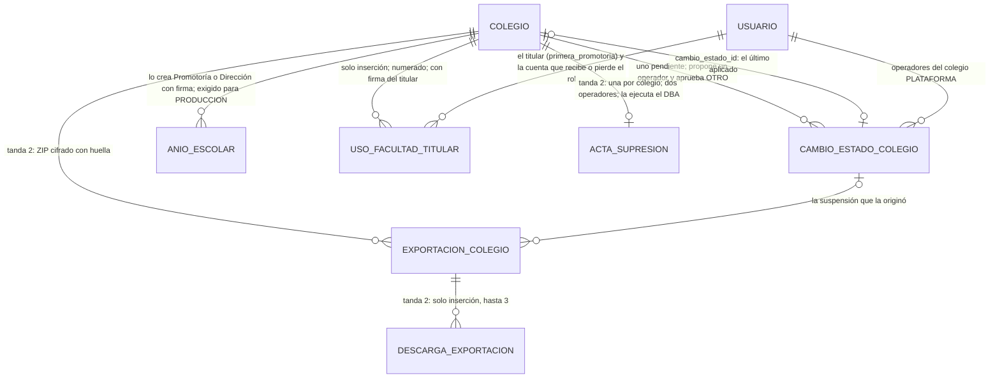

# Sprint 11 · Ciclo de vida del colegio: diseño de arquitectura

> Diseño del agente `arquitecto-software`, 24 de octubre de 2026. Rama `claude/sprint-11-ciclo-colegio`, que parte de `main`
> en `cb06efd` (merge del sprint 10): **última migración V38, 112 triggers y 16 funciones con huella (13 de `03` y 3 de `02`;
> 128 huellas)**. No modifiqué código ni scripts: solo escribí este archivo, el brief `sprint-11/tanda-1.md` y la sección del
> sprint 11 en `docs/plan-de-desarrollo.md`.
> Paquete base `pe.edu.virgenmaria.cuentasclaras`. El stack no cambia. **Dependencia nueva: `net.lingala.zip4j:zip4j`
> (tanda 2, ZIP con AES-256; decisión 199).**
>
> **Cómo se verificó (y qué NO se verificó)**
> - **Leído:** `CLAUDE.md` («Método por sprint»), la skill `contexto-colegio`, `plan-de-desarrollo.md`, el sprint 8
>   (secciones 3.1 a 3.5, 3.8, 3.10, 4 y 16: decisiones 108 a 138), `sprint-8-correcciones.md` (dos operadores),
>   `sprint-10/tanda-1.md`, `docs/entrega/terminos-de-servicio.md` (cláusulas 7 y 8), `contrato-encargo-tratamiento-datos.md`
>   (cláusula 9), `docs/operacion/suscripcion.md` y `respaldos.md`, V5, V25, V28 y V31, `scripts/mysql/02` (permisos de
>   `colegio` y `anio_escolar`) y `03` (funciones; `trg_colegio_nace`, `trg_colegio_cambio`, `trg_sesion_usuario_nace`,
>   `trg_usuario_nace`, `trg_configuracion_colegio_*`, `trg_cambio_contacto_titular_*`, `trg_orden_pago_nace`), `Colegio`,
>   `EstadoColegio`, `AltaColegio`, `AltaColegioRequest`, `ServicioEstructura`, `EstadoPuestaEnMarcha`, `RecorridoColegios`,
>   `ProveedorAutenticacion`, `ConfiguracionSeguridad` (CSP), `deploy/Caddyfile` y `AvisoPlataforma`.
> - **NO probado:** V39, V40, los GRANT, los triggers nuevos, sus versiones nuevas y la función nueva **no se ejecutaron**
>   en H2 ni en MySQL 8.4. El primer paso de cada tanda es aplicarlos sobre V1–V38 reales en las dos bases.
> - **Normativa:** los plazos de la sección 2 salen del texto del DS 016-2024-JUS (traducción publicada por NIAID) y de
>   fuentes secundarias para el Código Tributario y SUNAT. **Los revisa el abogado antes del primer contrato que termine**
>   (D11 del plan).

## 1. Resumen
- **Cuatro estados nuevos del colegio, sin vuelta atrás salvo la suspensión:** `BAJA` (un colegio en preparación que no
  arrancó), `SUSPENDIDO` (en producción, por falta de pago o fin de contrato; reactivable), `CERRADO` (fin de contrato, con la
  exportación entregada) y `SUPRIMIDO` (fin definitivo, con acta). **La aplicación no borra nada:** cada cambio es una
  fila de `cambio_estado_colegio` que **propone un operador y aprueba otro**, cada uno con su firma. Queda en la bitácora de la
  plataforma y en la del colegio, y se avisa al titular, a toda la Promotoría, al correo institucional y al correo externo de
  control.
- **El antifraude de la suspensión es el plazo:** se aplica **30 días después de aprobarse** (cláusula 7 de los términos).
  En ese plazo el colegio trabaja normal, ve su bitácora y, al aplicarse, recibe su exportación completa: un operador no puede
  apagar un colegio de un día para otro para que su Promotoría no vea algo. Durante la suspensión el personal no ingresa ni
  cobra (lo exige la base), las familias entran **en modo consulta** (estado de cuenta, comprobantes, libretas y comunicados) y
  la huella diaria sigue llegando a la Promotoría y al correo de control.
- **Exportación completa** (tanda 2): un ZIP cifrado con AES-256 con un CSV por tabla, las libretas y los comunicados en PDF,
  un `MANIFIESTO.csv` con la SHA-256 de cada archivo y una constancia en PDF. Su huella va a la bitácora y al correo de
  control. El titular la descarga con un enlace de un solo uso y su DNI, y ve la clave una sola vez.
- **Plazos:** como encargado, el proveedor **no puede guardar 5 años** los datos de un colegio que se fue (DS 016-2024-JUS,
  art. 31.2: hasta 2 años; lo que exija una norma se **devuelve** al colegio). La conservación tributaria la cumple el colegio
  con su exportación; la plataforma conserva **12 meses** (consulta de las familias: SUNAT pide al menos 1 año de consulta de
  comprobantes) y después suprime con acta. **Corrige la decisión 132** (sección 2).
- **Pedido nuevo del usuario (tanda 1):** el alta del operador ya no pide el año escolar. El colegio nace sin año y la
  Puesta en marcha muestra «Año escolar y fechas de clases» como paso bloqueante, que crea **Promotoría o Dirección con su
  firma**. La base exige el año para pasar a producción (sección 3.7).
- **Pedido nuevo del usuario (tanda 1, prioridad alta): la facultad del titular.** Un colegio nuevo nace con una sola persona
  (el titular) y no puede armar su equipo directivo porque dar Promotoría o Dirección exige que lo apruebe otra persona que
  no existe. El **titular del contrato** (la cuenta de su `primera_promotoria`) da y quita Promotoría y Dirección **sin segunda
  aprobación**, con su firma, un evento resaltado y avisos inmediatos al correo de control, a toda la Promotoría y a los
  operadores. En PRODUCCION, en cuanto existe otra persona activa de Promotoría o Dirección, vuelve la segunda aprobación
  (decisión 201; sección 3.12).
- **URL por colegio (parte B):** se recomienda `virgenmaria.cuotaria.pe` **ya** para la instalación dedicada (un registro DNS,
  sin código), y **dejar los subdominios de la compartida para cuando 3 colegios lo pidan** (1 tanda; sección 10).
  **Es una decisión abierta: no entra en las tandas hasta que el usuario la confirme.**
- **Tanda corta de interfaz 1b** (pedido del usuario): guía de puesta en marcha para todo el personal (banner con el
  siguiente paso y quién lo hace, estados vacíos que guían, mensajes de bloqueo con enlace), sin cambios en la base (3.14).
- **Dos tandas de base:** (1) estados, baja, suspensión, reactivación, modo consulta, año escolar del colegio y facultad del titular (V39; 117 triggers,
  19 funciones, 136 huellas); (2) exportación, cierre y supresión con acta (V40; 124 triggers, 20 funciones, 144 huellas).
  **La auditoría del diseño en papel (sección 3.13, 14 hallazgos) prevalece sobre lo que sigue.**

## 2. Plazos legales (investigación del 24-oct-2026)

| # | Norma | Qué dice | Qué significa para la plataforma |
|---|---|---|---|
| L1 | **Código Tributario, art. 87 num. 7** (texto del DL 1315, vigente desde 2017) | El deudor tributario conserva libros, registros, comprobantes y antecedentes **5 años o el plazo de prescripción, el que sea mayor**, desde el 1 de enero siguiente al vencimiento de la declaración | La obligación es **del colegio**, no del proveedor. Se cumple con la exportación (CSV de pagos y comprobantes) y con los XML y CDR que guardan su OSE y SUNAT |
| L2 | **Código Tributario, art. 43** (prescripción) | 4 años; 6 si no se declaró; 10 para el agente de retención o percepción que no pagó lo retenido | Por eso «5 años o la prescripción»: en el peor caso el colegio guarda 6 años o más. Lo fija su contador |
| L3 | **SUNAT, emisor electrónico** (orientación SUNAT, SEE del contribuyente) | El emisor ofrece a sus clientes la **consulta web de los comprobantes emitidos durante al menos 1 año**, con un mecanismo para que solo el cliente acceda | La familia sigue viendo sus comprobantes **12 meses** después del cierre (modo consulta). A confirmar si aplica igual cuando se emite por OSE (el OSE también ofrece consulta) |
| L4 | **Ley 29733, art. 30** | Ejecutada la prestación, el encargado **suprime** los datos, salvo autorización expresa del responsable cuando se presuman encargos posteriores; entonces los conserva con seguridad hasta el plazo del reglamento | El contrato de encargo debe decir que el colegio **autoriza expresamente** la conservación de 12 meses (consulta de las familias y posible reactivación) |
| L5 | **DS 016-2024-JUS, art. 31.2** | El plazo del art. 30 de la ley es de **hasta 2 años desde el último encargo**. Más tiempo solo si lo exige una norma, y entonces los datos **se devuelven al responsable** para que él los conserve. La conservación indefinida está prohibida | **Corrige la decisión 132** («bloqueados 5 años con el proveedor»): el proveedor conserva como máximo 24 meses; lo tributario lo guarda el colegio con su exportación |
| L6 | **DS 016-2024-JUS, art. 30 num. 4** (servicios tecnológicos tercerizados) | El proveedor **garantiza y acredita la supresión** cuando terminó el servicio y el responsable pudo recuperar los datos | La supresión exige una exportación entregada (o vencida sin descargar) y deja un **acta** con conteos y huellas |
| L7 | **DS 016-2024-JUS, arts. 84 y 85** | No procede la supresión si hay que conservar por ley o por contrato; cuando se pueda, se usa la **disociación o anonimización** | La bitácora de una instalación compartida no se borra (es la cadena de todos): sus campos personales se **tachan** con acta (sección 5.3) |
| L8 | **Ley 29571 (Código del Consumidor), art. 73, y criterio de INDECOPI** | El colegio no condiciona evaluaciones ni la **entrega de la libreta** al pago. Sí puede retener **certificados** de periodos impagos si lo informó 30 días antes de la matrícula | La plataforma no debe ser la que retiene la libreta: en la suspensión y el cierre la familia **sigue descargándola** 12 meses, y la exportación trae todas las libretas en PDF para que el colegio las entregue después |
| L9 | **Términos de servicio, cláusula 7** (sprint 8) | La suspensión por falta de pago es solo del personal y **con 30 días de aviso por escrito**; nunca se cortan los comprobantes ni el estado de cuenta de las familias | El plazo de 30 días lo exige la base (`efectiva_desde`), no la buena voluntad del operador |

**Plazo resultante (decisión 196, por defecto):** suspensión aplicada a los 30 días; exportación generada ese día y
disponible 30 días; cierre cuando se entrega (o a los 30 días); **consulta de las familias hasta 12 meses después del
cierre**; supresión al día siguiente, con acta. Los respaldos diarios vencen a los 35 días y los mensuales a los 12 meses
(`respaldos.md`): **el último respaldo con datos del colegio vence antes de 24 meses desde el cierre** (L5).

Lo que debe ajustar el abogado (tanda 2, documentos): la cláusula 8 de los términos y la 9 del encargo («un Excel por tabla»
pasa a «CSV y PDF en un ZIP cifrado»; «5 años bloqueados» pasa a «12 meses de consulta, con autorización expresa, y supresión
con acta»; el colegio conserva su copia el plazo tributario).

## 3. Hallazgos al leer el código y decisiones de diseño

### 3.1 Hallazgos (leer antes de implementar)
1. **H1 (crítico). «No está en producción» se usa como «está en preparación».** `trg_configuracion_colegio_registro` y
   `_cambio` dejan al operador, solo con su firma, escribir el **correo externo de control** cuando
   `NOT cc_colegio_en_produccion(colegio)`. Con `SUSPENDIDO`, un operador podría suspender y luego cambiar el testigo
   independiente sin la Promotoría. **Corrección:** función nueva `cc_colegio_en_preparacion(colegio)` y versión nueva de los
   dos triggers con ella. Los demás usos de `cc_colegio_en_produccion` (`trg_pago_registro`, `trg_orden_pago_nace`,
   `trg_mensaje_nace` para apoderados, `trg_cambio_correo_control_nace`, el OSE de `trg_conector_colegio_estado`) quedan bien:
   en `SUSPENDIDO` deben rechazar.
2. **H2 (alto). `RecorridoColegios.activos()` son todos los colegios de tipo COLEGIO** (`activo` es siempre TRUE y no
   cambia). Un colegio suspendido o dado de baja recibiría la apertura de periodos, las libretas, la muestra de caja y los
   recordatorios. **Corrección:** `activos()` pasa a ser `estado IN (PREPARACION, PRODUCCION)` y se agrega `conBitacora()`
   (los activos más los `SUSPENDIDO`) para `HuellaDiaria` y el resumen al correo de control.
3. **H3 (alto). Una orden de pago en vuelo cuando se aplica la suspensión.** `trg_pago_registro` rechaza el pago de un colegio
   que no está en producción: si la pasarela confirma una orden creada 5 minutos antes, el dinero se cobra y no se registra.
   **Corrección:** desde 2 horas antes de `efectiva_desde` no nacen órdenes (`trg_orden_pago_nace`, versión nueva; la orden
   vive 30 minutos) y la aplicación de la suspensión espera a que el colegio no tenga órdenes `CREADA` sin vencer.
4. **H4. La recaudación bancaria y Yape siguen cobrando en la cuenta del colegio** durante la suspensión (el banco no sabe de
   la plataforma) y la plataforma no puede impedirlo. **Mitigación:** el aviso a la Promotoría dice «pida a su banco cerrar la
   recaudación»; el aviso del portal dice a las familias que esos pagos no se verán aquí; al reactivar, la conciliación del
   sprint 4 muestra los abonos del periodo y Administración los registra por el flujo de siempre.
5. **H5. `ck_colegio_estado` y `ck_colegio_produccion` (V28) solo admiten PREPARACION y PRODUCCION**, y `produccion_desde`
   nulo solo en PREPARACION. V39 los reemplaza (`DROP CONSTRAINT` y `ADD CONSTRAINT`, como V35 con `acceso_dato_personal`).
6. **H6. `cc_sistema` no tiene UPDATE sobre `colegio.estado`** (`02`, bloque del sprint 8). Lo necesita para aplicar los
   cambios de estado; `cc_app` sí lo tiene (paso a producción) y `trg_colegio_cambio` debe impedirle los estados nuevos.
7. **H7. El alta crea el año escolar** (`AltaColegio`, transacción 4, `AnioEscolar.nuevo(..., true, ...)`) y
   `AltaColegioRequest` lo valida. Hoy `anio_escolar` **no tiene trigger** y lo crean Dirección y Administración sin firma
   (`ServicioEstructura.crearAnio`). La demo (`FamiliasDemo`) crea el año si falta. 20 clases de prueba usan
   `EscenarioPlataforma`, que pasa el año al alta. Los 27 archivos que leen `EN_CURSO` usan `Optional` (ninguno hace
   `orElseThrow`): un colegio sin año no rompe nada, y una prueba lo comprueba (sección 3.7).
8. **H8. `ck_sesion_usuario_cierre` (V25) no tiene un motivo para «colegio suspendido».** V39 agrega `COLEGIO_SUSPENDIDO`.
9. **H9 (alto, anterior a este sprint; comprobar en el paso 1). La hora de la base la puede mover la propia conexión.**
   `UTC_TIMESTAMP()` y `NOW()` obedecen a `SET timestamp = …` de la sesión, y esa variable no pide privilegios. Una conexión
   con la clave de `cc_sistema` podría «adelantar» 30 días y aplicar una suspensión el mismo día (y lo mismo con las ventanas de
   5 minutos de las firmas). `SYSDATE()` no obedece a `SET timestamp` (salvo con `--sysdate-is-now`). **Corrección en este
   sprint:** función nueva `cc_ahora_lima_real()` (`CONVERT_TZ(SYSDATE(6), @@session.time_zone, '-05:00')`, que da lo mismo
   cualquiera sea la zona de la sesión) en los controles de fecha nuevos (`efectiva_desde`, la aplicación, las órdenes de las
   2 horas); `VerificadorPermisosBaseDatos` exige `@@global.sysdate_is_now = 0`. **Ajustado por AP-3 (sección 3.13): el cambio cubre también `cc_hoy_lima`, las firmas y las sesiones en la tanda 1, y el resto en la tanda 2.** Texto original: el resto de los triggers (firmas,
   periodos, cierres) queda como hallazgo para la auditoría del diseño: cambiarlos todos es una tanda propia.

### 3.2 Estados y transiciones
```
PREPARACION ──(Promotoría, firma, año escolar, Dirección y Caja)──▶ PRODUCCION
PREPARACION ──(BAJA: operador A propone, operador B aprueba)──▶ BAJA ──(tanda 2: acta, a los 30 días)──▶ SUPRIMIDO
PRODUCCION ──(SUSPENSION: A propone, B aprueba; se aplica a los 30 días)──▶ SUSPENDIDO
SUSPENDIDO ──(REACTIVACION: A propone, B aprueba; inmediata)──▶ PRODUCCION
SUSPENDIDO ──(tanda 2, CIERRE: A propone, B aprueba; con la exportación entregada o vencida)──▶ CERRADO
CERRADO ──(tanda 2: acta de supresión de dos operadores, al vencer conservar_hasta)──▶ SUPRIMIDO
```

| Estado | Personal del colegio | Familias | Dinero | Procesos | Lista del operador |
|---|---|---|---|---|---|
| PREPARACION | Ingresa | Activan su portal | No (como hoy) | Todos menos los de cobro | Principal |
| PRODUCCION | Ingresa | Todo | Sí | Todos | Principal |
| SUSPENDIDO | **No ingresa** (sesiones cerradas) | **Consulta**: estado de cuenta, comprobantes, libretas y comunicados, con un aviso arriba | No (base) | Solo la huella diaria y el resumen al correo de control | Principal, con la etiqueta «Suspendido desde …» |
| BAJA | No | No | No | Ninguno | Filtro «Dados de baja» |
| CERRADO (tanda 2) | No | Consulta hasta `conservar_hasta` | No | Ninguno | Filtro «Cerrados» |
| SUPRIMIDO (tanda 2) | No | No | No | Ninguno | Filtro «Cerrados» (ficha y acta) |

### 3.3 `cambio_estado_colegio`: dos operadores, como `cambio_contacto_titular` (V31)
- **Quién es «la segunda persona del proveedor» (decisión 192):** **otro operador activo de `CC_OPERADORES`**, distinto de
  quien propuso. Recomendación de operación: uno es el responsable técnico y el otro el **gerente o representante legal del
  proveedor** (suspender es una decisión comercial, no técnica). Con un solo operador en `CC_OPERADORES` no se puede dar de
  baja, suspender ni reactivar: se agrega el segundo por despliegue (queda en la infraestructura y en la bitácora,
  `OPERADOR_CREADO`). La base lo exige (`ck_cambio_estado_colegio_otro` y el trigger).
- **Proponer** (`POST /plataforma/colegios/{id}/estado`): tipo, motivo tipificado, motivo escrito (20 a 500 caracteres) y,
  en la suspensión, la referencia del aviso escrito al representante legal (número de carta o fecha del correo). Firma del
  operador A en el colegio de plataforma: `cambio_estado_colegio:{colegio}:{n}` (n = cambios anteriores del colegio + 1).
  **Al proponer se avisa** en la misma transacción (`AvisoPlataforma`): titular, Promotoría, correo institucional y correo de
  control. La Promotoría se entera antes de que exista la aprobación.
- **Aprobar** (`POST /plataforma/cambios-estado/{id}/aprobar`): el operador B, con su firma
  `cambio_estado_colegio:{id}:APROBADO`. La base calcula `efectiva_desde`:
  - **SUSPENSION:** las 00:00 de Lima del día siguiente a `aprobado_en + 30 días` (decisión 194);
  - **BAJA** (ajustada por AP-6): inmediata solo sin datos y sin ninguna cuenta activada; si hay cuentas activadas, a los 7 días (el colegio pudo empezar a
    preparar con datos reales y tiene derecho a enterarse antes; decisión 193);
  - **REACTIVACION:** inmediata.
- **Aplicar:** el cambio APROBADO cuyo `efectiva_desde` llegó lo aplica `sistema.plataforma` (proceso `AplicacionCambiosEstado`,
  cada 15 minutos, `cc_sistema`). La BAJA inmediata y la REACTIVACION se aplican en la misma transacción de la aprobación.
  Aplicar es: `colegio.estado`, `estado_desde` y `cambio_estado_id`; cerrar las sesiones del personal (`COLEGIO_SUSPENDIDO`);
  evento resaltado en la bitácora del colegio y en la de la plataforma; avisos.
- **Rechazar** (otro operador, firma `:RECHAZADO`) y **anular** (cualquier operador, firma `:ANULADO`, solo antes de aplicar;
  por ejemplo, porque el colegio pagó). Anular avisa a los mismos destinatarios.
- **Un cambio pendiente por colegio** (`UNIQUE (colegio_id, pendiente)`; `pendiente` es TRUE en PROPUESTO y APROBADO).

### 3.4 Suspensión: qué pasa en cada momento
| Momento | Qué ve el colegio | Qué hace el sistema |
|---|---|---|
| Propuesta (día 0) | Correo y WhatsApp a titular, Promotoría, institucional y control: «El proveedor propone suspender el acceso de {colegio}. Motivo: …» | `CAMBIO_ESTADO_COLEGIO_PROPUESTO` en las dos bitácoras |
| Aprobación | Aviso: «El acceso del personal se suspenderá el {fecha}. Hasta entonces todo funciona. Recibirá la exportación completa de sus datos» | `efectiva_desde` = +30 días; franja ámbar con la fecha en todas las pantallas del personal |
| Días 1 a 30 | Todo funciona; la Promotoría puede descargar su bitácora (ya existe) | Recordatorio a 7 días y a 1 día del corte |
| 2 horas antes | La familia ya no puede iniciar un pago en línea | `trg_orden_pago_nace` rechaza (H3) |
| Día 30 | El personal sale y no vuelve a entrar: «El acceso de {colegio} está suspendido desde el {fecha}. Comuníquese con {proveedor}» | Aplica el cambio cuando no hay órdenes en vuelo; cierra sesiones; en la tanda 2, genera la exportación |
| Suspendido | Familias: «{colegio} no registra pagos en esta plataforma desde el {fecha}. Sus comprobantes, su estado de cuenta y sus libretas siguen aquí.» Sin «Pagar» ni Yape | Siguen la huella diaria y el resumen al correo de control |
| Reactivación | Todo vuelve; aviso a todos | El personal ingresa con su clave de siempre |

**Quién ingresa durante la suspensión (decisión 195):** nadie del personal, **tampoco la Promotoría**. Lo que la Promotoría
necesita (bitácora y datos) le llega con la exportación. Alternativa evaluada: dejar a la Promotoría una pantalla de solo
lectura. Se descarta porque «nadie del colegio ingresa» es la regla que pidió el usuario y la exportación ya cubre esa
necesidad.

### 3.5 Baja de un colegio en preparación
- **Condiciones (base):** el colegio está en PREPARACION; no tiene `pago` (ya garantizado), `comprobante` ni `orden_pago`.
- **Motivos:** `PRUEBA` (colegio de prueba), `NO_ARRANCO`, `PEDIDO_COLEGIO`, `DUPLICADO` y `OTRO`.
- **Sin dinero no significa sin datos:** un colegio en preparación puede haber importado su Excel de alumnos. La baja
  **también termina el encargo**: en la tanda 2 su supresión vence a los 30 días (`conservar_hasta`). Si el colegio pide sus
  datos, el operador genera una exportación `PEDIDO` antes de aprobar la baja.
- La baja sale de la lista principal y queda en el filtro «Dados de baja», con su ficha, su cambio y su bitácora.

### 3.6 Antifraude: el operador no puede suspender para tapar algo
| # | Escenario | Control | Prueba |
|---|---|---|---|
| F1 | Un operador suspende para que la Promotoría no vea una alerta o la bitácora | Dos operadores; 30 días con todo funcionando; avisos al titular, la Promotoría y el correo de control desde la propuesta; exportación completa al aplicar (tanda 2) | `f1SuspensionAntesDe30DiasFalla` (MySQL), `SuspensionAvisosTest` |
| F2 | Un solo operador propone y aprueba | `ck_cambio_estado_colegio_otro` y el trigger | `f2MismoOperadorNoApruebaFalla` |
| F3 | Dos operadores coluden | Siguen los 30 días, los avisos al correo de control (testigo externo que H1 protege) y la huella diaria | `f3AvisoAlCorreoDeControlAlProponer` |
| F4 | El operador cambia el correo de control durante la suspensión | H1: en SUSPENDIDO nadie lo cambia | `h1CorreoDeControlEnSuspendidoFalla` |
| F5 | La Promotoría (cc_app) pone su colegio en un estado nuevo | `trg_colegio_cambio`: con cc_app solo PREPARACION → PRODUCCION | `f5PromotoriaNoCambiaAEstadosNuevos` |
| F6 | El operador cambia el estado sin un cambio aprobado, o con el de otro colegio | `trg_colegio_cambio`: cada estado nuevo con SU `cambio_estado_colegio` APROBADO, del mismo colegio, origen y destino, y vencido su `efectiva_desde` | `f6EstadoSinCambioAprobadoFalla`, `f6CambioDeOtroColegioFalla` |
| F7 | El DBA cambia el estado a mano o adelanta una fecha | `RevisionEstadosColegio` diaria: todo colegio fuera de PREPARACION y PRODUCCION tiene su cambio APLICADO del estado en que está, y toda SUSPENSION tiene `efectiva_desde - aprobado_en` de 30 días o más; si no, alerta CRÍTICA a los operadores y al correo de control | `RevisionEstadosColegioTest` |
| F8 | El personal cobra en efectivo durante la suspensión | Fuera del sistema (relación del colegio con sus familias). El aviso del portal recuerda que todo pago lleva comprobante electrónico; al reactivar, la conciliación muestra los abonos | Riesgo aceptado (sección 11) |
| F9 | Pagos en línea en vuelo al suspender | H3 | `h3OrdenDentroDeLas2HorasFalla`, `AplicacionEsperaOrdenesTest` |
| F9b | La conexión mueve la hora con `SET timestamp` para saltar los 30 días | H9: `cc_ahora_lima_real()` con `SYSDATE()` | `h9SetTimestampNoAdelantaLaSuspension` |
| F10 | Alguien del personal sigue con una sesión abierta | La aplicación cierra las sesiones al aplicar; `trg_sesion_usuario_nace` no abre sesión del personal; el filtro de sesión rechaza en cada pedido | `f10SesionDelPersonalEnSuspendidoFalla`, `SesionAbiertaAlSuspenderTest` |
| F11 | Se reactiva para dejar entrar a alguien | Dos operadores y avisos a todos; las cuentas son las mismas de antes | `ReactivacionTest` |
| F12 | Se da de baja un colegio que ya cobró | `trg_colegio_cambio` y `trg_cambio_estado_colegio_nace`: BAJA solo desde PREPARACION, sin comprobantes ni órdenes | `f12BajaConComprobanteFalla` |
| F13 | Otra Promotoría (no el titular) usa la facultad | `cc_es_titular`: solo la cuenta de la `primera_promotoria` | `f13FacultadDeQuienNoEsTitularFalla` |
| F14 | El titular se da Dirección a sí mismo, o se quita su Promotoría | `ck_uso_facultad_titular_otro`; `trg_usuario_rol_baja` no quita el PROMOTOR del titular | `f14TitularSobreSiMismoFalla`, `f14PromotoriaDelTitularNoSeQuita` |
| F15 | El titular da Dirección a una cuenta con Caja | Las combinaciones prohibidas de `trg_usuario_rol_alta` siguen | `f15FacultadNoSaltaQuienCobraNoAprueba` |
| F16 | En producción, con otra Dirección activa, el titular suma Promotorías solo | `trg_uso_facultad_titular_nace` (decisión 201) | `f16FacultadEnProduccionConOtraDireccionFalla` |
| F17 | Un uso de la facultad sin aviso | Aviso al correo de control, a la Promotoría y a los operadores en la misma transacción; sin aviso, no se guarda | `FacultadTitularAvisosTest` |
| F18 | El operador crea el año escolar o un colegio pasa a producción sin año | `trg_anio_escolar_nace`; `trg_colegio_cambio` (d) | `f18AnioPorOperadorFalla`, `f18ProduccionSinAnioFalla` |

### 3.7 Pedido nuevo: el año escolar lo configura el colegio, no el operador (tanda 1)
**Principio:** el proveedor hace el alta, el titular y el contrato; **el colegio decide su calendario**, sus pensiones y su
equipo.

- **Alta:** se quita la sección «Año escolar inicial» de `plataforma/nuevo.html` y los campos `anio`, `inicioClases` y
  `finClases` de `AltaColegioRequest` (y de `vacio(int)`). La transacción 4 de `AltaColegio` solo guarda el logo y
  `COLEGIO_CREADO` (detalle «sin año escolar: lo configura el colegio»). El texto que ve el titular al activar pasa a «Tu
  colegio y tu cuenta los creó el operador X el …. Tu primer paso es configurar el año escolar y las fechas de clases».
  **El colegio nace en PREPARACION sin año escolar.**
- **Puesta en marcha:** el paso 3 de hoy («Año escolar y secciones») se separa en dos y la lista pasa de 14 a **15 pasos**:
  - **3 · Año escolar y fechas de clases** (obligatorio y bloqueante): hecho cuando hay un año `EN_CURSO` o `PLANIFICADO`
    con inicio y fin de clases. Enlace a `/estructura/anios/nuevo`. Quién: Promotoría o Dirección.
  - **4 · Secciones** (obligatorio): el año del paso 3 con al menos una sección por nivel ofrecido (la regla de hoy).
  - Los pasos 4 a 14 de hoy pasan a ser del 5 al 15. **Pensiones, alumnos y saldo inicial dicen «Primero configure el año
    escolar»**, sin enlace, mientras el paso 3 esté pendiente, porque dependen del año.
  - El operador ve el paso 3 como sí o no en `/plataforma/colegios/{id}`, como los demás.
- **Quién crea el año (decisión 197):** **Promotoría o Dirección, con la firma de su sesión** (`anio_escolar:{anio}:CREADO`,
  en el colegio). **Sin segunda aprobación:** el año no mueve dinero por sí solo; las cuotas salen del plan de pensiones, que ya
  aprueba otra persona (sprint 2) y que muestra las fechas del año a quien lo aprueba. Administración deja de crear años (hoy
  puede) y sigue creando secciones. El operador **nunca** crea un año: la base lo rechaza con cualquier nombre de operador.
- **La base (V39 y `03`):**
  - trigger nuevo `trg_anio_escolar_nace`: con cc_app, `creado_por` es una persona activa con PROMOTOR o DIRECTOR del colegio
    y con su firma; con cc_sistema, nunca (ningún proceso crea años). El DBA conserva su camino documentado;
  - **versión nueva de `trg_colegio_cambio`:** PREPARACION → PRODUCCION exige además un `anio_escolar` del colegio
    `EN_CURSO` o `PLANIFICADO`.
- **Lo que se ajusta en el código:**
  - `EstadoPuestaEnMarcha` (`PASOS` con `ANIO` y `SECCIONES`; 15 puntos) y `PasoAProduccion`;
  - `ServicioEstructura.crearAnio`: `@PreAuthorize` con PROMOTOR y DIRECTOR, y firma; `ModuloApp`: Promotoría entra a
    `/estructura/anios/**`;
  - `FamiliasDemo` y `DemoColegios`: la demo crea su año como su Dirección (ya lo crea si falta; comprobar que no dependa del
    alta); `DatosDemoColegioDev` (H2) sin cambio;
  - `EscenarioPlataforma`: el año lo crea la Promotoría del escenario con su firma; las 20 clases que lo usan no cambian si el
    escenario sigue exponiendo `anio()`;
  - pruebas que cambian: `AltaColegioTest`, `MatrizPermisosTest`, `EstructuraControllerTest` (Administración ya no crea años:
    403), `PuestaEnMarchaTest` (15 pasos), `PermisosMySqlTest` y `AuditoriaSprint10CurriculoMySqlTest` (crean el año por la
    ruta nueva).

### 3.8 Modo consulta de las familias (tanda 1)
- En SUSPENDIDO (y en CERRADO, tanda 2) el apoderado ingresa y ve **solo lectura**: estado de cuenta, comprobantes (con su
  enlace o PDF), libretas (descarga igual que hoy, sin mirar deuda: L8) y comunicados. Se ocultan «Pagar en línea», Yape,
  justificar inasistencias, confirmar lecturas nuevas y «Mis datos» (edición).
- `ModoConsultaFamilias` (`familias.service`) decide por el estado del colegio; `ModuloApp` y un `HandlerInterceptor`
  devuelven 403 a todo `POST` del portal salvo `/salir` y el cambio de la propia clave.
- La activación del portal de una familia que nunca entró **sí se permite** en SUSPENDIDO (necesita sus comprobantes).
- **Ninguna libreta se retiene:** `LibretaEnSuspensionTest` descarga la libreta de un alumno con deuda en un colegio
  SUSPENDIDO.

### 3.9 Exportación completa de los datos del colegio (tanda 2; era el pendiente «proceso manual»)
**Cuándo:** automática al aplicarse una SUSPENSION (motivo `SUSPENSION`); antes de un CIERRE si no hay una de menos de 30 días
(`CIERRE`); a pedido escrito del colegio, la genera un operador con su firma (`PEDIDO`, sin cambiar el estado). La genera
`sistema.exportacion` (cc_sistema) dentro de `ContextoColegio.en(colegio)`: solo lee filas de ese colegio.

**Formato (decisión 198):** un archivo `{ruc}-{aaaammdd}-exportacion.zip`, **cifrado con AES-256 (WinZip AE-2)**, que se abre con
7-Zip o con el Explorador de Windows 11, con este contenido:

| Ruta dentro del ZIP | Qué es |
|---|---|
| `LEEME.pdf` | Constancia: colegio, RUC, motivo, fecha, conteo de filas por tabla, SHA-256 del manifiesto, cómo verificarla, plazos de la sección 2 y qué guarda cada quien (el XML y el CDR de cada comprobante, su OSE y SUNAT) |
| `MANIFIESTO.csv` | `archivo,filas,bytes,sha256` de cada archivo del ZIP (menos él mismo) |
| `datos/{tabla}.csv` | Un CSV por tabla de negocio del colegio, de la lista fija `exportacion/tablas.txt` (alumnos, apoderados, matrículas, cuotas, pagos, aplicaciones, comprobantes, anulaciones, descuentos, cierres de caja, depósitos, conciliación, recaudación, solicitudes, comunicados, asistencia, calificaciones, libretas emitidas y entregas, mensajes sin el contenido de las claves, `evento_auditoria` del colegio con su `hash`, huellas diarias…) |
| `libretas/{anio}/{periodo}/{seccion}/{codigo}.pdf` | Cada libreta emitida, regenerada y **comparada con su huella guardada** (si una no coincide, la exportación falla y avisa: no se entrega algo distinto de lo que vio la familia) |
| `comunicados/{id}-{n}.pdf` | Los PDF de los comunicados (ya guardados) |

- **Nunca van:** `clave_hash`, tokens y sus huellas, `secreto_cifrado` de conectores, firmas de sesión, `sesion_usuario`, el
  logo de otros, ni nada de otro colegio. `ExportacionSinSecretosTest` recorre los encabezados.
- **CSV:** UTF-8 con BOM (Excel lo abre con tildes), coma, CRLF, RFC 4180; fechas ISO 8601 en hora de Lima; dinero con 2
  decimales y punto (`1250.00`). **Neutraliza la inyección de fórmulas:** una celda que empieza con `=`, `+`, `-`, `@`,
  tabulador o retorno lleva un apóstrofo delante (OWASP). `CsvSinFormulasTest`.
- **Clave:** 24 caracteres en 6 grupos (alfabeto sin 0/O ni 1/l), generada al crear el ZIP; se guarda **cifrada con
  `CC_CLAVE_CONECTORES`** (AES-GCM, AAD `exportacion|{colegio}|{id}`, como los secretos de los conectores) solo hasta que el
  titular la ve; después la columna queda en NULL. Si se pierde, se genera otra exportación.
- **Dónde vive:** en el disco de la VM (`CC_DIR_EXPORTACIONES`, fuera de los respaldos), 30 días; después
  `LimpiezaExportaciones` borra el archivo y la fila pasa a `VENCIDA` (la fila queda).
- **Entrega:** al titular (cuenta de su primera Promotoría), un enlace de un solo uso por correo y WhatsApp a
  `/exportacion/{token}`. Ahí escribe su DNI (el del contrato, como en la activación) y recibe un código de 6 dígitos por
  WhatsApp; con los dos, ve la clave una vez y descarga (hasta 3 descargas, cada una en `descarga_exportacion`). El correo de
  control recibe la **SHA-256 del ZIP y del manifiesto**, nunca el enlace ni la clave.
- **Huella:** `sha256_zip` y `sha256_manifiesto` en `exportacion_colegio` (no cambian: 1143) y en el evento
  `EXPORTACION_COLEGIO_GENERADA`. Quien recibe el ZIP verifica que no se cambió comparándolo con el correo de control.
- **Tamaño esperado:** un colegio de 500 alumnos con 3 años de historia: unas 400,000 filas y 6,000 libretas, unos 150 MB. Se
  genera en un hilo de fondo, en flujo (sin cargar todo en memoria), con un tope de 2 GB (`ExportacionGrandeTest` con 50,000
  filas).

### 3.10 Cierre (tanda 2)
- `cambio_estado_colegio` tipo `CIERRE`, de SUSPENDIDO a CERRADO, propuesto y aprobado por dos operadores; la base exige una
  `exportacion_colegio` del colegio `ENTREGADA`, o `LISTA` o `VENCIDA` con 30 días desde que se generó (el colegio tuvo la
  oportunidad de recuperarla: L6). Inmediato al aprobarse.
- La base pone `colegio.conservar_hasta = fecha del cierre + 12 meses` (decisión 196; entre 1 y 12 meses, nunca más: así los
  respaldos mensuales vencen antes de 24 meses, L5). Las familias siguen en modo consulta hasta esa fecha.
- Aviso al titular, la Promotoría, el correo institucional y el de control, con la fecha de supresión.

### 3.11 Fin definitivo: supresión con acta (tanda 2)
- **Cuándo:** CERRADO con `conservar_hasta` vencido, o BAJA con 30 días. `RevisionConservacion` (diaria) avisa a los operadores
  30 días antes y el día que vence. **Nunca es automática:** la ejecuta el DBA con un acta que aprobaron dos operadores.
- **`acta_supresion`** (una por colegio): la **propone** un operador (firma `acta_supresion:{colegio}`), la **aprueba otro**
  (`acta_supresion:{id}:APROBADA`); el DBA la pasa a `EJECUTANDO`, corre el script y la pasa a `EJECUTADA` con los conteos;
  el colegio pasa a `SUPRIMIDO` con ella. El acta guarda: filas suprimidas por tabla, filas tachadas de la bitácora,
  `huella_eventos` (SHA-256 de `id:hash` de los eventos del colegio, calculada antes de tachar), la fecha en que vence el último
  respaldo que los contiene y quién la ejecutó. Se imprime (`/plataforma/actas/{id}.pdf`) para firmarla y se envía al correo
  institucional y al de control del colegio (L6: «acreditar la supresión»).
- **Instalación dedicada (Virgen María, decisión 109):** el fin definitivo es **eliminar la instalación completa**: la instancia
  de Cloud SQL, la VM y el depósito de respaldos cuando vence su bloqueo de objetos. El acta lo dice con las fechas; no hace
  falta tachar nada.
- **Instalación compartida:** el script `scripts/fin-de-colegio/suprimir.sql` (como `cc_migrador`, con `SET @cc_acta = {id}`):
  1. comprueba el acta `EJECUTANDO` (aprobada por dos operadores) y el plazo vencido;
  2. **borra** las filas del colegio en las tablas de negocio, en el orden inverso de las FK, según
     `scripts/fin-de-colegio/inventario.txt` (la tanda 2 empieza escribiéndolo: cada tabla con `colegio_id`, si tiene datos
     personales, y qué trigger de UPDATE o DELETE la protege);
  3. **tacha** los eventos del colegio en `evento_auditoria` (`nombre_usuario = 'suprimido'`; `usuario_id`, `roles`,
     `valor_anterior`, `valor_nuevo`, `detalle` e `ip` a NULL). No cambian `id`, `secuencia`, `colegio_id`, `ocurrido_en`,
     `accion`, `entidad`, `entidad_id` ni `hash` (L7: anonimización, no borrado; la cadena es de todos los colegios);
  4. deja la fila de `colegio` con la ficha mínima (nombre, RUC, contrato, estado SUPRIMIDO) como evidencia del contrato.
- **Cómo lo permite la base sin abrir una puerta:** función nueva `cc_supresion_en_curso(colegio)`: TRUE solo si la conexión
  es `cc_migrador`, `@cc_acta` es el id de un acta `EJECUTANDO` de ese colegio aprobada por dos operadores y su colegio está
  en CERRADO o BAJA con el plazo vencido. Los triggers de UPDATE y DELETE de las tablas del inventario reciben una versión
  que **solo** con esa función deja pasar el borrado (las versiones no cambian el conteo de triggers). `trg_evento_auditoria_tachado`
  (nuevo, BEFORE UPDATE) rechaza todo UPDATE de la bitácora salvo el tachado exacto con esa función, y
  `trg_evento_auditoria_sin_borrado` (nuevo, BEFORE DELETE) rechaza siempre.
- **Verificación de la cadena:** `VerificadorIntegridadAuditoria` no recalcula el hash de un evento tachado de un colegio
  SUPRIMIDO: toma el `hash` guardado como eslabón y comprueba que `huella_eventos` del acta coincide con la de hoy. Un evento
  tachado sin acta, o con otro hash, rompe la verificación como hoy.
- **Respaldos:** no se reescriben (están bloqueados contra borrado). El acta dice la fecha en que vence el último que contiene
  datos del colegio (mensuales: 12 meses); `restaurar-y-verificar.sh` vuelve a aplicar `suprimir.sql` de las actas ejecutadas
  después del respaldo que restaura (`fin-de-colegio/reaplicar.sh`).

### 3.12 Pedido nuevo: la facultad del titular (tanda 1, prioridad alta)
**El bloqueo de hoy.** `ServicioUsuarios`: una cuenta nueva nace sin Promotoría ni Dirección; darlas pide `CAMBIO_ROLES`, que
aprueba OTRA persona de Promotoría o Dirección (decisiones 84 y 85; A8 del sprint 9). La única excepción es la primera
Dirección (`primera_direccion`, V27), una vez y con una sola Promotoría. Un colegio recién dado de alta tiene una persona
(el titular) y no puede sumar una segunda Promotoría, ni otra Dirección si la primera se fue o se equivocó.

**Qué es la facultad.**
- **Titular** = la cuenta de la `primera_promotoria` del colegio (la que creó el operador para el titular del contrato y que se
  activó con el DNI de `colegio.titular_documento`), **activa y con PROMOTOR**, en un colegio PREPARACION o PRODUCCION.
  Función nueva `cc_es_titular(colegio, nombre)`. No es un rol nuevo (no cambia `Rol`, `ModuloApp` ni las combinaciones): es
  una condición que la base reconoce.
- **Con ella el titular**, con la firma de su sesión (`facultad_titular:{colegio}:{n}`, n = usos anteriores + 1):
  - **crea** una cuenta del personal que nace ya con PROMOTOR o DIRECTOR (más sus otros roles permitidos);
  - **da** PROMOTOR o DIRECTOR a una cuenta del personal que ya existe;
  - **quita** PROMOTOR o DIRECTOR a otra cuenta.
  Cada uso es una fila de `uso_facultad_titular` (solo inserción) escrita en la misma transacción que el rol.
- **Lo que no cambia:**
  - «quien cobra no aprueba»: las combinaciones prohibidas de `trg_usuario_rol_alta` siguen (CAJA con PROMOTOR o DIRECTOR,
    DIRECTOR con ADMINISTRACION, DOCENTE con CAJA o ADMINISTRACION);
  - Administración, Caja y Docente siguen como hoy (los da Promotoría, sin aprobación);
  - **el titular no usa la facultad sobre sí mismo** (`usuario_id <> titular_id`: no se da Dirección ni se quita Promotoría) y
    **su condición de titular no se pierde con la aplicación**: versión nueva de `trg_usuario_rol_baja` (su PROMOTOR no se
    quita, ni con `CAMBIO_ROLES`) y de `trg_usuario_identidad` (su cuenta no se desactiva). Cambiar de titular sigue fuera del
    sistema, con carta del representante legal y acta del DBA (decisión 115);
  - el operador nunca la tiene (`cc_es_titular` exige una cuenta del colegio, y la base ya separa a los operadores).
- **Cada uso deja, en la misma transacción (si no se puede avisar, no se guarda, como `AvisoPlataforma`):**
  - evento resaltado `FACULTAD_TITULAR_USADA` en la bitácora del colegio (quién, a qué cuenta, qué rol, dar o quitar);
  - aviso inmediato al **correo externo de control** y a **toda la Promotoría activa**, también a quien recibió el rol;
  - aviso a los **operadores** (mensaje en el colegio de plataforma y evento en su bitácora), con el usuario y el rol, sin
    contactos (decisión 113).
- **En PRODUCCION (decisión 201, recomendada): la facultad vale solo mientras no haya otra persona activa con PROMOTOR o
  DIRECTOR además del titular.** Desde que la hay, dar o quitar esos roles vuelve a `CAMBIO_ROLES` con la aprobación de otra
  persona, como hoy. Por qué:
  - en preparación no hay dinero y el problema es arrancar: la facultad libre resuelve el bloqueo;
  - en producción, una cuenta del titular robada (o un titular presionado) podría sumar Promotorías que aprueben anulaciones y
    descuentos; con otra persona ya presente, la segunda firma vuelve a ser posible y no traba a nadie;
  - el colegio que en producción se quedó solo con el titular (la Dirección renunció) no se traba: la facultad vuelve a valer.
  - Alternativa evaluada: facultad libre siempre, solo con avisos. Es más simple, pero en producción deja a una sola persona
    decidir quién aprueba el dinero; los avisos lo detectan después, no lo impiden. Queda como opción para el usuario.
- **La base lo exige** (sección 6.3): `trg_uso_facultad_titular_nace` (cc_sistema; `cc_es_titular` con firma; destino del
  personal del mismo colegio y distinto del titular; en PRODUCCION, sin otra persona activa de Promotoría o Dirección) y la
  versión nueva de `trg_usuario_rol_alta` y `trg_usuario_rol_baja`: PROMOTOR o DIRECTOR también con SU fila de
  `uso_facultad_titular` (esa cuenta, ese rol, esa acción) escrita hace 5 minutos o menos (el mismo patrón de
  `primera_promotoria`).
- **A8 del sprint 9, ajustado:** «el alta de esos roles la da el titular con su facultad (con avisos) mientras el colegio está en
  preparación o no tiene otra persona de Promotoría o Dirección; si no, la aprueba la otra persona por `CAMBIO_ROLES`». El aviso
  de A8 (menos de 2 personas de Promotoría o Dirección) sigue igual. `primera_direccion` queda por compatibilidad: la pantalla
  ya no la ofrece al titular (usa la facultad); la sigue usando un colegio cuyo titular no está activo.
- **Pantallas:** en «Usuarios», el titular ve «Crear cuenta de Promotoría o Dirección» y, en cada cuenta, «Dar o quitar
  Promotoría o Dirección», con el texto «Como titular del contrato puedes hacerlo sin aprobación. Se avisará al correo de
  control, a la Promotoría y a la plataforma». En la Puesta en marcha, el paso 2 («Equipo con segregación») enlaza ahí.

### 3.13 Auditoría del diseño en papel (sobre 8dd46fb): 14 hallazgos incorporados (esta sección prevalece)
Revisión de `auditor-seguridad-antifraude`: 1 crítico, 6 altos, 5 medios y 2 bajos. Donde esta sección contradice a las
anteriores, vale esta. Los conteos nuevos: **tanda 1, 117 triggers, 19 funciones y 136 huellas** (`trg_anio_escolar_cambio`
se suma); **tanda 2, 124, 20 y 144**.

**AP-1 (crítico). Quitar al único contrapeso en producción.** Con el conteo que excluía al destino, el titular podía quitarle
Dirección a la única otra persona directiva sin que nadie lo aprobara. **Corrección:** en DAR, el conteo de la decisión 201
excluye al destino (como estaba); **en PRODUCCION, QUITAR va siempre por `CAMBIO_ROLES`** con la aprobación de otra persona. En
PREPARACION el titular sigue quitando con la facultad. `trg_uso_facultad_titular_nace`: `IF NEW.accion = 'QUITAR' AND
cc_colegio_en_produccion(NEW.colegio_id) THEN SIGNAL`. Prueba nueva `f16bQuitarAlUnicoDirectivoEnProduccionFalla` (MySQL y H2).

**AP-2 (alto). La facultad del titular, más dura:**
- **Código por WhatsApp en cada uso**, al contacto del titular (que solo cambian dos operadores: `cambio_contacto_titular`, V31).
  `TipoMensaje.CODIGO_FACULTAD`; el mensaje guarda **solo la SHA-256 del código** (el código va al proveedor y no se persiste);
  `uso_facultad_titular.mensaje_id` (UNIQUE) apunta a ese mensaje, del titular, a su contacto vigente y de hace 10 minutos o
  menos. Aunque la base no ve lo que escribió la persona (lo compara la aplicación), **sí prueba que el teléfono del titular
  recibió un aviso por cada uso**.
- **Las cuentas creadas con la facultad se activan con un contacto distinto al del titular** (`cc_contacto_normal` del celular y
  del correo de la cuenta nueva distinto de los del titular): el titular no puede crearse «otra persona».
- **Sin correo de control registrado no hay facultad** (`configuracion_colegio` con la clave del correo externo de control).
- **Dos operadores bloquean la facultad de inmediato:** `cambio_estado_colegio` con los tipos `BLOQUEO_FACULTAD` y
  `DESBLOQUEO_FACULTAD` (origen = destino = el estado actual; inmediatos al aprobarse), que ponen `colegio.facultad_bloqueada`.
  `cc_es_titular` exige `NOT facultad_bloqueada`. La columna `ambito` (`ESTADO` o `FACULTAD`) separa los pendientes: un bloqueo
  no espera a que se resuelva una suspensión (`UNIQUE (colegio_id, ambito, pendiente)`).

**AP-3 (alto). H9 en toda la base, no solo en lo nuevo.**
- `cc_ahora_lima_real()` pasa a tener cuerpo y **lanza SIGNAL si devuelve NULL** (por ejemplo, una zona de sesión que
  `CONVERT_TZ` no conoce):
  ```sql
  CREATE FUNCTION cc_ahora_lima_real() RETURNS DATETIME(6) NOT DETERMINISTIC NO SQL
  BEGIN
      DECLARE v DATETIME(6) DEFAULT CONVERT_TZ(SYSDATE(6), @@session.time_zone, '-05:00');
      IF v IS NULL THEN
          SIGNAL SQLSTATE '45000' SET MESSAGE_TEXT = 'cuentasclaras: no se pudo leer la hora real de la base';
      END IF;
      RETURN v;
  END$$
  ```
- **Tanda 1:** versiones nuevas de las funciones `cc_hoy_lima` (`DATE(cc_ahora_lima_real())`), `cc_firma_valida` y
  `cc_sesion_abierta`; los triggers nuevos y **todas** las versiones nuevas de la tanda usan `cc_ahora_lima_real()`; también
  `trg_firma_operacion_nace` (versión nueva: `firmada_bd` con el reloj real; si no, una firma fechada en el futuro duraría
  días) y `trg_sesion_usuario_nace` (`abierta_en` comparada con el reloj real).
- **CI:** el paso `reloj-real` cuenta `UTC_TIMESTAMP`, `NOW(`, `CURDATE`, `CURRENT_TIMESTAMP` y `CURRENT_DATE` en
  `03-triggers.sql` (fuera de comentarios) y **falla si el conteo supera el de `scripts/mysql/reloj-pendiente.txt`**, que en la
  tanda 1 queda con los usos que todavía no se cambian y **en la tanda 2 baja a 0**. Así el conteo solo puede bajar.
- **Tanda 2:** se reemplazan los usos que queden; `cc_supresion_en_curso` usa el mismo reloj.
- **Paso 1 de la tanda 1:** confirmar en MySQL 8.4 que `cc_app` (y `cc_sistema`) pueden hacer `SET timestamp = …` sin
  privilegios, y que `SYSDATE()` no lo obedece con `sysdate_is_now` apagado. Si `SET timestamp` exigiera privilegio, H9 baja a
  medio, pero el cambio se hace igual (no cuesta y quita la duda).

**AP-4 (alto). La suspensión con caja y comprobantes en orden.** La aplicación de una SUSPENSION (`trg_colegio_cambio`, bloque
c) exige además: **ningún `cierre_caja` del colegio en `POR_REVISAR` u `OBSERVADO`** y **ningún `comprobante` en `PENDIENTE`,
`ENVIADO` o `RECHAZADO`**. **No se cobra efectivo el último día:** versión nueva de `trg_pago_registro`, que rechaza un pago
`EFECTIVO` si el colegio tiene una SUSPENSION APROBADA con `efectiva_desde` en menos de 24 horas. Mientras la aplicación espera,
`AplicacionCambiosEstado` manda **cada día una alerta por cada cierre pendiente** (y cada comprobante no aceptado) al correo de
control, a la Promotoría y a los operadores. La bandeja del operador muestra «Bloqueada por: 2 cierres por revisar, 1
comprobante rechazado». Así nadie usa la suspensión para dejar un faltante de caja sin revisar.

**AP-5 (alto). Mensajes a las familias en SUSPENDIDO y CERRADO.** La regla «apoderados solo en producción» de
`trg_mensaje_nace` cortaba también la activación del portal y el restablecimiento de clave, que el modo consulta necesita.
**Versión nueva de `trg_mensaje_nace`:** en SUSPENDIDO y CERRADO, a un apoderado solo pasa `ACTIVACION_CUENTA` (es el mismo
enlace de acceso para activar y para restablecer la clave); todo lo demás (pagos, recordatorios, comunicados, asistencia,
libretas) se rechaza. Pruebas: `a5ActivacionDeApoderadoEnSuspendidoPasa`, `a5RecordatorioEnSuspendidoFalla`,
`a5ComunicadoEnSuspendidoFalla`.

**AP-6 (alto). La baja de un colegio con datos.** «Datos» = alguna fila de `alumno`, `apoderado` o `matricula` del colegio.
- **Sin datos y sin ninguna cuenta activada** (tampoco la del titular): baja inmediata.
- **Sin datos pero con alguna cuenta activada:** a los 7 días.
- **Con datos:** exige una `exportacion_colegio` del colegio `ENTREGADA` o `VENCIDA`. Como esa tabla llega en V40, **en la tanda 1
  la base rechaza la baja de un colegio con datos** y la tanda 2 trae la versión que la permite con la exportación.

**AP-7 (alto). `conservar_hasta` exacto.** V40: `CHECK (conservar_hasta IS NULL OR conservar_hasta =
DATE(suspendido_en) + INTERVAL 12 MONTH OR conservar_hasta = DATE(cerrado_en) + INTERVAL 30 DAY)` y el trigger lo calcula (no
lo recibe de la aplicación). Ver AP-11 para la fecha de partida y la variante sin autorización.

**AP-8 (medio). No hay suspensión sin exportación.** Mientras no exista V40, **la base rechaza proponer una SUSPENSION** (la
suspensión debe entregar los datos el día que se aplica). `trg_cambio_estado_colegio_nace`: `IF NEW.tipo = 'SUSPENSION' AND NOT
EXISTS (SELECT 1 FROM information_schema.tables WHERE table_schema = DATABASE() AND table_name = 'exportacion_colegio') THEN
SIGNAL`. Se habilita sola cuando llega V40, sin versión nueva del trigger. En la tanda 1 se construye y se prueba todo el flujo
(las pruebas de MySQL crean la suspensión como DBA, que conserva su camino); en producción no se puede usar hasta la tanda 2.
`CambiosEstadoColegio` lo repite en la aplicación (`suspensionDisponible()`), y la pantalla dice «Disponible cuando esté la
exportación de datos (tanda 2)».

**AP-9 (medio). El año escolar tampoco cambia sin firma.** Trigger nuevo **`trg_anio_escolar_cambio`** (BEFORE UPDATE):
`colegio_id` y `anio` fijos para todos; con cc_app, `actualizado_por` (columna nueva en V39) es PROMOTOR o DIRECTOR activo del
colegio con su firma `anio_escolar:{id}:{version}` sobre la versión anterior; con cc_sistema, solo `estado` y `vigente` por un
`sistema.*` (comprobar en el paso 1 quién llama hoy a `AnioEscolar.iniciar()` y `cerrar()`). Es el trigger que lleva el conteo
a 117.

**AP-10 (medio). El titular puede objetar.** Columnas nuevas en `cambio_estado_colegio`: `objecion` (20 a 500 caracteres),
`objetado_por`, `objetado_en`, `objecion_respuesta`, `objecion_resuelta_por` y `objecion_resuelta_en`. El titular objeta una
BAJA o una SUSPENSION en PROPUESTO o APROBADO con la firma de su sesión (`cambio_estado_colegio:{id}:OBJETADO`, en su colegio;
lo escribe cc_sistema por la ruta de identidad). La objeción se ve en la bandeja del operador y se avisa al correo de control y
a los operadores. La resuelve un operador **distinto de quien propuso**, con respuesta escrita y firma (`:OBJECION_RESUELTA`).
**APLICADO exige que no haya objeción o que esté resuelta** (`trg_cambio_estado_colegio_estado`). Una objeción por cambio.
Pruebas: `a10ObjecionSinResolverImpideAplicar`, `a10ObjecionLaResuelveOtroOperador`, `a10ObjecionDeQuienNoEsTitularFalla`.

**AP-11 (medio). Desde cuándo se cuentan los 24 meses, y la autorización expresa.**
- **Los 24 meses del DS 016-2024-JUS (L5) se cuentan desde que se aplica la suspensión** (es cuando termina el encargo útil):
  12 meses de conservación en la base más 12 de respaldos mensuales. Como el cierre llega unos 30 días después de la
  suspensión, la consulta de las familias dura **unos 11 meses** después del cierre. `colegio.suspendido_en` (V39) guarda
  cuándo se aplicó la suspensión (vuelve a NULL al reactivar). AP-7 queda así: `conservar_hasta = DATE(suspendido_en) +
  12 meses`, exacto.
- **La autorización expresa de L4 queda en la base:** `colegio.conservacion_autorizada_por` y `conservacion_autorizada_en` (V40),
  que pone el titular con su firma (`colegio:{id}:CONSERVACION`) al aceptar el contrato de encargo en la Puesta en marcha (paso
  nuevo, no bloqueante) o después. **Sin ella, el plazo es de 30 días desde el cierre** (`conservar_hasta = DATE(cerrado_en) +
  30 días`) y no hay modo consulta de 12 meses: las familias reciben su información por la exportación del colegio.
- Decisión 196 actualizada.

**AP-12 (medio). La exportación, fila por fila del colegio.** `ContextoColegio` no basta (las tablas sin `@TenantId` o leídas con
SQL nativo): cada consulta del exportador **filtra por `colegio_id` de forma explícita**, o con un join al dueño que lo tiene
(por ejemplo, `aplicacion_pago` por su `pago`). `exportacion/tablas.txt` dice, por tabla, la columna o el join. Prueba
`ExportacionDosColegiosTest`: con dos colegios cargados, **cada fila de cada CSV** del colegio A tiene su `colegio_id` (o su
dueño) en A, y ningún valor único de B aparece en el ZIP de A. **Descifrar la clave del ZIP con `CC_CLAVE_CONECTORES` deja el
evento `EXPORTACION_CLAVE_DESCIFRADA`** en la bitácora del colegio y en la de la plataforma (quién, cuándo, desde qué IP).

**AP-13 (bajo). Las libretas, antes del corte.** `AplicacionCambiosEstado` no aplica una SUSPENSION mientras haya un periodo
CERRADO del colegio con matrículas sin su `libreta_emitida` (las emite `EmisionLibretas` de siempre; espera como con las órdenes
en vuelo). Así la familia en modo consulta encuentra la libreta del último periodo y la exportación la trae. Prueba
`a13SuspensionEsperaLasLibretas`.

**AP-14 (bajo). La ficha mínima tras la supresión** (`colegio` en SUPRIMIDO, tanda 2). **Quedan:** `id`, `tipo`, `nombre`,
`razon_social`, `ruc`, `direccion` (la fiscal, pública en SUNAT), `niveles`, `contrato_codigo`, `titular_nombre`, `estado`,
`estado_desde`, `cambio_estado_id`, `suspendido_en`, `conservar_hasta`, `conservacion_autorizada_en`, `produccion_desde`,
`creado_en`, `creado_por`, `actualizado_en` y `version`. **Se ponen en NULL:** `titular_documento`, `correo_institucional`,
`produccion_por`, `actualizado_por`, `conservacion_autorizada_por` y los tres `aviso_privacidad_*`. Se borran su logo, su
`configuracion_colegio` (el correo de control) y todas sus cuentas. `suprimir.sql` lo hace en este orden y `SupresionFichaMinimaTest`
lo comprueba columna por columna.

### 3.14 Pedido del usuario: la guía de puesta en marcha (tanda 1b, solo interfaz)
**Objetivo:** mientras el colegio está en PREPARACION, nadie del personal se pregunta «¿y ahora qué hago?». Todo sale del
cálculo de los 15 pasos que ya existe (`EstadoPuestaEnMarcha`, sección 3.7). **Sin tablas ni columnas nuevas**, sin triggers ni
huellas: los conteos siguen en **117, 19 y 136**. Va en una **tanda corta de interfaz (1b)**, después de la tanda 1 (que trae los
15 pasos) y antes de la tanda 2. Brief: `docs/arquitectura/sprint-11/tanda-1b.md`. Aplica la skill `sistema-diseno`.

**El catálogo de pasos (`puestaenmarcha.model.PasoPuestaEnMarcha`, enum nuevo, sin datos en la base).** Cada paso dice su
título, el verbo de la acción, quién lo hace, la ruta y de qué pasos depende. `EstadoPuestaEnMarcha` sigue calculando si está
hecho; el enum solo agrega lo que la interfaz necesita.

| # | Paso | Acción del botón | Lo hace (roles) | Depende de |
|---|---|---|---|---|
| 1 | Datos y logo del colegio | «Completar los datos del colegio» | Promotoría | — |
| 2 | Equipo del colegio (en pantalla; «con segregación» en el código) | «Crear la cuenta de Dirección» primero (3.15); después, «Crear las cuentas de Administración y Caja» | Promotoría (el titular, con su facultad) | — |
| 3 | Año escolar y fechas de clases | «Configurar el año escolar» | Promotoría o Dirección | — |
| 4 | Secciones | «Crear las secciones del año {año}» | Administración o Dirección | 3 |
| 5 | Pensiones | «Proponer las pensiones del año {año}» | Administración propone; aprueba Promotoría o Dirección | 3 |
| 6 | Alumnos | «Importar los alumnos del año {año}» | Administración | 4 |
| 7 | Saldo inicial | «Cargar el saldo inicial» o «Firmar que no hay deudas anteriores» | Administración carga; Promotoría confirma | 6 |
| 8 | Comprobantes (OSE) | «Configurar los comprobantes» | Administración propone; aprueba otra persona | 1 |
| 9 | Cuenta bancaria | «Registrar la cuenta del banco» | Promotoría propone; aprueba otra persona | 1 |
| 10 | WhatsApp y correo | (sin botón) | La plataforma, automático | — |
| 11 | Correo externo de control | (sin botón) | El operador de la plataforma | — |
| 12 | Aviso de privacidad | «Aprobar el aviso de privacidad» | Dirección | 1 |
| 13 | Respaldo | (sin botón) | La plataforma, automático | — |
| 14 | Pago en línea (opcional) | «Configurar el pago en línea» | Promotoría propone; aprueba otra persona | 9 |
| 15 | Recaudación bancaria (opcional) | «Configurar la recaudación del banco» | Promotoría propone; aprueba otra persona | 9 |

**El siguiente paso (`puestaenmarcha.service.GuiaPuestaEnMarcha`, nuevo).** `guiaPara(colegioId, rolesDelUsuario)` devuelve
`GuiaVista(pendientes, total, obligatoriosHechos, siguiente, tuyo, esperandoPlataforma)`:
- `siguiente`: el primer paso **obligatorio y pendiente**, en el orden de la tabla, **cuyas dependencias están hechas** y que hace
  el colegio (no la plataforma);
- `tuyo`: si al rol actual no le toca el `siguiente`, el primer paso desbloqueado que sí le toca (puede no haber);
- `esperandoPlataforma`: los pasos 10, 11 y 13 pendientes («Lo hace la plataforma. Si lleva más de 2 días, escribe a soporte»).
- **El texto del avance (decisión 206):** «Tu colegio está en preparación: faltan N de 15 pasos», donde N son los pasos
  **obligatorios** pendientes; si faltan opcionales, se agrega «(y 2 opcionales)». La barra es obligatorios hechos sobre 13.
- **El botón solo aparece si el rol puede entrar a la ruta** según `ModuloApp` (si no hay un método público, se agrega
  `ModuloApp.puedeEntrar(Set<Rol> roles, String ruta)`): nunca un botón que termina en 403.
- **Nunca muestra datos de familias ni montos:** solo títulos, estados, roles y los conteos que ya muestra la lista («Alumnos:
  312»). El docente ve el banner, pero sin conteos (decisión 141: el docente no ve cifras de cobranza).

**1. Banner fijo en el inicio de cada rol.** Fragmento `fragments/guia.html :: bannerPreparacion(guia)` en las plantillas de
`inicio/` **salvo `apoderado.html`** (las familias no ven la preparación). Va arriba del contenido; no flota ni se puede cerrar
mientras el colegio esté en PREPARACION, y desaparece en PRODUCCION. Contenido:
- el título «Tu colegio está en preparación» y el texto del avance;
- la barra: `<progress max="13" value="{hechos}">` con su `<label>` visible («9 de 13 pasos obligatorios hechos»), que no
  depende del color;
- **el siguiente paso:** «Siguiente: Crear las secciones del año 2026 — lo hace Administración o Dirección», con el botón que
  lleva directo a la pantalla;
- si no le toca: «Este paso lo hace Administración o Dirección.» y, si hay `tuyo`, un botón secundario «Lo que puedes hacer tú:
  Aprobar el aviso de privacidad»;
- el enlace de texto «Ver los 15 pasos» a `/puesta-en-marcha`.

Marca y accesibilidad: superficie blanca con borde superior celeste (decorativo) y título en azul profundo; el botón en azul
primario (uno por pantalla: si el inicio ya tiene uno, el del banner pasa a secundario); `<section aria-labelledby>`, no
`role="alert"` (es persistente y no debe anunciarse en cada carga); objetivos de 44 px; foco visible; en celular, el texto y el
botón uno debajo del otro.

**2. Estados vacíos que guían.** Fragmento nuevo `componentes.html :: estadoVacioPaso(titulo, texto, punto)`: usa el
`estadoVacio` de hoy y agrega «Lo hace: {roles}» y el botón (si el rol puede) o el texto «Pídeselo a {roles}».

| Pantalla | Cuándo | Texto | Acción |
|---|---|---|---|
| Año escolar (`/estructura`) | Sin año | «Tu colegio todavía no tiene año escolar» | «Configurar el año escolar» (Promotoría o Dirección) |
| Secciones del año | Año sin secciones | «Este año todavía no tiene secciones» | «Agregar sección» (Administración o Dirección) |
| Pensiones | Sin plan del año | «Todavía no hay pensiones para {año}» | «Proponer pensiones» (Administración) |
| Alumnos | Sin alumnos en el año | «Todavía no hay alumnos matriculados en {año}» | «Importar alumnos del Excel» (Administración) |
| Conectores, cuenta del banco | Sin `CUENTA_BANCARIA` vigente | «Todavía no registraste la cuenta donde entra el dinero» | «Registrar la cuenta del banco» (Promotoría) |
| Usuarios | Sin Dirección o sin Caja | «Falta la cuenta de Dirección» o «de Caja» | «Crear la cuenta» (el titular o Promotoría) |
| Saldo inicial | Sin lote ni firma | «Falta el saldo inicial» | «Cargar el saldo» o «Firmar que no hay deudas anteriores» |

Si el paso depende de otro pendiente, el estado vacío dice «Primero: Configurar el año escolar» con su enlace (no un botón que
falla). En PRODUCCION estos estados vacíos siguen (por ejemplo, un año nuevo sin secciones), sin mencionar la puesta en marcha.

**3. Pantallas bloqueadas por la preparación.** `ColegioService.exigirEnProduccion` lanza `ColegioEnPreparacionException`
(nueva, subclase de `ReglaNegocioException`, con lo que se intentó: `COBRAR`, `PAGO_EN_LINEA`, `RECAUDACION`, `COMUNICADO`,
`RECORDATORIO`, `RENOVACION`). También se lanza cuando la base responde con el mensaje de preparación de `trg_pago_registro`,
`trg_orden_pago_nace` o `trg_mensaje_nace` (se reconoce el texto, como hoy con los otros 1644). `PreparacionAdvice`
(`@ControllerAdvice`) responde 409 con la misma pantalla y una alerta de advertencia (ícono y texto; `role="alert"`, porque es
el error de una acción): «Tu colegio está en preparación: todavía no se registran pagos. Cuando la Promotoría lo pase a
producción, podrás cobrar. Faltan N pasos.» y el enlace «Ver la Puesta en marcha». A las familias (portal en preparación) solo
se les dice «El colegio todavía no recibe pagos por aquí», sin enlace ni pasos. Donde se sabe antes (el botón «Cobrar» de caja,
«Enviar comunicado»), la pantalla ya muestra el botón deshabilitado con el motivo al lado (`aria-describedby`), no solo el
error al enviar.

**4. La pantalla de Puesta en marcha** (`/puesta-en-marcha`, hoy `puesta-en-marcha/lista.html`): cada paso en una fila (tarjeta
en celular) con número, título, **estado con texto e ícono** («Hecho», «Pendiente», «Opcional», «Bloqueado: primero el paso 3»,
«Lo hace la plataforma»), **el responsable (roles)**, el conteo (si lo hay) y el botón **«Ir»** (si el rol puede entrar) o «Lo
hace {roles}». Arriba, el mismo avance del banner. El paso siguiente lleva el texto «Siguiente», no solo un borde celeste. Al
final, «Pasar a producción» (solo Promotoría), deshabilitado con «Faltan N pasos obligatorios» hasta que la lista esté
completa. El `aria-label` de cada «Ir» incluye el paso («Ir: Crear las secciones del año 2026»).

**Pruebas (tanda 1b):** `GuiaPuestaEnMarchaTest` (el siguiente con dependencias, `tuyo` por rol, la plataforma aparte, N y la
barra, sin conteos para el docente); `BannerPreparacionTest` (en los inicios del personal, no en el del apoderado ni en
PRODUCCION; **nunca un botón a una ruta que daría 403**: recorre los 15 pasos con cada rol); `EstadosVaciosPasoTest` (las 7
pantallas, con y sin permiso, y «Primero: …» con la dependencia pendiente); `PreparacionAdviceTest` (cobrar, pago en línea,
comunicado y recaudación en PREPARACION: 409, texto y enlace; la familia, sin enlace); `PuestaEnMarchaVistaTest` (estado,
responsable e «Ir» de los 15); accesibilidad (`<progress>` con etiqueta, un solo botón primario por pantalla, `aria-label` en
«Ir», ningún estado solo por color); y una revisión en celular (360 px) con `disenador-ui` antes del merge.

### 3.15 Segundo bloqueo del alta: «preparaste la cuenta de quien lo hizo» (tanda 1)
**Lo que vio el usuario (Kepler):** el titular creó `testadmin` (Administración); `testadmin` propuso el plan de pensiones; el
titular no pudo aprobarlo: «Tú creaste, editaste o enviaste este plan (o preparaste la cuenta de quien lo hizo): debe aprobarlo
otra persona de Promotoría o Dirección». **La regla es correcta** (impide crear cuentas títere y aprobarles todo). En un colegio
nuevo el titular crea todas las cuentas, así que la salida es que **apruebe Dirección**.

**Dónde vive la regla (leído):** `seguridad.service.ControlParticipantes.ampliar(autores)` (auditoría antifraude A5). Suma a
los autores **solo** a quien creó la cuenta de cada autor (`usuario.creado_por`) o le restableció la clave
(`clave_restablecida_por`), si fue en los últimos **30 días** (`VENTANA`). **No es transitiva:** no suma a quien creó la cuenta
del que aprueba, ni a los «hermanos» creados por la misma persona. La usan `BandejaAprobaciones` (todas las `solicitud_cambio`:
anulaciones, descuentos, cierre y reapertura de caja, conectores, roles, asignaciones, correcciones, reemisión de libreta…),
`ServicioPlanesPension` (crear el borrador, enviar y aprobar), `ServicioSaldoInicial`, `ServicioRecaudacion`,
`ServicioExtractos`, `ServicioPartidas`, `ResponsablesPartida`, `ServicioCierreMensual`, `ServicioAvisosFamilia` y
`MensajesPromotoria` (quién no recibe un aviso).

**Por qué la facultad del titular destraba el flujo (sin cambiar la regla):**
- El titular crea `testdireccion` con DIRECTOR (facultad, 3.12) y `testadmin` con ADMINISTRACION.
- `testadmin` propone el plan. Participantes = {`testadmin`, el titular (creó su cuenta hace menos de 30 días)}.
- `testdireccion` **no** está en ese conjunto: no creó la cuenta de `testadmin` ni el plan. **Aprueba.**
- Lo mismo con el cierre de caja de la cajera que creó el titular: lo aprueba Dirección.
- **Comprobar en el paso 1:** que `usuario.creado_por` de una cuenta creada por el titular (por la facultad y por «Usuarios»)
  sea **el nombre del titular**, no `sistema.identidad`. Si fuera el del sistema, la regla A5 no bloquearía a nadie y estaría
  rota: sería un hallazgo crítico.

**Otras trabas del mismo tipo en un colegio de 2 directivos (el titular y una Dirección que él creó).** Todas duran **30 días**
desde que se creó la cuenta (después, `ampliar` ya no suma al creador). No se cambia la regla; se documentan y la guía (tanda
1b) enseña el camino:

| # | Qué | Por qué se traba | Camino |
|---|---|---|---|
| T1 | Lo que **propone la propia Dirección** y solo puede aprobar Promotoría: reemisión de una libreta (A3 del sprint 10), `CAMBIO_ROLES` y `ESTADO_CUENTA` de otra cuenta directiva | El titular creó la cuenta de Dirección: es participante | Que lo proponga otra persona (Administración, si el tipo lo permite) o el titular, y que lo apruebe Dirección; o esperar 30 días. Con la facultad, el titular da los roles directivos sin solicitud |
| T2 | **Cuenta bancaria, pasarela y recaudación** (`CAMBIO_CONECTOR`, «una Promotoría participa»): si la propone Administración, la Promotoría que aprueba sería el titular, que creó a Administración | El titular es participante y es la única Promotoría | **La propone el titular y la aprueba Dirección** (participa una Promotoría y aprueba otra persona que no preparó la cuenta del autor) |
| T3 | Lo que propone una Dirección y aprueba **otra** Dirección o Promotoría (asignaciones docentes, feriados) | Si solo hay una Dirección, solo queda el titular, que creó su cuenta | Que lo proponga Administración y lo apruebe Dirección; o el titular propone y Dirección aprueba |
| T4 | El saldo inicial y el OSE | Los carga o propone Administración; aprueba Promotoría **o** Dirección | Dirección (sin traba) |
| T5 | Un colegio con **solo el titular y Administración**, sin Dirección | Nadie puede aprobar nada de Administración durante 30 días | **Por eso crear Dirección es el primer paso del equipo** (guía, tanda 1b) |

- **Decisión 211:** **[No se cambia la regla A5. La guía y la Puesta en marcha piden crear primero a Dirección; cada paso
  que aprueba otra persona dice «Lo aprueba Dirección: el titular no aprueba lo de las cuentas que creó en los últimos 30
  días». La cuenta bancaria la propone el titular y la aprueba Dirección]**. Alternativa evaluada y descartada: eximir al
  titular de la regla en PREPARACION (reabre la cuenta títere justo cuando se cargan las pensiones y el saldo inicial).

**Escenario de punta a punta «del alta al cobro»** (pruebas obligatorias de la tanda 1):
1. El operador da de alta el colegio (sin año escolar).
2. El titular activa su cuenta con su DNI, crea el año escolar con su firma y, con la facultad, crea `testdireccion`
   (DIRECTOR). Después crea `testadmin` (ADMINISTRACION) y `testcaja` (CAJA).
3. `testadmin` crea las secciones y propone el plan de pensiones del nivel.
4. **El titular intenta aprobarlo y recibe el mensaje de A5** (la regla sigue).
5. **`testdireccion` lo aprueba.** El cronograma se genera.
6. El titular propone la cuenta bancaria y `testdireccion` la aprueba (T2). Dirección aprueba el aviso de privacidad. El titular
   firma «sin deudas anteriores» y «comprobante simulado». El operador registra el correo de control. El titular pasa el colegio a
   producción.
7. `testadmin` registra un alumno y su matrícula. Sus cuotas salen del plan aprobado.
8. `testcaja` cobra en efectivo: se emiten el comprobante y el aviso al apoderado.
9. `testcaja` cierra su caja a ciegas.
10. **`testdireccion` aprueba el cierre**, y el titular no puede (A5).
- **H2:** `AltaACobroTest` con todos los pasos y las aserciones de 4, 5 y 10.
- **MySQL real:** `AltaACobroMySqlTest`, con los permisos mínimos de `PermisosMySqlTest` (cc_app, cc_sistema y los triggers).
  Los pasos de la lista que dependen de procesos externos (WhatsApp activo y respaldo de menos de 26 horas) se cumplen con los
  dobles de prueba que ya usa `PermisosMySqlTest`; si alguno no se puede en MySQL, lo cubre H2 y MySQL cubre lo de la base
  (año con firma, facultad, aprobación del plan, pago, cierre y su aprobación).

## 4. Modelo


**Invariantes.** «(base)» = CHECK, UNIQUE o FK; «(MySQL)» = trigger; «(1142/1143)» = sin GRANT.
- **`colegio`** (versión nueva):
  - `estado` en PREPARACION, PRODUCCION, BAJA, SUSPENDIDO, CERRADO o SUPRIMIDO; la PLATAFORMA siempre en PRODUCCION (base);
  - `produccion_desde` nulo solo en PREPARACION y BAJA (base); fuera de PREPARACION y PRODUCCION, `cambio_estado_id` no es
    nulo (base);
  - con cc_app solo PREPARACION → PRODUCCION, ahora también con un año escolar (MySQL);
  - con cc_sistema, un estado nuevo solo con el `cambio_estado_colegio` de `NEW.cambio_estado_id`: APROBADO, del mismo
    colegio, con `estado_origen = OLD.estado`, `estado_destino = NEW.estado` y `efectiva_desde` vencido (MySQL);
  - BAJA y SUPRIMIDO no cambian de estado (salvo BAJA → SUPRIMIDO, tanda 2); fuera de PREPARACION y PRODUCCION la ficha no
    cambia (MySQL).
- **`cambio_estado_colegio`** (nueva):
  - uno pendiente por colegio y quien aprueba no es quien propone (base);
  - nace PROPUESTO, por un operador activo con su firma, con `estado_origen` igual al estado del colegio y una transición
    permitida para el tipo (MySQL);
  - PROPUESTO → APROBADO por OTRO operador activo con su firma; `efectiva_desde` la pone la base (MySQL);
  - APROBADO → APLICADO solo por `sistema.plataforma` (cc_sistema), con `efectiva_desde` vencido y el colegio ya en el estado
    destino con este cambio (`colegio.cambio_estado_id = id`) (MySQL);
  - PROPUESTO → RECHAZADO por otro operador; PROPUESTO o APROBADO → ANULADO por un operador; un cambio resuelto no cambia
    (MySQL); tipo, colegio, motivo y quién propuso no cambian (1143); solo cc_sistema lo escribe (1142 para cc_app).
- **`anio_escolar`** (trigger nuevo): nace por PROMOTOR o DIRECTOR activo del colegio con su firma (MySQL).
- **`uso_facultad_titular`** (nueva): numerada por colegio sin huecos (base y MySQL); rol PROMOTOR o DIRECTOR, acción DAR o
  QUITAR, sobre una cuenta del personal del mismo colegio distinta del titular (base y MySQL); la escribe solo cc_sistema, por
  el titular (`cc_es_titular`) con su firma; en PRODUCCION, solo sin otra persona activa de Promotoría o Dirección además del
  titular y de la cuenta destino (MySQL); `creado_en` lo pone la base; no cambia ni se borra (sin GRANT de UPDATE ni DELETE).
- **`usuario_rol`** (versiones nuevas): PROMOTOR o DIRECTOR también con SU uso de la facultad de hace 5 minutos o menos; el
  PROMOTOR del titular no se quita (MySQL). **`usuario`** (versión nueva): la cuenta del titular no se desactiva (MySQL).
- **`sesion_usuario`** (versión nueva): en BAJA, SUSPENDIDO, CERRADO y SUPRIMIDO no nace la sesión del personal; la de un
  apoderado, solo en SUSPENDIDO y CERRADO (MySQL).
- **`orden_pago`** (versión nueva): no nace si el colegio tiene una SUSPENSION APROBADA con `efectiva_desde` en menos de
  2 horas (MySQL).
- **`configuracion_colegio`** (versión nueva, H1): el operador solo en PREPARACION (MySQL).
- **`exportacion_colegio`, `descarga_exportacion` y `acta_supresion`** (tanda 2): sección 5, V40.

## 5. Migraciones Flyway (NO probadas: aplicar sobre V1–V38 en H2 2.4.240 MODE=MySQL y en MySQL 8.4 antes de seguir)
**Última migración en `main`: V38** (`V38__correcciones_sprint_10.sql`, confirmado en `cb06efd`). Sin `||` para concatenar (en
MySQL es OR). Lección de V32 a V34: un CHECK que evalúa NULL pasa; cada CHECK nuevo lleva su prueba con NULL.

### `V39__ciclo_de_vida_y_titular.sql` (tanda 1)
```sql
-- Sprint 11 · tanda 1. Estados nuevos del colegio (BAJA y SUSPENDIDO; CERRADO y SUPRIMIDO se usan en la tanda 2), el
-- cambio de estado de dos operadores, la facultad del titular y el motivo de cierre de sesión por suspensión.

-- 1. colegio (H5)
ALTER TABLE colegio ADD COLUMN estado_desde DATETIME(6);
ALTER TABLE colegio ADD COLUMN cambio_estado_id BIGINT;
ALTER TABLE colegio ADD COLUMN suspendido_en DATETIME(6);                    -- AP-11: cuándo se aplicó la suspensión
ALTER TABLE colegio ADD COLUMN facultad_bloqueada BOOLEAN NOT NULL DEFAULT FALSE;  -- AP-2: la bloquean dos operadores
ALTER TABLE colegio ADD COLUMN facultad_cambio_id BIGINT;                    -- el BLOQUEO o DESBLOQUEO aplicado
ALTER TABLE anio_escolar ADD COLUMN actualizado_por VARCHAR(60);             -- AP-9: quién firmó el último cambio
UPDATE colegio SET estado_desde = COALESCE(produccion_desde, creado_en);
ALTER TABLE colegio MODIFY COLUMN estado_desde DATETIME(6) NOT NULL;           -- comprobar MODIFY en H2 MODE=MySQL
ALTER TABLE colegio DROP CONSTRAINT ck_colegio_estado;
ALTER TABLE colegio ADD CONSTRAINT ck_colegio_estado CHECK (
    estado IN ('PREPARACION', 'PRODUCCION', 'BAJA', 'SUSPENDIDO', 'CERRADO', 'SUPRIMIDO')
    AND (tipo = 'COLEGIO' OR estado = 'PRODUCCION'));
ALTER TABLE colegio DROP CONSTRAINT ck_colegio_produccion;
ALTER TABLE colegio ADD CONSTRAINT ck_colegio_produccion CHECK (
    (estado IN ('PREPARACION', 'BAJA') AND produccion_desde IS NULL)
    OR (estado IN ('PRODUCCION', 'SUSPENDIDO', 'CERRADO') AND produccion_desde IS NOT NULL AND produccion_por IS NOT NULL)
    OR estado = 'SUPRIMIDO');
ALTER TABLE colegio ADD CONSTRAINT ck_colegio_cambio_estado CHECK (
    estado IN ('PREPARACION', 'PRODUCCION') OR cambio_estado_id IS NOT NULL);
ALTER TABLE colegio ADD CONSTRAINT ck_colegio_suspendido CHECK ((estado IN ('SUSPENDIDO', 'CERRADO') AND suspendido_en IS NOT NULL)
    OR (estado NOT IN ('SUSPENDIDO', 'CERRADO') AND suspendido_en IS NULL) OR estado = 'SUPRIMIDO');
-- (la reactivación deja PRODUCCION con cambio_estado_id: el CHECK no lo prohíbe)

-- 2. cambio_estado_colegio: lo propone un operador y lo aprueba OTRO (como cambio_contacto_titular, V31)
CREATE TABLE cambio_estado_colegio (
    id                BIGINT        NOT NULL AUTO_INCREMENT PRIMARY KEY,
    colegio_id        BIGINT        NOT NULL,
    plataforma_id     BIGINT        NOT NULL,
    tipo              VARCHAR(20)   NOT NULL,   -- BAJA, SUSPENSION, REACTIVACION, BLOQUEO_FACULTAD, DESBLOQUEO_FACULTAD (CIERRE en V40)
    ambito            VARCHAR(8)    NOT NULL,   -- ESTADO o FACULTAD (AP-2: un bloqueo no espera a una suspensión)
    motivo_tipo       VARCHAR(16)   NOT NULL,
    motivo            VARCHAR(500)  NOT NULL,
    referencia_aviso  VARCHAR(120),             -- la carta o el correo al representante legal (SUSPENSION)
    estado_origen     VARCHAR(12)   NOT NULL,
    estado_destino    VARCHAR(12)   NOT NULL,
    estado            VARCHAR(10)   NOT NULL,   -- PROPUESTO, APROBADO, APLICADO, RECHAZADO, ANULADO
    pendiente         BOOLEAN,                  -- TRUE en PROPUESTO y APROBADO; si no, NULL (uno pendiente por colegio)
    propuesto_por     VARCHAR(60)   NOT NULL,
    operador_id       BIGINT        NOT NULL,
    aprobado_por      VARCHAR(60),
    aprobador_id      BIGINT,
    aprobado_en       DATETIME(6),              -- lo pone la base
    efectiva_desde    DATETIME(6),              -- lo pone la base al aprobar (hora de Lima)
    aplicado_en       DATETIME(6),              -- lo pone la base
    resuelto_por      VARCHAR(60),              -- quien rechaza o anula
    resuelto_en       DATETIME(6),
    objecion              VARCHAR(500),         -- AP-10: la objeción del titular, con su firma
    objetado_por          VARCHAR(60),
    objetado_en           DATETIME(6),
    objecion_respuesta    VARCHAR(500),
    objecion_resuelta_por VARCHAR(60),
    objecion_resuelta_en  DATETIME(6),
    creado_en         DATETIME(6)   NOT NULL,
    creado_por        VARCHAR(60)   NOT NULL,
    actualizado_en    DATETIME(6)   NOT NULL,
    version           BIGINT        NOT NULL DEFAULT 0,
    CONSTRAINT uk_cambio_estado_colegio_id_colegio UNIQUE (id, colegio_id),
    CONSTRAINT uk_cambio_estado_colegio_pendiente UNIQUE (colegio_id, ambito, pendiente),
    CONSTRAINT fk_cambio_estado_colegio_colegio FOREIGN KEY (colegio_id) REFERENCES colegio (id),
    CONSTRAINT fk_cambio_estado_colegio_operador FOREIGN KEY (operador_id, plataforma_id) REFERENCES usuario (id, colegio_id),
    CONSTRAINT fk_cambio_estado_colegio_aprobador FOREIGN KEY (aprobador_id, plataforma_id) REFERENCES usuario (id, colegio_id),
    CONSTRAINT ck_cambio_estado_colegio_tipo CHECK (
        (tipo = 'BAJA' AND estado_origen = 'PREPARACION' AND estado_destino = 'BAJA'
            AND motivo_tipo IN ('PRUEBA', 'NO_ARRANCO', 'PEDIDO_COLEGIO', 'DUPLICADO', 'OTRO'))
        OR (tipo = 'SUSPENSION' AND estado_origen = 'PRODUCCION' AND estado_destino = 'SUSPENDIDO'
            AND motivo_tipo IN ('FALTA_PAGO', 'FIN_CONTRATO', 'PEDIDO_COLEGIO', 'OTRO')
            AND referencia_aviso IS NOT NULL AND CHAR_LENGTH(TRIM(referencia_aviso)) >= 5)
        OR (tipo = 'REACTIVACION' AND estado_origen = 'SUSPENDIDO' AND estado_destino = 'PRODUCCION'
            AND motivo_tipo IN ('PAGO_RECIBIDO', 'ACUERDO', 'OTRO'))
        OR (tipo IN ('BLOQUEO_FACULTAD', 'DESBLOQUEO_FACULTAD') AND estado_origen = estado_destino
            AND estado_origen IN ('PREPARACION', 'PRODUCCION') AND motivo_tipo IN ('SEGURIDAD', 'PEDIDO_COLEGIO', 'OTRO'))),
    CONSTRAINT ck_cambio_estado_colegio_ambito CHECK ((ambito = 'FACULTAD' AND tipo IN ('BLOQUEO_FACULTAD', 'DESBLOQUEO_FACULTAD'))
        OR (ambito = 'ESTADO' AND tipo NOT IN ('BLOQUEO_FACULTAD', 'DESBLOQUEO_FACULTAD'))),
    CONSTRAINT ck_cambio_estado_colegio_objecion CHECK ((objecion IS NULL AND objetado_por IS NULL AND objetado_en IS NULL
            AND objecion_resuelta_por IS NULL)
        OR (objecion IS NOT NULL AND CHAR_LENGTH(TRIM(objecion)) >= 20 AND objetado_por IS NOT NULL AND objetado_en IS NOT NULL
            AND tipo IN ('BAJA', 'SUSPENSION')
            AND ((objecion_resuelta_por IS NULL AND objecion_resuelta_en IS NULL AND objecion_respuesta IS NULL)
                OR (objecion_resuelta_por IS NOT NULL AND objecion_resuelta_por <> propuesto_por
                    AND objecion_resuelta_en IS NOT NULL AND CHAR_LENGTH(TRIM(objecion_respuesta)) >= 20)))),
    CONSTRAINT ck_cambio_estado_colegio_motivo CHECK (CHAR_LENGTH(TRIM(motivo)) BETWEEN 20 AND 500),
    CONSTRAINT ck_cambio_estado_colegio_estado CHECK (estado IN ('PROPUESTO', 'APROBADO', 'APLICADO', 'RECHAZADO', 'ANULADO')
        AND ((estado IN ('PROPUESTO', 'APROBADO') AND pendiente IS NOT NULL AND pendiente)
            OR (estado IN ('APLICADO', 'RECHAZADO', 'ANULADO') AND pendiente IS NULL))),
    CONSTRAINT ck_cambio_estado_colegio_aprobado CHECK (
        (estado IN ('APROBADO', 'APLICADO') AND aprobado_por IS NOT NULL AND aprobador_id IS NOT NULL
            AND aprobado_en IS NOT NULL AND efectiva_desde IS NOT NULL)
        OR (estado IN ('PROPUESTO', 'RECHAZADO') AND aprobado_por IS NULL AND efectiva_desde IS NULL)
        OR estado = 'ANULADO'),
    -- Quien aprueba no es quien propone; quien rechaza tampoco (dos operadores).
    CONSTRAINT ck_cambio_estado_colegio_otro CHECK (
        (aprobado_por IS NULL OR aprobado_por <> propuesto_por)
        AND (estado <> 'RECHAZADO' OR (resuelto_por IS NOT NULL AND resuelto_por <> propuesto_por))),
    CONSTRAINT ck_cambio_estado_colegio_aplicado CHECK ((estado = 'APLICADO' AND aplicado_en IS NOT NULL)
        OR (estado <> 'APLICADO' AND aplicado_en IS NULL)),
    CONSTRAINT ck_cambio_estado_colegio_resuelto CHECK ((estado IN ('RECHAZADO', 'ANULADO') AND resuelto_por IS NOT NULL
            AND resuelto_en IS NOT NULL)
        OR (estado NOT IN ('RECHAZADO', 'ANULADO') AND resuelto_por IS NULL AND resuelto_en IS NULL)),
    CONSTRAINT ck_cambio_estado_colegio_actor CHECK (creado_por = propuesto_por AND propuesto_por NOT LIKE 'sistema%')
);
-- FK circular: se agrega después de crear la tabla (comprobar la FK compuesta que incluye la PK en H2 y MySQL).
ALTER TABLE colegio ADD CONSTRAINT fk_colegio_cambio_estado FOREIGN KEY (cambio_estado_id, id)
    REFERENCES cambio_estado_colegio (id, colegio_id);
```

```sql
-- 3. La facultad del titular (sección 3.12). Solo inserción: no tiene version ni actualizado_en.
CREATE TABLE uso_facultad_titular (
    id           BIGINT       NOT NULL AUTO_INCREMENT PRIMARY KEY,
    colegio_id   BIGINT       NOT NULL,
    numero       INT          NOT NULL,   -- 1, 2, 3… por colegio (la firma lo lleva)
    titular_id   BIGINT       NOT NULL,
    titular      VARCHAR(60)  NOT NULL,
    usuario_id   BIGINT       NOT NULL,   -- la cuenta que recibe o pierde el rol
    rol          VARCHAR(30)  NOT NULL,
    accion       VARCHAR(6)   NOT NULL,
    cuenta_nueva BOOLEAN      NOT NULL,   -- TRUE si la cuenta se creó en esta misma operación
    mensaje_id   BIGINT       NOT NULL,   -- AP-2: el CODIGO_FACULTAD que recibió el titular (una vez)
    creado_en    DATETIME(6)  NOT NULL,   -- lo pone la base
    creado_por   VARCHAR(60)  NOT NULL,
    CONSTRAINT uk_uso_facultad_titular_numero UNIQUE (colegio_id, numero),
    CONSTRAINT uk_uso_facultad_titular_mensaje UNIQUE (mensaje_id),
    CONSTRAINT fk_uso_facultad_titular_mensaje FOREIGN KEY (mensaje_id) REFERENCES mensaje (id),
    CONSTRAINT fk_uso_facultad_titular_colegio FOREIGN KEY (colegio_id) REFERENCES colegio (id),
    CONSTRAINT fk_uso_facultad_titular_titular FOREIGN KEY (titular_id, colegio_id) REFERENCES usuario (id, colegio_id),
    CONSTRAINT fk_uso_facultad_titular_usuario FOREIGN KEY (usuario_id, colegio_id) REFERENCES usuario (id, colegio_id),
    CONSTRAINT ck_uso_facultad_titular_rol CHECK (rol IN ('PROMOTOR', 'DIRECTOR')),
    CONSTRAINT ck_uso_facultad_titular_accion CHECK (accion IN ('DAR', 'QUITAR') AND (accion = 'DAR' OR NOT cuenta_nueva)),
    CONSTRAINT ck_uso_facultad_titular_otro CHECK (usuario_id <> titular_id),
    CONSTRAINT ck_uso_facultad_titular_actor CHECK (creado_por = titular AND numero >= 1)
);

-- 4. Motivo de cierre de sesión por suspensión (H8): se copia la lista de V25 y se agrega uno.
ALTER TABLE sesion_usuario DROP CONSTRAINT ck_sesion_usuario_cierre;
ALTER TABLE sesion_usuario ADD CONSTRAINT ck_sesion_usuario_cierre CHECK ((cerrada_en IS NULL AND motivo_cierre IS NULL)
    OR (cerrada_en IS NOT NULL AND motivo_cierre IS NOT NULL
        AND motivo_cierre IN ('SALIO', 'VENCIO', 'OTRA_SESION', 'CUENTA_CAMBIADA', 'REINICIO', 'COLEGIO_SUSPENDIDO')));
```
- `anio_escolar` gana `actualizado_por` y dos triggers (`_nace` y `_cambio`, AP-9). `AltaColegio` deja de insertarlo.
- Los nombres de columnas de `mensaje` (`usuario_id`, `destino`) y de `configuracion_colegio` (`clave`, `valor`) usados en los
  triggers se confirman contra V17 y V21 en el paso 1.
- Entidades: `CambioEstadoColegio` (`plataforma.model`; `tipo`, `colegioId`, `motivo*`, `estadoOrigen`, `estadoDestino`,
  `propuestoPor`, `operadorId` con `updatable = false`); `UsoFacultadTitular` (`seguridad.model`, `@Immutable`, repositorio
  `Repository` sin `delete*`); `Colegio` con `estadoDesde` y `cambioEstadoId` (en `@DynamicUpdate`, como hoy) y los métodos
  `darDeBaja(cambio)`, `suspender(cambio)`, `reactivar(cambio)` que solo cambian el estado y el enlace (la hora la pone la
  base); `EstadoColegio` con `BAJA`, `SUSPENDIDO`, `CERRADO` y `SUPRIMIDO` y sus etiquetas; `MotivoCierreSesion` con
  `COLEGIO_SUSPENDIDO`.

### `V40__exportacion_cierre_y_supresion.sql` (tanda 2, esquema; el SQL completo se escribe con el brief de la tanda 2)
- `colegio`: `conservar_hasta DATE` (nulo salvo en CERRADO y BAJA; CHECK `conservar_hasta <= DATE(estado_desde) + INTERVAL 12 MONTH`).
- `cambio_estado_colegio`: `ck_cambio_estado_colegio_tipo` con `CIERRE` (SUSPENDIDO → CERRADO, motivos `FIN_CONTRATO`,
  `FALTA_PAGO`, `PEDIDO_COLEGIO`, `OTRO`) y `exportacion_id`.
- `exportacion_colegio`: `id`, `colegio_id`, `plataforma_id`, `cambio_estado_id` (nulo en `PEDIDO`), `motivo`
  (`SUSPENSION`, `CIERRE`, `PEDIDO`), `estado` (`GENERANDO`, `LISTA`, `ENTREGADA`, `VENCIDA`, `FALLIDA`), `archivos`, `filas`,
  `bytes`, `sha256_zip` y `sha256_manifiesto` (CHAR(64), no cambian: 1143), `clave_cifrada` (VARBINARY, NULL después de
  verla), `clave_version`, `token_hash` (CHAR(64), UNIQUE), `token_vence_en`, `codigo_hash`, `codigo_vence_en`,
  `descargas` (0 a 3), `generada_en`, `vence_en` (+30 días), `entregada_en`, `creado_por` (`sistema.exportacion` o el
  operador del `PEDIDO`), `version`. Una `GENERANDO` o `LISTA` por colegio (UNIQUE con `vigente`).
- `descarga_exportacion` (solo inserción): `exportacion_id`, `colegio_id`, `ip` truncada (/24, como la bitácora), `creado_en`.
- `acta_supresion`: `colegio_id` (UNIQUE), `tipo` (`BAJA`, `CIERRE`), `estado` (`PROPUESTA`, `APROBADA`, `EJECUTANDO`,
  `EJECUTADA`), `propuesto_por`, `aprobado_por` (distinto: CHECK), `ejecutado_por` (el DBA), `filas_suprimidas` (JSON por
  tabla), `eventos_tachados`, `huella_eventos` (CHAR(64)), `respaldos_vencen_el` (DATE), fechas y `version`.

## 6. MySQL: permisos, triggers, funciones, huellas, verificador y CI

### 6.1 `scripts/mysql/01-usuarios.sql`
Sin cambios en las dos tandas. En la tanda 2, `cc_migrador` ejecuta `suprimir.sql` (ya tiene DML; no se le da nada nuevo).

### 6.2 `scripts/mysql/02-permisos-tablas.sql`, bloque «Sprint 11 · tanda 1»
```sql
-- Los cambios de estado los escribe solo cc_sistema (EjecucionPlataforma y AplicacionCambiosEstado). cc_app los lee para la
-- franja del personal y el aviso del portal. Tipo, colegio, motivo, origen, destino y quién propuso no cambian (1143).
GRANT SELECT ON cuentasclaras.cambio_estado_colegio TO 'cc_negocio';
GRANT INSERT, UPDATE (estado, pendiente, aprobado_por, aprobador_id, aprobado_en, efectiva_desde, aplicado_en, resuelto_por,
    resuelto_en, actualizado_en, version) ON cuentasclaras.cambio_estado_colegio TO 'cc_sistema'@'%';
-- H6: el operador (cc_sistema) aplica el estado; las columnas se suman a las del bloque del sprint 8.
GRANT UPDATE (estado, estado_desde, cambio_estado_id) ON cuentasclaras.colegio TO 'cc_sistema'@'%';
-- cc_app (la Promotoría al pasar a producción) también pone estado_desde; cambio_estado_id NO (1143).
GRANT UPDATE (estado_desde) ON cuentasclaras.colegio TO 'cc_negocio';
-- La facultad del titular: solo inserción y solo por la ruta de identidad (cc_sistema), como primera_promotoria.
GRANT SELECT ON cuentasclaras.uso_facultad_titular TO 'cc_negocio';
GRANT INSERT ON cuentasclaras.uso_facultad_titular TO 'cc_sistema'@'%';
```
- `anio_escolar`: los GRANT no cambian (`INSERT, UPDATE` a `cc_negocio`); quién inserta lo decide el trigger nuevo.
- `permisos_objetos()` y `PermisosEsperados` con las filas nuevas.

### 6.3 `scripts/mysql/03-triggers.sql`, bloque «Sprint 11 · tanda 1 (V39)»
Encabezado: «Versión de la migración V39 (sprint 11, tanda 1): 117 triggers y 16 funciones (19 con huella; 136 huellas).
Versión anterior (V38, correcciones del sprint 10): 112 triggers y 13 funciones (16 con huella; 128 huellas).»
**Comparar siempre con `<=>`** sobre variables de `SELECT … INTO` y en todo lo que pueda ser NULL. Las horas son de Lima en la
base: siempre `cc_ahora_lima_real()` (AP-3), nunca `UTC_TIMESTAMP()`.

**Funciones nuevas (al principio del archivo, junto a `cc_colegio_en_produccion`):**
```sql
-- Sprint 11, tanda 1 (H1): ¿el colegio está en preparación? «No en producción» ya no lo significa: hay SUSPENDIDO y BAJA.
DROP FUNCTION IF EXISTS cc_colegio_en_preparacion$$
CREATE FUNCTION cc_colegio_en_preparacion(p_colegio BIGINT) RETURNS BOOLEAN NOT DETERMINISTIC READS SQL DATA
    RETURN EXISTS (SELECT 1 FROM colegio c WHERE c.id = p_colegio AND c.tipo = 'COLEGIO' AND c.estado = 'PREPARACION')$$

-- Sprint 11, tanda 1 (H9): la hora de Lima que la conexión no puede mover. UTC_TIMESTAMP() y NOW() obedecen a SET timestamp
-- de la sesión; SYSDATE() no (el verificador exige sysdate_is_now apagado). SYSDATE() sale en la zona de la sesión y
-- CONVERT_TZ la lleva a Lima, sea cual sea esa zona.
DROP FUNCTION IF EXISTS cc_ahora_lima_real$$
CREATE FUNCTION cc_ahora_lima_real() RETURNS DATETIME(6) NOT DETERMINISTIC NO SQL
BEGIN
    DECLARE v DATETIME(6) DEFAULT CONVERT_TZ(SYSDATE(6), @@session.time_zone, '-05:00');
    IF v IS NULL THEN
        SIGNAL SQLSTATE '45000' SET MESSAGE_TEXT = 'cuentasclaras: no se pudo leer la hora real de la base';
    END IF;
    RETURN v;
END$$

-- Sprint 11, tanda 1 (sección 3.12): ¿es el titular del contrato? La cuenta de la primera Promotoría del colegio, activada,
-- activa, del personal y con PROMOTOR, en un colegio en preparación o en producción.
DROP FUNCTION IF EXISTS cc_es_titular$$
CREATE FUNCTION cc_es_titular(p_colegio BIGINT, p_nombre VARCHAR(60)) RETURNS BOOLEAN NOT DETERMINISTIC READS SQL DATA
    RETURN EXISTS (SELECT 1 FROM primera_promotoria p
        JOIN usuario u ON u.id = p.usuario_id AND u.colegio_id = p.colegio_id
        JOIN usuario_rol r ON r.usuario_id = u.id
        JOIN colegio c ON c.id = p.colegio_id
        WHERE p.colegio_id = p_colegio AND u.nombre_usuario = p_nombre AND u.activo AND u.apoderado_id IS NULL
          AND r.rol = 'PROMOTOR' AND c.tipo = 'COLEGIO' AND c.estado IN ('PREPARACION', 'PRODUCCION')
          AND cc_cuenta_activada(u.id) AND NOT c.facultad_bloqueada)$$
```

**Triggers nuevos (4):**
```sql
-- Un cambio de estado lo PROPONE un operador activo con su firma (cambio_estado_colegio:{colegio}:{n}), desde el estado
-- actual del colegio. La BAJA, sin comprobantes ni órdenes de pago. Nace sin aprobación ni fechas.
DROP TRIGGER IF EXISTS trg_cambio_estado_colegio_nace$$
CREATE TRIGGER trg_cambio_estado_colegio_nace BEFORE INSERT ON cambio_estado_colegio FOR EACH ROW
BEGIN
    IF NOT cc_es_sistema() OR NOT (NEW.estado <=> 'PROPUESTO') OR NOT (NEW.pendiente <=> TRUE)
            OR NEW.aprobado_por IS NOT NULL OR NEW.aprobador_id IS NOT NULL OR NEW.efectiva_desde IS NOT NULL
            OR NEW.aplicado_en IS NOT NULL OR NEW.resuelto_por IS NOT NULL
            OR NOT cc_operador_activo(NEW.propuesto_por)
            OR NOT EXISTS (SELECT 1 FROM usuario o JOIN colegio p ON p.id = o.colegio_id WHERE o.id = NEW.operador_id
                AND o.colegio_id = NEW.plataforma_id AND p.tipo = 'PLATAFORMA' AND o.nombre_usuario = NEW.propuesto_por)
            OR NOT EXISTS (SELECT 1 FROM colegio c WHERE c.id = NEW.colegio_id AND c.tipo = 'COLEGIO'
                AND c.estado <=> NEW.estado_origen)
            OR NOT cc_firma_valida(NEW.plataforma_id, CONCAT('cambio_estado_colegio:', NEW.colegio_id, ':',
                (SELECT COUNT(*) FROM cambio_estado_colegio x WHERE x.colegio_id = NEW.colegio_id) + 1), NEW.propuesto_por) THEN
        SIGNAL SQLSTATE '45000' SET MESSAGE_TEXT = 'cuentasclaras: el cambio de estado del colegio lo propone un operador con su firma';
    END IF;
    IF NEW.tipo <=> 'BAJA' AND (EXISTS (SELECT 1 FROM comprobante k WHERE k.colegio_id = NEW.colegio_id)
            OR EXISTS (SELECT 1 FROM orden_pago o WHERE o.colegio_id = NEW.colegio_id)) THEN
        SIGNAL SQLSTATE '45000' SET MESSAGE_TEXT = 'cuentasclaras: un colegio con comprobantes u ordenes de pago no se da de baja';
    END IF;
    -- AP-6 (tanda 1): con datos, la baja exige la exportación entregada o vencida, que llega en V40: hasta entonces, no.
    IF NEW.tipo <=> 'BAJA' AND (EXISTS (SELECT 1 FROM alumno a WHERE a.colegio_id = NEW.colegio_id)
            OR EXISTS (SELECT 1 FROM apoderado d WHERE d.colegio_id = NEW.colegio_id)
            OR EXISTS (SELECT 1 FROM matricula x WHERE x.colegio_id = NEW.colegio_id)) THEN
        SIGNAL SQLSTATE '45000' SET MESSAGE_TEXT = 'cuentasclaras: un colegio con datos se da de baja con su exportacion entregada';
    END IF;
    -- AP-8: sin la exportación (V40) no hay suspensión.
    IF NEW.tipo <=> 'SUSPENSION' AND NOT EXISTS (SELECT 1 FROM information_schema.tables t
            WHERE t.table_schema = DATABASE() AND t.table_name = 'exportacion_colegio') THEN
        SIGNAL SQLSTATE '45000' SET MESSAGE_TEXT = 'cuentasclaras: la suspension llega con la exportacion de datos (V40)';
    END IF;
END$$

-- Se APRUEBA por OTRO operador activo con su firma (la base pone aprobado_en y efectiva_desde: 30 días en la suspensión,
-- 7 días en la baja de un colegio cuyo titular ya activó su cuenta, inmediato en lo demás); se APLICA solo con efectiva_desde
-- vencido y el colegio ya en el estado destino con este cambio; se RECHAZA por otro operador; se ANULA antes de aplicar.
DROP TRIGGER IF EXISTS trg_cambio_estado_colegio_estado$$
CREATE TRIGGER trg_cambio_estado_colegio_estado BEFORE UPDATE ON cambio_estado_colegio FOR EACH ROW
BEGIN
    DECLARE v_ahora DATETIME(6) DEFAULT cc_ahora_lima_real();
    IF SUBSTRING_INDEX(SESSION_USER(), '@', 1) = 'cc_app' THEN
        SIGNAL SQLSTATE '45000' SET MESSAGE_TEXT = 'cuentasclaras: el cambio de estado lo escribe solo cc_sistema';
    END IF;
    -- El DBA conserva su camino documentado (las pruebas de MySQL lo usan para simular la fecha); lo delata
    -- RevisionEstadosColegio (F7), que exige efectiva_desde - aprobado_en >= 30 días en toda SUSPENSION.
    IF cc_es_sistema() THEN
    IF OLD.estado IN ('APLICADO', 'RECHAZADO', 'ANULADO') THEN
        SIGNAL SQLSTATE '45000' SET MESSAGE_TEXT = 'cuentasclaras: un cambio de estado resuelto no cambia';
    END IF;
    IF OLD.estado <> 'PROPUESTO' AND (NOT (NEW.aprobado_por <=> OLD.aprobado_por)
            OR NOT (NEW.aprobador_id <=> OLD.aprobador_id) OR NOT (NEW.aprobado_en <=> OLD.aprobado_en)
            OR NOT (NEW.efectiva_desde <=> OLD.efectiva_desde)) THEN
        SIGNAL SQLSTATE '45000' SET MESSAGE_TEXT = 'cuentasclaras: la aprobacion y la fecha efectiva no cambian';
    END IF;
    IF OLD.estado = 'PROPUESTO' AND NEW.estado <=> 'APROBADO' THEN
        IF NEW.aprobado_por <=> OLD.propuesto_por OR NOT cc_operador_activo(NEW.aprobado_por)
                OR NOT EXISTS (SELECT 1 FROM usuario o WHERE o.id = NEW.aprobador_id AND o.colegio_id = OLD.plataforma_id
                    AND o.nombre_usuario = NEW.aprobado_por)
                OR NOT EXISTS (SELECT 1 FROM colegio c WHERE c.id = OLD.colegio_id AND c.estado <=> OLD.estado_origen)
                OR NOT cc_firma_valida(OLD.plataforma_id, CONCAT('cambio_estado_colegio:', OLD.id, ':APROBADO'),
                    NEW.aprobado_por) THEN
            SIGNAL SQLSTATE '45000' SET MESSAGE_TEXT = 'cuentasclaras: el cambio de estado lo aprueba OTRO operador con su firma';
        END IF;
        SET NEW.aprobado_en = v_ahora;
        SET NEW.efectiva_desde = CASE OLD.tipo
            WHEN 'SUSPENSION' THEN TIMESTAMP(DATE(v_ahora) + INTERVAL 31 DAY)
            WHEN 'BAJA' THEN IF(EXISTS (SELECT 1 FROM usuario u WHERE u.colegio_id = OLD.colegio_id
                AND cc_cuenta_activada(u.id)), v_ahora + INTERVAL 7 DAY, v_ahora)   -- AP-6: cualquier cuenta activada
            ELSE v_ahora END;
    ELSEIF OLD.estado = 'APROBADO' AND NEW.estado <=> 'APLICADO' THEN
        IF OLD.efectiva_desde > v_ahora OR (OLD.objecion IS NOT NULL AND NEW.objecion_resuelta_en IS NULL)
                OR NOT EXISTS (SELECT 1 FROM colegio c WHERE c.id = OLD.colegio_id
                AND c.estado <=> OLD.estado_destino AND c.cambio_estado_id <=> OLD.id) THEN   -- AP-10: objeción resuelta
            SIGNAL SQLSTATE '45000' SET MESSAGE_TEXT = 'cuentasclaras: el cambio se aplica en su fecha, con el colegio en el estado destino';
        END IF;
        SET NEW.aplicado_en = v_ahora;
        SET NEW.pendiente = NULL;
    ELSEIF OLD.estado = 'PROPUESTO' AND NEW.estado <=> 'RECHAZADO' THEN
        IF NEW.resuelto_por <=> OLD.propuesto_por OR NOT cc_operador_activo(NEW.resuelto_por)
                OR NOT cc_firma_valida(OLD.plataforma_id, CONCAT('cambio_estado_colegio:', OLD.id, ':RECHAZADO'),
                    NEW.resuelto_por) THEN
            SIGNAL SQLSTATE '45000' SET MESSAGE_TEXT = 'cuentasclaras: el cambio de estado lo rechaza OTRO operador con su firma';
        END IF;
        SET NEW.resuelto_en = v_ahora;
        SET NEW.pendiente = NULL;
    ELSEIF OLD.estado IN ('PROPUESTO', 'APROBADO') AND NEW.estado <=> 'ANULADO' THEN
        IF NOT cc_operador_activo(NEW.resuelto_por)
                OR NOT cc_firma_valida(OLD.plataforma_id, CONCAT('cambio_estado_colegio:', OLD.id, ':ANULADO'),
                    NEW.resuelto_por) THEN
            SIGNAL SQLSTATE '45000' SET MESSAGE_TEXT = 'cuentasclaras: la anulacion del cambio de estado lleva la firma del operador';
        END IF;
        SET NEW.resuelto_en = v_ahora;
        SET NEW.pendiente = NULL;
    ELSE
        SIGNAL SQLSTATE '45000' SET MESSAGE_TEXT = 'cuentasclaras: transicion del cambio de estado no permitida';
    END IF;
    END IF;
END$$

-- Pedido del usuario (sección 3.7): el año escolar lo crea Promotoría o Dirección del colegio con su firma
-- (anio_escolar:{anio}:CREADO). Nunca cc_sistema: ni el operador ni un proceso. Solo en un colegio que opera.
DROP TRIGGER IF EXISTS trg_anio_escolar_nace$$
CREATE TRIGGER trg_anio_escolar_nace BEFORE INSERT ON anio_escolar FOR EACH ROW
BEGIN
    IF cc_es_sistema() OR (SUBSTRING_INDEX(SESSION_USER(), '@', 1) = 'cc_app' AND NOT (
            (cc_rol_activo(NEW.colegio_id, NEW.creado_por, 'PROMOTOR') OR cc_rol_activo(NEW.colegio_id, NEW.creado_por, 'DIRECTOR'))
            AND cc_firma_valida(NEW.colegio_id, CONCAT('anio_escolar:', NEW.anio, ':CREADO'), NEW.creado_por))) THEN
        SIGNAL SQLSTATE '45000' SET MESSAGE_TEXT = 'cuentasclaras: el anio escolar lo crea Promotoria o Direccion del colegio con su firma';
    END IF;
    IF NOT EXISTS (SELECT 1 FROM colegio c WHERE c.id = NEW.colegio_id AND c.tipo = 'COLEGIO'
            AND c.estado IN ('PREPARACION', 'PRODUCCION')) THEN
        SIGNAL SQLSTATE '45000' SET MESSAGE_TEXT = 'cuentasclaras: el colegio no esta operando: no se crean anios escolares';
    END IF;
END$$

-- Pedido del usuario (sección 3.12): la facultad del titular. La escribe cc_sistema (ruta de identidad) por el titular con
-- su firma (facultad_titular:{colegio}:{numero}), numerada sin huecos, sobre otra cuenta del personal del mismo colegio.
-- En PRODUCCION, solo si no hay otra persona activa con PROMOTOR o DIRECTOR además del titular y de la cuenta destino
-- (decisión 201). La hora la pone la base: así la ventana de 5 minutos de trg_usuario_rol_alta no se adelanta.
DROP TRIGGER IF EXISTS trg_uso_facultad_titular_nace$$
CREATE TRIGGER trg_uso_facultad_titular_nace BEFORE INSERT ON uso_facultad_titular FOR EACH ROW
BEGIN
    IF NOT cc_es_sistema() OR NOT (NEW.creado_por <=> NEW.titular) OR NOT cc_es_titular(NEW.colegio_id, NEW.titular)
            OR NOT EXISTS (SELECT 1 FROM usuario t WHERE t.id = NEW.titular_id AND t.colegio_id = NEW.colegio_id
                AND t.nombre_usuario = NEW.titular)
            OR NOT EXISTS (SELECT 1 FROM usuario u WHERE u.id = NEW.usuario_id AND u.colegio_id = NEW.colegio_id
                AND u.apoderado_id IS NULL)
            OR NEW.usuario_id <=> NEW.titular_id
            OR NOT (NEW.numero <=> (SELECT COUNT(*) FROM uso_facultad_titular x WHERE x.colegio_id = NEW.colegio_id) + 1)
            OR NOT cc_firma_valida(NEW.colegio_id, CONCAT('facultad_titular:', NEW.colegio_id, ':', NEW.numero), NEW.titular) THEN
        SIGNAL SQLSTATE '45000' SET MESSAGE_TEXT = 'cuentasclaras: la facultad del titular la usa el titular con su firma, sobre otra cuenta del personal';
    END IF;
    -- AP-1: en producción, QUITAR va siempre por CAMBIO_ROLES (nunca se quita solo al contrapeso).
    IF NEW.accion <=> 'QUITAR' AND cc_colegio_en_produccion(NEW.colegio_id) THEN
        SIGNAL SQLSTATE '45000' SET MESSAGE_TEXT = 'cuentasclaras: en produccion, quitar Promotoria o Direccion se aprueba con CAMBIO_ROLES';
    END IF;
    -- AP-2: código por WhatsApp al contacto del titular (de hace 10 minutos, usado una vez), cuenta nueva con otro contacto,
    -- correo de control registrado y facultad no bloqueada (esto último lo mira cc_es_titular).
    IF NOT EXISTS (SELECT 1 FROM mensaje m JOIN usuario t ON t.id = NEW.titular_id WHERE m.id = NEW.mensaje_id
            AND m.colegio_id = NEW.colegio_id AND m.tipo = 'CODIGO_FACULTAD' AND m.usuario_id <=> NEW.titular_id
            AND cc_contacto_normal(m.destino) IN (cc_contacto_normal(t.telefono_whatsapp), cc_contacto_normal(t.correo))
            AND m.creado_en >= cc_ahora_lima_real() - INTERVAL 10 MINUTE)
            OR NOT EXISTS (SELECT 1 FROM configuracion_colegio k WHERE k.colegio_id = NEW.colegio_id
                AND k.clave = 'huella_correo_externo' AND k.valor IS NOT NULL)
            OR (NEW.cuenta_nueva AND EXISTS (SELECT 1 FROM usuario u JOIN usuario t ON t.id = NEW.titular_id
                WHERE u.id = NEW.usuario_id AND (
                    (u.telefono_whatsapp IS NOT NULL AND cc_contacto_normal(u.telefono_whatsapp) IN
                        (cc_contacto_normal(t.telefono_whatsapp), cc_contacto_normal(t.correo)))
                    OR (u.correo IS NOT NULL AND cc_contacto_normal(u.correo) IN
                        (cc_contacto_normal(t.telefono_whatsapp), cc_contacto_normal(t.correo)))))) THEN
        SIGNAL SQLSTATE '45000' SET MESSAGE_TEXT = 'cuentasclaras: la facultad pide el codigo del titular, correo de control y una cuenta con otro contacto';
    END IF;
    IF cc_colegio_en_produccion(NEW.colegio_id) AND EXISTS (SELECT 1 FROM usuario u JOIN usuario_rol r ON r.usuario_id = u.id
            WHERE u.colegio_id = NEW.colegio_id AND u.activo AND u.id <> NEW.titular_id AND u.id <> NEW.usuario_id
              AND r.rol IN ('PROMOTOR', 'DIRECTOR')) THEN
        SIGNAL SQLSTATE '45000' SET MESSAGE_TEXT = 'cuentasclaras: en produccion, con otra Promotoria o Direccion activa, el rol se aprueba con CAMBIO_ROLES';
    END IF;
    SET NEW.creado_en = cc_ahora_lima_real();
END$$
```

**Trigger nuevo (5.º), AP-9:**
```sql
-- El año escolar no cambia sin firma: colegio y año fijos; cc_app, Promotoría o Dirección con su firma sobre la versión
-- anterior (anio_escolar:{id}:{version}); cc_sistema, solo estado y vigente, por un sistema.*.
DROP TRIGGER IF EXISTS trg_anio_escolar_cambio$$
CREATE TRIGGER trg_anio_escolar_cambio BEFORE UPDATE ON anio_escolar FOR EACH ROW
BEGIN
    IF NOT (NEW.colegio_id <=> OLD.colegio_id) OR NOT (NEW.anio <=> OLD.anio) THEN
        SIGNAL SQLSTATE '45000' SET MESSAGE_TEXT = 'cuentasclaras: el colegio y el anio de un anio escolar no cambian';
    END IF;
    IF SUBSTRING_INDEX(SESSION_USER(), '@', 1) = 'cc_app' AND NOT (
            (cc_rol_activo(NEW.colegio_id, NEW.actualizado_por, 'PROMOTOR') OR cc_rol_activo(NEW.colegio_id, NEW.actualizado_por, 'DIRECTOR'))
            AND cc_firma_valida(NEW.colegio_id, CONCAT('anio_escolar:', OLD.id, ':', OLD.version), NEW.actualizado_por)) THEN
        SIGNAL SQLSTATE '45000' SET MESSAGE_TEXT = 'cuentasclaras: el anio escolar lo cambia Promotoria o Direccion con su firma';
    END IF;
    IF cc_es_sistema() AND (NOT (NEW.actualizado_por <=> OLD.actualizado_por OR NEW.actualizado_por LIKE 'sistema.%')
            OR NOT (NEW.inicio_clases <=> OLD.inicio_clases) OR NOT (NEW.fin_clases <=> OLD.fin_clases)) THEN
        SIGNAL SQLSTATE '45000' SET MESSAGE_TEXT = 'cuentasclaras: el sistema solo cambia el estado del anio escolar';
    END IF;
END$$
```

**Versiones nuevas (11 triggers y 3 funciones; no cambian el conteo). Todas con `cc_ahora_lima_real()` (AP-3):**
- **funciones** `cc_hoy_lima` (`DATE(cc_ahora_lima_real())`), `cc_firma_valida` (la ventana de 5 minutos con el reloj real) y
  `cc_sesion_abierta` (`vence_en > cc_ahora_lima_real()`);
- **`trg_firma_operacion_nace`** (`firmada_bd = cc_ahora_lima_real()` y la sesión vigente con el reloj real);
- **`trg_pago_registro`** (AP-4): un pago `EFECTIVO` se rechaza con una SUSPENSION APROBADA cuyo `efectiva_desde` está a menos de
  24 horas;
- **`trg_mensaje_nace`** (AP-5): en SUSPENDIDO y CERRADO, a un apoderado solo `ACTIVACION_CUENTA`; y `CODIGO_FACULTAD` (AP-2)
  solo al titular, a su contacto vigente;
- **`trg_colegio_cambio`** (estados nuevos, año escolar y ficha congelada). Sobre la versión de las correcciones del sprint 8:
  ```sql
  -- (a) reemplaza «IF OLD.estado = 'PRODUCCION' AND (NOT (NEW.estado <=> 'PRODUCCION') OR …ruc…)»:
  IF OLD.estado <> 'PREPARACION' AND NOT (NEW.ruc <=> OLD.ruc) THEN
      SIGNAL SQLSTATE '45000' SET MESSAGE_TEXT = 'cuentasclaras: un colegio que ya opero no cambia su RUC';
  END IF;
  IF v_ficha AND OLD.estado NOT IN ('PREPARACION', 'PRODUCCION') THEN
      SIGNAL SQLSTATE '45000' SET MESSAGE_TEXT = 'cuentasclaras: la ficha de un colegio suspendido o dado de baja no cambia';
  END IF;
  -- (b) reemplaza «IF v_quien = 'cc_sistema' AND (OLD.estado = 'PRODUCCION' OR NOT (NEW.estado <=> OLD.estado))»:
  IF v_quien = 'cc_sistema' AND v_ficha AND OLD.estado <> 'PREPARACION' THEN
      SIGNAL SQLSTATE '45000' SET MESSAGE_TEXT = 'cuentasclaras: el operador solo cambia la ficha de un colegio en preparacion';
  END IF;
  -- (c) quién cambia el estado: cc_app solo PREPARACION -> PRODUCCION; cc_sistema solo con SU cambio aprobado y vencido.
  IF v_quien = 'cc_app' AND NOT (NEW.estado <=> OLD.estado)
          AND NOT (OLD.estado = 'PREPARACION' AND NEW.estado <=> 'PRODUCCION') THEN
      SIGNAL SQLSTATE '45000' SET MESSAGE_TEXT = 'cuentasclaras: el colegio solo pasa a produccion; lo demas lo deciden dos operadores';
  END IF;
  IF v_quien = 'cc_sistema' AND NOT (NEW.estado <=> OLD.estado) AND NOT EXISTS (SELECT 1 FROM cambio_estado_colegio x
          WHERE x.id = NEW.cambio_estado_id AND x.colegio_id = NEW.id AND x.estado = 'APROBADO'
            AND x.estado_origen <=> OLD.estado AND x.estado_destino <=> NEW.estado
            AND x.efectiva_desde <= cc_ahora_lima_real()) THEN
      SIGNAL SQLSTATE '45000' SET MESSAGE_TEXT = 'cuentasclaras: el estado cambia solo con su cambio aprobado por dos operadores y en su fecha';
  END IF;
  -- AP-4: la suspensión se aplica con la caja revisada y los comprobantes aceptados.
  IF NEW.estado <=> 'SUSPENDIDO' AND NOT (OLD.estado <=> 'SUSPENDIDO') AND (
          EXISTS (SELECT 1 FROM cierre_caja k WHERE k.colegio_id = NEW.id AND k.estado IN ('POR_REVISAR', 'OBSERVADO'))
          OR EXISTS (SELECT 1 FROM comprobante k WHERE k.colegio_id = NEW.id
              AND k.estado_envio IN ('PENDIENTE', 'ENVIADO', 'RECHAZADO'))) THEN
      SIGNAL SQLSTATE '45000' SET MESSAGE_TEXT = 'cuentasclaras: la suspension espera los cierres de caja aprobados y los comprobantes aceptados';
  END IF;
  -- AP-11: suspendido_en lo pone la base y vuelve a NULL al reactivar.
  IF NEW.estado <=> 'SUSPENDIDO' AND NOT (OLD.estado <=> 'SUSPENDIDO') THEN
      SET NEW.suspendido_en = cc_ahora_lima_real();
  ELSEIF NEW.estado <=> 'PRODUCCION' AND OLD.estado <=> 'SUSPENDIDO' THEN
      SET NEW.suspendido_en = NULL;
  ELSEIF NOT (NEW.suspendido_en <=> OLD.suspendido_en) THEN
      SIGNAL SQLSTATE '45000' SET MESSAGE_TEXT = 'cuentasclaras: la fecha de suspension la pone la base';
  END IF;
  -- AP-2: la facultad se bloquea o desbloquea solo con SU cambio de ámbito FACULTAD aprobado por dos operadores.
  IF NOT (NEW.facultad_bloqueada <=> OLD.facultad_bloqueada) AND NOT (v_quien = 'cc_sistema' AND EXISTS (
          SELECT 1 FROM cambio_estado_colegio x WHERE x.id = NEW.facultad_cambio_id AND x.colegio_id = NEW.id
            AND x.estado = 'APROBADO' AND x.tipo = IF(NEW.facultad_bloqueada, 'BLOQUEO_FACULTAD', 'DESBLOQUEO_FACULTAD'))) THEN
      SIGNAL SQLSTATE '45000' SET MESSAGE_TEXT = 'cuentasclaras: la facultad del titular la bloquean dos operadores';
  END IF;
  IF NOT (NEW.cambio_estado_id <=> OLD.cambio_estado_id) AND NEW.estado <=> OLD.estado THEN
      SIGNAL SQLSTATE '45000' SET MESSAGE_TEXT = 'cuentasclaras: el cambio de estado solo cambia con el estado';
  END IF;
  IF NEW.estado <=> 'BAJA' AND (EXISTS (SELECT 1 FROM comprobante k WHERE k.colegio_id = NEW.id)
          OR EXISTS (SELECT 1 FROM orden_pago o WHERE o.colegio_id = NEW.id)) THEN
      SIGNAL SQLSTATE '45000' SET MESSAGE_TEXT = 'cuentasclaras: un colegio con comprobantes u ordenes de pago no se da de baja';
  END IF;
  -- (d) en el bloque del paso a producción, una condición más:
  --     AND EXISTS (SELECT 1 FROM anio_escolar a WHERE a.colegio_id = NEW.id AND a.estado IN ('EN_CURSO', 'PLANIFICADO'))
  --     con el mensaje «a produccion lo pasa la Promotoria con su firma, con anio escolar, Direccion y Caja activas».
  -- (e) al final: la hora del estado la pone la base.
  IF NOT (NEW.estado <=> OLD.estado) THEN
      SET NEW.estado_desde = cc_ahora_lima_real();
  END IF;
  ```
  (a) a (d) van dentro del `IF v_quien IN ('cc_app', 'cc_sistema')` de hoy: el DBA conserva su camino y lo delata F7.
- **`trg_sesion_usuario_nace`** (F10): después de las comprobaciones de hoy,
  ```sql
  IF EXISTS (SELECT 1 FROM colegio c JOIN usuario u ON u.id = NEW.usuario_id
          WHERE c.id = NEW.colegio_id AND c.tipo = 'COLEGIO'
            AND (c.estado IN ('BAJA', 'SUPRIMIDO') OR (c.estado IN ('SUSPENDIDO', 'CERRADO') AND u.apoderado_id IS NULL))) THEN
      SIGNAL SQLSTATE '45000' SET MESSAGE_TEXT = 'cuentasclaras: el colegio no esta operando: el personal no ingresa';
  END IF;
  ```
- **`trg_orden_pago_nace`** (H3): antes de la comprobación de producción,
  ```sql
  IF EXISTS (SELECT 1 FROM cambio_estado_colegio x WHERE x.colegio_id = NEW.colegio_id AND x.tipo = 'SUSPENSION'
          AND x.estado = 'APROBADO' AND x.efectiva_desde <= cc_ahora_lima_real() + INTERVAL 2 HOUR) THEN
      SIGNAL SQLSTATE '45000' SET MESSAGE_TEXT = 'cuentasclaras: el colegio se suspende en menos de 2 horas: sin pagos en linea';
  END IF;
  ```
- **`trg_configuracion_colegio_registro` y `trg_configuracion_colegio_cambio`** (H1): en la rama del operador,
  `NOT cc_colegio_en_produccion(NEW.colegio_id)` pasa a `cc_colegio_en_preparacion(NEW.colegio_id)`. En SUSPENDIDO o BAJA
  ninguna de las dos ramas se cumple y la base rechaza.
- **`trg_usuario_rol_alta`** (3.12): en la condición grande de PROMOTOR y DIRECTOR, una excepción más:
  ```sql
  AND NOT EXISTS (SELECT 1 FROM uso_facultad_titular f WHERE f.colegio_id = v_colegio AND f.usuario_id = NEW.usuario_id
      AND f.rol = NEW.rol AND f.accion = 'DAR' AND f.creado_en >= cc_ahora_lima_real() - INTERVAL 5 MINUTE)
  ```
  Las combinaciones prohibidas se comprueban antes y no cambian («quien cobra no aprueba» rige también para el titular).
- **`trg_usuario_rol_baja`** (3.12): quitar PROMOTOR o DIRECTOR vale también con SU uso `QUITAR` de hace 5 minutos o menos; y
  al principio,
  ```sql
  IF OLD.rol = 'PROMOTOR' AND EXISTS (SELECT 1 FROM primera_promotoria p WHERE p.usuario_id = OLD.usuario_id) THEN
      SIGNAL SQLSTATE '45000' SET MESSAGE_TEXT = 'cuentasclaras: la Promotoria del titular no se quita con la aplicacion';
  END IF;
  ```
- **`trg_usuario_identidad`** (3.12): `IF OLD.activo AND NOT (NEW.activo <=> TRUE) AND EXISTS (SELECT 1 FROM
  primera_promotoria p WHERE p.usuario_id = OLD.id) THEN SIGNAL … 'la cuenta del titular no se desactiva con la aplicacion'`.
  El bloqueo por intentos fallidos sigue igual (no toca `activo`).

**Conteo esperado (tanda 1):** 112 → **117 triggers** (`trg_cambio_estado_colegio_nace`, `trg_cambio_estado_colegio_estado`,
`trg_anio_escolar_nace`, `trg_anio_escolar_cambio`, `trg_uso_facultad_titular_nace`) y 11 con versión nueva; funciones de `03` 13 → **16**
(`cc_colegio_en_preparacion`, `cc_es_titular`, `cc_ahora_lima_real`), con huella 16 → **19** (16 + 3 de `02`); huellas 128 → **135**. Prod:
«Huellas de los 117 triggers y las 19 funciones verificadas».

**Tanda 2 (V40), adelanto del conteo:** 7 triggers nuevos (`trg_exportacion_colegio_nace`, `trg_exportacion_colegio_cambio`,
`trg_descarga_exportacion_nace`, `trg_acta_supresion_nace`, `trg_acta_supresion_estado`, `trg_evento_auditoria_tachado`,
`trg_evento_auditoria_sin_borrado`) y la función `cc_supresion_en_curso`: **124 triggers, 20 funciones, 144 huellas**. Versiones
nuevas: `trg_cambio_estado_colegio_*` y `trg_colegio_cambio` (CIERRE, `conservar_hasta`), `trg_sesion_usuario_nace` (CERRADO
hasta `conservar_hasta`) y los triggers de UPDATE y DELETE de las tablas del inventario (3.11).

### 6.4 `VerificadorPermisosBaseDatos`, `HuellasObjetosBd` y verificadores
- `TRIGGERS_ESPERADOS` con los 5 nuevos; `HuellasObjetosBd` = 136; `triggers_instalados()` (02) con la lista nueva.
- Pruebas imposibles al arrancar: 1142 (`INSERT INTO cambio_estado_colegio` con cc_app; `UPDATE uso_facultad_titular`;
  `DELETE FROM uso_facultad_titular`); 1143 (`UPDATE cambio_estado_colegio SET tipo = tipo`, `… SET motivo = motivo`,
  `UPDATE colegio SET cambio_estado_id = cambio_estado_id` con cc_app); 1644 (un `cambio_estado_colegio` que nace APROBADO;
  un `uso_facultad_titular` del colegio 0; un `anio_escolar` del colegio 0 con cc_sistema).
- `VerificadorPermisosBaseDatos` exige además `@@global.sysdate_is_now = 0` (H9).
- `VerificadorConfiguracion`: sin cambios. `RevisionEstadosColegio` (diaria, 05:10, `sistema.plataforma`) cubre F7.

### 6.5 CI y respaldo
- `.github/workflows/ci.yml`: paso «Sprint 11, tanda 1» del job `mysql` (V1–V39, 136 huellas, 117 y 19); `paso-0.sh`,
  `en-la-vm.sh`, `despliegue-gcp.md` y `mysql-usuarios.md` con los conteos nuevos.
- `scripts/respaldo/tablas-vigiladas.txt` y `respaldar.sh`: `uso_facultad_titular` (solo inserción, por colegio).
  `cambio_estado_colegio` no es de solo inserción (cambia de estado): no se vigila por conteo; lo cubre la bitácora.

## 7. Segregación de funciones
| Acción | Propone o hace | Aprueba | Nunca |
|---|---|---|---|
| Dar de baja, suspender, reactivar, cerrar | Operador A con firma | **Operador B** con firma | La Promotoría o cualquier cuenta del colegio; un solo operador |
| Aplicar un cambio aprobado | `sistema.plataforma` en su fecha | — | Un operador a mano; antes de `efectiva_desde` |
| Crear el año escolar | Promotoría o Dirección con firma | — (el plan de pensiones ya lo aprueba otra persona) | Operador, Administración, Caja, Docente |
| Dar o quitar Promotoría o Dirección | El titular con firma (en preparación, o en producción sin otra persona directiva) | — | El titular sobre sí mismo; el operador |
| Dar o quitar Promotoría o Dirección (otros casos) | Promotoría o Dirección (`CAMBIO_ROLES`) | Otra persona de Promotoría o Dirección | Quien lo pidió |
| Generar una exportación a pedido (tanda 2) | Operador con firma | — (se avisa al titular y al correo de control) | Una cuenta del colegio |
| Acta de supresión (tanda 2) | Operador A | Operador B | Ejecutarla sin plazo vencido |

## 8. Clases, endpoints y configuración

### 8.1 Clases por paquete (firmas)
- **`colegio.model`:** `EstadoColegio` (+4 valores; `opera()`: PREPARACION o PRODUCCION; `consultaFamilias()`: SUSPENDIDO o
  CERRADO); `Colegio.darDeBaja(Long cambioId)`, `suspender(Long cambioId)`, `reactivar(Long cambioId)`.
- **`colegio.service`:** `AvisoPlataforma.Tipo` +`CAMBIO_ESTADO_PROPUESTO`, `CAMBIO_ESTADO_APROBADO`, `CAMBIO_ESTADO_APLICADO`,
  `CAMBIO_ESTADO_ANULADO`, `CAMBIO_ESTADO_RECHAZADO`, `SUSPENSION_PROXIMA` y `FACULTAD_TITULAR_USADA`, y el indicador nuevo
  `operadores` (avisa a los operadores activos, en el colegio de plataforma); `EstadoDelColegio` (lee el estado y el cambio
  pendiente para la franja; sin datos de familias).
- **`plataforma.model` y `plataforma.service`:** `CambioEstadoColegio`, `TipoCambioEstado`, `MotivoCambioEstado`,
  `EstadoCambioEstado`; `CambiosEstadoColegio` (`proponer(colegioId, tipo, motivoTipo, motivo, referenciaAviso)`,
  `aprobar(id)`, `rechazar(id, motivo)`, `anular(id, motivo)`), todos por `EjecucionPlataforma` con la firma de la sesión;
  `proceso.AplicacionCambiosEstado` (cada 15 minutos; espera órdenes en vuelo, H3; cierra sesiones del personal;
  recordatorios a 7 días y a 1 día); `proceso.RevisionEstadosColegio` (diaria, F7).
- **`seguridad.model` y `seguridad.service`:** `UsoFacultadTitular`; `FacultadTitular` (`esTitular(usuario)`,
  `puedeUsar(usuario)`, `crearCuentaDirectiva(datos, roles)`, `dar(usuarioId, rol)`, `quitar(usuarioId, rol)`), por la ruta de
  identidad (`EjecucionIdentidad`) con la firma del titular; `ServicioUsuarios` delega en `FacultadTitular` cuando aplica y,
  si no, `CAMBIO_ROLES` como hoy; `ServicioCierreSesion.cerrarPersonalDe(colegioId, COLEGIO_SUSPENDIDO)`;
  `ProveedorAutenticacion` rechaza al personal de un colegio que no opera (mismo mensaje genérico; evento
  `INGRESO_RECHAZADO_COLEGIO_SUSPENDIDO`) y un filtro de sesión lo comprueba en cada pedido.
- **`familias.service`:** `ModoConsultaFamilias` (sección 3.8) y el interceptor del portal.
- **`comun.sistema.RecorridoColegios`:** `activos()` (PREPARACION y PRODUCCION, H2), `enProduccion()` (como hoy),
  `conBitacora()` (más SUSPENDIDO).
- **`plataforma.service.AltaColegio` y `plataforma.dto.AltaColegioRequest`:** sin año escolar (3.7).
- **`colegio.service.ServicioEstructura.crearAnio`:** PROMOTOR o DIRECTOR con firma (`ClaveFirma` +`ANIO_ESCOLAR_CREADO`).
- **`puestaenmarcha.service.EstadoPuestaEnMarcha`:** 15 pasos (3.7).
- **ArchUnit:** `plataforma` sigue sin depender de los módulos con datos de familias; `familias.service.ModoConsultaFamilias`
  depende de `colegio.model` y nada más; nadie fuera de `plataforma` escribe `CambioEstadoColegio`; nadie fuera de
  `seguridad.service` escribe `UsoFacultadTitular`.

### 8.2 Endpoints y permisos (en `ModuloApp`, con `@PreAuthorize` como segunda capa)
| Ruta | Quién | Qué |
|---|---|---|
| `GET /plataforma/colegios?ver=baja` | OPERADOR | La lista con el filtro de dados de baja (la principal ya no los muestra) |
| `POST /plataforma/colegios/{id}/estado` | OPERADOR, firma | Propone BAJA, SUSPENSION o REACTIVACION |
| `GET /plataforma/cambios-estado` | OPERADOR | Bandeja de cambios propuestos y aprobados (con «Aprobar» solo si no es tuyo) |
| `POST /plataforma/cambios-estado/{id}/aprobar` | OPERADOR, firma | Aprueba (otro operador) |
| `POST /plataforma/cambios-estado/{id}/rechazar` y `/anular` | OPERADOR, firma | Rechaza (otro) o anula |
| `GET /estructura/anios/nuevo` y `POST /estructura/anios` | PROMOTOR, DIRECTOR, firma | Año escolar y fechas de clases |
| `POST /usuarios/directivos` | El titular, firma | Crea una cuenta con PROMOTOR o DIRECTOR (facultad) |
| `POST /usuarios/{id}/facultad` | El titular, firma | Da o quita PROMOTOR o DIRECTOR (facultad) |
| `GET /portal/**` (modo consulta) | APODERADO | Lectura en SUSPENDIDO; los `POST` del portal, 403 salvo `/salir` y la clave |

`RutasIdorTest` y `CatalogoRutasConId` con las rutas nuevas con id (el cambio de otro colegio da 404 al operador que no lo
propuso, salvo en la bandeja; `/usuarios/{id}/facultad` sobre una cuenta de otro colegio da 404).

### 8.3 Configuración
`cuentasclaras.ciclo.dias-aviso-suspension: 30` (solo informativo: la base fija 30 y la prueba compara),
`cuentasclaras.ciclo.horas-sin-ordenes-antes: 2`, `cuentasclaras.ciclo.dias-aviso-baja-activada: 7` (igual, lo fija la base),
`cuentasclaras.ciclo.meses-conservacion: 12` (tanda 2) y `CC_DIR_EXPORTACIONES` (tanda 2).

## 9. Bitácora y mensajes
| Evento (`AccionAuditoria`) | Resaltado | Bitácora | Avisa a |
|---|---|---|---|
| `CAMBIO_ESTADO_COLEGIO_PROPUESTO` | Sí | Plataforma y colegio | Titular, Promotoría, institucional, control |
| `CAMBIO_ESTADO_COLEGIO_APROBADO` | Sí | Plataforma y colegio | Los mismos, con la fecha efectiva |
| `CAMBIO_ESTADO_COLEGIO_RECHAZADO` y `_ANULADO` | Sí | Plataforma y colegio | Los mismos |
| `COLEGIO_DADO_DE_BAJA`, `COLEGIO_SUSPENDIDO`, `COLEGIO_REACTIVADO` | Sí | Plataforma y colegio | Los mismos y los operadores |
| `SUSPENSION_PROXIMA` (7 días y 1 día antes) | No | Colegio | Titular, Promotoría, control |
| `INGRESO_RECHAZADO_COLEGIO_SUSPENDIDO` | No | Colegio | — |
| `ESTADO_COLEGIO_SIN_CAMBIO` (F7) | Sí, CRÍTICA | Plataforma y colegio | Operadores y control |
| `ANIO_ESCOLAR_CREADO` (ya existe; ahora con la firma) | No | Colegio | — |
| `FACULTAD_TITULAR_USADA` | Sí | Colegio y plataforma | Control, toda la Promotoría (también quien recibió el rol) y los operadores |

- **Mensajes:** plantillas nuevas de correo y de WhatsApp (`docs/entrega/plantillas-whatsapp-meta.md`, a aprobar por Meta),
  todas con `{{1}}` = el nombre del colegio. Los destinatarios son el personal y el correo de control, no apoderados: la regla
  de `trg_mensaje_nace` «apoderados solo en producción» no los frena. **A las familias no se les escribe:** ven el aviso en el
  portal (decisión 195).
- **Microcopy** (revisar con `investigador-ux`): «El proveedor propone suspender el acceso del personal de {colegio} desde el
  {fecha}. Motivo: {motivo}. Hasta esa fecha todo funciona. Si cree que es un error, escriba a {soporte}.»

## 10. Parte B: ¿una dirección por colegio? (decisión abierta 202: no entra en las tandas hasta que el usuario la confirme)

### 10.1 Cómo se resuelve hoy el colegio
- Hay **una página de ingreso para todos** (`/login`, con la marca del producto; decisión 125: no publicar la lista de
  clientes). El colegio **sale del usuario**: `nombre_usuario` es único en toda la base (`uk_usuario_nombre_usuario`, V2), y
  `ProveedorAutenticacion` busca su colegio (`detalles.colegioDe(nombre)`) y abre la sesión en él (`ContextoColegio`).
- La cookie es `__Host-CCSESION`: `Secure`, `Path=/` y **sin `Domain`**, así que solo la recibe el host exacto que la emitió.
- La CSP (`ConfiguracionSeguridad`) usa `'self'` en todo (`form-action 'self'`, `frame-ancestors 'none'`): no depende del host.
- Caddy atiende un solo nombre (`CC_DOMINIO_APP`) con un certificado de Let's Encrypt por HTTP-01.

### 10.2 Qué haría falta para `{colegio}.cuotaria.pe` en la instalación compartida
| Pieza | Qué es | Costo y riesgo |
|---|---|---|
| DNS comodín | `*.cuotaria.pe` apunta a la IP de la VM compartida | Un registro, sin costo |
| Certificado comodín | Let's Encrypt **solo emite comodines por DNS-01**: Caddy compilado con el módulo del DNS (por ejemplo `caddy-dns/googleclouddns`, con `xcaddy`) y una cuenta de servicio que escribe registros TXT | Una imagen propia de Caddy que mantener. **La credencial del DNS en la VM es un riesgo**: quien la robe emite certificados del dominio. Mitigación: delegar `_acme-challenge.cuotaria.pe` a una zona aparte y dar permiso solo sobre ella |
| Alternativa al comodín | «TLS bajo demanda» de Caddy: un certificado por subdominio por HTTP-01, con un `ask` que pregunta a la aplicación si el nombre existe | Sin credencial de DNS, pero **cada certificado queda en los registros públicos de Certificate Transparency** y publica la lista de clientes (contra la decisión 125). Por eso se prefiere el comodín |
| Resolver el colegio por el `Host` | Columna `colegio.subdominio` (UNIQUE, `^[a-z0-9-]{3,30}$`; reservados `app`, `demo`, `www`, `api`, `correo`, `mail`, `notifica`, `plataforma`) y un filtro que lee el `Host` | Una migración y un filtro. **Caddy solo pasa nombres conocidos** y la aplicación rechaza todo `Host` que no sea `app.` o un subdominio registrado (inyección de `Host` en enlaces y redirecciones) |
| Un usuario no entra por el subdominio de otro | `ProveedorAutenticacion` compara el colegio del usuario con el del `Host`; si no coinciden, el **mismo** «Usuario o clave incorrectos» (no revela que la cuenta existe) y `INGRESO_FALLIDO` con «subdominio de otro colegio». El filtro de sesión compara en cada pedido el colegio de la sesión con el del `Host` | Prueba `SubdominioDeOtroColegioTest`. El operador solo entra por `app.` |
| Marca antes de ingresar | El ingreso del subdominio muestra el nombre y el logo; `GET /marca/logo` hoy sale de la sesión, así que hace falta un `GET /marca/logo-publico` que lo saque del `Host` | Confirma que ese colegio es cliente: es lo que quiere quien lo pide. `app.` sigue genérica |
| Cookies | `__Host-` ya es por host: la sesión de `virgenmaria.` no viaja a `otro.`. Un subdominio hermano **podría plantar** una cookie sin prefijo con `Domain=.cuotaria.pe` (*cookie tossing*), pero la sesión y el CSRF (que vive en la sesión) no se pisan | **La demo debe salir del dominio de la marca** (por ejemplo a `cuotaria-demo.pe`): es la única instalación donde un desconocido opera, y la que podría plantar cookies a sus hermanos |
| CSP y HSTS | Sin cambios en la CSP (`'self'` es el host del colegio). HSTS con `includeSubDomains`, ya que todo es HTTPS | — |
| Enlaces en mensajes | Los WhatsApp y correos del colegio llevan su subdominio | Si el enlace va en una variable de la plantilla, no hay que volver a aprobarla en Meta |

**Costo estimado:** una tanda (3 a 4 días): migración, filtro, ingreso por host, logo público, Caddy con DNS-01, pruebas y
`despliegue-gcp.md`. Infraestructura: unos US$ 0.20 al mes por la zona de Cloud DNS; los certificados son gratis.

### 10.3 Con la instalación dedicada del Virgen María (decisiones 108 y 109)
La dedicada **ya tiene su propia dirección**: basta con llamarla `virgenmaria.cuotaria.pe`. Es un registro `A` a su VM (un
nombre concreto gana al comodín en el DNS), `CC_DOMINIO_APP=virgenmaria.cuotaria.pe` y su certificado por HTTP-01, como hoy.
**Sin código, sin comodín y sin credencial de DNS.** Su ingreso puede mostrar la marca del colegio desde ya, porque en una
dedicada hay un solo colegio (un ajuste menor de `login.html` que no publica a nadie más). También podría usar un dominio del
colegio (`pagos.colegiovirgenmaria.edu.pe`, con un CNAME que crea el colegio).

### 10.4 Correos salientes
- **Hoy (decisión 121):** SMTP del proveedor, «De: {colegio} vía {marca}», un solo dominio.
- **Recomendado:** un remitente del dominio de la marca **en un subdominio de envío**, por ejemplo `avisos@notifica.cuotaria.pe`,
  con el nombre del colegio en el «De» y el **`Reply-To` al correo institucional del colegio** (las familias responden al
  colegio, no al proveedor). En ese subdominio: **SPF** con el `include` del proveedor de correo, **DKIM** de 2048 bits y
  **DMARC** en `p=none` con informes (`rua`) que pasa a `p=quarantine` y luego a `p=reject` en unas semanas. El subdominio
  aparte protege la reputación del dominio principal.
- **Un remitente por colegio en el dominio de la marca** (`virgenmaria@notifica.cuotaria.pe`): posible y sin DNS nuevo, pero
  no mejora la entrega; es cosmético.
- **Enviar con el dominio del colegio** (`avisos@colegiovirgenmaria.edu.pe`): exige que cada colegio publique nuestro SPF y
  nuestra clave DKIM en su DNS, y su DMARC queda en nuestras manos. Muchos colegios no administran su DNS. **No para el MVP.**

### 10.5 Recomendación (decisión 202, por defecto)
**[Virgen María en `virgenmaria.cuotaria.pe` ya (registro DNS y variable de entorno, sin código), con su marca en el ingreso;
la compartida sigue en `app.cuotaria.pe`; los subdominios de la compartida se construyen cuando 3 colegios lo pidan, con
certificado comodín por DNS-01 y la zona `_acme-challenge` delegada; la demo sale del dominio de la marca; el correo sale de
`notifica.cuotaria.pe` con SPF, DKIM y DMARC, y `Reply-To` al colegio]**.
- **Por qué no ya en la compartida:** cuesta una tanda y agrega una credencial de DNS a la VM, y hoy ningún colegio de la
  compartida lo pide. La seguridad no mejora (la cookie ya es por host); mejora la confianza de las familias, que ven la marca
  de su colegio antes de escribir su clave.
- **Riesgos de hacerlo:** credencial del DNS robada (emisión de certificados del dominio); `Host` mal validado (enlaces de
  restablecimiento que apuntan a otro sitio); subdominios que revelan clientes (aceptado para quien lo pide); más piezas que
  operar en Caddy.

## 11. Riesgos aceptados y residuales
| Riesgo | Por qué se acepta o cómo se mitiga |
|---|---|
| El personal cobra en efectivo durante la suspensión (F8) | Fuera del sistema; el aviso del portal recuerda a las familias que todo pago lleva comprobante electrónico; al reactivar, la conciliación muestra los abonos del banco |
| El banco y Yape siguen cobrando en la cuenta del colegio (H4) | Aviso a la Promotoría para cerrar la recaudación; al reactivar, se cargan los extractos del periodo |
| Dos operadores coluden | 30 días, avisos al testigo externo (correo de control, protegido por H1) y huella diaria. Residual: no lo impide, lo hace visible |
| Una instalación con un solo operador no puede suspender | Por diseño; se agrega el segundo por despliegue. El procedimiento manual con acta del DBA queda para emergencias (como la decisión 115) |
| La cuenta del titular robada | Con la facultad, en preparación el atacante podría sumar Promotorías: no hay dinero todavía y cada uso avisa al correo de control, a la Promotoría y a los operadores. En producción la facultad se apaga en cuanto hay otra persona directiva (decisión 201). La cuenta del titular no se desactiva con la aplicación: si la roban, el procedimiento es el de la decisión 115 (carta y DBA) y, mientras tanto, los operadores pueden proponer la suspensión |
| El titular no se puede cambiar en el sistema | Decisión 115, sin cambios (fuera del sistema, con acta) |
| Libretas y comprobantes después de los 12 meses | Las tiene el colegio en su exportación (L1, L8); el XML y el CDR, su OSE y SUNAT |
| La exportación pesa más de lo esperado | Tope de 2 GB y generación en flujo; prueba con 50,000 filas; si un colegio lo supera, se parte en varios ZIP (se decide cuando pase) |
| La clave del ZIP se pierde | Se genera otra exportación (la anterior vence a los 30 días) |
| El tachado de la bitácora toca el corazón de la auditoría | Solo con `cc_supresion_en_curso` (acta de dos operadores, `cc_migrador`, plazo vencido) y con `huella_eventos` en el acta; `VerificadorIntegridadAuditoria` con su prueba de tachado con y sin acta |
| Plazos legales de fuentes secundarias | El abogado revisa la sección 2 y las cláusulas 8 y 9 antes del primer cierre real |
| `MODIFY COLUMN` y la FK circular en H2 | Se comprueban primero en las dos bases (paso 1 de la tanda 1); si H2 no acepta `MODIFY`, `estado_desde` queda nulo y lo exige la aplicación |

## 12. Plan de implementación en 2 tandas
**Auditoría del diseño en papel: hecha** (sobre 8dd46fb; 14 hallazgos incorporados en la sección 3.13 y en el brief). PR en borrador desde el inicio; **la tanda está terminada cuando el CI del PR está en verde.**

### Tanda 1 · Estados, baja, suspensión, año escolar y facultad del titular (V39; 117 triggers; 19 funciones; 136 huellas)
Brief: `docs/arquitectura/sprint-11/tanda-1.md`. Pasos pequeños y verificables:
1. V39 aplicada sobre V1–V38 en H2 y en MySQL 8.4 (CHECK nuevos con NULL, FK circular, `MODIFY`).
2. `03` y `02`: 3 funciones nuevas y 3 con versión nueva, 5 triggers nuevos y 11 versiones (AP-3: el reloj real); `huellas_objetos()` = 136; job `mysql` local de lo tocado.
3. **Año escolar al colegio** (3.7): alta sin año, `crearAnio` con firma, 15 pasos, paso a producción con año; demo y escenario.
4. **Facultad del titular** (3.12): `FacultadTitular`, pantallas de «Usuarios», avisos; `ServicioUsuarios` delega.
5. `CambiosEstadoColegio`, bandeja de operadores, `AplicacionCambiosEstado`, cierre de sesiones, franja y avisos.
6. Modo consulta de las familias (3.8) y `RecorridoColegios` (H2).
7. Pruebas H2 y MySQL del brief; CI en verde.

### Tanda 1b · Guía de puesta en marcha (solo interfaz; sin migración; 117, 19 y 136 sin cambios)
Briefs: `docs/arquitectura/sprint-11/tanda-1b.md` (la guía, sección 3.14) y `tanda-1b-interfaz.md` (correcciones de
interfaz F-D1 a F-D6: tarjetas, vencimientos, fechas y textos de Pensiones; bandeja de Aprobaciones con lo que hoy se aprueba en
otras pantallas; ancho de 1760 px y tableros).
1. `PasoPuestaEnMarcha` y `GuiaPuestaEnMarcha` sobre `EstadoPuestaEnMarcha`, con sus pruebas.
2. Banner en los inicios del personal.
3. Estados vacíos de las 7 pantallas.
4. `ColegioEnPreparacionException` y `PreparacionAdvice`; botones deshabilitados con su motivo.
5. Puesta en marcha con estado, responsable e «Ir»; revisión en celular con `disenador-ui`; CI en verde.
6. Correcciones de `tanda-1b-interfaz.md` (F-D1 a F-D6), con revisión visual en 390, 1280, 1600 y 1920 px.

### Tanda 2 · Exportación, cierre y supresión (V40; 124 triggers; 20 funciones; 144 huellas)
1. Inventario `scripts/fin-de-colegio/inventario.txt` (tablas con `colegio_id`, datos personales, triggers que las protegen).
2. V40, triggers y `cc_supresion_en_curso`; versiones que habilitan la BAJA con datos (AP-6) y el CIERRE; `conservar_hasta`
   exacto (AP-7, AP-11) y la autorización expresa del titular; `reloj-pendiente.txt` en 0 (AP-3).
3. Exportación (3.9; AP-12: `colegio_id` explícito o join al dueño, prueba con dos colegios fila por fila, evento al descifrar
   la clave): generador en flujo, CSV, libretas comparadas con su huella, ZIP AES-256, manifiesto, constancia, entrega
   con enlace, DNI y código, limpieza a los 30 días.
4. Cierre (3.10) y modo consulta hasta `conservar_hasta`.
5. Acta de supresión (3.11; ficha mínima de AP-14), `suprimir.sql`, `reaplicar.sh`, tachado y verificador de la cadena.
6. Documentos: cláusula 8 de los términos y 9 del encargo (para el abogado), `docs/operacion/fin-de-un-colegio.md` (procedimiento
   y acta), `suscripcion.md` («la plataforma no tiene un botón de suspensión» deja de ser cierto).
7. CI en verde.

## Tanda 1 · Implementación
Rama `claude/sprint-11-ciclo-colegio`, PR #22 en borrador. Commits de la tanda: `89e710b` (V39, `03`, `02`, verificador y
modelo), `162d53e` y `76a2dd6` (facultad del titular, año escolar del colegio, «preparaste la cuenta» y la prueba del alta
al cobro, entregados primero como bloque propio) y los del ciclo de vida (cambios de estado, objeción, franja y modo consulta).

**Paso 1 (comprobado antes de seguir):**
- **MySQL 8.4.11:** `cc_app` y `cc_sistema` **sí** pueden hacer `SET timestamp = …` (no hace falta privilegio). `NOW()`,
  `UTC_TIMESTAMP()`, `CURDATE()` y `CURRENT_TIMESTAMP` lo obedecen; `SYSDATE()` no. Por eso existe `cc_ahora_lima_real()`
  (`CONVERT_TZ(SYSDATE(6), @@session.time_zone, '-05:00')`, probado con `time_zone` en `SYSTEM`, `+00:00`, `-05:00` y
  `America/Lima`; SIGNAL si da NULL).
- **`@@global.sysdate_is_now` no es una variable de sistema** en 8.4 (solo una opción de arranque): el verificador lo
  comprueba por comportamiento: `SELECT /*+ SET_VAR(timestamp=946684800) */ SYSDATE(6) > NOW(6) + INTERVAL 1 DAY` debe ser
  verdadero (si el servidor arrancó con `--sysdate-is-now`, el arranque de producción falla).
- El CHECK se evalúa **después** del BEFORE trigger (comprobado); `MODIFY … NOT NULL DEFAULT` funciona en H2 2.4.240
  MODE=MySQL (como en V28); la FK circular `colegio` ↔ `cambio_estado_colegio` se crea en las dos bases; los `DROP`/`ADD
  CONSTRAINT` de `colegio` pasan con filas existentes.
- Nadie llama hoy a `AnioEscolar.iniciar()` ni `cerrar()` sobre años guardados (AP-9: solo la creación y `cambiarFechas`).
- A5 (decisión 211): la regla no es transitiva; `AltaACobroTest` (H2) y `AuditoriaSprint11CicloMySqlTest` (MySQL) prueban
  que Dirección, creada por el titular, aprueba el plan de la Administración que también creó el titular, y que el titular
  no puede.

**Desviaciones respecto del diseño (todas anotadas en el código):**
1. El código de la facultad **no se guarda**: se deriva con HMAC (`DerivadorSecreto.codigoFacultad`, clave del colegio y
   clave del pedido) al despachar el mensaje `CODIGO_FACULTAD` y al verificarlo; el mensaje guarda solo su clave.
2. `uso_facultad_titular` lleva `actualizado_en` y `version` (extiende `BaseEntity`); sigue `@Immutable` y sin `UPDATE` ni
   `DELETE` para nadie (1142).
3. `CambioEstadoColegio`, sus enums y su repositorio viven en `colegio.model` y `colegio.repository` (los lee la franja del
   personal, que no puede depender de `plataforma`); solo `plataforma` los escribe (regla ArchUnit
   `soloLaPlataformaEscribeCambiosDeEstado`). Los usos de la facultad los escribe solo `FacultadTitular` (otra regla).
4. La Puesta en marcha tiene **16 entradas** en `PASOS` (los 15 pasos del brief más «Secciones» separado de «Año escolar y
   fechas de clases», con `PRIMERO_EL_ANIO`).
5. La suspensión: `cuentasclaras.ciclo.suspension-disponible` es `false` en producción (AP-8; la pantalla lo dice) y `true`
   en las pruebas de H2, que prueban el flujo completo; en MySQL la base la rechaza igual sin la exportación (V40).
6. En las pruebas de MySQL, cuando una prueba no creó el año, `CuentasDePrueba.pasarAProduccion` deja uno de paso (2099) como
   DBA y lo cierra después (F18: la base exige el año para producción).
7. La objeción del titular está en `/colegio/estado` (módulo «Colegio»; la ve también Dirección; objeta solo el titular con
   su facultad sin bloquear, como `cc_es_titular`) y la responde un operador en la bandeja `/plataforma/cambios-estado`.

**Construido:** V39; `03` con 117 triggers, 16 funciones (19 con huella, 136 huellas) y `reloj-pendiente.txt` (31) con el
paso `reloj-real` del CI; `02`; `VerificadorPermisosBaseDatos` (5 triggers, inserciones imposibles y reloj real); año
escolar del colegio con firma; facultad del titular con código por WhatsApp, avisos y bloqueo; `CambiosEstadoColegio`,
`AplicadorCambioEstado`, `AplicacionCambiosEstado` (cada 15 min), `RevisionEstadosColegio` (F7, diaria), `ObjecionesTitular`;
bandeja de operadores con «Aprobar» oculto para quien propuso, «Bloqueada por» y la objeción; filtro «Dados de baja»;
`FiltroColegioQueOpera` e ingreso rechazado del personal (`INGRESO_RECHAZADO_COLEGIO_SUSPENDIDO`); franja ámbar
(`EstadoDelColegio`); modo consulta de las familias (`ModoConsultaFamilias`: todo POST 403 salvo la clave y `/salir`);
`RecorridoColegios` (H2).

**Pruebas:** H2: `CambioEstadoColegioTest` (F2, AP-6, un pendiente por ámbito, bandeja, bloqueo de la facultad, F7,
suspensión a los 30 días con objeción, cierre de sesiones del personal, filtro y modo consulta, aislamiento de la objeción),
`AplicacionCambiosEstadoTest` (AP-4, AP-13, AP-10, F10), `RecorridoColegiosTest`, `AltaACobroTest` y las de la facultad y el
año; `RutasIdorTest` con las rutas nuevas. MySQL: `AuditoriaSprint11CicloMySqlTest` (alta al cobro, facultad fuera de su
camino, baja y bloqueo de dos operadores, F2, F6, 1142, 1143, cambio que nace aprobado, reloj real) y `PermisosMySqlTest`.

**Quedan para las correcciones o la tanda 2 (no se pueden probar sin V40 o piden un colegio suspendido en MySQL):** las
pruebas de MySQL de la suspensión aplicada (`a4…`, `h3…`, `f10…`, `a5…` en SUSPENDIDO), que en esta tanda cubre H2 con la
misma lógica; en MySQL la suspensión no se puede proponer hasta V40.

## 13. Decisiones abiertas para el usuario
Valor por defecto entre corchetes; se implementa el valor por defecto mientras el usuario no diga otra cosa (salvo la 202,
que no entra en las tandas sin su confirmación). Sigue la numeración del sprint 10 (la última es la 191).

| # | Tema | Por defecto |
|---|---|---|
| 192 | La segunda persona del proveedor | **[Otro operador activo de `CC_OPERADORES`; de preferencia, el responsable técnico y el gerente o representante legal del proveedor. Con un solo operador no hay baja, suspensión ni reactivación]** |
| 193 | Baja de un colegio en preparación (**ajustada por AP-6**) | **[Dos operadores; sin comprobantes ni órdenes de pago; inmediata solo sin datos y sin ninguna cuenta activada; sin datos pero con cuentas activadas, a los 7 días; con datos (alumnos, apoderados o matrículas), con la exportación entregada o vencida (tanda 2; en la tanda 1, rechazada); el titular puede objetar (AP-10); sale de la lista principal]** |
| 194 | Plazo de la suspensión | **[30 días desde la aprobación, fijado por la base; desde 2 horas antes no hay pagos en línea; se puede anular hasta que se aplica]** |
| 195 | Quién entra durante la suspensión | **[Nadie del personal, tampoco la Promotoría; las familias en modo consulta (estado de cuenta, comprobantes, libretas y comunicados); a las familias no se les escribe, ven el aviso en el portal; la huella diaria y el resumen al correo de control siguen]** |
| 196 | Conservación (**corrige la 132; ajustada por AP-7 y AP-11**) | **[Con la autorización expresa del titular registrada en la base: `conservar_hasta` = fecha en que se aplicó la suspensión + 12 meses, exacto (unos 11 meses de consulta para las familias después del cierre; con los respaldos mensuales, 24 meses desde la suspensión). Sin autorización: 30 días desde el cierre. Después, supresión con acta. Lo tributario lo conserva el colegio con su exportación]**. Lo revisa el abogado |
| 197 | Quién crea el año escolar | **[Promotoría o Dirección, con su firma y sin segunda aprobación; Administración ya no crea años; el operador nunca]** |
| 198 | Formato de la exportación | **[Un ZIP con AES-256: un CSV por tabla (UTF-8 con BOM, sin fórmulas), libretas y comunicados en PDF, `MANIFIESTO.csv` con SHA-256 y `LEEME.pdf`; los comprobantes como CSV, con el XML y el CDR en su OSE y SUNAT; 30 días para descargarla]** |
| 199 | Cifrado del ZIP | **[`zip4j` (Apache 2.0): ZIP AES-256 que abre 7-Zip y el Explorador de Windows 11]**. Alternativas: `age` (lo usan los respaldos, pero el colegio no sabe abrirlo) o 7z por línea de comandos (otra herramienta en la imagen) |
| 200 | Fin definitivo | **[Dedicada: se elimina la instalación completa con acta. Compartida: el DBA borra las filas del colegio y tacha sus eventos de la bitácora con un acta de dos operadores; la fila del colegio queda con la ficha mínima]** |
| 201 | Facultad del titular (**ajustada por AP-1 y AP-2**) | **[En PREPARACION da y quita. En PRODUCCION solo da, y solo mientras no haya otra persona activa con Promotoría o Dirección además del titular y del destino; quitar en PRODUCCION va siempre por `CAMBIO_ROLES`. Cada uso pide un código por WhatsApp al contacto del titular; la cuenta nueva lleva un contacto distinto; sin correo de control no hay facultad; dos operadores la bloquean de inmediato]** |
| 202 | Una dirección por colegio (**abierta, fuera de las tandas**) | **[Virgen María en `virgenmaria.cuotaria.pe` ya, sin código; subdominios de la compartida cuando 3 colegios lo pidan (una tanda, comodín por DNS-01); demo fuera del dominio de la marca; correo desde `notifica.cuotaria.pe` con SPF, DKIM y DMARC y `Reply-To` al colegio]** |
| 203 | Reactivación | **[Dos operadores, inmediata, sin pedir nada al colegio; las cuentas vuelven como estaban; los pagos del periodo se registran por la conciliación]** |
| 204 | Suspensión antes de la tanda 2 (AP-8) | **[No: la base la rechaza hasta que exista V40 (la exportación)]** |
| 205 | Objeción del titular (AP-10) | **[El titular objeta con su firma; la resuelve otro operador con respuesta escrita; sin resolver, no se aplica]** |
| 206 | Texto del avance de la guía | **[«Faltan N de 15 pasos», con N = obligatorios pendientes, y «(y 2 opcionales)» si faltan; barra sobre los 13 obligatorios]** |
| 207 | Dónde va la guía | **[Banner en el inicio del personal (no en el portal de las familias), estados vacíos en 7 pantallas y mensaje con enlace al intentar algo bloqueado; tanda corta 1b, sin cambios en la base]** |
| 208 | Ancho del armazón | **[Fluido hasta 1760 px, margen lateral de 24 a 32 px, encabezado alineado; texto corrido a unos 70 caracteres]** |
| 209 | Bandeja de Aprobaciones | **[Lista y cuenta también lo que se aprueba en otra pantalla (8 tipos), con «Revisar» a esa pantalla y la regla de `puedeResolver`; la aprobación sigue en su pantalla]** |
| 210 | Inicio en preparación | **[Domina la guía; sin cifras ni gráficos hasta producción; en producción, estados vacíos por gráfico sin datos]** |
| 211 | «Preparaste la cuenta» (A5) en un colegio nuevo | **[La regla no cambia; crear primero a Dirección, que aprueba lo de las cuentas que creó el titular; la cuenta bancaria la propone el titular y la aprueba Dirección; las trabas T1 a T5 de 3.15 duran 30 días y la guía las explica]** |

## Fuentes
- Código Tributario, art. 87 num. 7 (texto del DL 1315) y art. 43: resumen en [Noticiero Contable](https://noticierocontable.com/guardar-los-libros-contables/),
  [Misha](https://misha.pe/tributario/tiempo-guardar-libros-contables) e [IusLatin](https://iuslatin.pe/atencion-personas-juridicas-deberan-conservar-libros-contables-por-5-anos-decreto-legislativo-1536/);
  infracción en [SUNAT Orientación](https://orientacion.sunat.gob.pe/infracciones-sanciones-y-gradualidad-sobre-libros-y-registros-empresas).
- Consulta web de comprobantes por al menos un año: [SUNAT Orientación, operatividad del emisor electrónico](https://orientacion.sunat.gob.pe/3529-operatividad).
- Ley 29733, art. 30: [texto en El Peruano](https://diariooficial.elperuano.pe/Normas/obtenerDocumento?idNorma=23).
- DS 016-2024-JUS, arts. 30, 31.2, 82.3, 84 y 85: [traducción publicada por NIAID ClinRegs](https://clinregs.niaid.nih.gov/sites/default/files/documents/peru/Decree016-2024_GoogleTranslate.pdf)
  (leída el 24-oct-2026; cotejar con el texto oficial de El Peruano).
- INDECOPI y la libreta: [Gestión](https://gestion.pe/economia/colegios-privados-no-pueden-impedir-a-escolares-rendir-examenes-finales-por-falta-de-pagos-noticia/),
  [La República](https://larepublica.pe/sociedad/2024/11/26/indecopi-advierte-a-colegios-privados-de-peru-prohibir-examenes-finales-por-falta-de-pago-puede-ser-denunciado-indecopi-1758588),
  [Modelo.pe](https://modelo.pe/blog/colegio-puede-retener-libreta-de-notas-por-deuda/) y el estudio de la
  [PUCP](https://repositorio.pucp.edu.pe/index/handle/123456789/153608).
- Certificados comodín por DNS-01 y TLS bajo demanda: documentación de Let's Encrypt y de Caddy (no se citó una versión).

## Archivos del repositorio leídos (sin modificar)
`CLAUDE.md`; `.claude/skills/contexto-colegio/SKILL.md`; `docs/plan-de-desarrollo.md`; `docs/arquitectura/sprint-8-lista-para-vender.md`,
`sprint-8-correcciones.md`, `sprint-9-asistencia-comunicados.md` (A8), `sprint-10/tanda-1.md`; `docs/entrega/terminos-de-servicio.md`,
`contrato-encargo-tratamiento-datos.md`; `docs/operacion/suscripcion.md`, `respaldos.md`; V2, V3, V5, V25, V28, V31, V35;
`scripts/mysql/02-permisos-tablas.sql` y `03-triggers.sql` (partes); `deploy/Caddyfile`; las clases `Colegio`, `EstadoColegio`,
`AnioEscolar`, `AvisoPlataforma`, `ColegioEnProduccion`, `AltaColegio`, `AltaColegioRequest`, `ServicioEstructura`,
`ServicioUsuarios`, `EstadoPuestaEnMarcha`, `RecorridoColegios`, `ProveedorAutenticacion`, `MotivoCierreSesion`,
`ConfiguracionSeguridad`, `PropiedadesPasarela`, `DemoColegios`, `FamiliasDemo` y `EscenarioPlataforma` (test).
