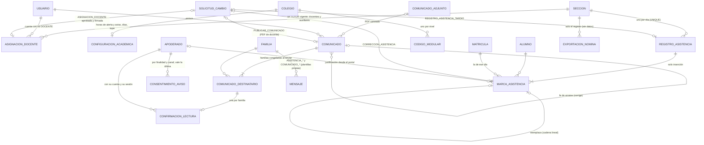

# Sprint 9 · Asistencia y comunicados: diseño de arquitectura

> Diseño del agente `arquitecto-software`, 14 de octubre de 2026. Rama `claude/sprint-9-asistencia-comunicados`, que parte de `main` con los sprints 0 a 8: última migración V31, **86 triggers y 7 funciones en `03`** (10 funciones con huella con las 3 de `02`: **96 huellas**), 2438 pruebas (140 de MySQL real). **No modifiqué código, scripts ni otros documentos:** solo escribí este archivo.
> Paquete base `pe.edu.virgenmaria.cuentasclaras` (los identificadores internos no cambian, decisión 122). Los textos que ven las personas dicen **Cuotaria**, que sale de `CC_MARCA_NOMBRE`; ninguna plantilla ni pantalla lleva la marca escrita a mano (`MarcaUnicaTest`).
> **Dependencia nueva de la aplicación: una, a decidir (decisión 157):** Apache PDFBox 3.0.x (licencia Apache 2.0; la última que encontré es la 3.0.8, de julio de 2026) para validar, sanear y leer el texto del PDF adjunto de un comunicado. Sin ella, el adjunto no se puede revisar de verdad (sección 3.9). Nada más: la nómina usa Apache POI, que ya está.
>
> **Cómo se verificó (y qué NO se verificó)**
> - **Leído:** `CLAUDE.md`, la skill `contexto-colegio`, `plan-de-desarrollo.md` (sprint 9 y fase 2), `estado-del-proyecto.md`, `sprint-8-lista-para-vender.md` (secciones 1 a 16), `sprint-8-correcciones.md`, `sprint-5-familias.md` (secciones 1 a 6), V5, V20, V25, V26 y V31, `02-permisos-tablas.sql` (bloques 0 a 3), `03-triggers.sql` (funciones, `trg_solicitud_cambio_*`, `trg_mensaje_nace`, `trg_mensaje_envio`, `trg_enlace_activacion_*` y `trg_usuario_rol_alta`), `ModuloApp`, `PlantillaMensaje`, `TipoAviso`, `ActorSistema`, `TipoSolicitud`, `ReglasArquitecturaTest` (lista de reglas), `docs/entrega/plantillas-whatsapp-meta.md` y los estudios de `reports/`.
> - **NO probado:** V32, V33 y V34, los GRANT, los 9 triggers nuevos, las 2 versiones nuevas y las 3 funciones nuevas **no se ejecutaron** en H2 ni en MySQL 8. El primer paso de cada tanda es aplicarlos sobre V1–V31 reales en las dos bases (hallazgo 1 del sprint 3).
> - **SIAGIE (lo más incierto):** confirmé en fuentes oficiales y de las UGEL que **la nómina de matrícula la genera el propio SIAGIE** y que la carga masiva usa **una plantilla Excel que el SIAGIE genera por grado y sección**. **No pude ver las columnas de esa plantilla** (sección 3.11): el formato de Cuotaria es un perfil configurable y provisional hasta tener un archivo real (decisión 164 y D12 del plan).
> - **Precios de WhatsApp (muy incierto):** las fuentes no coinciden. La página oficial de Meta remite a una tarjeta de tarifas en PEN que no pude leer; tres agregadores dan para Perú, desde el 1 de octubre de 2026, una tarifa «utility» de **US$ 0.021, 0.030 o 0.0345** por mensaje entregado y una «marketing» de **US$ 0.070 a 0.081**. Uno de ellos dice que desde esa fecha las plantillas «utility» dentro de la ventana de 24 horas ya no son gratis; la página de Meta que leí dice que siguen siéndolo. Las estimaciones de la sección 3.7 usan el rango completo y se confirman con la tarjeta oficial en PEN antes de fijar precios.
> - **Normativa:** los plazos de conservación (Ley 29733) y el alcance de la Ley 29571 sobre comunicados los confirma el asesor legal; aquí van valores por defecto.

## 1. Resumen
- **Dos módulos nuevos que no tocan el dinero.** `academico` (asignaciones docentes, asistencia y nómina para el SIAGIE) y `comunicados` (comunicados con confirmación de lectura). Envían mensajes por el canal que ya existe (`comunicacion`, sprint 5), pero **ni `cobranza` ni `caja` dependen de ellos, y ellos no leen nada de cobranza** (ArchUnit). El docente **nunca** ve deudas, pagos, DNI, fechas de nacimiento ni contactos: solo los nombres de los alumnos de las secciones que Dirección le asignó.
- **La asistencia es un libro de solo inserción, como los pagos.** Cada marca (presente, tarde, falta, falta justificada) es una fila que nadie edita ni borra. Corregir es agregar otra fila que reemplaza a la anterior: el mismo día, por un docente de la sección; después del día, **solo con la aprobación firmada de Dirección**. En los dos casos, si el aviso ya salió, **la familia recibe la corrección**: el padre vuelve a ser el auditor. La base exige que la asistencia se registre **el mismo día, con la hora de la base**, por un docente asignado a esa sección.
- **Un aviso por familia y por día, a una hora fija** (10:30 por defecto), con los hermanos juntos, por WhatsApp con el consentimiento de la familia y correo de respaldo. Plantillas propias, que **nunca mencionan cobranza** (lo comprueban la aplicación y un trigger) y que no se mezclan con los avisos de pago.
- **Comunicados que no se editan y que no pueden cobrar.** Dirección y Promotoría escriben a todo el colegio, un nivel, un grado o una sección; el docente, solo a sus secciones. El emisor lo pone el sistema (nadie se hace pasar por Dirección), un **filtro bloquea cobranza, montos, cuentas, celulares, DNI y enlaces**, cada comunicado lleva un pie fijo («el colegio nunca le pedirá pagos por un comunicado») y el PDF se sanea. Un comunicado enviado no cambia: se manda una **fe de erratas** a los mismos destinatarios. La familia confirma «Leído» **en el portal, con su sesión**; nadie confirma por ella.
- **WhatsApp cuesta por mensaje.** Con los valores por defecto (asistencia agrupada por familia y comunicados en un resumen diario con tope de 4 al mes por familia), un colegio de 300 alumnos generaría unos **15,500 mensajes al año, unos US$ 325–535** (sección 3.7).
- **Nómina para el SIAGIE:** Cuotaria entrega, por sección, los datos que pide la matrícula masiva del SIAGIE en un perfil de columnas configurable, para copiarlos en la plantilla oficial. La nómina oficial la sigue generando y aprobando el SIAGIE.
- **Tres tandas:** (1) docentes y secciones (V32, 88 triggers); (2) asistencia con aviso a las familias (V33, 91 triggers); (3) comunicados y nómina para el SIAGIE (V34, 95 triggers).

## 2. Hallazgos al leer el código (leer antes de implementar)
1. **H1 (alto). La base no puede impedir que el docente lea deudas.** `cc_negocio` tiene `SELECT ON cuentasclaras.*` y todas las personas usan `cc_app`. «El docente nunca ve deudas» depende SOLO de la aplicación: `ModuloApp`, `@PreAuthorize`, los servicios y los DTO. Por eso este diseño lo cubre con tres pruebas independientes (E30 y E31) y una regla ArchUnit, y no promete una «segunda capa» de MySQL que no existe.
2. **H2 (alto). El consentimiento que ya existe es solo para los avisos de pago.** La verificación del contacto (S5-A1) dice «confirme que este celular es suyo para recibir los avisos de pagos del colegio». Usar ese contacto para asistencia y comunicados es una **finalidad nueva** (Ley 29733) y, para WhatsApp, un *opt-in* que Meta exige que nombre al negocio y el tipo de mensajes. Se agrega el consentimiento por finalidad y canal (sección 3.6, tabla `consentimiento_aviso`).
3. **H3 (alto). Los comunicados rompen una regla del sprint 5:** «ninguna persona escribe texto libre a un apoderado» (`PlantillaMensaje`). Un comunicado es texto libre de una persona. Por eso: el texto **nunca va dentro del WhatsApp** (solo en el portal y el correo; en WhatsApp, cuántos comunicados hay y de quién), un filtro de contenido, el emisor fijo y el pie fijo (sección 3.8).
4. **H4. `comunicacion` depende de `caja` y `cobranza`** (sprint 5, decisión 1). Si los comunicados vivieran ahí, nada impediría que un servicio de comunicados leyera deudas. Van en un paquete propio, `comunicados`, con su regla ArchUnit (sección 3.1).
5. **H5. `alumno` no tiene sexo ni código de estudiante, y el colegio no tiene sus códigos modulares** (uno por nivel). Sin ellos no hay nómina para el SIAGIE. V34 los agrega como opcionales y la pantalla del SIAGIE dice qué falta.
6. **H6. `seccion` no tiene tutor ni docentes.** El rol `DOCENTE` existe desde el sprint 1, pero no tiene datos: hoy solo llega a `/cuenta/contacto`. `ModuloApp.ACADEMICO` y `COMUNICADOS` existen con `disponible = false`.
7. **H7. `acceso_dato_personal` tiene CHECK con tipos fijos** (`ck_acceso_dato_tipo` y `ck_acceso_dato_objeto`, V26). Hay que recrearlos para registrar la lista de una sección, los reportes de asistencia y la nómina.
8. **H8. Los feriados nacionales viven en Java** (`FeriadosNacionales`), no en la base. El trigger de la asistencia solo puede comprobar el fin de semana, el año escolar y la tabla `feriado`; los feriados nacionales los comprueba la aplicación.
9. **H9. `matricula.seccion_id` se puede cambiar** (cambio de sección, sprint 2). Cada marca guarda su `matricula_id` y su sección: la historia de un alumno que cambió de sección no se pierde ni se mueve.
10. **H10. Las alertas al celular (`TipoAviso`, decisión 70) van a Promotoría** y la plantilla `cc_alerta_promotoria_v2` la crea solo `sistema.panel`. La alerta «sección sin asistencia» va a **Dirección**: se agrega `TipoAviso.SECCION_SIN_ASISTENCIA` con destinatario por tipo, por el mismo camino (sin plantilla nueva).
11. **H11. Las 26 plantillas de Meta son de categoría «utility»** y están pensadas para operaciones concretas (un pago, una anulación). Según las guías de categorización de Meta, un aviso general sin relación con una operación de la persona se clasifica como **marketing**, que cuesta 2 a 3 veces más y tiene límites de frecuencia por usuario. El aviso de comunicados se escribe como notificación de la cuenta («tiene N comunicados en el portal») y sin el texto libre (sección 3.8). Meta puede reclasificarlo igual: riesgo en la sección 15.
12. **H12. La aplicación no tiene librería de PDF** (solo Apache POI). El sprint 8 rechazó el SVG del logo por riesgoso; un PDF es bastante más complejo (JavaScript, acciones, archivos embebidos, formularios XFA). Ver la sección 3.9.
13. **H13. «Faltan filas» cuenta las tablas de solo inserción** (sprint 7 y V30). Las 6 tablas de solo inserción nuevas entran en el conteo por colegio de `respaldar.sh`, y la purga por plazo de conservación (sección 3.12) tiene que pasar por el mismo procedimiento con acta que la de `acceso_dato_personal`; si no, el respaldo siguiente avisaría «faltan filas».

## 3. Decisiones de diseño

### 3.1 Módulos y dependencias (ArchUnit, sin ciclos)
| Paquete | Qué tiene | Depende de | No depende de |
|---|---|---|---|
| `academico` (nuevo) | Asignaciones docentes, asistencia, justificaciones, reportes, configuración académica y nómina para el SIAGIE | `alumnos` (alumnos y matrículas, solo lectura), `colegio`, `aprobaciones`, `seguridad` (sesión y firma), `auditoria`, `privacidad` (registro de accesos), `comun` | `cobranza`, `caja`, `comprobantes`, `pasarela`, `recaudacion`, `conciliacion`, `panel`, `familias`, `matricula`, `comunicacion`, `comunicados` |
| `comunicados` (nuevo) | Comunicados, adjuntos, destinatarios, confirmaciones y filtro de contenido | `academico.api` (secciones del docente), `alumnos`, `colegio`, `aprobaciones`, `seguridad`, `auditoria`, `privacidad`, `comun` | Los mismos de arriba (salvo `academico.api`) |
| `comunicacion` (existe) | El canal: crea y despacha los mensajes. Gana `comunicacion.proceso.AvisosAsistencia` y `AvisosComunicados` | Además de lo de hoy, lee `academico.api.InasistenciasDelDia` y `comunicados.api.ComunicadosPorAvisar` (interfaces de solo lectura) | — |

- **Nadie del lado del dinero depende de lo nuevo:** `cobranza`, `caja`, `comprobantes`, `pasarela`, `recaudacion` y `conciliacion` no dependen de `academico` ni de `comunicados` (se amplía la regla que hoy existe para `academico`).
- **El portal de las familias no crece dentro de `familias`** (que depende de `caja` y `cobranza`): las páginas `/familia/asistencia/**` y `/familia/comunicados/**` las sirven controladores de `academico.web` y `comunicados.web`, bajo el módulo `FAMILIA` de `ModuloApp` (rol APODERADO).
- **Actores de sistema nuevos** (`ActorSistema`; `ck_usuario_nombre_reservado` ya impide que una persona se llame así):
  - `sistema.asistencia`: crea los avisos de asistencia;
  - `sistema.comunicados`: crea los avisos y el resumen de comunicados;
  - `sistema.academico`: termina las asignaciones al cerrar el año o al desactivarse la cuenta del docente.
- **Sin SQL nativo, sin `delete*` y sin `@Modifying`** en los repositorios nuevos (reglas que ya existen).
- **Orden de bloqueos** (se extiende el del sprint 5): solicitud → asignacion_docente → registro_asistencia → marca_asistencia → comunicado → comunicado_destinatario → mensaje → bitácora. Ninguna transacción nueva toca tablas de dinero.

### 3.2 Asignaciones docentes (tanda 1)
- **Tabla `asignacion_docente`** (V32): un docente, una sección, un año y un tipo:
  - `TUTOR`: uno por sección (lo exige un UNIQUE). Ve la asistencia completa de su sección y las justificaciones;
  - `DOCENTE`: dicta en la sección; las áreas van como texto en este sprint («Matemática, Ciencia y Tecnología»); el sprint 10 agrega el catálogo de áreas y competencias;
  - `AUXILIAR` (auxiliar de educación): solo marca y corrige la asistencia del día; no envía comunicados (decisión 140).
- **Dar acceso a datos de menores lo deciden dos personas; quitarlo, una** (como los roles en el sprint 7):
  - **propone** Administración o Dirección (`POST /academico/asignaciones`), con la solicitud `ASIGNACION_DOCENTE` (`TipoSolicitud` nuevo; `solicitud_cambio` no tiene CHECK de tipo);
  - **aprueba otra persona** de Dirección o Promotoría en la bandeja de siempre, con la firma de su sesión. **Nunca el docente asignado** (un director que también enseña no aprueba su propia asignación);
  - **termina** Dirección o Promotoría con su firma (`asignacion_docente:{id}:TERMINADA`), sin aprobación, o `sistema.academico` al cerrar el año o al desactivarse la cuenta. Terminar no borra nada: lo registrado por ese docente sigue a su nombre;
  - la base lo exige: `trg_asignacion_docente_nace` y `trg_asignacion_docente_estado` (sección 7.3).
- **Copiar las asignaciones del año anterior:** botón «Proponer las mismas del año pasado», que crea las propuestas de las secciones con el mismo grado y nombre. Cada una es una solicitud; la bandeja permite aprobarlas seguidas, cada una con su firma.
- **Combinación de roles** (decisión 141): **DOCENTE no se combina con CAJA ni con ADMINISTRACION**, porque esas cuentas ven quién debe. Sí con DIRECTOR (en colegios chicos el director enseña), con un aviso en la pantalla de usuarios: «Esta persona verá deudas por su rol de Dirección». La base lo exige en una versión nueva de `trg_usuario_rol_alta`. Las combinaciones que ya existan antes de V32 no se tocan: el verificador las lista en el log y la lista de puesta en marcha las muestra como pendientes hasta que Promotoría las corrija.

### 3.3 Qué ve el docente (acceso mínimo, Ley 29733)
| Dato | Docente o auxiliar | Tutor | Dirección | Promotoría |
|---|---|---|---|---|
| Nombres y número de orden de los alumnos de SUS secciones | Sí | Sí | Todas | No |
| Asistencia del día de sus secciones | Sí | Sí | Todas | No (decisión 143) |
| Asistencia del mes y reporte por alumno | Solo lo que marcó | Su sección | Todas | No |
| Motivo y nota de una justificación | No | Su sección | Sí | No |
| DNI, fecha de nacimiento, apoderados, celulares y correos | **Nunca** | **Nunca** | Sí (ficha, como hoy) | Como hoy |
| Deudas, pagos, morosidad y estado de cuenta | **Nunca** | **Nunca** | Como hoy | Como hoy |
| Quién confirmó un comunicado suyo | Nombre del alumno y «confirmó» o «pendiente» | Igual | Todos | Los suyos |

- Los DTO del docente (`academico.dto.AlumnoDeSeccion`, `MarcaDelDia`, `ResumenSeccion`) **no tienen** campos de documento, nacimiento, contacto, apoderado ni dinero: lo comprueba `DtoDocenteSinDatosTest` por reflexión.
- **Registro de quién vio datos** (`acceso_dato_personal`, sprint 7): tipos nuevos `LISTA_SECCION` (con la cantidad, una vez por persona, sección y día), `REPORTE_ASISTENCIA` (cantidad) y `NOMINA_SIAGIE` (cantidad). Promotoría los ve en «Quién vio datos personales», como los demás.
- **Una sección ajena o de otro colegio responde 404** (`@TenantId` más la asignación vigente), igual que el IDOR de hoy.

### 3.4 Asistencia diaria (tanda 2)
**Un registro por sección y día** (`registro_asistencia`, UNIQUE por colegio, sección y fecha) y **una marca por alumno** (`marca_asistencia`). Las dos tablas son de **solo inserción**: `cc_app` no tiene UPDATE ni DELETE (1142).

- **En menos de 1 minuto desde el celular:**
  - la pantalla `/academico/asistencia/{seccion}/hoy` lista a los alumnos en orden alfabético, **todos en «Presente»**;
  - el docente toca a quien faltó (un toque: Falta; dos: Tarde, con la hora de llegada opcional; tres: vuelve a Presente);
  - un solo botón «Guardar asistencia de 3.° B» con el resumen («26 presentes, 2 faltas, 1 tarde»). Un solo POST crea el registro y sus marcas.
- **Estados** (decisión 145): `PRESENTE`, `TARDE` (con `hora_llegada` opcional), `FALTA` y `FALTA_JUSTIFICADA`.
- **Quién registra** (decisión 144): cualquier docente con una asignación VIGENTE en la sección (tutor, docente o auxiliar) o Dirección (para cubrir a un docente ausente). **Turno único** por colegio en este sprint.
- **Solo el día de hoy, con la hora de la base:** `trg_registro_asistencia_nace` exige `fecha = cc_hoy_lima()` (la fecha de Lima según el reloj de MySQL, no el del servidor de la aplicación), un día de lunes a viernes dentro de las fechas de clases del año EN_CURSO y sin día no laborable del colegio. La aplicación además rechaza los feriados nacionales (H8). El trigger guarda `registrado_bd`.
- **Corregir no es editar:** una corrección es una marca nueva con `reemplaza_id` apuntando a la marca vigente. Un UNIQUE sobre `reemplaza_id` impide dos «sucesoras» de la misma marca: la historia es una cadena lineal y la marca vigente es la que nadie reemplazó.

| Cuándo | Quién | Cómo | Aviso a la familia |
|---|---|---|---|
| El mismo día, antes del aviso | Un docente asignado o Dirección | Directo (`CORRECCION_DEL_DIA`) | El aviso de la hora fija ya sale con el estado correcto |
| El mismo día, después del aviso | Un docente asignado o Dirección | Directo (`CORRECCION_DEL_DIA`), con motivo | **Sí**: `cc_asistencia_corregida_v2` en el siguiente envío. Evento resaltado; Dirección ve la lista «Correcciones de hoy después del aviso» |
| Otro día | Lo pide el docente o el tutor; **lo aprueba otra persona de Dirección o Promotoría** con su firma | Solicitud `CORRECCION_ASISTENCIA` (marca, estado nuevo y motivo) → marca `CORRECCION_APROBADA` | **Sí**, siempre |

- **Registro de un día pasado** (decisión 146): no hay modo sin conexión. Si un día no hubo internet, el docente anota en papel y pide `REGISTRO_ASISTENCIA_TARDIO` (sección, fecha y motivo), que aprueba otra persona de Dirección o Promotoría con su firma, hasta 5 días hábiles atrás (la base acepta como máximo 15 días calendario). Con la solicitud aprobada, el docente registra ese día dentro de la hora siguiente; las faltas de ese día se avisan a las familias como corrección («se registró la asistencia del …»).
- **Alerta «sección sin asistencia»** (decisión 149): a la hora de alerta del colegio (09:30 por defecto), `AlertasAcademicas` cuenta las secciones activas con clases ese día que no tienen registro y publica **una** alerta del día a **Dirección**, con el número de secciones (sin nombres de alumnos), por el camino de las alertas del sprint 6 (`TipoAviso.SECCION_SIN_ASISTENCIA`, `cc_alerta_promotoria_v2`).
- **Reporte mensual** (`/academico/asistencia/reporte`): por sección (tutor y Dirección) y por alumno (tutor y Dirección): días de clase, presentes, tardanzas, faltas y faltas justificadas, y el porcentaje de inasistencia injustificada. Sin exportación en este sprint (solo pantalla e impresión); cada consulta queda en `acceso_dato_personal` (`REPORTE_ASISTENCIA`).

### 3.5 Justificación desde el portal (tanda 2)
- El apoderado ve en `/familia/asistencia` el mes de cada hijo y, en cada FALTA de los últimos 5 días hábiles (decisión 150), el botón «Justificar».
- Elige un **motivo de una lista** (`SALUD`, `FAMILIAR`, `TRAMITE`, `OTRO`) y puede agregar una **nota de hasta 200 caracteres**, con el aviso «No escriba diagnósticos ni datos de salud: basta con el motivo». La salud es un dato sensible (Ley 29733): por eso hay lista y la nota es opcional y corta.
- La falta queda **justificada al instante** (marca `JUSTIFICACION`, con el apoderado y su sesión): la familia es responsable de su hijo y no se le pide permiso a nadie. El tutor la ve en su sección.
- **Dirección puede revertirla** (marca `REVERSION_JUSTIFICACION`, con motivo y su firma), por ejemplo si la justificación es falsa; la familia recibe la corrección.
- Una tardanza no se justifica desde el portal en este sprint.

### 3.6 Avisos de asistencia a las familias (tanda 2)
Reutiliza la mensajería del sprint 5 sin cambiar sus reglas: outbox `mensaje`, WhatsApp con correo de respaldo, destino **igual al contacto registrado y verificado** (S5-A1), nada a un contacto del personal sin aprobación (S5-M1), nada a las familias de un colegio en preparación (S8-M2) y el nombre del colegio en `{{1}}` (sprint 8).

- **A una hora fija, una vez por familia y día** (decisión 151):
  - a la **hora del aviso** del colegio (10:30 por defecto, entre 09:00 y 13:00), `comunicacion.proceso.AvisosAsistencia`, como `sistema.asistencia`, lee las marcas vigentes del día con FALTA o TARDE (`academico.api.InasistenciasDelDia`) y crea **un mensaje por familia** con todos sus hijos («Mateo: falta. Lucía: llegó tarde, 08:12»);
  - a la **segunda hora** (16:00 por defecto) sale lo que cambió después: faltas registradas tarde y correcciones posteriores al primer aviso (`cc_asistencia_corregida_v2`);
  - clave idempotente: `ASISTENCIA:{fecha}:{tanda}:FAMILIA:{id}:APODERADO:{id}:{canal}`;
  - solo de lunes a viernes, días de clase, y nunca fuera de 07:00–20:00.
- **A quién:** a los apoderados activos de la familia con el consentimiento de asistencia, **como máximo 2 por familia** (la familia elige cuáles en el portal; por defecto, los dos primeros con consentimiento). Cada apoderado recibe por WhatsApp si dio su consentimiento para ese canal; si no, o si el WhatsApp queda FALLIDO, por correo.
- **No se mezclan con la cobranza** (INDECOPI y Ley 29571):
  - tipos de mensaje propios (`ASISTENCIA_DIA` y `ASISTENCIA_CORREGIDA`) y plantillas propias (`cc_asistencia_*`), con un botón que lleva a `/familia/asistencia`, no al estado de cuenta;
  - un mensaje de asistencia nunca lleva montos ni palabras de cobranza, y una plantilla de asistencia nunca sirve para otro tipo: lo exige la aplicación (`PlantillasMensajeTest`) y **también `trg_mensaje_nace`** (sección 7.3);
  - el aviso es idéntico para una familia con deuda y una al día: el proceso ni siquiera puede leer las deudas (ArchUnit);
  - la historia de mensajes del portal los muestra en una pestaña aparte («Asistencia y comunicados»).
- **Consentimiento** (decisión 152, H2). Tabla `consentimiento_aviso`, de solo inserción: cada fila dice, para un apoderado, una **finalidad** (`ASISTENCIA` o `COMUNICADOS`), un **canal** (`WHATSAPP` o `CORREO`), si lo **otorga** o lo retira, el **origen** y la versión del aviso de privacidad. Vale la última fila.
  - **WhatsApp exige el sí explícito** (el *opt-in* de Meta): lo da el apoderado en el portal (`/familia/avisos`) o lo registra Administración desde la **ficha de matrícula firmada**, con el código de la ficha como evidencia;
  - **el correo se envía salvo oposición**: la finalidad está en el aviso de privacidad del colegio (lo actualiza el asesor legal) y el apoderado lo apaga en el portal;
  - **el portal muestra siempre todo**, haya o no consentimiento;
  - `trg_mensaje_nace` lo exige: un WhatsApp de asistencia o comunicados sin la última fila «otorgado» para esa finalidad no nace.
- **El mensaje solo lleva el primer nombre del alumno** (minimización): nada de apellidos, sección ni DNI en un WhatsApp que queda en el teléfono y en los servidores de Meta.

### 3.7 Volumen y costo de WhatsApp (estimación, a medir en el piloto)
Meta cobra **por plantilla entregada** desde el 1 de julio de 2025 (ya no por conversación). El número es de la plataforma (decisión 120): el costo lo paga el proveedor y se recupera en la suscripción, así que define el precio por tramo de alumnos (decisión 168).

**Supuestos** (ninguno medido; el piloto los corrige): colegio de 300 alumnos y 220 familias, 185 días de clase (38 semanas, 10 meses), **7 % del alumnado con falta o tardanza cada día** (21 alumnos, 19 familias), 1.4 apoderados con WhatsApp y consentimiento por familia, y por semana 1 comunicado de Dirección a todo el colegio más 2 de docentes por sección (unos 3 comunicados por familia, en 2.5 días distintos). Tarifa «utility» de Perú: **US$ 0.021 a 0.0345** por mensaje entregado; «marketing», **US$ 0.070 a 0.081** (fuentes discrepantes, ver el encabezado). Dólar a S/ 3.75, referencial.

| Opción | Asistencia (mensajes al año) | US$ al año |
|---|---|---|
| A. Un mensaje por alumno y por evento, a todos los apoderados | ~8,500 | 180–295 |
| **B. Uno por familia y día (hermanos juntos), hasta 2 apoderados** (por defecto) | **~5,500** | **115–190** |
| C. Como B, a un solo apoderado | ~3,900 | 80–135 |
| D. Como C, y las tardanzas solo en el portal y el correo | ~2,250 | 47–78 |

| Opción | Comunicados (mensajes al año) | US$ al año («utility») | US$ al año si Meta los clasifica «marketing» |
|---|---|---|---|
| X. Un WhatsApp por comunicado, a todos los apoderados | ~35,100 | 740–1,210 | 2,470–2,840 |
| Y. Un resumen por familia y día con comunicados, a un contacto principal | ~20,900 | 440–720 | 1,460–1,690 |
| **Z. Como Y, con tope de 4 por familia al mes** (los urgentes aparte, ~0.5 al mes) (por defecto) | **~10,000** | **210–345** | 700–810 |

- **Total por defecto (B + Z): unos 15,500 mensajes al año, US$ 325–535** (unos S/ 1,220–2,000 al año, o S/ 120–200 por mes de clases) para 300 alumnos. Como referencia, los avisos de pago que ya existen suman unos 4,000 mensajes al año (US$ 85–140).
- **Cómo se agrupa y se limita** (decisiones 151, 158, 159 y 160):
  - asistencia: **un mensaje por familia y día**, con todos los hijos y sus faltas y tardanzas; un segundo envío solo si algo cambió; **hasta 2 apoderados**;
  - comunicados: **nunca un WhatsApp por comunicado**. Un **resumen diario** a la hora del colegio (18:00 por defecto) solo los días con comunicados nuevos o por confirmar, a **un contacto principal** por familia (el resto, por correo);
  - **tope de 4 resúmenes por WhatsApp por familia al mes** (configurable por colegio). Pasado el tope, ese mes van por correo y quedan en el portal. Los **urgentes** (solo Dirección o Promotoría) salen al momento y no cuentan para el tope;
  - **un solo recordatorio** a las 48 horas a quien no confirmó, y solo si el comunicado pide confirmación; va dentro del resumen, no aparte;
  - **los avisos de pago, anulación y descuento no tienen tope ni se agrupan**: son el control antifraude (regla 4 de la skill).
- **El correo y el portal no cuestan por mensaje:** la familia que no da su consentimiento para WhatsApp recibe todo por correo y en el portal.
- **Tablero de consumo:** `/panel/sistema` (Promotoría) muestra los mensajes del mes por tipo (pagos, asistencia, comunicados), para comparar con la factura de Meta.

### 3.8 Comunicados (tanda 3)
**Quién escribe y a quién** (decisión 154):

| Emisor | Alcance | Firma que ve la familia (la pone el sistema) | Urgente | PDF |
|---|---|---|---|---|
| Promotoría | Todo el colegio, un nivel, un grado o una sección | «Promotoría del {colegio}» | Sí | Sí, sale al momento |
| Dirección | Igual | «Dirección del {colegio}» | Sí | Sí, sale al momento |
| Docente (tutor o docente) | Solo una sección con su asignación VIGENTE (si tiene varias, se crea uno por sección) | «Prof. {nombre}, tutor(a) de 3.° B» o «Prof. {nombre}, Matemática, 3.° B» | No | **Lo aprueba Dirección antes de salir** (decisión 157) |
| Auxiliar | — | — | — | — |

- **Nunca a una sola familia:** el alcance mínimo es una sección (CHECK de la base). Una «citación» individual es el camino más corto para presionar por una deuda; queda fuera de este sprint.
- **Nadie se hace pasar por Dirección:**
  - el emisor y su etiqueta los arma el sistema desde la cuenta y el rol real de la sesión; no hay un campo «firma» que alguien escriba;
  - un docente solo puede tener alcance SECCION, sin urgente; la base lo exige (`ck_comunicado_emisor` y `trg_comunicado_nace`, que además compara el rol con `usuario_rol`);
  - enviar lleva la **firma de la sesión** de quien envía (`comunicado:{huella}:ENVIAR`): con la clave de `cc_app` no se envía «como la directora» sin su sesión abierta;
  - Dirección ve en `/comunicados` todos los comunicados de los docentes (con un contador de «nuevos de docentes» en su inicio) y los puede retirar.
- **Filtro de contenido** (`comunicados.service.FiltroContenido`, decisión 155). Se aplica al título, al texto y al texto que se extrae del PDF. Normaliza (minúsculas, sin tildes, sin signos repetidos, `0→o`, `1→i`, `3→e`, `4→a`, `5→s`, espacios entre letras) y **rechaza** con el motivo y el fragmento:
  1. **cobranza:** deuda, debe(n), moroso(s), morosidad, pensión, cuota, pago(s), pagar, pague, vencido, cobranza, cobro, adeuda, atrasado en pagos;
  2. **montos:** «S/», «soles», «nuevos soles», «US$», cifras con dos decimales;
  3. **medios de pago y cuentas:** Yape, Plin, transferencia, depósito, número de cuenta, CCI, interbancaria, BCP, BBVA, Interbank, Scotiabank, Banco de la Nación, números de 13 a 20 dígitos;
  4. **contactos y documentos:** celulares (9 dígitos que empiezan con 9, con o sin +51 y espacios), números de 8 dígitos (DNI) y correos;
  5. **enlaces:** cualquier URL o dominio fuera del de la plataforma (`CC_URL_PUBLICA`).
  - **Sin excepciones, tampoco para Dirección** (decisión 155): lo que es de cobranza va por los recordatorios y el portal de la cobranza. Un intento rechazado queda en la bitácora (`COMUNICADO_RECHAZADO_POR_CONTENIDO`, con la regla, sin el texto) y, si es de un docente y es de cobranza, como alerta de atención para Dirección: que un docente intente escribir sobre deudas a una sección es justo lo que el plan prohíbe.
- **Pie fijo** en el portal, el correo y la impresión de cada comunicado (decisión 156): «{colegio} nunca le pedirá pagos ni datos personales por un comunicado. Los pagos se hacen solo en el portal de Cuotaria, en el banco con el código del alumno o en la caja del colegio. Si algo le parece raro, avísenos desde el portal.» (la marca sale de `CC_MARCA_NOMBRE`). El padre, otra vez, como auditor: un comunicado que pide un Yape es fraude por definición.
- **Texto plano:** título de 5 a 120 caracteres y texto de 10 a 4,000, sin HTML ni Markdown. Se muestra escapado (Thymeleaf `th:text`), con los saltos de línea convertidos en párrafos.
- **Enviado no se edita** (decisión 162):
  - el comunicado se inserta **ya completo** al enviarse (no hay borradores en la base; la vista previa vive en el formulario). Título, texto, alcance, emisor y adjunto **no están en ningún GRANT de UPDATE** (1143);
  - su `huella_contenido` (SHA-256 del alcance con su nivel, grado o sección, el título, el texto y la huella del PDF) va en el evento `COMUNICADO_ENVIADO` de la bitácora encadenada: si el DBA cambia el texto, «Verificar integridad» lo detecta al recalcular la huella (E19);
  - **fe de erratas:** un comunicado nuevo de tipo `FE_DE_ERRATAS` que apunta al original, del mismo emisor o de Dirección, al **mismo alcance**, y cuyos destinatarios son **un subconjunto de los del original** (lo exige `trg_comunicado_destinatario_nace`). El portal muestra en el original «Hay una fe de erratas del …» con el enlace;
  - **retiro:** Dirección o Promotoría pueden retirar un comunicado enviado (por ejemplo, si expuso datos por error), con motivo y su firma. No se borra: la familia ve «Este comunicado fue retirado por Dirección el … Motivo: …», y el texto queda solo para Dirección y en la bitácora.
- **Sin duplicados:** la firma del envío es única por colegio y huella, así que el mismo contenido no se envía dos veces a la misma sección (un doble clic o un reenvío por error); para corregir, la fe de erratas.
- **Destinatarios congelados:** al enviarse, el sistema calcula las familias con un alumno con matrícula ACTIVA en el alcance y las guarda en `comunicado_destinatario` (una fila por familia). Las estadísticas y las confirmaciones son de ese conjunto; una familia que se matricula después no lo ve.

### 3.9 El PDF adjunto (tanda 3)
Un comunicado lleva **como máximo un PDF de hasta 2 MB y 10 páginas** (decisión 157). `comunicados.service.AdjuntosComunicado` es la **única** clase que usa PDFBox (ArchUnit).

1. **Antes de abrirlo:** el tamaño (≤ 2 MB, con el límite de subida de Spring), que empiece con `%PDF-` y que no sea a la vez otra cosa conocida (cabecera ZIP, HTML o JavaScript en el primer kilobyte: polígloto).
2. **Al abrirlo con PDFBox,** con memoria limitada (`MemoryUsageSetting` con un tope de unos 50 MB y archivos temporales en `/tmp`, que en el contenedor es `tmpfs`) y un **tiempo máximo de 10 segundos** (en un hilo aparte que se cancela):
   - se rechaza el PDF cifrado o con contraseña, el dañado y el de más de 10 páginas;
   - se rechaza (no se «limpia») lo activo: JavaScript en el árbol de nombres o en cualquier acción, `OpenAction` y acciones automáticas (`AA`) del catálogo, de las páginas o de las anotaciones, acciones `Launch`, `SubmitForm`, `ImportData`, `GoToR` y `GoToE`, archivos embebidos (`EmbeddedFiles` y anotaciones de archivo), `RichMedia`, formularios (`AcroForm`, también XFA) y enlaces `URI` a dominios ajenos. Rechazar es más simple de probar que limpiar, y el emisor solo tiene que exportar de nuevo su documento «como PDF».
3. **Se vuelve a guardar** con PDFBox (`save` completo, sin actualizaciones incrementales): se pierden los bytes antes de `%PDF-` y después del último `%%EOF`, las revisiones anteriores y los objetos huérfanos. Se guardan el SHA-256 del original y el del saneado; solo se sirve el saneado.
4. **Se extrae el texto** (`PDFTextStripper`) y pasa por el **mismo filtro** que el comunicado (sección 3.8). Un PDF que es solo una imagen no tiene texto: por eso el de un docente lo aprueba Dirección, que lo ve antes de que salga (decisión 157). El de Dirección o Promotoría sale al momento.
5. **Se sirve** en `/comunicados/{id}/adjunto` (personal) y `/familia/comunicados/{id}/adjunto` (destinatarios), siempre con `Content-Type: application/pdf`, `Content-Disposition: attachment; filename="comunicado-{id}.pdf"` (el nombre original no se usa), `X-Content-Type-Options: nosniff`, `Content-Security-Policy: sandbox; default-src 'none'` y `Cache-Control: private, no-store`.

- **Antivirus (ClamAV):** no en este sprint (otro contenedor, sus firmas y su memoria en una VM de 2 GB). El saneado y el rechazo de lo activo cubren los vectores conocidos de un PDF; el riesgo que queda está en la sección 15.
- **Por qué PDFBox y no una revisión «a mano» de los bytes:** las palabras clave de un PDF pueden ir comprimidas dentro de flujos de objetos (PDF 1.5) o escritas con escapes (`/J#61vaScript`). Buscarlas en los bytes da una falsa seguridad. **Sin PDFBox** (si el usuario no acepta la dependencia), la alternativa es **no aceptar adjuntos en este sprint**.
- **Dónde se guarda:** en la base (`comunicado_adjunto`, `MEDIUMBLOB`), como el logo del sprint 8. Con unos 100 PDF de 1 MB por colegio y año, son unos 100 MB por colegio: dentro de los 10 GB con crecimiento automático de Cloud SQL. Si una instalación crece mucho, se mueve a un almacenamiento de objetos (decisión futura).

### 3.10 Confirmación de lectura y estadísticas (tanda 3)
- **La familia confirma en el portal, con su sesión** (decisión 161): `/familia/comunicados/{id}` muestra el comunicado y, si pide confirmación, el botón «Confirmo que lo leí». Es un POST con CSRF desde la sesión de un apoderado de una familia destinataria. **No hay enlace que confirme** (el botón del WhatsApp lleva al portal, que pide ingresar), ni confirmación presencial cargada por el personal.
- **Una confirmación por familia y comunicado** (UNIQUE), con el apoderado que confirmó, su cuenta y su sesión. La base exige que la familia sea destinataria (FK a `comunicado_destinatario`), que la cuenta sea de un apoderado de **esa** familia y que la sesión sea suya y esté abierta (`trg_confirmacion_lectura_nace`).
- **Estadísticas** (decisión 163), para el emisor y Dirección:

| Cifra | Qué significa | De dónde sale |
|---|---|---|
| Destinatarias | Familias con un alumno en el alcance al enviarse | `comunicado_destinatario` |
| Avisadas | Familias a las que se les creó el aviso (WhatsApp o correo) | `comunicado_destinatario.avisado_mensaje_id` |
| Entregadas | El WhatsApp llegó o el correo lo aceptó el servidor | `mensaje.estado` |
| Leídas | La familia abrió el comunicado en el portal o leyó el WhatsApp del aviso | `comunicado_destinatario.abierto_en` o `mensaje.leido_en` |
| **Confirmadas** | La familia pulsó «Confirmo que lo leí» | `confirmacion_lectura` |

- La lista de familias pendientes muestra el **nombre del alumno** (no del apoderado ni su contacto). No hay botón «escribir a quien no confirmó»: el recordatorio de las 48 horas lo hace el sistema.
- Una familia sin cuenta en el portal no puede confirmar; aparece como «sin portal» (dato útil para la adopción, que es meta del plan: 70 % de familias con el portal activado).

### 3.11 Nómina de matrícula para el SIAGIE (tanda 3)
**Lo que se pudo verificar** (fuentes al final):
- **La nómina de matrícula la genera el SIAGIE.** Para 2026, la RM 010-2026-MINEDU (norma de matrícula) dispone que la nómina se genere y descargue desde el SIAGIE, y las UGEL piden a los directores de los colegios privados **aprobarla** allí (una UGEL dio 72 horas). Cuotaria no puede producir la nómina oficial: produce los **datos para registrar la matrícula** en el SIAGIE.
- **La carga masiva usa una plantilla que genera el propio SIAGIE:** en «Matrícula masiva (Excel)» se elige grado y sección y se pulsa «Generar plantilla Excel». La guía oficial v3.3.0 dice que el archivo es un **`.xls`** con un nombre como `Mats_12345678_X12345678X_12345678901.xls` y que **no se debe cambiar el nombre**; se llena, se sube con «Carga nómina de Excel» y el SIAGIE la procesa en segundo plano y marca en rojo los registros observados.
- **El identificador del alumno es el DNI;** el código del estudiante se usa solo si no tiene DNI (modelo de nómina 2025 de una UGEL). La ficha única de matrícula pide apellidos, nombres, sexo y fecha de nacimiento.

**Lo que NO se pudo verificar:** las columnas exactas de la plantilla vigente, su orden, sus códigos (por ejemplo, cómo escribe el sexo o la situación de matrícula), si tiene hojas o columnas ocultas y protegidas, y si la guía v3.3.0 (antigua) sigue vigente. **Todo eso se confirma con una plantilla real descargada por la Dirección de un colegio piloto** (D12 del plan).

**Diseño, por eso, configurable** (decisiones 164 a 166):
- **Datos nuevos** (V34): `alumno.sexo` (`M` o `F`, opcional) y `alumno.codigo_estudiante` (opcional, para quien no tiene DNI); los **códigos modulares** del colegio, uno por nivel con su anexo (`codigo_modular`), que registra Dirección. La importación de Excel del sprint 2 gana las columnas opcionales «Sexo» y «Código de estudiante».
- **Situación de matrícula calculada, no escrita:** `INGRESANTE` (sin matrícula en el colegio el año anterior), `PROMOVIDO` (el año anterior estuvo en el grado previo), `REPITENTE` (mismo grado) y `REENTRANTE` (tuvo matrícula antes, no el año anterior). La renovación del sprint 5 ya marca las repitencias.
- **Perfil de columnas** en un archivo versionado dentro del jar (`src/main/resources/siagie/perfiles/*.json`), no editable por el colegio: el formato es del MINEDU y cambiarlo es una entrega revisada. Cada perfil dice el título de la hoja y, por columna, el encabezado, el **campo** de un catálogo cerrado (`CampoNomina`: orden, tipo y número de documento, código de estudiante, apellidos, nombres, sexo, fecha de nacimiento, nivel, grado, sección, código modular, anexo, situación, fecha de matrícula o vacía) y la traducción de sus valores (por ejemplo `M → Hombre`). El perfil por defecto, `SIAGIE_MATRICULA_PROVISIONAL`, lleva esos campos en ese orden y la etiqueta «PROVISIONAL» en el nombre del archivo y en la primera fila.
- **Salida:** `/academico/siagie/nomina?seccion=` descarga un `.xlsx` por sección (`EscritorXlsxSeguro`: sin fórmulas, todo como texto para que el DNI conserve sus ceros y nada empiece con «=») con el código de la exportación impreso. La secretaria **copia las columnas en la plantilla que descargó del SIAGIE**. Llenar directamente el `.xls` del SIAGIE (POI lo puede escribir) queda para cuando haya un archivo real, porque podría tener validaciones o datos ocultos que se romperían (decisión 164).
- **Antes de exportar**, «Datos que faltan para el SIAGIE» lista por sección los alumnos sin sexo, sin DNI ni código de estudiante y los niveles sin código modular. Exportar con datos faltantes se permite, con el aviso.
- **Quién y con qué rastro** (decisión 166): solo **Dirección** (responsable del SIAGIE según las UGEL). Cada descarga queda en la bitácora (`NOMINA_SIAGIE_EXPORTADA`, con el código y el SHA-256 del archivo, sin su contenido), en `exportacion_nomina` y en `acceso_dato_personal` (`NOMINA_SIAGIE`, con la cantidad de alumnos). El archivo no se guarda.
- **Para después** (no en este sprint): subir la nómina aprobada que descarga el SIAGIE y compararla con las matrículas de Cuotaria (alumnos que están en una y no en la otra).

### 3.12 Ley 29733: datos de menores
- **Acceso mínimo:** la sección 3.3. El docente solo ve nombres; Promotoría no ve la asistencia por alumno (decisión 143); la nómina, solo Dirección.
- **Registro de quién ve:** `acceso_dato_personal` con los tipos `LISTA_SECCION`, `REPORTE_ASISTENCIA` y `NOMINA_SIAGIE`. La alerta de «más de 50 fichas en un día» del sprint 7 no cuenta las listas (cantidad, no fichas); se agrega una alerta si una persona exporta la nómina de más de 10 secciones en un día.
- **Finalidad y consentimiento:** la sección 3.6. El aviso de privacidad del colegio (sprint 8) agrega las finalidades «asistencia» y «comunicados» y los encargados (Meta para WhatsApp); lo redacta el asesor legal y Dirección aprueba la versión nueva.
- **Datos sensibles:** la justificación usa una lista de motivos y una nota corta con aviso (sección 3.5); la nota se ve solo para el tutor y Dirección; los logs nunca llevan nombres de alumnos, notas ni textos de comunicados (`LogsSinDatosPersonalesTest`).
- **Conservación** (decisión 153, a confirmar por el asesor legal):

| Dato | Se conserva | Después |
|---|---|---|
| Marcas y registros de asistencia | El año escolar y los 2 años siguientes | El DBA purga con el script revisado y acta (como `acceso_dato_personal`), dejando los totales mensuales por alumno en el reporte impreso que archiva el colegio |
| Nota de una justificación | 1 año | Se anonimiza (queda el motivo de la lista) |
| Comunicados, adjuntos, destinatarios y confirmaciones | El año escolar y los 2 años siguientes | Purga con acta |
| Consentimientos | Mientras la familia esté en el colegio y 2 años después | Purga con acta |
| Mensajes (el WhatsApp de asistencia lleva el primer nombre del alumno) | La regla de hoy de `mensaje` (decisión 98) | Igual |
| Exportaciones de la nómina | 2 años (no guardan datos de alumnos) | Purga con acta |

  El reporte «Datos con plazo vencido» del sprint 7 suma estas tablas. Las purgas siguen el procedimiento del sprint 7 para `acceso_dato_personal` (script revisado y acta); la alerta «faltan filas» que provoquen en el respaldo siguiente la resuelve Promotoría citando el acta (H13). **No verifiqué** cómo se resolvió esa alerta para la purga del sprint 7: se confirma en la tanda 2.
- **«Mis datos»** del portal muestra también la asistencia de los hijos, las justificaciones enviadas y los consentimientos vigentes.

### 3.13 INDECOPI y la Ley 29571: la asistencia y los comunicados no cobran
El colegio no puede condicionar lo académico al pago (skill `contexto-colegio`). Este sprint agrega dos canales nuevos hacia las familias; ninguno puede servir para presionar por una deuda:
1. **Separación de código:** `academico` y `comunicados` no dependen de nada de cobranza (ArchUnit). El proceso que arma los avisos de asistencia **no puede saber** quién debe.
2. **Mismo trato:** una familia con deuda vencida y otra al día reciben el mismo aviso de asistencia, pueden justificar igual y ven y confirman los comunicados igual (`AsistenciaSinDeudaTest`). Nada de lo académico se bloquea por deuda.
3. **Mensajes separados:** tipos y plantillas propios; un mensaje de asistencia o de comunicados nunca lleva montos ni palabras de cobranza, y una plantilla académica nunca sirve para un aviso de cobranza. Lo exigen la aplicación y `trg_mensaje_nace`. El botón de esos mensajes nunca lleva al estado de cuenta.
4. **Comunicados sin cobranza:** el filtro de la sección 3.8, sin excepciones, y el alcance mínimo de una sección: **ningún comunicado puede nombrar la morosidad de un alumno ni dirigirse a una familia sola**.
5. **Lo que el docente ve no cambia con la deuda:** sus pantallas no tienen ningún dato ni marca que dependa de pagos (E30).
6. **Los recordatorios de cobranza del sprint 5 no cambian:** siguen sin mencionar lo académico, y no se envían más ni menos según la asistencia.

### 3.14 Multi-colegio y demo
- **`colegio_id` en todo:** las 11 tablas nuevas tienen `colegio_id` (y, salvo `configuracion_academica`, cuya clave es el colegio, `UNIQUE (id, colegio_id)`) y FK compuestas a sección, año, alumno, matrícula, familia, apoderado, usuario, sesión y solicitud del **mismo** colegio. Las entidades llevan `@TenantId`. `RutasIdorTest` agrega las rutas nuevas con los 3 colegios (dos de la semilla y uno del alta) y **un docente de otra sección del mismo colegio**.
- **Nada sale a las familias de un colegio en preparación** (S8-M2, ya en `trg_mensaje_nace`), y un comunicado exige un colegio en producción (`trg_comunicado_nace`). La asistencia sí se puede registrar en preparación (sin avisos), para practicar.
- **Plantillas con el colegio en `{{1}}`** (sprint 8): `PlantillasConColegioTest` agrega las 4 nuevas.
- **Demo de promotores** (`demo.<dominio>`, perfil `demo`, decisión 167). `DatosDemoColegio` suma, con datos ficticios:
  - la cuenta `xxxx.docente` como **tutora de 3.° B de Primaria** y docente de Matemática en 4.° A, con sus asignaciones aprobadas;
  - **15 días de asistencia** hacia atrás (con el día de hoy sin registrar en 3.° B, para que el prospecto lo marque en un minuto), algunas faltas y tardanzas, sus avisos en `/mensajes` y una corrección aprobada;
  - la familia de la cuenta `xxxx.apoderado` con **una falta de ayer por justificar** y un comunicado por confirmar;
  - **3 comunicados**: uno de Dirección a todo el colegio con el PDF de ejemplo, uno de la tutora a 3.° B y una fe de erratas, con estadísticas y confirmaciones de familias ficticias;
  - códigos modulares ficticios (`0000001`, `0000002`, `0000003`) y la nómina de una sección con la marca «DEMO · DATOS FICTICIOS» en la primera fila y en el nombre del archivo.
  - En la demo, **el adjunto solo acepta el PDF de ejemplo** empaquetado en el jar (por su SHA-256, como la importación), para que nadie suba un documento real con datos de alumnos.
  - El recorrido guiado (`/demo/guia`) gana dos pasos: «Marca la asistencia de 3.° B en un minuto» y «Envía un comunicado y mira quién lo confirmó».

## 4. Modelo


**Invariantes.** «(base)» = CHECK, UNIQUE o FK; «(MySQL)» = trigger; «(1142/1143)» = sin GRANT.

- **`asignacion_docente`** (tanda 1):
  - sección, año, docente y colegio coherentes (base, FK compuestas); un TUTOR VIGENTE por sección; una propuesta pendiente y una vigente por docente, sección y tipo (base);
  - nace PROPUESTA, la propone una persona activa de Promotoría, Dirección o Administración, para una cuenta activa con rol DOCENTE y sin apoderado, en un año no cerrado (MySQL);
  - PROPUESTA → VIGENTE solo con SU `ASIGNACION_DOCENTE` aprobada y firmada (`cc_solicitud_firmada`) por otra persona activa de Dirección o Promotoría que **no es el docente asignado** (MySQL); → RECHAZADA con la solicitud rechazada (MySQL);
  - VIGENTE → TERMINADA por Dirección o Promotoría con su firma, o por `sistema.academico` (MySQL); nada más cambia de estado (MySQL);
  - docente, sección, año, tipo, áreas y quién la propuso no cambian (1143).
- **`registro_asistencia`** (tanda 2): uno por colegio, sección y fecha (base); solo inserción (1142); de hoy en Lima según la base, o de un día pasado (≤ 15 días) con su `REGISTRO_ASISTENCIA_TARDIO` aprobada y firmada (MySQL); en un día de clases del año EN_CURSO, de lunes a viernes y sin día no laborable del colegio (MySQL; los feriados nacionales, la aplicación); por un docente con asignación VIGENTE en la sección o por Dirección, con su sesión abierta (MySQL); `registrado_bd` lo pone la base (MySQL).
- **`marca_asistencia`** (tanda 2):
  - solo inserción (1142); una marca inicial por registro y alumno; una sola sucesora por marca (base);
  - la inicial es de un alumno con matrícula ACTIVA en esa sección, del día de hoy (o dentro de la hora siguiente a un registro tardío aprobado), por quien puede registrar (MySQL);
  - una corrección reemplaza una marca del mismo registro y alumno y cambia el estado (base y MySQL). El mismo día: un docente asignado o Dirección. Otro día: con SU `CORRECCION_ASISTENCIA` aprobada y firmada, con el estado nuevo de la solicitud (MySQL);
  - la justificación pasa de FALTA a FALTA_JUSTIFICADA, por la cuenta de un apoderado activo de la familia del alumno, con su sesión, hasta 15 días atrás (MySQL; 5 hábiles, la aplicación); la reversión la hace Dirección con su firma (MySQL);
  - la hora de llegada solo en TARDE; motivo y apoderado solo en la justificación; solicitud solo en la corrección aprobada (base).
- **`consentimiento_aviso`** (tanda 2): solo inserción (1142); desde el portal, por la cuenta del propio apoderado con su sesión; desde la ficha, por Administración o Dirección con el código de la ficha (base y MySQL).
- **`mensaje`** (versión nueva de `trg_mensaje_nace`, tandas 2 y 3): los tipos `ASISTENCIA_*` y `COMUNICADO_*` los crea solo su actor de sistema (`cc_sistema`), a un apoderado, con una plantilla de su familia; sus parámetros no tienen montos ni palabras de cobranza; por WhatsApp, con el último consentimiento de esa finalidad otorgado; por correo, sin oposición; una plantilla académica no sirve para otro tipo (MySQL).
- **`comunicado`** (tanda 3):
  - alcance coherente con nivel, grado y sección; un docente solo con alcance SECCION y sin urgente; fe de erratas si y solo si corrige a otro (base);
  - nace ENVIADO (con la firma de la sesión del emisor) o POR_APROBAR (solo un docente con PDF), en un colegio en producción y en el año EN_CURSO, por una persona activa cuyo rol real coincide con el del emisor y con su sesión; un docente, solo en una sección con su asignación VIGENTE de tutor o docente (MySQL);
  - la fe de erratas tiene el mismo alcance que el original, y es del mismo emisor o de Dirección o Promotoría (MySQL);
  - título, texto, alcance, emisor, adjunto y huella no cambian (1143);
  - POR_APROBAR → ENVIADO con SU `PUBLICAR_COMUNICADO` aprobada y firmada por Dirección o Promotoría; → RECHAZADO con la solicitud rechazada; ENVIADO → RETIRADO por Dirección o Promotoría con su firma y motivo (MySQL); `enviado_en`, `destinatarios` y `solicitud_id` se escriben una vez (MySQL).
- **`comunicado_adjunto`** (tanda 3): solo inserción (1142); PDF de 2 MB y 10 páginas como máximo, con sus dos SHA-256 (base).
- **`comunicado_destinatario`** (tanda 3): una fila por comunicado y familia (base); solo de un comunicado ENVIADO, de una familia con un alumno con matrícula ACTIVA en el alcance, o, en una fe de erratas, de una familia destinataria del original (MySQL); solo cambian `abierto_en`, `avisado_mensaje_id` y `recordado_mensaje_id` (1143).
- **`confirmacion_lectura`** (tanda 3): solo inserción (1142); una por comunicado y familia; la familia es destinataria (base, FK); la cuenta es de un apoderado activo de esa familia, con su sesión abierta, en un comunicado ENVIADO (MySQL).
- **`codigo_modular`** (tanda 3): uno por colegio y nivel; 7 dígitos y anexo de 1 dígito (base).
- **`exportacion_nomina`** (tanda 3): solo inserción (1142).

## 5. Máquinas de estado
**Asignación docente** (`asignacion_docente.estado`)
```
PROPUESTA ──(ASIGNACION_DOCENTE aprobada y firmada por otra persona de Dirección o Promotoría, que no es el docente)──▶ VIGENTE
    └──(solicitud rechazada)──▶ RECHAZADA
VIGENTE ──(Dirección o Promotoría con su firma; sistema.academico al cerrar el año o al desactivarse la cuenta)──▶ TERMINADA
```

**Marca de asistencia** (no hay estados que cambien: cada flecha es una fila NUEVA que reemplaza a la vigente)
```
REGISTRO (PRESENTE | TARDE | FALTA | FALTA_JUSTIFICADA)
   ├──(mismo día: docente asignado o Dirección)────────────────────────▶ CORRECCION_DEL_DIA (otro estado)
   ├──(otro día: CORRECCION_ASISTENCIA aprobada y firmada por Dirección)──▶ CORRECCION_APROBADA (otro estado)
   └──(FALTA, hasta 5 días hábiles: el apoderado en el portal)──────────▶ JUSTIFICACION (FALTA_JUSTIFICADA)
                                                                              └──(Dirección con su firma)──▶ REVERSION_JUSTIFICACION (FALTA)
```
- La marca vigente de un alumno en un registro es la que ninguna otra reemplaza. Toda marca nueva después de la hora del aviso genera `ASISTENCIA_CORREGIDA` a la familia.

**Comunicado** (`comunicado.estado`)
```
(nace) ENVIADO ──(Dirección o Promotoría, con firma y motivo)──▶ RETIRADO
(nace) POR_APROBAR (docente con PDF) ──(PUBLICAR_COMUNICADO aprobada y firmada)──▶ ENVIADO
                                     └──(solicitud rechazada, con comentario)──▶ RECHAZADO
```
- Una fe de erratas es otro comunicado (nace ENVIADO o POR_APROBAR con las mismas reglas), nunca un cambio del original.

**Consentimiento** (por apoderado, finalidad y canal; vale la última fila): sin fila → OTORGADO ⇄ RETIRADO. Por WhatsApp, «sin fila» equivale a no; por correo, a sí.

**Mensaje:** el del sprint 5, sin cambios (PENDIENTE → ENVIADO → ENTREGADO → LEIDO, o FALLIDO con el respaldo por correo).

## 6. Migraciones Flyway (NO probadas: aplicar sobre V1–V31 en H2 2.4.240 MODE=MySQL y en MySQL 8.4 antes de seguir)

### `V32__asignaciones_docentes.sql` (tanda 1)
```sql
-- Sprint 9 · tanda 1. Asignaciones de docentes, tutores y auxiliares a secciones por año escolar. Dar acceso a los datos
-- de una sección lo deciden dos personas (propone Administración o Dirección; aprueba otra persona de Dirección o
-- Promotoría con su firma, nunca el docente asignado); quitarlo, una. Nada se borra.
CREATE TABLE asignacion_docente (
    id               BIGINT        NOT NULL AUTO_INCREMENT PRIMARY KEY,
    colegio_id       BIGINT        NOT NULL,
    anio_escolar_id  BIGINT        NOT NULL,
    seccion_id       BIGINT        NOT NULL,
    usuario_id       BIGINT        NOT NULL,   -- el docente (cuenta del personal con rol DOCENTE)
    tipo             VARCHAR(10)   NOT NULL,   -- TUTOR | DOCENTE | AUXILIAR
    areas            VARCHAR(120),             -- texto en este sprint; el sprint 10 agrega el catálogo
    estado           VARCHAR(12)   NOT NULL,   -- PROPUESTA | VIGENTE | RECHAZADA | TERMINADA
    pendiente        BOOLEAN,                  -- TRUE solo en PROPUESTA; si no, NULL
    vigente          BOOLEAN,                  -- TRUE solo en VIGENTE; si no, NULL
    tutor_vigente    BOOLEAN,                  -- TRUE solo en un TUTOR VIGENTE; si no, NULL (un tutor por sección)
    solicitud_id     BIGINT,
    propuesto_por    VARCHAR(60)   NOT NULL,
    resuelto_por     VARCHAR(60),
    resuelto_en      DATETIME(6),
    terminada_por    VARCHAR(60),
    terminada_en     DATETIME(6),
    motivo_fin       VARCHAR(300),
    creado_en        DATETIME(6)   NOT NULL,
    creado_por       VARCHAR(60)   NOT NULL,
    actualizado_en   DATETIME(6)   NOT NULL,
    version          BIGINT        NOT NULL DEFAULT 0,
    CONSTRAINT uk_asignacion_docente_id_colegio UNIQUE (id, colegio_id),
    CONSTRAINT uk_asignacion_docente_pendiente UNIQUE (seccion_id, usuario_id, tipo, pendiente),
    CONSTRAINT uk_asignacion_docente_vigente UNIQUE (seccion_id, usuario_id, tipo, vigente),
    CONSTRAINT uk_asignacion_docente_tutor UNIQUE (seccion_id, tutor_vigente),
    CONSTRAINT uk_asignacion_docente_solicitud UNIQUE (colegio_id, solicitud_id),
    CONSTRAINT fk_asignacion_docente_colegio FOREIGN KEY (colegio_id) REFERENCES colegio (id),
    CONSTRAINT fk_asignacion_docente_anio FOREIGN KEY (anio_escolar_id, colegio_id) REFERENCES anio_escolar (id, colegio_id),
    CONSTRAINT fk_asignacion_docente_seccion FOREIGN KEY (seccion_id, colegio_id) REFERENCES seccion (id, colegio_id),
    CONSTRAINT fk_asignacion_docente_seccion_anio FOREIGN KEY (seccion_id, anio_escolar_id)
        REFERENCES seccion (id, anio_escolar_id),
    CONSTRAINT fk_asignacion_docente_usuario FOREIGN KEY (usuario_id, colegio_id) REFERENCES usuario (id, colegio_id),
    CONSTRAINT fk_asignacion_docente_solicitud FOREIGN KEY (solicitud_id, colegio_id)
        REFERENCES solicitud_cambio (id, colegio_id),
    CONSTRAINT ck_asignacion_docente_tipo CHECK (tipo IN ('TUTOR', 'DOCENTE', 'AUXILIAR')),
    CONSTRAINT ck_asignacion_docente_estado CHECK (estado IN ('PROPUESTA', 'VIGENTE', 'RECHAZADA', 'TERMINADA')
        AND ((estado = 'PROPUESTA' AND pendiente) OR (estado <> 'PROPUESTA' AND pendiente IS NULL))
        AND ((estado = 'VIGENTE' AND vigente) OR (estado <> 'VIGENTE' AND vigente IS NULL))
        AND ((estado = 'VIGENTE' AND tipo = 'TUTOR' AND tutor_vigente)
            OR (NOT (estado = 'VIGENTE' AND tipo = 'TUTOR') AND tutor_vigente IS NULL))),
    CONSTRAINT ck_asignacion_docente_resolucion CHECK ((estado = 'PROPUESTA' AND resuelto_por IS NULL)
        OR (estado <> 'PROPUESTA' AND resuelto_por IS NOT NULL AND resuelto_en IS NOT NULL
            AND resuelto_por <> propuesto_por)),
    CONSTRAINT ck_asignacion_docente_fin CHECK ((estado = 'TERMINADA' AND terminada_por IS NOT NULL
            AND terminada_en IS NOT NULL AND CHAR_LENGTH(TRIM(motivo_fin)) >= 5)
        OR (estado <> 'TERMINADA' AND terminada_por IS NULL AND terminada_en IS NULL)),
    CONSTRAINT ck_asignacion_docente_actor CHECK (creado_por = propuesto_por AND propuesto_por NOT LIKE 'sistema%')
);
CREATE INDEX ix_asignacion_docente_usuario ON asignacion_docente (colegio_id, usuario_id, estado);
CREATE INDEX ix_asignacion_docente_seccion ON asignacion_docente (colegio_id, seccion_id, estado);

-- Ley 29733 (sección 3.12): quién vio la lista de una sección, un reporte de asistencia o la nómina para el SIAGIE
-- (cantidad de alumnos, sin nombres). Se agregan los tres tipos de una vez (H7).
ALTER TABLE acceso_dato_personal DROP CONSTRAINT ck_acceso_dato_tipo;
ALTER TABLE acceso_dato_personal ADD CONSTRAINT ck_acceso_dato_tipo CHECK (tipo IN ('FICHA_FAMILIA', 'FICHA_ALUMNO',
    'BUSQUEDA', 'MOROSOS', 'LLAMADA_CONTROL', 'IMPORTACION', 'APROBACION_CONTACTO', 'LISTA_SECCION',
    'REPORTE_ASISTENCIA', 'NOMINA_SIAGIE'));
ALTER TABLE acceso_dato_personal DROP CONSTRAINT ck_acceso_dato_objeto;
ALTER TABLE acceso_dato_personal ADD CONSTRAINT ck_acceso_dato_objeto CHECK (
    (tipo IN ('FICHA_FAMILIA', 'APROBACION_CONTACTO', 'LLAMADA_CONTROL') AND familia_id IS NOT NULL)
    OR (tipo = 'FICHA_ALUMNO' AND alumno_id IS NOT NULL)
    OR tipo IN ('BUSQUEDA', 'MOROSOS', 'IMPORTACION', 'LISTA_SECCION', 'REPORTE_ASISTENCIA', 'NOMINA_SIAGIE'));
```
> - `AsignacionDocente` extiende `BaseEntity` con `@TenantId`; `seccionId`, `anioEscolarId`, `usuarioId`, `tipo`, `areas` y `propuestoPor` son `updatable = false` (GRANT por columna, 1143; lo comprueba `InmutabilidadAcademicoTest`, como `InmutabilidadCuotasTest`).
> - **Comprobar:** que `seccion` tiene `uk_seccion_id_anio (id, anio_escolar_id)` (V5: sí); que un `UNIQUE` con columnas `NULL` admite varias filas en las dos bases (el patrón ya se usa en `uk_anio_escolar_vigente`); y que V26 no recreó con otro nombre los CHECK de `acceso_dato_personal` (V27 no los toca, según el sprint 7).
> - La bandeja impide que el docente asignado apruebe su propia asignación aunque tenga el rol de Dirección (aplicación y `trg_asignacion_docente_estado`).

### `V33__asistencia_y_consentimientos.sql` (tanda 2)
```sql
-- Sprint 9 · tanda 2. Asistencia diaria (registro por sección y día, marcas de SOLO INSERCIÓN: corregir es agregar una
-- marca que reemplaza a la vigente), consentimiento por finalidad y canal para los avisos de asistencia y comunicados, y
-- la configuración académica de cada colegio. Nada se borra.

-- Horas y plazos de cada colegio (los cambia Dirección; queda en la bitácora con el antes y el después). Los rangos los
-- fija la base: el aviso no se puede correr a la noche para que las familias no se enteren.
CREATE TABLE configuracion_academica (
    colegio_id               BIGINT       NOT NULL PRIMARY KEY,
    hora_alerta              TIME         NOT NULL DEFAULT '09:30:00',
    hora_aviso               TIME         NOT NULL DEFAULT '10:30:00',
    hora_segundo_aviso       TIME         NOT NULL DEFAULT '16:00:00',
    dias_justificacion       INT          NOT NULL DEFAULT 5,     -- días hábiles
    dias_registro_tardio     INT          NOT NULL DEFAULT 5,     -- días hábiles
    hora_resumen_comunicados TIME         NOT NULL DEFAULT '18:00:00',
    tope_resumenes_mes       INT          NOT NULL DEFAULT 4,     -- WhatsApp de comunicados por familia y mes
    actualizado_por          VARCHAR(60)  NOT NULL,
    creado_en                DATETIME(6)  NOT NULL,
    creado_por               VARCHAR(60)  NOT NULL,
    actualizado_en           DATETIME(6)  NOT NULL,
    version                  BIGINT       NOT NULL DEFAULT 0,
    CONSTRAINT fk_configuracion_academica_colegio FOREIGN KEY (colegio_id) REFERENCES colegio (id),
    CONSTRAINT ck_configuracion_academica_horas CHECK (hora_alerta BETWEEN '07:00:00' AND '12:00:00'
        AND hora_aviso BETWEEN '09:00:00' AND '13:00:00' AND hora_aviso > hora_alerta
        AND hora_segundo_aviso BETWEEN '13:00:00' AND '18:00:00'
        AND hora_resumen_comunicados BETWEEN '12:00:00' AND '19:30:00'),
    CONSTRAINT ck_configuracion_academica_plazos CHECK (dias_justificacion BETWEEN 1 AND 10
        AND dias_registro_tardio BETWEEN 1 AND 10 AND tope_resumenes_mes BETWEEN 0 AND 20)
);

-- Un registro por sección y día. SOLO INSERCIÓN. registrado_bd lo pone la base (trigger): la hora del servidor de la
-- aplicación no decide qué día es.
CREATE TABLE registro_asistencia (
    id               BIGINT        NOT NULL AUTO_INCREMENT PRIMARY KEY,
    colegio_id       BIGINT        NOT NULL,
    anio_escolar_id  BIGINT        NOT NULL,
    seccion_id       BIGINT        NOT NULL,
    fecha            DATE          NOT NULL,
    origen           VARCHAR(10)   NOT NULL,   -- DEL_DIA | TARDIO
    solicitud_id     BIGINT,                   -- REGISTRO_ASISTENCIA_TARDIO aprobada (solo TARDIO)
    registrado_por   VARCHAR(60)   NOT NULL,
    sesion_id        BIGINT        NOT NULL,
    registrado_bd    DATETIME(6),
    alumnos          INT           NOT NULL,
    creado_en        DATETIME(6)   NOT NULL,
    creado_por       VARCHAR(60)   NOT NULL,
    actualizado_en   DATETIME(6)   NOT NULL,
    version          BIGINT        NOT NULL DEFAULT 0,
    CONSTRAINT uk_registro_asistencia_dia UNIQUE (colegio_id, seccion_id, fecha),
    CONSTRAINT uk_registro_asistencia_id_colegio UNIQUE (id, colegio_id),
    CONSTRAINT uk_registro_asistencia_id_seccion UNIQUE (id, seccion_id),
    CONSTRAINT uk_registro_asistencia_solicitud UNIQUE (colegio_id, solicitud_id),
    CONSTRAINT fk_registro_asistencia_colegio FOREIGN KEY (colegio_id) REFERENCES colegio (id),
    CONSTRAINT fk_registro_asistencia_anio FOREIGN KEY (anio_escolar_id, colegio_id) REFERENCES anio_escolar (id, colegio_id),
    CONSTRAINT fk_registro_asistencia_seccion FOREIGN KEY (seccion_id, colegio_id) REFERENCES seccion (id, colegio_id),
    CONSTRAINT fk_registro_asistencia_seccion_anio FOREIGN KEY (seccion_id, anio_escolar_id)
        REFERENCES seccion (id, anio_escolar_id),
    CONSTRAINT fk_registro_asistencia_sesion FOREIGN KEY (sesion_id, colegio_id) REFERENCES sesion_usuario (id, colegio_id),
    CONSTRAINT fk_registro_asistencia_solicitud FOREIGN KEY (solicitud_id, colegio_id)
        REFERENCES solicitud_cambio (id, colegio_id),
    CONSTRAINT ck_registro_asistencia_origen CHECK (origen IN ('DEL_DIA', 'TARDIO')
        AND ((origen = 'TARDIO') = (solicitud_id IS NOT NULL))),
    CONSTRAINT ck_registro_asistencia_alumnos CHECK (alumnos >= 0),
    CONSTRAINT ck_registro_asistencia_actor CHECK (creado_por = registrado_por AND registrado_por NOT LIKE 'sistema%')
);
CREATE INDEX ix_registro_asistencia_fecha ON registro_asistencia (colegio_id, fecha);

-- Una marca por alumno y registro; corregir es INSERTAR otra que reemplaza a la vigente (reemplaza_id). SOLO INSERCIÓN.
-- Una sola sucesora por marca: la historia es una cadena y la vigente es la que nadie reemplazó.
CREATE TABLE marca_asistencia (
    id                    BIGINT        NOT NULL AUTO_INCREMENT PRIMARY KEY,
    colegio_id            BIGINT        NOT NULL,
    registro_id           BIGINT        NOT NULL,
    seccion_id            BIGINT        NOT NULL,   -- la del registro (el alumno puede cambiar de sección después)
    fecha                 DATE          NOT NULL,   -- la del registro (consultas por alumno y mes)
    alumno_id             BIGINT        NOT NULL,
    matricula_id          BIGINT        NOT NULL,
    estado                VARCHAR(20)   NOT NULL,   -- PRESENTE | TARDE | FALTA | FALTA_JUSTIFICADA
    hora_llegada          TIME,
    origen                VARCHAR(24)   NOT NULL,   -- REGISTRO | CORRECCION_DEL_DIA | CORRECCION_APROBADA |
                                                    -- JUSTIFICACION | REVERSION_JUSTIFICACION
    primera               BOOLEAN,                  -- TRUE en la marca del registro; NULL en las que reemplazan
    reemplaza_id          BIGINT,
    solicitud_id          BIGINT,                   -- CORRECCION_ASISTENCIA aprobada (solo CORRECCION_APROBADA)
    motivo                VARCHAR(300),             -- de la corrección (persona) o de la reversión
    motivo_justificacion  VARCHAR(12),              -- SALUD | FAMILIAR | TRAMITE | OTRO (solo JUSTIFICACION)
    nota_justificacion    VARCHAR(200),             -- opcional; se anonimiza al año (sección 3.12)
    apoderado_id          BIGINT,                   -- quien justificó
    familia_id            BIGINT,
    sesion_id             BIGINT        NOT NULL,
    creado_en             DATETIME(6)   NOT NULL,
    creado_por            VARCHAR(60)   NOT NULL,
    actualizado_en        DATETIME(6)   NOT NULL,
    version               BIGINT        NOT NULL DEFAULT 0,
    CONSTRAINT uk_marca_asistencia_id_colegio UNIQUE (id, colegio_id),
    CONSTRAINT uk_marca_asistencia_id_alumno UNIQUE (id, alumno_id),
    CONSTRAINT uk_marca_asistencia_primera UNIQUE (registro_id, alumno_id, primera),
    CONSTRAINT uk_marca_asistencia_reemplaza UNIQUE (colegio_id, reemplaza_id),
    CONSTRAINT uk_marca_asistencia_solicitud UNIQUE (colegio_id, solicitud_id),
    CONSTRAINT fk_marca_asistencia_colegio FOREIGN KEY (colegio_id) REFERENCES colegio (id),
    CONSTRAINT fk_marca_asistencia_registro FOREIGN KEY (registro_id, seccion_id)
        REFERENCES registro_asistencia (id, seccion_id),
    CONSTRAINT fk_marca_asistencia_registro_colegio FOREIGN KEY (registro_id, colegio_id)
        REFERENCES registro_asistencia (id, colegio_id),
    CONSTRAINT fk_marca_asistencia_alumno FOREIGN KEY (alumno_id, colegio_id) REFERENCES alumno (id, colegio_id),
    CONSTRAINT fk_marca_asistencia_matricula FOREIGN KEY (matricula_id, colegio_id) REFERENCES matricula (id, colegio_id),
    CONSTRAINT fk_marca_asistencia_reemplaza FOREIGN KEY (reemplaza_id, alumno_id)
        REFERENCES marca_asistencia (id, alumno_id),
    CONSTRAINT fk_marca_asistencia_solicitud FOREIGN KEY (solicitud_id, colegio_id)
        REFERENCES solicitud_cambio (id, colegio_id),
    CONSTRAINT fk_marca_asistencia_apoderado FOREIGN KEY (apoderado_id, familia_id) REFERENCES apoderado (id, familia_id),
    CONSTRAINT fk_marca_asistencia_familia FOREIGN KEY (familia_id, colegio_id) REFERENCES familia (id, colegio_id),
    CONSTRAINT fk_marca_asistencia_sesion FOREIGN KEY (sesion_id, colegio_id) REFERENCES sesion_usuario (id, colegio_id),
    CONSTRAINT ck_marca_asistencia_estado CHECK (estado IN ('PRESENTE', 'TARDE', 'FALTA', 'FALTA_JUSTIFICADA')
        AND (hora_llegada IS NULL OR estado = 'TARDE')),
    CONSTRAINT ck_marca_asistencia_origen CHECK (origen IN ('REGISTRO', 'CORRECCION_DEL_DIA', 'CORRECCION_APROBADA',
        'JUSTIFICACION', 'REVERSION_JUSTIFICACION')
        AND ((origen = 'REGISTRO' AND primera AND reemplaza_id IS NULL)
            OR (origen <> 'REGISTRO' AND primera IS NULL AND reemplaza_id IS NOT NULL))
        AND ((origen = 'CORRECCION_APROBADA') = (solicitud_id IS NOT NULL))
        AND (origen NOT IN ('CORRECCION_DEL_DIA', 'CORRECCION_APROBADA', 'REVERSION_JUSTIFICACION')
            OR CHAR_LENGTH(TRIM(motivo)) >= 5)),
    CONSTRAINT ck_marca_asistencia_justificacion CHECK (
        (origen = 'JUSTIFICACION' AND estado = 'FALTA_JUSTIFICADA' AND apoderado_id IS NOT NULL AND familia_id IS NOT NULL
            AND motivo_justificacion IN ('SALUD', 'FAMILIAR', 'TRAMITE', 'OTRO'))
        OR (origen <> 'JUSTIFICACION' AND apoderado_id IS NULL AND familia_id IS NULL AND motivo_justificacion IS NULL
            AND nota_justificacion IS NULL)),
    CONSTRAINT ck_marca_asistencia_actor CHECK (creado_por NOT LIKE 'sistema%')
);
CREATE INDEX ix_marca_asistencia_alumno ON marca_asistencia (colegio_id, alumno_id, fecha);
CREATE INDEX ix_marca_asistencia_registro ON marca_asistencia (colegio_id, registro_id);
CREATE INDEX ix_marca_asistencia_fecha ON marca_asistencia (colegio_id, fecha, estado);

-- H2. Consentimiento por finalidad y canal para los avisos de asistencia y de comunicados. SOLO INSERCIÓN: vale la
-- última fila de cada apoderado, finalidad y canal. WhatsApp exige un «sí» explícito (opt-in de Meta); el correo sale
-- salvo oposición (la finalidad está en el aviso de privacidad del colegio).
CREATE TABLE consentimiento_aviso (
    id                        BIGINT        NOT NULL AUTO_INCREMENT PRIMARY KEY,
    colegio_id                BIGINT        NOT NULL,
    familia_id                BIGINT        NOT NULL,
    apoderado_id              BIGINT        NOT NULL,
    finalidad                 VARCHAR(12)   NOT NULL,   -- ASISTENCIA | COMUNICADOS
    canal                     VARCHAR(10)   NOT NULL,   -- WHATSAPP | CORREO
    otorgado                  BOOLEAN       NOT NULL,
    contacto_principal        BOOLEAN       NOT NULL DEFAULT FALSE,  -- COMUNICADOS por WhatsApp: el que recibe el resumen
    origen                    VARCHAR(8)    NOT NULL,   -- PORTAL | FICHA
    evidencia                 VARCHAR(40),              -- código de la ficha de matrícula firmada (FICHA)
    aviso_privacidad_version  VARCHAR(20)   NOT NULL,
    sesion_id                 BIGINT        NOT NULL,
    creado_en                 DATETIME(6)   NOT NULL,
    creado_por                VARCHAR(60)   NOT NULL,
    actualizado_en            DATETIME(6)   NOT NULL,
    version                   BIGINT        NOT NULL DEFAULT 0,
    CONSTRAINT uk_consentimiento_aviso_id_colegio UNIQUE (id, colegio_id),
    CONSTRAINT fk_consentimiento_aviso_colegio FOREIGN KEY (colegio_id) REFERENCES colegio (id),
    CONSTRAINT fk_consentimiento_aviso_familia FOREIGN KEY (familia_id, colegio_id) REFERENCES familia (id, colegio_id),
    CONSTRAINT fk_consentimiento_aviso_apoderado FOREIGN KEY (apoderado_id, familia_id) REFERENCES apoderado (id, familia_id),
    CONSTRAINT fk_consentimiento_aviso_sesion FOREIGN KEY (sesion_id, colegio_id) REFERENCES sesion_usuario (id, colegio_id),
    CONSTRAINT ck_consentimiento_aviso_valores CHECK (finalidad IN ('ASISTENCIA', 'COMUNICADOS')
        AND canal IN ('WHATSAPP', 'CORREO') AND origen IN ('PORTAL', 'FICHA')
        AND (NOT contacto_principal OR (finalidad = 'COMUNICADOS' AND canal = 'WHATSAPP' AND otorgado))),
    CONSTRAINT ck_consentimiento_aviso_evidencia CHECK ((origen = 'FICHA' AND CHAR_LENGTH(TRIM(evidencia)) >= 3)
        OR (origen = 'PORTAL' AND evidencia IS NULL)),
    CONSTRAINT ck_consentimiento_aviso_actor CHECK (creado_por NOT LIKE 'sistema%')
);
CREATE INDEX ix_consentimiento_aviso_vigente ON consentimiento_aviso (colegio_id, apoderado_id, finalidad, canal, id);

-- Avisos nuevos a las familias (tipos propios, plantillas propias: sección 3.6).
ALTER TABLE mensaje DROP CONSTRAINT ck_mensaje_tipo;
ALTER TABLE mensaje ADD CONSTRAINT ck_mensaje_tipo CHECK (tipo IN ('PAGO_REGISTRADO', 'PAGO_ANULADO',
    'DESCUENTO_APROBADO', 'CONTACTO_CAMBIADO', 'ACTIVACION_CUENTA', 'HUELLA_BITACORA', 'RECORDATORIO_VENCIMIENTO',
    'CUOTA_VENCIDA', 'RENOVACION_MATRICULA', 'RENOVACION_REGISTRADA', 'AVISO_ATENDIDO', 'VERIFICACION_CONTACTO',
    'APODERADO_AGREGADO', 'CONTACTO_POR_VERIFICAR', 'FERIADO_PROPUESTO', 'RESUMEN_DIARIO', 'ALERTA_PROMOTORIA',
    'CONECTOR_VIGENTE', 'COLEGIO_EN_PRODUCCION', 'AVISO_ALTA', 'CORREO_CONTROL', 'ASISTENCIA_DIA',
    'ASISTENCIA_CORREGIDA'));
CREATE INDEX ix_mensaje_tipo_fecha ON mensaje (colegio_id, tipo, creado_en);
```
> - **Ningún dato se migra:** sin consentimiento previo, nadie recibe un WhatsApp de asistencia hasta que lo dé (en el portal o con la ficha). El correo sí sale desde el primer día, salvo oposición.
> - `configuracion_academica` no tiene fila hasta que Dirección cambie algo: sin fila, la aplicación usa los valores por defecto (los mismos de la tabla).
> - **Comprobar:** el tipo `TIME` y sus literales en los CHECK con H2 en modo MySQL; la FK de una tabla consigo misma (`fk_marca_asistencia_reemplaza`) en las dos bases; y que el índice `ix_mensaje_tipo_fecha` no duplica uno existente.
> - Las entidades `RegistroAsistencia`, `MarcaAsistencia` y `ConsentimientoAviso` tienen todos sus campos `updatable = false`, y sus repositorios no tienen `save` sobre una entidad existente (`InmutabilidadAcademicoTest`).

### `V34__comunicados_y_nomina_siagie.sql` (tanda 3)
```sql
-- Sprint 9 · tanda 3. Comunicados que no se editan (fe de erratas), con PDF saneado, destinatarios congelados y
-- confirmación de lectura de la familia con su sesión; datos para la matrícula en el SIAGIE. Nada se borra.

-- SIAGIE (sección 3.11): sexo y código de estudiante (solo para quien no tiene DNI), opcionales.
ALTER TABLE alumno ADD COLUMN sexo CHAR(1);
ALTER TABLE alumno ADD COLUMN codigo_estudiante VARCHAR(20);
ALTER TABLE alumno ADD CONSTRAINT ck_alumno_sexo CHECK (sexo IS NULL OR sexo IN ('M', 'F'));
ALTER TABLE alumno ADD CONSTRAINT ck_alumno_codigo_estudiante CHECK (codigo_estudiante IS NULL
    OR REGEXP_LIKE(codigo_estudiante, '^[0-9A-Z]{8,20}$'));
ALTER TABLE alumno ADD CONSTRAINT uk_alumno_codigo_estudiante UNIQUE (colegio_id, codigo_estudiante);

-- Códigos modulares del colegio, uno por nivel (los registra Dirección; se ven en ESCALE).
CREATE TABLE codigo_modular (
    id               BIGINT        NOT NULL AUTO_INCREMENT PRIMARY KEY,
    colegio_id       BIGINT        NOT NULL,
    nivel            VARCHAR(12)   NOT NULL,
    codigo           CHAR(7)       NOT NULL,
    anexo            CHAR(1)       NOT NULL DEFAULT '0',
    actualizado_por  VARCHAR(60)   NOT NULL,
    creado_en        DATETIME(6)   NOT NULL,
    creado_por       VARCHAR(60)   NOT NULL,
    actualizado_en   DATETIME(6)   NOT NULL,
    version          BIGINT        NOT NULL DEFAULT 0,
    CONSTRAINT uk_codigo_modular_nivel UNIQUE (colegio_id, nivel),
    CONSTRAINT fk_codigo_modular_colegio FOREIGN KEY (colegio_id) REFERENCES colegio (id),
    CONSTRAINT ck_codigo_modular_valores CHECK (nivel IN ('INICIAL', 'PRIMARIA', 'SECUNDARIA')
        AND REGEXP_LIKE(codigo, '^[0-9]{7}$') AND REGEXP_LIKE(anexo, '^[0-9]$'))
);

-- El PDF saneado de un comunicado (sección 3.9). SOLO INSERCIÓN.
CREATE TABLE comunicado_adjunto (
    id               BIGINT        NOT NULL AUTO_INCREMENT PRIMARY KEY,
    colegio_id       BIGINT        NOT NULL,
    contenido        MEDIUMBLOB    NOT NULL,   -- el PDF vuelto a guardar por PDFBox
    bytes            INT           NOT NULL,
    paginas          INT           NOT NULL,
    sha256           CHAR(64)      NOT NULL,   -- del saneado
    sha256_original  CHAR(64)      NOT NULL,
    creado_en        DATETIME(6)   NOT NULL,
    creado_por       VARCHAR(60)   NOT NULL,
    actualizado_en   DATETIME(6)   NOT NULL,
    version          BIGINT        NOT NULL DEFAULT 0,
    CONSTRAINT uk_comunicado_adjunto_id_colegio UNIQUE (id, colegio_id),
    CONSTRAINT fk_comunicado_adjunto_colegio FOREIGN KEY (colegio_id) REFERENCES colegio (id),
    CONSTRAINT ck_comunicado_adjunto_tamano CHECK (bytes BETWEEN 1 AND 2097152 AND paginas BETWEEN 1 AND 10),
    CONSTRAINT ck_comunicado_adjunto_sha CHECK (REGEXP_LIKE(sha256, '^[0-9a-f]{64}$', 'c')
        AND REGEXP_LIKE(sha256_original, '^[0-9a-f]{64}$', 'c')),
    CONSTRAINT ck_comunicado_adjunto_actor CHECK (creado_por NOT LIKE 'sistema%')
);

-- El comunicado nace COMPLETO al enviarse (no hay borradores en la base). Título, texto, alcance, emisor, adjunto y
-- huella NO están en ningún GRANT de UPDATE (1143): un comunicado enviado no se edita; se corrige con una fe de erratas.
CREATE TABLE comunicado (
    id                     BIGINT         NOT NULL AUTO_INCREMENT PRIMARY KEY,
    colegio_id             BIGINT         NOT NULL,
    anio_escolar_id        BIGINT         NOT NULL,
    tipo                   VARCHAR(14)    NOT NULL,   -- NORMAL | FE_DE_ERRATAS
    corrige_id             BIGINT,
    emisor_usuario_id      BIGINT         NOT NULL,
    emisor_rol             VARCHAR(12)    NOT NULL,   -- PROMOTORIA | DIRECCION | DOCENTE
    emisor_etiqueta        VARCHAR(120)   NOT NULL,   -- la arma el sistema («Dirección del …», «Prof. …, tutor(a) de …»)
    alcance                VARCHAR(10)    NOT NULL,   -- COLEGIO | NIVEL | GRADO | SECCION
    nivel                  VARCHAR(12),
    grado                  VARCHAR(20),
    seccion_id             BIGINT,
    titulo                 VARCHAR(120)   NOT NULL,
    cuerpo                 VARCHAR(4000)  NOT NULL,
    urgente                BOOLEAN        NOT NULL DEFAULT FALSE,
    requiere_confirmacion  BOOLEAN        NOT NULL DEFAULT TRUE,
    adjunto_id             BIGINT,
    huella_contenido       CHAR(64)       NOT NULL,   -- SHA-256 de alcance (con nivel, grado o sección), título, texto y SHA-256 del adjunto
    estado                 VARCHAR(12)    NOT NULL,   -- POR_APROBAR | ENVIADO | RECHAZADO | RETIRADO
    solicitud_id           BIGINT,                    -- PUBLICAR_COMUNICADO (docente con PDF)
    enviado_en             DATETIME(6),
    destinatarios          INT,
    retirado_por           VARCHAR(60),
    retirado_en            DATETIME(6),
    motivo_retiro          VARCHAR(300),
    sesion_id              BIGINT         NOT NULL,
    creado_en              DATETIME(6)    NOT NULL,
    creado_por             VARCHAR(60)    NOT NULL,
    actualizado_en         DATETIME(6)    NOT NULL,
    version                BIGINT         NOT NULL DEFAULT 0,
    CONSTRAINT uk_comunicado_id_colegio UNIQUE (id, colegio_id),
    CONSTRAINT uk_comunicado_solicitud UNIQUE (colegio_id, solicitud_id),
    CONSTRAINT fk_comunicado_colegio FOREIGN KEY (colegio_id) REFERENCES colegio (id),
    CONSTRAINT fk_comunicado_anio FOREIGN KEY (anio_escolar_id, colegio_id) REFERENCES anio_escolar (id, colegio_id),
    CONSTRAINT fk_comunicado_corrige FOREIGN KEY (corrige_id, colegio_id) REFERENCES comunicado (id, colegio_id),
    CONSTRAINT fk_comunicado_emisor FOREIGN KEY (emisor_usuario_id, colegio_id) REFERENCES usuario (id, colegio_id),
    CONSTRAINT fk_comunicado_seccion FOREIGN KEY (seccion_id, colegio_id) REFERENCES seccion (id, colegio_id),
    CONSTRAINT fk_comunicado_seccion_anio FOREIGN KEY (seccion_id, anio_escolar_id) REFERENCES seccion (id, anio_escolar_id),
    CONSTRAINT fk_comunicado_adjunto FOREIGN KEY (adjunto_id, colegio_id) REFERENCES comunicado_adjunto (id, colegio_id),
    CONSTRAINT fk_comunicado_solicitud FOREIGN KEY (solicitud_id, colegio_id) REFERENCES solicitud_cambio (id, colegio_id),
    CONSTRAINT fk_comunicado_sesion FOREIGN KEY (sesion_id, colegio_id) REFERENCES sesion_usuario (id, colegio_id),
    CONSTRAINT ck_comunicado_tipo CHECK (tipo IN ('NORMAL', 'FE_DE_ERRATAS')
        AND ((tipo = 'FE_DE_ERRATAS') = (corrige_id IS NOT NULL))),
    CONSTRAINT ck_comunicado_alcance CHECK (
        (alcance = 'COLEGIO' AND nivel IS NULL AND grado IS NULL AND seccion_id IS NULL)
        OR (alcance = 'NIVEL' AND nivel IN ('INICIAL', 'PRIMARIA', 'SECUNDARIA') AND grado IS NULL AND seccion_id IS NULL)
        OR (alcance = 'GRADO' AND grado IS NOT NULL AND nivel IS NULL AND seccion_id IS NULL)
        OR (alcance = 'SECCION' AND seccion_id IS NOT NULL AND nivel IS NULL AND grado IS NULL)),
    CONSTRAINT ck_comunicado_emisor CHECK (emisor_rol IN ('PROMOTORIA', 'DIRECCION', 'DOCENTE')
        AND (emisor_rol <> 'DOCENTE' OR (alcance = 'SECCION' AND NOT urgente))),
    CONSTRAINT ck_comunicado_texto CHECK (CHAR_LENGTH(TRIM(titulo)) >= 5 AND CHAR_LENGTH(TRIM(cuerpo)) >= 10
        AND REGEXP_LIKE(huella_contenido, '^[0-9a-f]{64}$', 'c')),
    CONSTRAINT ck_comunicado_estado CHECK (estado IN ('POR_APROBAR', 'ENVIADO', 'RECHAZADO', 'RETIRADO')
        AND ((estado IN ('ENVIADO', 'RETIRADO') AND enviado_en IS NOT NULL) OR estado IN ('POR_APROBAR', 'RECHAZADO'))
        AND ((estado = 'RETIRADO' AND retirado_por IS NOT NULL AND retirado_en IS NOT NULL
                AND CHAR_LENGTH(TRIM(motivo_retiro)) >= 10)
            OR (estado <> 'RETIRADO' AND retirado_por IS NULL AND retirado_en IS NULL))),
    CONSTRAINT ck_comunicado_actor CHECK (creado_por NOT LIKE 'sistema%')
);
CREATE INDEX ix_comunicado_fecha ON comunicado (colegio_id, estado, enviado_en);
CREATE INDEX ix_comunicado_emisor ON comunicado (colegio_id, emisor_usuario_id, creado_en);

-- Familias destinatarias, congeladas al enviarse. Solo cambian abierto_en (la primera vez que la familia lo abre) y el
-- mensaje que lo avisó y el que lo recordó (los escribe sistema.comunicados).
CREATE TABLE comunicado_destinatario (
    id               BIGINT        NOT NULL AUTO_INCREMENT PRIMARY KEY,
    colegio_id       BIGINT        NOT NULL,
    comunicado_id    BIGINT        NOT NULL,
    familia_id       BIGINT        NOT NULL,
    alumnos          INT           NOT NULL,   -- cuántos hijos tiene en el alcance
    abierto_en       DATETIME(6),
    avisado_mensaje_id   BIGINT,               -- el resumen (o urgente) que lo avisó por primera vez
    recordado_mensaje_id BIGINT,               -- el resumen que llevó el recordatorio de las 48 h
    creado_en        DATETIME(6)   NOT NULL,
    creado_por       VARCHAR(60)   NOT NULL,
    actualizado_en   DATETIME(6)   NOT NULL,
    version          BIGINT        NOT NULL DEFAULT 0,
    CONSTRAINT uk_comunicado_destinatario UNIQUE (comunicado_id, familia_id),
    CONSTRAINT uk_comunicado_destinatario_id_colegio UNIQUE (id, colegio_id),
    CONSTRAINT fk_comunicado_destinatario_comunicado FOREIGN KEY (comunicado_id, colegio_id)
        REFERENCES comunicado (id, colegio_id),
    CONSTRAINT fk_comunicado_destinatario_familia FOREIGN KEY (familia_id, colegio_id) REFERENCES familia (id, colegio_id),
    CONSTRAINT fk_comunicado_destinatario_aviso FOREIGN KEY (avisado_mensaje_id, colegio_id) REFERENCES mensaje (id, colegio_id),
    CONSTRAINT fk_comunicado_destinatario_recordatorio FOREIGN KEY (recordado_mensaje_id, colegio_id)
        REFERENCES mensaje (id, colegio_id),
    CONSTRAINT ck_comunicado_destinatario_alumnos CHECK (alumnos >= 1)
);
CREATE INDEX ix_comunicado_destinatario_familia ON comunicado_destinatario (colegio_id, familia_id, creado_en);

-- «Confirmo que lo leí»: una por familia y comunicado, por un apoderado de ESA familia con su sesión. SOLO INSERCIÓN.
-- La FK a comunicado_destinatario exige que la familia sea destinataria.
CREATE TABLE confirmacion_lectura (
    id               BIGINT        NOT NULL AUTO_INCREMENT PRIMARY KEY,
    colegio_id       BIGINT        NOT NULL,
    comunicado_id    BIGINT        NOT NULL,
    familia_id       BIGINT        NOT NULL,
    apoderado_id     BIGINT        NOT NULL,
    usuario_id       BIGINT        NOT NULL,
    sesion_id        BIGINT        NOT NULL,
    creado_en        DATETIME(6)   NOT NULL,
    creado_por       VARCHAR(60)   NOT NULL,
    actualizado_en   DATETIME(6)   NOT NULL,
    version          BIGINT        NOT NULL DEFAULT 0,
    CONSTRAINT uk_confirmacion_lectura UNIQUE (comunicado_id, familia_id),
    CONSTRAINT fk_confirmacion_lectura_destinatario FOREIGN KEY (comunicado_id, familia_id)
        REFERENCES comunicado_destinatario (comunicado_id, familia_id),
    CONSTRAINT fk_confirmacion_lectura_comunicado FOREIGN KEY (comunicado_id, colegio_id)
        REFERENCES comunicado (id, colegio_id),
    CONSTRAINT fk_confirmacion_lectura_apoderado FOREIGN KEY (apoderado_id, familia_id) REFERENCES apoderado (id, familia_id),
    CONSTRAINT fk_confirmacion_lectura_usuario FOREIGN KEY (usuario_id, colegio_id) REFERENCES usuario (id, colegio_id),
    CONSTRAINT fk_confirmacion_lectura_sesion FOREIGN KEY (sesion_id, colegio_id) REFERENCES sesion_usuario (id, colegio_id),
    CONSTRAINT ck_confirmacion_lectura_actor CHECK (creado_por NOT LIKE 'sistema%')
);

-- Cada descarga de la nómina para el SIAGIE (sin datos de alumnos: el archivo no se guarda). SOLO INSERCIÓN.
CREATE TABLE exportacion_nomina (
    id               BIGINT        NOT NULL AUTO_INCREMENT PRIMARY KEY,
    colegio_id       BIGINT        NOT NULL,
    anio_escolar_id  BIGINT        NOT NULL,
    seccion_id       BIGINT        NOT NULL,
    perfil           VARCHAR(40)   NOT NULL,
    filas            INT           NOT NULL,
    faltantes        INT           NOT NULL,   -- alumnos con datos que faltan para el SIAGIE
    codigo           VARCHAR(16)   NOT NULL,   -- impreso en el archivo
    sha256           CHAR(64)      NOT NULL,
    creado_en        DATETIME(6)   NOT NULL,
    creado_por       VARCHAR(60)   NOT NULL,
    actualizado_en   DATETIME(6)   NOT NULL,
    version          BIGINT        NOT NULL DEFAULT 0,
    CONSTRAINT uk_exportacion_nomina_codigo UNIQUE (colegio_id, codigo),
    CONSTRAINT fk_exportacion_nomina_colegio FOREIGN KEY (colegio_id) REFERENCES colegio (id),
    CONSTRAINT fk_exportacion_nomina_seccion FOREIGN KEY (seccion_id, anio_escolar_id) REFERENCES seccion (id, anio_escolar_id),
    CONSTRAINT fk_exportacion_nomina_seccion_colegio FOREIGN KEY (seccion_id, colegio_id) REFERENCES seccion (id, colegio_id),
    CONSTRAINT ck_exportacion_nomina_valores CHECK (filas >= 0 AND faltantes BETWEEN 0 AND filas
        AND REGEXP_LIKE(sha256, '^[0-9a-f]{64}$', 'c')),
    CONSTRAINT ck_exportacion_nomina_actor CHECK (creado_por NOT LIKE 'sistema%')
);

ALTER TABLE mensaje DROP CONSTRAINT ck_mensaje_tipo;
ALTER TABLE mensaje ADD CONSTRAINT ck_mensaje_tipo CHECK (tipo IN ('PAGO_REGISTRADO', 'PAGO_ANULADO',
    'DESCUENTO_APROBADO', 'CONTACTO_CAMBIADO', 'ACTIVACION_CUENTA', 'HUELLA_BITACORA', 'RECORDATORIO_VENCIMIENTO',
    'CUOTA_VENCIDA', 'RENOVACION_MATRICULA', 'RENOVACION_REGISTRADA', 'AVISO_ATENDIDO', 'VERIFICACION_CONTACTO',
    'APODERADO_AGREGADO', 'CONTACTO_POR_VERIFICAR', 'FERIADO_PROPUESTO', 'RESUMEN_DIARIO', 'ALERTA_PROMOTORIA',
    'CONECTOR_VIGENTE', 'COLEGIO_EN_PRODUCCION', 'AVISO_ALTA', 'CORREO_CONTROL', 'ASISTENCIA_DIA',
    'ASISTENCIA_CORREGIDA', 'COMUNICADOS_RESUMEN', 'COMUNICADO_URGENTE'));
```
> - El resumen de comunicados es un `mensaje` por familia y día (`entidad = 'familia'`). Qué comunicados avisó y recordó queda en `comunicado_destinatario.avisado_mensaje_id` y `recordado_mensaje_id`, que se escriben una vez (lo vigila la aplicación; ver el residual de la sección 15). De ahí salen las estadísticas y el tope mensual.
> - **Comprobar:** que `uk_alumno_codigo_estudiante` acepta varios `NULL` (sí en las dos bases); que `MEDIUMBLOB` funciona en H2 (el logo del sprint 8 ya lo usa); y que la FK de `confirmacion_lectura` a la clave compuesta `(comunicado_id, familia_id)` se crea en MySQL (la sostiene `uk_comunicado_destinatario`).

## 7. Cambios de MySQL: `01`, `02`, `03`, el verificador, las huellas y el CI

### 7.1 `scripts/mysql/01-usuarios.sql`
**Sin cambios.** No hay usuarios ni roles nuevos: las personas escriben con `cc_app` (por el rol `cc_negocio`) y los actores `sistema.asistencia`, `sistema.comunicados` y `sistema.academico` con `cc_sistema`. No hay `04-una-vez-sprint-9.sql`: las bases existentes solo necesitan `migrar`, `02` y `03`, en ese orden y con la aplicación detenida (como siempre).

### 7.2 `scripts/mysql/02-permisos-tablas.sql` (al final del bloque 1, por tanda)
```sql
-- ===================== Sprint 9 · tanda 1 (V32): asignaciones docentes =====================
-- Se proponen (INSERT) y cambian de estado; docente, sección, año, tipo, áreas y quién la propuso NO cambian (1143). Nunca
-- DELETE. Qué transición vale lo decide trg_asignacion_docente_estado. acceso_dato_personal: sin cambios (ya tiene INSERT).
GRANT INSERT, UPDATE (estado, pendiente, vigente, tutor_vigente, solicitud_id, resuelto_por, resuelto_en, terminada_por,
    terminada_en, motivo_fin, actualizado_en, version) ON cuentasclaras.asignacion_docente TO 'cc_negocio';

-- ===================== Sprint 9 · tanda 2 (V33): asistencia y consentimientos =====================
-- La asistencia es un libro de SOLO INSERCIÓN, como los pagos: corregir es insertar una marca que reemplaza a la vigente.
-- Con cc_app, UPDATE o DELETE de un registro o una marca: 1142. El consentimiento, igual (vale la última fila).
GRANT INSERT, UPDATE (hora_alerta, hora_aviso, hora_segundo_aviso, dias_justificacion, dias_registro_tardio,
    hora_resumen_comunicados, tope_resumenes_mes, actualizado_por, actualizado_en, version)
    ON cuentasclaras.configuracion_academica TO 'cc_negocio';
GRANT INSERT ON cuentasclaras.registro_asistencia TO 'cc_negocio';                -- solo inserción
GRANT INSERT ON cuentasclaras.marca_asistencia TO 'cc_negocio';                   -- solo inserción
GRANT INSERT ON cuentasclaras.consentimiento_aviso TO 'cc_negocio';               -- solo inserción
-- mensaje: sin cambios (los tipos nuevos usan las mismas columnas; el estado lo sigue cambiando solo cc_sistema).

-- ===================== Sprint 9 · tanda 3 (V34): comunicados y nómina para el SIAGIE =====================
-- comunicado: título, texto, alcance, emisor, adjunto y huella NO están en el UPDATE (1143): enviado no se edita.
GRANT INSERT, UPDATE (codigo, anexo, actualizado_por, actualizado_en, version) ON cuentasclaras.codigo_modular
    TO 'cc_negocio';
GRANT INSERT ON cuentasclaras.comunicado_adjunto TO 'cc_negocio';                 -- solo inserción
GRANT INSERT, UPDATE (estado, solicitud_id, enviado_en, destinatarios, retirado_por, retirado_en, motivo_retiro,
    actualizado_en, version) ON cuentasclaras.comunicado TO 'cc_negocio';
GRANT INSERT, UPDATE (abierto_en, avisado_mensaje_id, recordado_mensaje_id, actualizado_en, version)
    ON cuentasclaras.comunicado_destinatario TO 'cc_negocio';
GRANT INSERT ON cuentasclaras.confirmacion_lectura TO 'cc_negocio';               -- solo inserción
GRANT INSERT ON cuentasclaras.exportacion_nomina TO 'cc_negocio';                 -- solo inserción
-- alumno: sin cambios (mantiene su UPDATE por tabla; sexo y codigo_estudiante se auditan con el antes y el después).
```
> - **Antes de quitar o agregar un GRANT, buscar todo lugar que escriba esa tabla** (regla del sprint 7). Ninguna tabla existente pierde permisos.
> - `permisos_objetos()` no cambia; el simulacro semanal compara las líneas nuevas.
> - `respaldar.sh` agrega a su lista de tablas de solo inserción, con el conteo por colegio de V30: `registro_asistencia`, `marca_asistencia`, `consentimiento_aviso`, `comunicado_adjunto`, `confirmacion_lectura` y `exportacion_nomina` (H13).

### 7.3 `scripts/mysql/03-triggers.sql`

#### Tanda 1 (V32): 1 función, 2 triggers nuevos y 1 con versión nueva: 88 triggers
```sql
DELIMITER $$
-- Sprint 9, tanda 1: ¿esta persona tiene una asignación VIGENTE en esta sección, con su cuenta activa y el rol DOCENTE?
-- p_con_auxiliar: la asistencia la marca también el auxiliar; los comunicados, no.
DROP FUNCTION IF EXISTS cc_docente_de_seccion$$
CREATE FUNCTION cc_docente_de_seccion(p_nombre VARCHAR(60), p_seccion BIGINT, p_con_auxiliar BOOLEAN) RETURNS BOOLEAN
    NOT DETERMINISTIC READS SQL DATA
    RETURN EXISTS (SELECT 1 FROM asignacion_docente a
        JOIN usuario u ON u.id = a.usuario_id AND u.colegio_id = a.colegio_id
        JOIN usuario_rol r ON r.usuario_id = u.id
        WHERE a.seccion_id = p_seccion AND a.estado = 'VIGENTE' AND u.nombre_usuario = p_nombre AND u.activo
          AND u.apoderado_id IS NULL AND r.rol = 'DOCENTE' AND (p_con_auxiliar OR a.tipo <> 'AUXILIAR'))$$

-- Una asignación nace PROPUESTA, la propone Promotoría, Dirección o Administración del colegio, para una cuenta activa con
-- rol DOCENTE (sin apoderado), en un año que no está cerrado.
DROP TRIGGER IF EXISTS trg_asignacion_docente_nace$$
CREATE TRIGGER trg_asignacion_docente_nace BEFORE INSERT ON asignacion_docente FOR EACH ROW
BEGIN
    IF NOT (NEW.estado <=> 'PROPUESTA') OR NEW.solicitud_id IS NOT NULL OR NEW.resuelto_por IS NOT NULL
            OR NOT EXISTS (SELECT 1 FROM usuario u JOIN usuario_rol r ON r.usuario_id = u.id
                WHERE u.colegio_id = NEW.colegio_id AND u.nombre_usuario = NEW.propuesto_por AND u.activo
                  AND r.rol IN ('PROMOTOR', 'DIRECTOR', 'ADMINISTRACION')) THEN
        SIGNAL SQLSTATE '45000' SET MESSAGE_TEXT = 'cuentasclaras: una asignacion nace propuesta por Promotoria, Direccion o Administracion';
    END IF;
    IF NOT EXISTS (SELECT 1 FROM usuario u JOIN usuario_rol r ON r.usuario_id = u.id WHERE u.id = NEW.usuario_id
                AND u.colegio_id = NEW.colegio_id AND u.activo AND u.apoderado_id IS NULL AND r.rol = 'DOCENTE')
            OR NOT EXISTS (SELECT 1 FROM anio_escolar a WHERE a.id = NEW.anio_escolar_id AND a.colegio_id = NEW.colegio_id
                AND a.estado <> 'CERRADO') THEN
        SIGNAL SQLSTATE '45000' SET MESSAGE_TEXT = 'cuentasclaras: se asigna una cuenta DOCENTE activa en un anio abierto';
    END IF;
END$$

-- Dar acceso: SU solicitud aprobada y firmada por otra persona de Dirección o Promotoría que NO es el docente. Quitarlo:
-- Dirección o Promotoría con su firma, o sistema.academico.
DROP TRIGGER IF EXISTS trg_asignacion_docente_estado$$
CREATE TRIGGER trg_asignacion_docente_estado BEFORE UPDATE ON asignacion_docente FOR EACH ROW
BEGIN
    IF OLD.estado = 'PROPUESTA' AND NEW.estado = 'VIGENTE' THEN
        IF NOT (cc_solicitud_firmada(NEW.solicitud_id)
                AND EXISTS (SELECT 1 FROM solicitud_cambio s WHERE s.id = NEW.solicitud_id AND s.colegio_id = NEW.colegio_id
                    AND s.tipo = 'ASIGNACION_DOCENTE' AND s.entidad = 'asignacion_docente' AND s.entidad_id = NEW.id
                    AND s.solicitado_por = OLD.propuesto_por AND s.resuelto_por = NEW.resuelto_por)
                AND EXISTS (SELECT 1 FROM usuario u JOIN usuario_rol r ON r.usuario_id = u.id
                    WHERE u.colegio_id = NEW.colegio_id AND u.nombre_usuario = NEW.resuelto_por AND u.activo
                      AND r.rol IN ('PROMOTOR', 'DIRECTOR'))
                AND NOT EXISTS (SELECT 1 FROM usuario d WHERE d.id = NEW.usuario_id AND d.nombre_usuario = NEW.resuelto_por)
                AND EXISTS (SELECT 1 FROM usuario d JOIN usuario_rol r ON r.usuario_id = d.id WHERE d.id = NEW.usuario_id
                    AND d.activo AND r.rol = 'DOCENTE')) THEN
            SIGNAL SQLSTATE '45000' SET MESSAGE_TEXT = 'cuentasclaras: la asignacion la aprueba otra persona de Direccion con su firma, nunca el docente';
        END IF;
    ELSEIF OLD.estado = 'PROPUESTA' AND NEW.estado = 'RECHAZADA' THEN
        IF NOT EXISTS (SELECT 1 FROM solicitud_cambio s WHERE s.id = NEW.solicitud_id AND s.colegio_id = NEW.colegio_id
                AND s.tipo = 'ASIGNACION_DOCENTE' AND s.entidad_id = NEW.id AND s.estado = 'RECHAZADA'
                AND s.resuelto_por = NEW.resuelto_por) THEN
            SIGNAL SQLSTATE '45000' SET MESSAGE_TEXT = 'cuentasclaras: la asignacion se rechaza con su solicitud rechazada';
        END IF;
    ELSEIF OLD.estado = 'VIGENTE' AND NEW.estado = 'TERMINADA' THEN
        IF NOT ((NEW.terminada_por LIKE 'sistema.%' AND cc_es_sistema())
                OR (EXISTS (SELECT 1 FROM usuario u JOIN usuario_rol r ON r.usuario_id = u.id
                        WHERE u.colegio_id = NEW.colegio_id AND u.nombre_usuario = NEW.terminada_por AND u.activo
                          AND r.rol IN ('PROMOTOR', 'DIRECTOR'))
                    AND cc_firma_valida(NEW.colegio_id, CONCAT('asignacion_docente:', NEW.id, ':TERMINADA'),
                        NEW.terminada_por))) THEN
            SIGNAL SQLSTATE '45000' SET MESSAGE_TEXT = 'cuentasclaras: la asignacion la termina Direccion con su firma o el sistema';
        END IF;
    ELSEIF NOT (NEW.estado <=> OLD.estado) OR (OLD.estado <> 'PROPUESTA' AND NOT (NEW.solicitud_id <=> OLD.solicitud_id)) THEN
        -- Solo una PROPUESTA cambia sin cambiar de estado (el enlace con su solicitud).
        SIGNAL SQLSTATE '45000' SET MESSAGE_TEXT = 'cuentasclaras: transicion de asignacion no permitida';
    END IF;
END$$
DELIMITER ;
```
**Versión nueva de `trg_usuario_rol_alta`** (mismo nombre): después del bloque de combinaciones prohibidas de hoy, uno propio con su mensaje:
```sql
    IF EXISTS (SELECT 1 FROM usuario_rol r WHERE r.usuario_id = NEW.usuario_id AND (
            (NEW.rol = 'DOCENTE' AND r.rol IN ('CAJA', 'ADMINISTRACION'))
            OR (r.rol = 'DOCENTE' AND NEW.rol IN ('CAJA', 'ADMINISTRACION')))) THEN
        SIGNAL SQLSTATE '45000' SET MESSAGE_TEXT = 'cuentasclaras: el docente no ve deudas: DOCENTE no se combina con CAJA ni ADMINISTRACION';
    END IF;
```

#### Tanda 2 (V33): 2 funciones, 3 triggers nuevos y 1 con versión nueva: 91 triggers
```sql
DELIMITER $$
-- Sprint 9, tanda 2: el día de hoy en Lima según el reloj de la BASE (Perú no tiene horario de verano). Mismo criterio que
-- cc_firma_valida (UTC menos 5 horas).
DROP FUNCTION IF EXISTS cc_hoy_lima$$
CREATE FUNCTION cc_hoy_lima() RETURNS DATE NOT DETERMINISTIC NO SQL
    RETURN DATE(UTC_TIMESTAMP() - INTERVAL 5 HOUR)$$

-- ¿Es una sesión abierta y vigente de esta persona en este colegio? (lo que escribe un docente o una familia lleva su
-- sesión: con la clave de cc_app no se escribe «como» alguien que no está conectado).
DROP FUNCTION IF EXISTS cc_sesion_abierta$$
CREATE FUNCTION cc_sesion_abierta(p_sesion BIGINT, p_nombre VARCHAR(60), p_colegio BIGINT) RETURNS BOOLEAN
    NOT DETERMINISTIC READS SQL DATA
    RETURN EXISTS (SELECT 1 FROM sesion_usuario s JOIN usuario u ON u.id = s.usuario_id AND u.colegio_id = s.colegio_id
        WHERE s.id = p_sesion AND s.colegio_id = p_colegio AND u.nombre_usuario = p_nombre AND u.activo
          AND s.cerrada_en IS NULL AND s.vence_en > UTC_TIMESTAMP(6) - INTERVAL 5 HOUR)$$

-- El registro del día: un docente asignado a la sección (o Dirección) con su sesión, un día de clases del año en curso, y
-- HOY según la base; otro día, solo con su REGISTRO_ASISTENCIA_TARDIO aprobada y firmada por Dirección o Promotoría.
DROP TRIGGER IF EXISTS trg_registro_asistencia_nace$$
CREATE TRIGGER trg_registro_asistencia_nace BEFORE INSERT ON registro_asistencia FOR EACH ROW
BEGIN
    SET NEW.registrado_bd = UTC_TIMESTAMP(6) - INTERVAL 5 HOUR;
    IF NOT cc_sesion_abierta(NEW.sesion_id, NEW.registrado_por, NEW.colegio_id)
            OR NOT (cc_docente_de_seccion(NEW.registrado_por, NEW.seccion_id, TRUE)
                OR EXISTS (SELECT 1 FROM usuario u JOIN usuario_rol r ON r.usuario_id = u.id
                    WHERE u.colegio_id = NEW.colegio_id AND u.nombre_usuario = NEW.registrado_por AND u.activo
                      AND r.rol = 'DIRECTOR')) THEN
        SIGNAL SQLSTATE '45000' SET MESSAGE_TEXT = 'cuentasclaras: la asistencia la registra un docente de la seccion o Direccion, con su sesion';
    END IF;
    IF NOT EXISTS (SELECT 1 FROM seccion s JOIN anio_escolar a ON a.id = s.anio_escolar_id
                WHERE s.id = NEW.seccion_id AND s.colegio_id = NEW.colegio_id AND s.activa AND a.id = NEW.anio_escolar_id
                  AND a.estado = 'EN_CURSO' AND NEW.fecha BETWEEN a.inicio_clases AND a.fin_clases)
            OR DAYOFWEEK(NEW.fecha) IN (1, 7)
            OR EXISTS (SELECT 1 FROM feriado f WHERE f.colegio_id = NEW.colegio_id AND f.fecha = NEW.fecha AND f.vigente
                AND NOT f.pendiente) THEN
        SIGNAL SQLSTATE '45000' SET MESSAGE_TEXT = 'cuentasclaras: la asistencia es de un dia de clases del anio en curso';
    END IF;
    IF NEW.origen = 'DEL_DIA' AND NOT (NEW.fecha <=> cc_hoy_lima()) THEN
        SIGNAL SQLSTATE '45000' SET MESSAGE_TEXT = 'cuentasclaras: la asistencia se registra el mismo dia; otro dia necesita la aprobacion de Direccion';
    END IF;
    IF NEW.origen = 'TARDIO' AND NOT (NEW.fecha < cc_hoy_lima() AND NEW.fecha >= cc_hoy_lima() - INTERVAL 15 DAY
            AND cc_solicitud_firmada(NEW.solicitud_id)
            AND EXISTS (SELECT 1 FROM solicitud_cambio s JOIN usuario u ON u.nombre_usuario = s.resuelto_por
                    AND u.colegio_id = s.colegio_id JOIN usuario_rol r ON r.usuario_id = u.id
                WHERE s.id = NEW.solicitud_id AND s.colegio_id = NEW.colegio_id AND s.tipo = 'REGISTRO_ASISTENCIA_TARDIO'
                  AND s.entidad = 'seccion' AND s.entidad_id = NEW.seccion_id AND s.solicitado_por = NEW.registrado_por
                  AND JSON_UNQUOTE(JSON_EXTRACT(s.datos, '$.fecha')) = DATE_FORMAT(NEW.fecha, '%Y-%m-%d')
                  AND u.activo AND r.rol IN ('PROMOTOR', 'DIRECTOR'))) THEN
        SIGNAL SQLSTATE '45000' SET MESSAGE_TEXT = 'cuentasclaras: el registro de un dia pasado exige su solicitud aprobada y firmada por Direccion';
    END IF;
END$$

-- El consentimiento: en el portal, la cuenta del propio apoderado con su sesión; desde la ficha firmada, Administración o
-- Dirección con su sesión (la evidencia la exige el CHECK).
DROP TRIGGER IF EXISTS trg_consentimiento_aviso_nace$$
CREATE TRIGGER trg_consentimiento_aviso_nace BEFORE INSERT ON consentimiento_aviso FOR EACH ROW
BEGIN
    IF NOT cc_sesion_abierta(NEW.sesion_id, NEW.creado_por, NEW.colegio_id)
            OR (NEW.origen = 'PORTAL' AND NOT EXISTS (SELECT 1 FROM usuario u WHERE u.nombre_usuario = NEW.creado_por
                AND u.colegio_id = NEW.colegio_id AND u.apoderado_id = NEW.apoderado_id))
            OR (NEW.origen = 'FICHA' AND NOT EXISTS (SELECT 1 FROM usuario u JOIN usuario_rol r ON r.usuario_id = u.id
                WHERE u.nombre_usuario = NEW.creado_por AND u.colegio_id = NEW.colegio_id AND u.apoderado_id IS NULL
                  AND r.rol IN ('ADMINISTRACION', 'DIRECTOR'))) THEN
        SIGNAL SQLSTATE '45000' SET MESSAGE_TEXT = 'cuentasclaras: el consentimiento lo da el apoderado en el portal o se registra desde su ficha firmada';
    END IF;
END$$

-- Cada marca: de su registro y con la sesión de quien la escribe. La inicial, de un alumno matriculado en la sección y del
-- día (o en la hora siguiente a un registro tardío aprobado). Una corrección reemplaza la marca de ese alumno y cambia el
-- estado: el mismo día, un docente de la sección o Dirección; otro día, con SU solicitud aprobada y firmada. La
-- justificación, la cuenta de un apoderado de la familia del alumno; la reversión, Dirección con su firma.
DROP TRIGGER IF EXISTS trg_marca_asistencia_nace$$
CREATE TRIGGER trg_marca_asistencia_nace BEFORE INSERT ON marca_asistencia FOR EACH ROW
BEGIN
    DECLARE v_fecha DATE;
    DECLARE v_origen_registro VARCHAR(10);
    DECLARE v_registrado_bd DATETIME(6);
    DECLARE v_estado_anterior VARCHAR(20);
    DECLARE v_origen_anterior VARCHAR(24);
    DECLARE v_es_personal BOOLEAN;
    SELECT r.fecha, r.origen, r.registrado_bd INTO v_fecha, v_origen_registro, v_registrado_bd
      FROM registro_asistencia r WHERE r.id = NEW.registro_id AND r.colegio_id = NEW.colegio_id
       AND r.seccion_id = NEW.seccion_id;
    IF v_fecha IS NULL OR NOT (NEW.fecha <=> v_fecha) OR NOT cc_sesion_abierta(NEW.sesion_id, NEW.creado_por, NEW.colegio_id) THEN
        SIGNAL SQLSTATE '45000' SET MESSAGE_TEXT = 'cuentasclaras: la marca es de su registro y lleva la sesion de quien la escribe';
    END IF;
    SET v_es_personal = cc_docente_de_seccion(NEW.creado_por, NEW.seccion_id, TRUE)
        OR EXISTS (SELECT 1 FROM usuario u JOIN usuario_rol r ON r.usuario_id = u.id WHERE u.colegio_id = NEW.colegio_id
            AND u.nombre_usuario = NEW.creado_por AND u.activo AND r.rol = 'DIRECTOR');
    IF NEW.origen = 'REGISTRO' THEN
        IF NOT v_es_personal
                OR NOT EXISTS (SELECT 1 FROM matricula m WHERE m.id = NEW.matricula_id AND m.colegio_id = NEW.colegio_id
                    AND m.alumno_id = NEW.alumno_id AND m.seccion_id = NEW.seccion_id AND m.estado = 'ACTIVA')
                OR NOT ((v_origen_registro = 'DEL_DIA' AND v_fecha = cc_hoy_lima())
                    OR (v_origen_registro = 'TARDIO' AND v_registrado_bd >= UTC_TIMESTAMP(6) - INTERVAL 6 HOUR)) THEN
            SIGNAL SQLSTATE '45000' SET MESSAGE_TEXT = 'cuentasclaras: la marca inicial es de hoy, de un alumno de la seccion y de quien registra';
        END IF;
    ELSE
        SELECT a.estado, a.origen INTO v_estado_anterior, v_origen_anterior FROM marca_asistencia a
         WHERE a.id = NEW.reemplaza_id AND a.colegio_id = NEW.colegio_id AND a.registro_id = NEW.registro_id
           AND a.alumno_id = NEW.alumno_id AND a.matricula_id = NEW.matricula_id;
        IF v_estado_anterior IS NULL OR v_estado_anterior = NEW.estado THEN
            SIGNAL SQLSTATE '45000' SET MESSAGE_TEXT = 'cuentasclaras: una correccion reemplaza una marca de ese alumno y cambia el estado';
        END IF;
        IF NEW.origen = 'CORRECCION_DEL_DIA' AND NOT (v_es_personal AND v_fecha = cc_hoy_lima()) THEN
            SIGNAL SQLSTATE '45000' SET MESSAGE_TEXT = 'cuentasclaras: despues del dia, la correccion la aprueba Direccion';
        END IF;
        IF NEW.origen = 'CORRECCION_APROBADA' AND NOT (cc_solicitud_firmada(NEW.solicitud_id)
                AND EXISTS (SELECT 1 FROM solicitud_cambio s JOIN usuario u ON u.nombre_usuario = s.resuelto_por
                        AND u.colegio_id = s.colegio_id JOIN usuario_rol r ON r.usuario_id = u.id
                    WHERE s.id = NEW.solicitud_id AND s.colegio_id = NEW.colegio_id AND s.tipo = 'CORRECCION_ASISTENCIA'
                      AND s.entidad = 'marca_asistencia' AND s.entidad_id = NEW.reemplaza_id
                      AND JSON_UNQUOTE(JSON_EXTRACT(s.datos, '$.estadoNuevo')) = NEW.estado
                      AND NEW.creado_por IN (s.solicitado_por, s.resuelto_por)
                      AND u.activo AND r.rol IN ('PROMOTOR', 'DIRECTOR'))) THEN
            SIGNAL SQLSTATE '45000' SET MESSAGE_TEXT = 'cuentasclaras: la correccion de otro dia exige su solicitud aprobada y firmada por Direccion';
        END IF;
        IF NEW.origen = 'JUSTIFICACION' AND NOT (v_estado_anterior = 'FALTA' AND NEW.estado = 'FALTA_JUSTIFICADA'
                AND v_fecha >= cc_hoy_lima() - INTERVAL 15 DAY
                AND EXISTS (SELECT 1 FROM usuario u JOIN apoderado p ON p.id = u.apoderado_id
                        JOIN alumno al ON al.familia_id = p.familia_id
                    WHERE u.nombre_usuario = NEW.creado_por AND u.colegio_id = NEW.colegio_id AND u.activo AND p.activo
                      AND p.id = NEW.apoderado_id AND p.familia_id = NEW.familia_id AND al.id = NEW.alumno_id)) THEN
            SIGNAL SQLSTATE '45000' SET MESSAGE_TEXT = 'cuentasclaras: la falta la justifica un apoderado de la familia del alumno, con su sesion';
        END IF;
        IF NEW.origen = 'REVERSION_JUSTIFICACION' AND NOT (v_origen_anterior = 'JUSTIFICACION' AND NEW.estado = 'FALTA'
                AND EXISTS (SELECT 1 FROM usuario u JOIN usuario_rol r ON r.usuario_id = u.id
                    WHERE u.colegio_id = NEW.colegio_id AND u.nombre_usuario = NEW.creado_por AND u.activo
                      AND r.rol = 'DIRECTOR')
                AND cc_firma_valida(NEW.colegio_id, CONCAT('marca_asistencia:', NEW.reemplaza_id, ':REVERTIDA'),
                    NEW.creado_por)) THEN
            SIGNAL SQLSTATE '45000' SET MESSAGE_TEXT = 'cuentasclaras: la justificacion la revierte Direccion con su firma';
        END IF;
    END IF;
END$$
DELIMITER ;
```
> - «Dentro de la hora siguiente» del registro tardío se escribe `registrado_bd >= ahora − 6 h` porque `registrado_bd` está en hora de Lima (UTC − 5) y la comparación usa UTC: la ventana real es de 1 hora. **Comprobar** con una prueba en MySQL que la ventana es de una hora (y la zona de `sesion_usuario.vence_en`).
> - El trigger lee `marca_asistencia` dentro de su propio trigger de INSERT (solo lectura de otra fila; MySQL prohíbe escribir la tabla, no leerla). `trg_conector_colegio_estado` (sprint 8) lee su propia tabla y pasó el job `mysql`; **comprobar** lo mismo en un trigger de INSERT.

**Versión nueva de `trg_mensaje_nace`** (mismo nombre; tanda 2 con los tipos de asistencia, tanda 3 suma los de comunicados). Bloque nuevo, después de «solo cc_sistema firma como sistema» y del bloque de preparación (S8-M2), y **antes** de las reglas del contacto registrado y verificado, que siguen igual:
```sql
    -- Sprint 9 (secciones 3.6 y 3.13): los avisos de asistencia y de comunicados los crea solo su proceso, a un apoderado,
    -- con su plantilla; no hablan de cobranza; por WhatsApp, con el último consentimiento de esa finalidad otorgado; por
    -- correo, sin oposición. Y una plantilla académica nunca sirve para otro aviso.
    IF NEW.tipo IN ('ASISTENCIA_DIA', 'ASISTENCIA_CORREGIDA', 'COMUNICADOS_RESUMEN', 'COMUNICADO_URGENTE') THEN
        IF NOT (NEW.destinatario_tipo <=> 'APODERADO')
                OR NOT ((NEW.tipo LIKE 'ASISTENCIA%' AND NEW.creado_por <=> 'sistema.asistencia'
                        AND NEW.plantilla LIKE 'cc\_asistencia%')
                    OR (NEW.tipo LIKE 'COMUNICADO%' AND NEW.creado_por <=> 'sistema.comunicados'
                        AND NEW.plantilla LIKE 'cc\_comunicado%')) THEN
            SIGNAL SQLSTATE '45000' SET MESSAGE_TEXT = 'cuentasclaras: los avisos de asistencia y comunicados los crea su proceso, con su plantilla';
        END IF;
        IF REGEXP_LIKE(NEW.parametros,
                'S/|US[$]|[0-9][.,][0-9]{2}([^0-9]|$)|\bdeud|\bpensi[oó]n|\bcuotas?\b|\bpag(o|os|ar|ue|ues)\b|\bmoros|\bcobr|\bvencid|\byape\b|\bplin\b',
                'i') THEN
            SIGNAL SQLSTATE '45000' SET MESSAGE_TEXT = 'cuentasclaras: un aviso de asistencia o de comunicados no habla de cobranza';
        END IF;
        IF NEW.canal = 'WHATSAPP' AND NOT EXISTS (SELECT 1 FROM consentimiento_aviso c
                WHERE c.id = (SELECT MAX(c2.id) FROM consentimiento_aviso c2 WHERE c2.colegio_id = NEW.colegio_id
                    AND c2.apoderado_id = NEW.apoderado_id AND c2.canal = 'WHATSAPP'
                    AND c2.finalidad = IF(NEW.tipo LIKE 'ASISTENCIA%', 'ASISTENCIA', 'COMUNICADOS'))
                  AND c.otorgado) THEN
            SIGNAL SQLSTATE '45000' SET MESSAGE_TEXT = 'cuentasclaras: sin el consentimiento del apoderado no se le escribe por WhatsApp';
        END IF;
        IF NEW.canal = 'CORREO' AND EXISTS (SELECT 1 FROM consentimiento_aviso c
                WHERE c.id = (SELECT MAX(c2.id) FROM consentimiento_aviso c2 WHERE c2.colegio_id = NEW.colegio_id
                    AND c2.apoderado_id = NEW.apoderado_id AND c2.canal = 'CORREO'
                    AND c2.finalidad = IF(NEW.tipo LIKE 'ASISTENCIA%', 'ASISTENCIA', 'COMUNICADOS'))
                  AND NOT c.otorgado) THEN
            SIGNAL SQLSTATE '45000' SET MESSAGE_TEXT = 'cuentasclaras: el apoderado se opuso a recibir estos avisos por correo';
        END IF;
    ELSEIF NEW.plantilla LIKE 'cc\_asistencia%' OR NEW.plantilla LIKE 'cc\_comunicado%' THEN
        SIGNAL SQLSTATE '45000' SET MESSAGE_TEXT = 'cuentasclaras: una plantilla de asistencia o de comunicados no sirve para otro aviso';
    END IF;
```
> - La expresión regular corre sobre los **parámetros**, que en estos tipos son: el nombre del colegio, fechas, primeros nombres, estados fijos («falta», «llegó tarde»), horas, cuántos comunicados y las etiquetas de los emisores (y el título, solo en un urgente). **Comprobar** con H2 que la aplicación usa la misma lista (`ContenidoSinCobranza`, una sola fuente para Java y para la prueba que compara con el trigger) y, en MySQL 8.4 (ICU), que `\b` y `'i'` funcionan como se espera, con nombres como «Pagán» o «Vencesla» (no deben coincidir).
> - Un primer nombre que dispare la regla (improbable) deja el aviso sin crear y una alerta técnica: el proceso lo reintenta con «su hijo(a)» en lugar del nombre (sección 15).

#### Tanda 3 (V34): 4 triggers nuevos y 1 con versión nueva: 95 triggers
```sql
DELIMITER $$
-- Un comunicado lo envía una persona del colegio con su sesión, con su rol REAL, en un colegio en producción y en el año en
-- curso. Un docente, solo a una sección con su asignación vigente (no auxiliar); con PDF, queda POR_APROBAR. Enviar lleva
-- la firma de la sesión. La fe de erratas va al mismo alcance que el original.
DROP TRIGGER IF EXISTS trg_comunicado_nace$$
CREATE TRIGGER trg_comunicado_nace BEFORE INSERT ON comunicado FOR EACH ROW
BEGIN
    IF NEW.estado NOT IN ('ENVIADO', 'POR_APROBAR') OR NEW.solicitud_id IS NOT NULL OR NEW.retirado_por IS NOT NULL
            OR NOT cc_colegio_en_produccion(NEW.colegio_id)
            OR NOT cc_sesion_abierta(NEW.sesion_id, NEW.creado_por, NEW.colegio_id)
            OR NOT EXISTS (SELECT 1 FROM usuario u JOIN usuario_rol r ON r.usuario_id = u.id
                WHERE u.id = NEW.emisor_usuario_id AND u.colegio_id = NEW.colegio_id AND u.nombre_usuario = NEW.creado_por
                  AND u.activo AND u.apoderado_id IS NULL
                  AND r.rol = CASE NEW.emisor_rol WHEN 'PROMOTORIA' THEN 'PROMOTOR' WHEN 'DIRECCION' THEN 'DIRECTOR'
                      ELSE 'DOCENTE' END)
            OR NOT EXISTS (SELECT 1 FROM anio_escolar a WHERE a.id = NEW.anio_escolar_id AND a.colegio_id = NEW.colegio_id
                AND a.estado = 'EN_CURSO') THEN
        SIGNAL SQLSTATE '45000' SET MESSAGE_TEXT = 'cuentasclaras: el comunicado lo envia una persona del colegio con su rol real y su sesion';
    END IF;
    IF NEW.emisor_rol = 'DOCENTE' AND NOT (NEW.alcance = 'SECCION'
            AND cc_docente_de_seccion(NEW.creado_por, NEW.seccion_id, FALSE)
            AND ((NEW.adjunto_id IS NULL AND NEW.estado = 'ENVIADO')
                OR (NEW.adjunto_id IS NOT NULL AND NEW.estado = 'POR_APROBAR'))) THEN
        SIGNAL SQLSTATE '45000' SET MESSAGE_TEXT = 'cuentasclaras: el docente escribe solo a sus secciones; con PDF, lo aprueba Direccion';
    END IF;
    IF NEW.emisor_rol <> 'DOCENTE' AND NEW.estado <> 'ENVIADO' THEN
        SIGNAL SQLSTATE '45000' SET MESSAGE_TEXT = 'cuentasclaras: el comunicado de Direccion o Promotoria sale al enviarse';
    END IF;
    IF NEW.estado = 'ENVIADO' AND NOT cc_firma_valida(NEW.colegio_id,
            CONCAT('comunicado:', LEFT(NEW.huella_contenido, 40), ':ENVIAR'), NEW.creado_por) THEN
        SIGNAL SQLSTATE '45000' SET MESSAGE_TEXT = 'cuentasclaras: el envio lleva la firma de la sesion de quien lo envia';
    END IF;
    IF NEW.tipo = 'FE_DE_ERRATAS' AND NOT EXISTS (SELECT 1 FROM comunicado o WHERE o.id = NEW.corrige_id
            AND o.colegio_id = NEW.colegio_id AND o.estado IN ('ENVIADO', 'RETIRADO') AND o.alcance = NEW.alcance
            AND o.nivel <=> NEW.nivel AND o.grado <=> NEW.grado AND o.seccion_id <=> NEW.seccion_id
            AND (o.emisor_usuario_id = NEW.emisor_usuario_id OR NEW.emisor_rol IN ('DIRECCION', 'PROMOTORIA'))) THEN
        SIGNAL SQLSTATE '45000' SET MESSAGE_TEXT = 'cuentasclaras: la fe de erratas va al mismo alcance que el original';
    END IF;
END$$

-- POR_APROBAR → ENVIADO con SU PUBLICAR_COMUNICADO aprobada y firmada por Dirección o Promotoría; → RECHAZADO con la
-- solicitud rechazada; ENVIADO → RETIRADO por Dirección o Promotoría con su firma. Lo escrito del envío no cambia.
DROP TRIGGER IF EXISTS trg_comunicado_estado$$
CREATE TRIGGER trg_comunicado_estado BEFORE UPDATE ON comunicado FOR EACH ROW
BEGIN
    IF (OLD.solicitud_id IS NOT NULL AND NOT (NEW.solicitud_id <=> OLD.solicitud_id))
            OR (OLD.enviado_en IS NOT NULL AND NOT (NEW.enviado_en <=> OLD.enviado_en))
            OR (OLD.destinatarios IS NOT NULL AND NOT (NEW.destinatarios <=> OLD.destinatarios)) THEN
        SIGNAL SQLSTATE '45000' SET MESSAGE_TEXT = 'cuentasclaras: lo escrito del envio de un comunicado no cambia';
    END IF;
    IF OLD.estado = 'POR_APROBAR' AND NEW.estado = 'ENVIADO' THEN
        IF NOT (cc_solicitud_firmada(NEW.solicitud_id) AND EXISTS (SELECT 1 FROM solicitud_cambio s
                    JOIN usuario u ON u.nombre_usuario = s.resuelto_por AND u.colegio_id = s.colegio_id
                    JOIN usuario_rol r ON r.usuario_id = u.id
                WHERE s.id = NEW.solicitud_id AND s.colegio_id = NEW.colegio_id AND s.tipo = 'PUBLICAR_COMUNICADO'
                  AND s.entidad = 'comunicado' AND s.entidad_id = NEW.id AND s.solicitado_por = OLD.creado_por
                  AND u.activo AND r.rol IN ('PROMOTOR', 'DIRECTOR'))) THEN
            SIGNAL SQLSTATE '45000' SET MESSAGE_TEXT = 'cuentasclaras: el comunicado del docente con PDF lo aprueba Direccion con su firma';
        END IF;
    ELSEIF OLD.estado = 'POR_APROBAR' AND NEW.estado = 'RECHAZADO' THEN
        IF NOT EXISTS (SELECT 1 FROM solicitud_cambio s WHERE s.id = NEW.solicitud_id AND s.colegio_id = NEW.colegio_id
                AND s.tipo = 'PUBLICAR_COMUNICADO' AND s.entidad_id = NEW.id AND s.estado = 'RECHAZADA') THEN
            SIGNAL SQLSTATE '45000' SET MESSAGE_TEXT = 'cuentasclaras: el comunicado se rechaza con su solicitud rechazada';
        END IF;
    ELSEIF OLD.estado = 'ENVIADO' AND NEW.estado = 'RETIRADO' THEN
        IF NOT (EXISTS (SELECT 1 FROM usuario u JOIN usuario_rol r ON r.usuario_id = u.id
                    WHERE u.colegio_id = NEW.colegio_id AND u.nombre_usuario = NEW.retirado_por AND u.activo
                      AND r.rol IN ('PROMOTOR', 'DIRECTOR'))
                AND cc_firma_valida(NEW.colegio_id, CONCAT('comunicado:', NEW.id, ':RETIRADO'), NEW.retirado_por)) THEN
            SIGNAL SQLSTATE '45000' SET MESSAGE_TEXT = 'cuentasclaras: un comunicado lo retira Direccion o Promotoria con su firma';
        END IF;
    ELSEIF NOT (NEW.estado <=> OLD.estado) THEN
        SIGNAL SQLSTATE '45000' SET MESSAGE_TEXT = 'cuentasclaras: transicion de comunicado no permitida';
    END IF;
END$$

-- Destinatario: solo de un comunicado ENVIADO; una familia con un alumno con matrícula ACTIVA en el alcance, o, en una fe
-- de erratas, una familia destinataria del original (nunca más familias que el original).
DROP TRIGGER IF EXISTS trg_comunicado_destinatario_nace$$
CREATE TRIGGER trg_comunicado_destinatario_nace BEFORE INSERT ON comunicado_destinatario FOR EACH ROW
BEGIN
    DECLARE v_estado VARCHAR(12);
    DECLARE v_tipo VARCHAR(14);
    DECLARE v_corrige BIGINT;
    DECLARE v_alcance VARCHAR(10);
    DECLARE v_nivel VARCHAR(12);
    DECLARE v_grado VARCHAR(20);
    DECLARE v_seccion BIGINT;
    DECLARE v_anio BIGINT;
    SELECT c.estado, c.tipo, c.corrige_id, c.alcance, c.nivel, c.grado, c.seccion_id, c.anio_escolar_id
      INTO v_estado, v_tipo, v_corrige, v_alcance, v_nivel, v_grado, v_seccion, v_anio
      FROM comunicado c WHERE c.id = NEW.comunicado_id AND c.colegio_id = NEW.colegio_id;
    IF NOT (v_estado <=> 'ENVIADO') OR NEW.abierto_en IS NOT NULL OR NEW.avisado_mensaje_id IS NOT NULL
            OR NEW.recordado_mensaje_id IS NOT NULL THEN
        SIGNAL SQLSTATE '45000' SET MESSAGE_TEXT = 'cuentasclaras: solo un comunicado enviado tiene destinatarios, y nacen sin abrir ni avisar';
    END IF;
    IF v_tipo = 'FE_DE_ERRATAS' THEN
        IF NOT EXISTS (SELECT 1 FROM comunicado_destinatario d WHERE d.comunicado_id = v_corrige
                AND d.familia_id = NEW.familia_id) THEN
            SIGNAL SQLSTATE '45000' SET MESSAGE_TEXT = 'cuentasclaras: la fe de erratas va solo a los destinatarios del original';
        END IF;
    ELSEIF NOT EXISTS (SELECT 1 FROM alumno al JOIN matricula m ON m.alumno_id = al.id JOIN seccion s ON s.id = m.seccion_id
            WHERE al.familia_id = NEW.familia_id AND al.colegio_id = NEW.colegio_id AND m.anio_escolar_id = v_anio
              AND m.estado = 'ACTIVA'
              AND (v_alcance = 'COLEGIO' OR (v_alcance = 'NIVEL' AND s.grado LIKE CONCAT(v_nivel, '\_%'))
                  OR (v_alcance = 'GRADO' AND s.grado = v_grado) OR (v_alcance = 'SECCION' AND s.id = v_seccion))) THEN
        SIGNAL SQLSTATE '45000' SET MESSAGE_TEXT = 'cuentasclaras: el destinatario tiene un alumno matriculado en el alcance del comunicado';
    END IF;
END$$

-- «Confirmo que lo leí»: la cuenta de un apoderado activo de ESA familia, con su sesión abierta, en un comunicado ENVIADO.
-- Que la familia sea destinataria lo exige la FK.
DROP TRIGGER IF EXISTS trg_confirmacion_lectura_nace$$
CREATE TRIGGER trg_confirmacion_lectura_nace BEFORE INSERT ON confirmacion_lectura FOR EACH ROW
BEGIN
    IF NOT cc_sesion_abierta(NEW.sesion_id, NEW.creado_por, NEW.colegio_id)
            OR NOT EXISTS (SELECT 1 FROM usuario u JOIN apoderado p ON p.id = u.apoderado_id
                WHERE u.id = NEW.usuario_id AND u.colegio_id = NEW.colegio_id AND u.nombre_usuario = NEW.creado_por
                  AND u.activo AND p.id = NEW.apoderado_id AND p.familia_id = NEW.familia_id AND p.activo)
            OR NOT EXISTS (SELECT 1 FROM comunicado c WHERE c.id = NEW.comunicado_id AND c.colegio_id = NEW.colegio_id
                AND c.estado = 'ENVIADO') THEN
        SIGNAL SQLSTATE '45000' SET MESSAGE_TEXT = 'cuentasclaras: la lectura la confirma un apoderado de esa familia, con su sesion';
    END IF;
END$$
DELIMITER ;
```
- **Versión nueva de `trg_mensaje_nace`:** la de la tanda 2 con los tipos `COMUNICADOS_RESUMEN` y `COMUNICADO_URGENTE` (el bloque de arriba ya los nombra; en la tanda 2 el CHECK de V33 todavía no los admite, así que esa parte no se ejecuta hasta V34). Si se prefiere que cada versión nombre solo lo que existe, la tanda 2 lleva solo los dos tipos de asistencia y la tanda 3 agrega los otros dos.
- **Recordatorio del hallazgo 1 del sprint 3:** ningún trigger nombra una tabla que no exista en su tanda. `cc_docente_de_seccion` (tanda 1) lee `asignacion_docente` (V32); `trg_mensaje_nace` de la tanda 2 lee `consentimiento_aviso` (V33); los de la tanda 3 leen `comunicado*` y `confirmacion_lectura` (V34).

#### Conteo por tanda
| Tanda | Nuevos | Con versión nueva | Triggers | Funciones con huella (03 + 02) | Huellas |
|---|---|---|---|---|---|
| Hoy (V31) | — | — | 86 | 7 + 3 = 10 | 96 |
| 1 (V32) | `trg_asignacion_docente_nace`, `trg_asignacion_docente_estado`; función `cc_docente_de_seccion` | `trg_usuario_rol_alta` | **88** | 8 + 3 = 11 | **99** |
| 2 (V33) | `trg_registro_asistencia_nace`, `trg_marca_asistencia_nace`, `trg_consentimiento_aviso_nace`; funciones `cc_hoy_lima` y `cc_sesion_abierta` | `trg_mensaje_nace` | **91** | 10 + 3 = 13 | **104** |
| 3 (V34) | `trg_comunicado_nace`, `trg_comunicado_estado`, `trg_comunicado_destinatario_nace`, `trg_confirmacion_lectura_nace` | `trg_mensaje_nace` | **95** | 13 | **108** |

### 7.4 `VerificadorPermisosBaseDatos` y `VerificadorConfiguracion` (prod y piloto)
Además de lo de hoy:
1. **`TRIGGERS_ESPERADOS`:** 88, 91 y 95. **Huellas:** 99, 104 y 108 («Huellas de los 95 triggers y las 13 funciones verificadas»). El valor esperado sigue saliendo del `03` y el `02` empaquetados en el jar.
2. **Nuevas para `cc_app`** (1142 o 1143, con `WHERE 1 = 0`):
   - `UPDATE registro_asistencia …`, `DELETE FROM marca_asistencia …`, `UPDATE consentimiento_aviso …`, `UPDATE confirmacion_lectura …`, `UPDATE exportacion_nomina …` y `UPDATE comunicado_adjunto …` (1142);
   - `UPDATE comunicado SET titulo = titulo …`, `… SET cuerpo = cuerpo …`, `… SET adjunto_id = adjunto_id …`; `UPDATE asignacion_docente SET usuario_id = usuario_id …` y `… SET seccion_id = seccion_id …`; `UPDATE comunicado_destinatario SET familia_id = familia_id …` (1143).
3. **Inserciones imposibles nuevas** (1644 del trigger; otro código significa que falta):
   - con `cc_app`: una `asignacion_docente` VIGENTE del colegio 0;
   - con `cc_app`: un `registro_asistencia` del colegio 0 con la fecha de ayer y origen `DEL_DIA`;
   - con `cc_app`: un `comunicado` del colegio 0 con `emisor_rol = 'DIRECCION'` (el trigger responde antes que las FK: «no esta en produccion» o «rol real»);
   - con `cc_sistema`: un `mensaje` `ASISTENCIA_DIA` del colegio 0 creado por `sistema.asistencia` con «S/ 350.00» en los parámetros (responde la regla de cobranza o la de preparación, ambas 1644).
4. **Combinaciones de roles anteriores a V32:** el verificador cuenta las cuentas activas con DOCENTE y CAJA o ADMINISTRACION y escribe «Hay N cuentas con DOCENTE combinado con CAJA o ADMINISTRACION: corrígelas en Usuarios». **No impide arrancar** (no las creó esta versión); la lista de puesta en marcha las muestra como pendientes.
5. **`VerificadorConfiguracion`:** `cuentasclaras.comunicados.adjunto.max-bytes` no puede pasar del límite del contenedor (`spring.servlet.multipart.max-file-size`, hoy 5 MB) ni `academico.max-apoderados-aviso` de 2 sin cambiar la decisión 151. En el perfil `demo`, el adjunto acepta solo el PDF de ejemplo (por SHA-256).

### 7.5 CI y respaldo
- **Job `mysql`:**
  - V1–V34, `02` y `03` en su versión;
  - clase nueva `mysql/AuditoriaSprint9MySqlTest` con los escenarios de la sección 13 que dicen «MySQL»;
  - el paso `comprobar` gana los casos de 7.4;
  - `PermisosMySqlTest` agrega los caminos legítimos con permisos mínimos: proponer y aprobar una asignación, registrar el día, corregir el mismo día y otro día con solicitud, justificar desde el portal, dar el consentimiento, enviar un comunicado de Dirección y uno de docente con PDF aprobado, confirmar la lectura y exportar la nómina.
- **Job `respaldo`:** el respaldo de una base con asistencia y comunicados de 2 colegios; `pruebas-ci.sh faltan-filas-por-colegio` agrega un caso: se borra (como DBA) una `marca_asistencia` del colegio A y el respaldo marca solo a A.
- **Job `demo`:** «Crear mi demo» devuelve un colegio con asistencia de 15 días, 3 comunicados y la nómina de ejemplo; subir un PDF distinto del de ejemplo se rechaza.
- **Prueba de carga corta** (tanda 2): 40 secciones guardando su asistencia en el mismo minuto (las 8:00 de un lunes) en MySQL real; el guardado de una sección de 30 alumnos con sus 30 triggers debe tardar menos de 1 segundo.

## 8. Configuración
```yaml
cuentasclaras:
  academico:                                    # tanda 1 y 2. Las horas de cada colegio están en configuracion_academica
    revisar-avisos-cada: "0 */5 7-18 * * MON-FRI"   # el proceso mira cada 5 min si a un colegio le toca su hora
    registro-tardio-max-dias: 15                # tope de la base (el del colegio es en días hábiles, 1 a 10)
    justificacion-nota-max: 200
    max-apoderados-aviso: 2                     # decisión 151
    max-secciones-nomina-dia: 10                # alerta si una persona exporta más (sección 3.12)
  comunicados:                                  # tanda 3
    titulo-max: 120
    cuerpo-max: 4000
    adjunto:
      max-bytes: 2MB                            # decisión 157
      max-paginas: 10
      max-segundos-validacion: 10
      max-memoria: 50MB
    recordatorio-horas: 48                      # decisión 160
    dominios-permitidos: ""                     # vacío: solo el de CC_URL_PUBLICA (decisión 155)
  siagie:
    perfil-nomina: SIAGIE_MATRICULA_PROVISIONAL # decisión 164; archivo en src/main/resources/siagie/perfiles/
```
> - **Sin variables de entorno nuevas** ni secretos nuevos. El pie fijo de los comunicados y los textos de las plantillas van en `messages.properties` y en `PlantillaMensaje`, con `{marca}` y `{colegio}` como parámetros (`MarcaUnicaTest`).
> - `spring.servlet.multipart` no cambia: hoy admite 5 MB (con 2 MB validados por la aplicación para el Excel). El límite de 2 MB del PDF lo valida `AdjuntosComunicado` con un mensaje claro, como el del Excel.

## 9. Clases por paquete (firmas)

### `academico` (nuevo)
- `academico.model`: `AsignacionDocente`, `TipoAsignacion` (`TUTOR`, `DOCENTE`, `AUXILIAR`), `EstadoAsignacion`, `RegistroAsistencia`, `MarcaAsistencia`, `EstadoAsistencia`, `OrigenMarca`, `MotivoJustificacion`, `ConfiguracionAcademica`, `CodigoModular` y `ExportacionNomina`. Repositorios sin `delete*`; los de las tablas de solo inserción, sin actualización (`InmutabilidadAcademicoTest`).
- `academico.service.Asignaciones`: `AsignacionDocente proponer(long seccionId, long docenteId, TipoAsignacion, String areas)` (DIRECTOR, ADMINISTRACION), `List<AsignacionDocente> proponerLasDelAnioAnterior(long anioId)`, `void terminar(long asignacionId, String motivo)` (DIRECTOR, PROMOTOR; firma) y `void terminarPorSistema(long asignacionId, String motivo)` (`sistema.academico`).
- `academico.service.ManejadorAsignacionDocente`: tipo `ASIGNACION_DOCENTE` de la bandeja (firma, VIGENTE, evento, aviso al docente por su contacto).
- `academico.service.SeccionesDelDocente`: `List<SeccionDocente> mias()` y `void exigir(long seccionId, boolean conAuxiliar)` (404 si no es suya). La usan `comunicados` por `academico.api.SeccionesDocente`.
- `academico.service.RegistroAsistencia`: `HojaDelDia hoja(long seccionId)` (registra `LISTA_SECCION`), `ResultadoRegistro guardar(long seccionId, List<MarcaPedida>)`, `void corregirHoy(long marcaId, EstadoAsistencia, String motivo)`, `SolicitudCambio pedirCorreccion(long marcaId, EstadoAsistencia, String motivo)` y `SolicitudCambio pedirRegistroTardio(long seccionId, LocalDate fecha, String motivo)`.
- `academico.service.ManejadorCorreccionAsistencia` y `ManejadorRegistroTardio`: tipos `CORRECCION_ASISTENCIA` y `REGISTRO_ASISTENCIA_TARDIO` de la bandeja.
- `academico.service.JustificacionesFamilia`: `List<MesAsistencia> delMes(YearMonth)` (portal, solo sus hijos) y `void justificar(long marcaId, MotivoJustificacion, String nota)` (APODERADO); `void revertir(long marcaId, String motivo)` (DIRECTOR, firma).
- `academico.service.ReportesAsistencia`: `ReporteSeccion seccion(long seccionId, YearMonth)` y `ReporteAlumno alumno(long alumnoId, YearMonth)` (tutor de la sección y DIRECTOR; `REPORTE_ASISTENCIA`).
- `academico.service.AlertasAcademicas`: «sección sin asistencia» a la hora de alerta de cada colegio, por `comun.alertas` con `TipoAviso.SECCION_SIN_ASISTENCIA` (solo Dirección).
- `academico.service.CierreAnioAcademico`: al pasar el año a CERRADO, termina las asignaciones (`sistema.academico`).
- `academico.service.ConsentimientosAviso`: `void registrarEnPortal(Finalidad, Canal, boolean otorga, boolean principal)` (APODERADO) y `void registrarDesdeFicha(long apoderadoId, Finalidad, Canal, String codigoFicha)` (ADMINISTRACION, DIRECTOR). Lo lee `comunicacion` por `academico.api.Consentimientos`.
- `academico.siagie.NominaSiagie`: `DatosFaltantes faltantes(long anioId)`, `ArchivoNomina exportar(long seccionId)` (DIRECTOR; registra `exportacion_nomina`, `NOMINA_SIAGIE` y el evento) y `academico.siagie.PerfilNomina` (lee el JSON del perfil; `CampoNomina` es un enum cerrado).
- `academico.api` (interfaces de solo lectura para otros módulos): `InasistenciasDelDia` (por colegio y fecha: familia, primer nombre del alumno, estado y hora; nada más), `SeccionesDocente` y `Consentimientos`.
- `academico.web`: `AsignacionesController` (`/academico/asignaciones/**`), `AsistenciaController` (`/academico/asistencia/**`), `SiagieController` (`/academico/siagie/**`), `ConfiguracionAcademicaController` (`/academico/configuracion`) y `PortalAsistenciaController` (`/familia/asistencia/**`, `/familia/avisos`).

### `comunicados` (nuevo)
- `comunicados.model`: `Comunicado`, `TipoComunicado`, `AlcanceComunicado`, `EmisorRol`, `EstadoComunicado`, `ComunicadoAdjunto`, `ComunicadoDestinatario` y `ConfirmacionLectura`.
- `comunicados.service.FiltroContenido`: `Resultado revisar(String texto)` con las reglas de la sección 3.8 (una lista en un solo lugar, `ContenidoSinCobranza`, que también usa la prueba que la compara con la expresión de `trg_mensaje_nace`).
- `comunicados.service.AdjuntosComunicado`: `AdjuntoValidado validar(MultipartFile)` (sección 3.9; la única clase que usa `org.apache.pdfbox`) y `ComunicadoAdjunto guardar(AdjuntoValidado)`.
- `comunicados.service.EnvioComunicados`: `VistaPrevia previsualizar(BorradorComunicado)` (no guarda nada), `Comunicado enviar(BorradorComunicado)` (firma, destinatarios, evento con la huella), `Comunicado enviarFeDeErratas(long originalId, BorradorComunicado)` y `void retirar(long id, String motivo)` (DIRECTOR, PROMOTOR; firma).
- `comunicados.service.ManejadorPublicarComunicado`: tipo `PUBLICAR_COMUNICADO` de la bandeja (el PDF del docente se ve en la bandeja antes de aprobar).
- `comunicados.service.EtiquetaEmisor`: arma «Dirección del …», «Promotoría del …» o «Prof. …, tutor(a) de …» desde la cuenta y su asignación; nadie la escribe.
- `comunicados.service.LecturaFamilia`: `List<ComunicadoParaFamilia> mios()`, `ComunicadoParaFamilia abrir(long id)` (marca `abierto_en` la primera vez) y `void confirmar(long id)` (APODERADO, con su sesión).
- `comunicados.service.EstadisticasComunicado`: `Estadisticas de(long id)` (emisor y Dirección; lista de pendientes con el nombre del alumno).
- `comunicados.service.IntegridadComunicados`: recalcula la huella de cada comunicado y la compara con la del evento `COMUNICADO_ENVIADO`; la llama «Verificar integridad» de la bitácora.
- `comunicados.api.ComunicadosPorAvisar` (para `comunicacion`): por colegio y día, los comunicados nuevos y por recordar de cada familia, sin el texto (solo ids, emisores y, en los urgentes, el título).
- `comunicados.web`: `ComunicadosController` (`/comunicados/**`) y `PortalComunicadosController` (`/familia/comunicados/**`).

### `comunicacion` (cambios)
- `comunicacion.model.PlantillaMensaje`: 4 plantillas nuevas (sección 11). `TipoMensaje`: `ASISTENCIA_DIA`, `ASISTENCIA_CORREGIDA`, `COMUNICADOS_RESUMEN` y `COMUNICADO_URGENTE`.
- `comunicacion.proceso.AvisosAsistencia` (`sistema.asistencia`): a la hora del aviso y a la segunda hora de cada colegio, un mensaje por familia y apoderado (hasta 2), por WhatsApp con consentimiento o por correo; idempotente por la clave.
- `comunicacion.proceso.AvisosComunicados` (`sistema.comunicados`): a la hora del resumen de cada colegio, un resumen por familia al contacto principal (respetando el tope del mes) y por correo a los demás apoderados; los urgentes, al enviarse (dentro de 07:00–20:00; fuera de ese horario, a las 07:00).
- `comunicacion.service.ConsumoMensajes`: mensajes del mes por grupo (pagos, asistencia, comunicados) para `/panel/sistema`.

### `seguridad`, `aprobaciones`, `comun`, `auditoria`, `privacidad`, `demo`
- `seguridad.config.ModuloApp`: `ASIGNACIONES` (`/academico/asignaciones/**`: PROMOTOR, DIRECTOR, ADMINISTRACION), `SIAGIE` (`/academico/siagie/**`: DIRECTOR), `ACADEMICO` disponible (`/academico/**`: DIRECTOR, DOCENTE) y `COMUNICADOS` disponible (PROMOTOR, DIRECTOR, DOCENTE). `ASIGNACIONES` y `SIAGIE` van **antes** que `ACADEMICO` (la primera regla gana).
- `seguridad.service.ServicioUsuarios`: rechaza DOCENTE con CAJA o ADMINISTRACION (decisión 141) y avisa de DOCENTE con DIRECTOR.
- `aprobaciones.model.TipoSolicitud`: `ASIGNACION_DOCENTE`, `CORRECCION_ASISTENCIA`, `REGISTRO_ASISTENCIA_TARDIO` y `PUBLICAR_COMUNICADO`.
- `comun.sistema.ActorSistema`: `ASISTENCIA("sistema.asistencia")`, `COMUNICADOS("sistema.comunicados")` y `ACADEMICO("sistema.academico")`.
- `comun.alertas.TipoAviso`: `SECCION_SIN_ASISTENCIA` («Hay secciones sin asistencia registrada»), con destinatario Dirección.
- `auditoria.model.AccionAuditoria`: los eventos de la sección 12.
- `privacidad`: los tipos nuevos de acceso; «Mis datos» con la asistencia, las justificaciones y los consentimientos; «Datos con plazo vencido» con las tablas nuevas.
- `alumnos`: la ficha y la importación ganan «Sexo» y «Código de estudiante» (opcionales).
- `demo.inicial.DatosDemoColegio`: los datos de la sección 3.14; `demo.service.PdfEjemploDemo` (SHA-256 del PDF de ejemplo).

### Reglas ArchUnit nuevas
- `academico` y `comunicados` no dependen de `cobranza`, `caja`, `comprobantes`, `pasarela`, `recaudacion`, `conciliacion`, `panel`, `familias` ni `matricula`; `academico` tampoco de `comunicacion` ni de `comunicados`.
- `cobranza`, `caja`, `comprobantes`, `pasarela`, `recaudacion` y `conciliacion` no dependen de `academico` ni de `comunicados` (amplía la regla actual).
- `org.apache.pdfbox..` solo desde `comunicados.service.AdjuntosComunicado`.
- Los DTO de `academico.dto` y `comunicados.dto` que ve un DOCENTE no tienen campos llamados `*documento*`, `*nacimiento*`, `*telefono*`, `*correo*`, `*apoderado*`, `*monto*`, `*deuda*` ni `*saldo*` (`DtoDocenteSinDatosTest`).
- `comunicacion.proceso.AvisosAsistencia` y `AvisosComunicados` solo leen de `academico.api` y `comunicados.api`.

## 10. Endpoints y matriz de permisos (rutas en `ModuloApp`, con `@PreAuthorize` como segunda capa)
DOC = docente, tutor o auxiliar (con la asignación que se indica). Ninguna ruta nueva es para Caja ni para el operador.

| Ruta | Acción | PROM | DIR | ADM | DOC | APOD |
|---|---|---|---|---|---|---|
| `GET /academico` | Inicio académico: mis secciones de hoy (docente) o el estado del día del colegio (Dirección) | | X | | X | |
| `GET /academico/asignaciones` | Asignaciones del año por sección | X | X | X | | |
| `POST /academico/asignaciones` | Proponer una asignación (crea `ASIGNACION_DOCENTE`) | | X | X | | |
| `POST /academico/asignaciones/copiar-anio-anterior` | Proponer las del año anterior | | X | X | | |
| `POST /academico/asignaciones/{id}/terminar` | Terminar una asignación (firma) | X | X | | | |
| `POST /aprobaciones/{id}/aprobar` (`ASIGNACION_DOCENTE`, `CORRECCION_ASISTENCIA`, `REGISTRO_ASISTENCIA_TARDIO`, `PUBLICAR_COMUNICADO`) | Aprobar con firma; nunca quien pidió ni el docente asignado | X | X | | | |
| `GET /academico/secciones/{id}` | Lista de la sección: nombres y número de orden (`LISTA_SECCION`) | | X | | Su sección | |
| `GET, POST /academico/asistencia/{seccionId}/hoy` | Hoja del día y guardar | | X | | Su sección | |
| `POST /academico/asistencia/marcas/{id}/corregir-hoy` | Corrección del mismo día | | X | | Su sección | |
| `POST /academico/asistencia/marcas/{id}/pedir-correccion` | Pedir la corrección de otro día | | X | | Su sección | |
| `POST /academico/asistencia/{seccionId}/pedir-registro-tardio` | Pedir registrar un día pasado | | X | | Su sección | |
| `POST /academico/asistencia/marcas/{id}/revertir-justificacion` | Revertir una justificación (firma) | | X | | | |
| `GET /academico/asistencia/reporte` | Reporte mensual por sección y por alumno (`REPORTE_ASISTENCIA`) | | X | | Tutor de la sección | |
| `GET, POST /academico/configuracion` | Horas de alerta, aviso y resumen; plazos; tope mensual | | X | | | |
| `GET /academico/siagie` | Datos que faltan y códigos modulares | | X | | | |
| `POST /academico/siagie/codigos-modulares` | Registrar o corregir un código modular | | X | | | |
| `GET /academico/siagie/nomina?seccion={id}` | Descargar la nómina de una sección (`NOMINA_SIAGIE`) | | X | | | |
| `POST /alumnos/{id}/datos-siagie` | Sexo y código de estudiante (con el antes y el después en la bitácora) | | X | X | | |
| `POST /alumnos/consentimientos` | Registrar el consentimiento desde la ficha firmada | | X | X | | |
| `GET /comunicados` | Comunicados: los suyos (docente) o todos (Dirección y Promotoría) | X | X | | Los suyos | |
| `GET, POST /comunicados/nuevo` | Vista previa y envío (firma) | X | X | | Sus secciones (no auxiliar) | |
| `POST /comunicados/{id}/fe-de-erratas` | Fe de erratas (firma) | X | X | | Los suyos | |
| `POST /comunicados/{id}/retirar` | Retirar (firma y motivo) | X | X | | | |
| `GET /comunicados/{id}` | Detalle y estadísticas | X | X | | Los suyos | |
| `GET /comunicados/{id}/adjunto` | PDF saneado (descarga) | X | X | | Los suyos | |
| `GET /familia/asistencia` | El mes de sus hijos | | | | | X |
| `POST /familia/asistencia/marcas/{id}/justificar` | Justificar una falta de su hijo | | | | | X |
| `GET, POST /familia/avisos` | Consentimientos por finalidad y canal; contacto principal | | | | | X |
| `GET /familia/comunicados` y `/familia/comunicados/{id}` | Sus comunicados (marca «abierto») | | | | | X |
| `POST /familia/comunicados/{id}/confirmar` | «Confirmo que lo leí» | | | | | X |
| `GET /familia/comunicados/{id}/adjunto` | El PDF de un comunicado suyo | | | | | X |

- **Segregación:**
  - quien propone una asignación no la aprueba, y el docente asignado tampoco;
  - quien pide una corrección o un registro tardío no lo aprueba;
  - el docente no aprueba nada ni ve la bandeja;
  - el PDF de un docente lo aprueba Dirección o Promotoría;
  - Promotoría no ve la asistencia por alumno (decisión 143).
- **IDOR:**
  - `/academico/secciones/{id}`, `/academico/asistencia/{seccionId}/**` y `/academico/asistencia/marcas/{id}/**` de una sección sin asignación vigente: 404; de otro colegio: 404 (`@TenantId`);
  - `/familia/asistencia/marcas/{id}/justificar` de un alumno de otra familia: 404;
  - `/familia/comunicados/{id}` de un comunicado del que la familia no es destinataria: 404 (también si es de su colegio);
  - `/comunicados/{id}` de otro docente: 404;
  - `CatalogoRutasConId` incorpora todas las rutas con id y `RutasIdorTest` las recorre con 3 colegios, con otra familia y con un docente de otra sección.
- **INDECOPI:** ninguna ruta académica o de comunicados recibe ni muestra datos de cobranza; el portal muestra la asistencia y los comunicados igual con deuda o sin ella.
- **Todo POST con CSRF** (sprint 7); los que cambian estado de otra persona llevan firma de sesión.

## 11. Plantillas nuevas de WhatsApp (para Meta; `{{1}}` es siempre el nombre del colegio)
Categoría **Utilidad**, idioma `es`, sin encabezado ni pie, con el mismo formato que `docs/entrega/plantillas-whatsapp-meta.md` (que pasa de 26 a 30 plantillas; `PlantillasMetaDocTest` exige que coincida con el código). Ninguna lleva la marca: va en el nombre visible del número (decisión 122). Ninguna menciona pagos, deudas, evaluaciones ni consecuencias (`PlantillasMensajeTest`).

| # | Nombre en Meta | Para | Texto | Botón |
|---|---|---|---|---|
| 27 | `cc_asistencia_v2` | Familias | `{{1}}: asistencia del {{2}}. {{3}}. Si hay un error o desea justificar una falta, ingrese al portal.` | «Ver asistencia» (`/familia/asistencia`) |
| 28 | `cc_asistencia_corregida_v2` | Familias | `{{1}}: se corrigió la asistencia de {{2}} del {{3}}: ahora figura {{4}} (antes: {{5}}). Lo registró {{6}}. Si no lo reconoce, avísenos desde el portal.` | «Ver asistencia» (`/familia/asistencia`) |
| 29 | `cc_comunicados_v2` | Familias | `{{1}}: tiene {{2}} en el portal, de {{3}}. Léalos y confirme su lectura allí.` | «Ver comunicados» (`/familia/comunicados`) |
| 30 | `cc_comunicado_urgente_v2` | Familias | `{{1}}: {{2}} le envió un comunicado urgente: «{{3}}». Léalo en el portal.` | «Ver comunicados» (`/familia/comunicados`) |

| Plantilla | Ejemplos para Meta (ficticios) |
|---|---|
| `cc_asistencia_v2` | `{{1}}` Colegio San Martín (ejemplo); `{{2}}` lunes 15/03/2027; `{{3}}` Mateo: falta. Lucía: llegó tarde (08:12) |
| `cc_asistencia_corregida_v2` | `{{1}}` Colegio San Martín (ejemplo); `{{2}}` Mateo; `{{3}}` 15/03/2027; `{{4}}` presente; `{{5}}` falta; `{{6}}` Prof. Ana T. |
| `cc_comunicados_v2` | `{{1}}` Colegio San Martín (ejemplo); `{{2}}` 2 comunicados nuevos y 1 por confirmar; `{{3}}` Dirección y la tutora de 3.° B |
| `cc_comunicado_urgente_v2` | `{{1}}` Colegio San Martín (ejemplo); `{{2}}` Dirección; `{{3}}` Suspensión de clases del martes 16 |

- **Por qué no va el título en el resumen:** es texto libre de una persona (H3) y Meta clasifica por contenido (H11): un título como «¡Gran kermés del Día de la Madre!» convertiría el aviso en marketing. El título va solo en el **urgente**, que escribe Dirección o Promotoría (pasa por el filtro) y que es, por naturaleza, información necesaria. Si Meta lo clasifica como marketing igual, el urgente sale sin título con `cc_comunicados_v2` (sección 15).
- **El correo** de cada aviso lleva lo mismo y, en el resumen de comunicados, además los títulos y el pie fijo (el correo no lo clasifica Meta y no cuesta por mensaje).
- **Correcciones con el nombre de quien registró:** «Prof. Ana T.» (nombre y la inicial del apellido), como el «registrado por» de los avisos de pago.

## 12. Eventos de auditoría nuevos y alertas
| Evento (`AccionAuditoria`) | Resaltado | Qué guarda (sin datos personales de más) |
|---|---|---|
| `ASIGNACION_DOCENTE_PROPUESTA`, `_APROBADA`, `_RECHAZADA` | No | Docente, sección, tipo, quién propuso y quién aprobó |
| `ASIGNACION_DOCENTE_TERMINADA` | No | Quién y motivo |
| `ASISTENCIA_REGISTRADA` | No | Sección, fecha, conteos por estado, quién, origen (del día o tardío) |
| `ASISTENCIA_CORREGIDA` | **Sí**, si fue después del aviso o de otro día | Marca anterior y nueva (estados), quién, motivo y solicitud |
| `ASISTENCIA_JUSTIFICADA` | No | Marca, motivo de la lista (sin la nota), apoderado |
| `JUSTIFICACION_REVERTIDA` | **Sí** | Marca, quién y motivo |
| `CONSENTIMIENTO_AVISO` | No | Apoderado, finalidad, canal, otorga o retira, origen y evidencia |
| `CONFIGURACION_ACADEMICA_CAMBIADA` | **Sí** | Antes y después |
| `COMUNICADO_ENVIADO` | No | Emisor, alcance, destinatarios, **huella del contenido** y huella del PDF |
| `COMUNICADO_POR_APROBAR`, `COMUNICADO_RECHAZADO` | No | Emisor, alcance y solicitud |
| `COMUNICADO_RECHAZADO_POR_CONTENIDO` | **Sí** si es de cobranza o de pagos | Emisor, alcance y la regla que coincidió (sin el texto) |
| `FE_DE_ERRATAS_ENVIADA` | No | Original, huella nueva |
| `COMUNICADO_RETIRADO` | **Sí** | Quién y motivo |
| (sin evento) «Confirmo que lo leí» | — | **Fuera de la cadena de la bitácora por volumen**, como `acceso_dato_personal`: cientos de familias confirmando a la vez bloquearían la fila de `auditoria_cadena`. La protegen el GRANT (solo inserción), su trigger y el conteo de «faltan filas» |
| `DATOS_SIAGIE_CAMBIADOS` | No | Alumno, campo, antes y después |
| `CODIGO_MODULAR_CAMBIADO` | **Sí** | Nivel, antes y después |
| `NOMINA_SIAGIE_EXPORTADA` | No | Sección, perfil, filas, faltantes, código y SHA-256 del archivo |

**Alertas:**
- **Dirección** (al celular, `cc_alerta_promotoria_v2`): «Hay secciones sin asistencia registrada (3)» a la hora de alerta.
- **Dirección** (panel, atención): correcciones de asistencia después del aviso (resumen del día); intento de un docente de enviar un comunicado de cobranza; más de 10 secciones de nómina exportadas por una persona en un día.
- **Promotoría** (panel, atención): el tope de WhatsApp de comunicados se alcanzó en más del 50 % de las familias del mes; un consentimiento registrado desde ficha para más de 30 familias en un día por la misma persona (revisión, no bloqueo).
- **Técnica:** un aviso de asistencia que el trigger rechazó por la regla de cobranza (nombre que coincidió, sección 7.3).

## 13. Escenarios de fraude, seguridad y privacidad, su control y la prueba que lo demuestra
Las pruebas de MySQL van en `mysql/AuditoriaSprint9MySqlTest` (job `mysql`), salvo que se indique otra clase. «e…» es el nombre del método de esa clase.

### 13.1 Asistencia manipulada
| # | Escenario | Control | Prueba |
|---|---|---|---|
| E1 | **Un docente marca la asistencia de un día pasado o futuro** (para cubrir un día que no registró o cambiar lo que ya pasó) | La aplicación solo ofrece hoy; `trg_registro_asistencia_nace` exige `cc_hoy_lima()` con el reloj de la base | `RegistroAsistenciaTest.soloElDiaDeHoy`; `e1RegistroDeAyerSinSolicitudFalla` y `e1RegistroDeMananaFalla` (1644) |
| E2 | **Un docente marca la asistencia de una sección ajena** (u otro colegio) | `SeccionesDelDocente.exigir` (404); `@TenantId`; `cc_docente_de_seccion` en el trigger | `RegistroAsistenciaTest.seccionAjenaResponde404`; `e2SeccionAjenaFalla` (1644); `RutasIdorTest` |
| E3 | **Un docente con la asignación propuesta (sin aprobar), rechazada o terminada, o con la cuenta desactivada, sigue marcando** | La asignación debe estar VIGENTE y la cuenta activa (aplicación y trigger) | `e3AsignacionNoVigenteNoMarca` (3 casos, 1644); `AsignacionesTest.alTerminarPierdeLaSeccion` |
| E4 | **Alguien se da acceso a una sección:** el docente se asigna, quien propone aprueba, o un director-docente aprueba su propia asignación | Solicitud aprobada y firmada por otra persona de Dirección o Promotoría que no es el docente (aplicación, CHECK y trigger) | `AsignacionesTest.quienProponeNoApruebaYElDocenteTampoco`; `e4AsignacionSinSolicitudFirmadaFalla` y `e4ElDocenteNoApruebaLaSuya` (1644) |
| E5 | **Un tutor borra faltas el mismo día después del aviso** (FALTA → PRESENTE) | La marca anterior no cambia; la nueva queda a su nombre con motivo; **la familia recibe la corrección**; Dirección ve la lista del día | `CorreccionAsistenciaTest.despuesDelAvisoLaFamiliaRecibeLaCorreccion` y `quedaEnLaListaDeDireccion` |
| E6 | **Un tutor borra faltas de días anteriores** (por ejemplo, para que un alumno no pase el 30 % de inasistencias) | Solo con `CORRECCION_ASISTENCIA` aprobada y firmada por otra persona de Dirección; aviso a la familia | `CorreccionAsistenciaTest.otroDiaExigeAprobacion`; `e6CorreccionDeOtroDiaSinSolicitudFalla`, `e6ConLaSolicitudDeOtraMarcaFalla` y `e6ConOtroEstadoQueElAprobadoFalla` (1644) |
| E7 | **Con la clave de `cc_app`, editar o borrar una marca o un registro** | Sin GRANT de UPDATE ni DELETE | `e7LaAsistenciaNoSeEditaNiSeBorra` (1142) |
| E8 | **Bifurcar la historia:** dos correcciones de la misma marca (una «buena» para el reporte y otra para la familia) | `UNIQUE (colegio_id, reemplaza_id)`: una sola sucesora | `e8DosSucesorasDeLaMismaMarcaFallan` (1062); `MarcaVigenteTest.laVigenteEsLaUltimaDeLaCadena` |
| E9 | **Cambiar la hora del servidor de la aplicación** para que «hoy» sea otro día | El día lo decide la base (`cc_hoy_lima`) | `e9ElDiaLoDecideLaBase` (registro con `fecha` distinta de la de la base: 1644) |
| E10 | **Registro tardío** sin aprobación, aprobado por quien lo pidió o con otra fecha | `trg_registro_asistencia_nace` exige su solicitud aprobada, firmada, de esa sección y esa fecha | `e10RegistroTardioExigeSuSolicitud` (3 casos, 1644) |
| E11 | **Una familia justifica la falta de un alumno de otra familia** | El alumno es de la familia del apoderado (aplicación: 404; trigger) | `JustificacionTest.otraFamiliaResponde404`; `e11JustificarAlumnoAjenoFalla` (1644) |
| E12 | **El personal registra con `cc_app` una «justificación de la familia»** (para borrar faltas sin aprobación) | La cuenta debe ser del apoderado, con su sesión abierta | `e12JustificacionSinLaSesionDelApoderadoFalla` (1644) |
| E13 | **Revertir una justificación sin firma**, o hacerlo un docente | Dirección con su firma | `e13ReversionSinFirmaFalla` (1644); `JustificacionTest.elDocenteNoRevierte` (403) |
| E14 | **Un apoderado justifica faltas viejas** (de hace un mes) | 5 días hábiles en la aplicación; 15 días en la base | `JustificacionTest.fueraDePlazoSeRechaza`; `e14JustificacionDeHaceUnMesFalla` (1644) |
| E15 | **Dirección corre la hora del aviso a la noche** para que las familias no se enteren de las faltas | CHECK de horas (09:00 a 13:00); evento resaltado con el antes y el después | `e15HoraDeAvisoFueraDeRangoFalla` (3819); `ConfiguracionAcademicaTest.cambiarHorasQuedaResaltado` |

### 13.2 Comunicados
| # | Escenario | Control | Prueba |
|---|---|---|---|
| E16 | **Alguien suplanta a Dirección:** un docente envía a todo el colegio, como «Dirección» o urgente | Emisor y etiqueta desde la cuenta y su rol real; docente solo SECCION sin urgente (CHECK y trigger) | `ComunicadosTest.elDocenteNoEscribeComoDireccion` (la etiqueta sale de la cuenta); `e16DocenteConRolDireccionFalla`, `e16DocenteAlColegioFalla` (3819) y `e16UrgenteDeDocenteFalla` |
| E17 | **Con la clave de `cc_app`, un comunicado «de la directora»** sin su sesión | Firma de la sesión del emisor (`cc_firma_valida`) y su sesión abierta | `e17ComunicadoSinFirmaFalla` (1644) |
| E18 | **Un docente escribe a una sección que no es suya** (o un auxiliar envía) | `cc_docente_de_seccion(…, FALSE)` | `ComunicadosTest.seccionAjenaResponde404`; `e18SeccionAjenaYAuxiliarFallan` (1644) |
| E19 | **Un comunicado se edita después de enviado** (título, texto, PDF), con `cc_app` o por el DBA | Sin GRANT de esas columnas (1143); PDF de solo inserción; huella en la bitácora encadenada | `e19ElComunicadoNoSeEdita` (1143); `IntegridadComunicadosTest.unTextoCambiadoPorElDbaSeDetecta`; `ComunicadosTest.laFeDeErratasNoTocaElOriginal` |
| E20 | **Una fe de erratas llega a más familias que el original** (o a otro alcance) | Mismo alcance (trigger) y destinatarios ⊆ originales | `e20FeDeErratasConOtroAlcanceFalla` y `e20FeDeErratasAOtraFamiliaFalla` (1644) |
| E21 | **Un comunicado nombra la morosidad de un alumno** («Mateo debe 3 pensiones») o presiona por deudas | `FiltroContenido` sin excepciones; alcance mínimo de una sección; evento resaltado y alerta a Dirección si es de un docente | `FiltroContenidoTest` (30 casos: tildes, mayúsculas, `p3nsión`, «d e u d a», montos, «S/.»); `ComunicadosTest.cobranzaSeRechazaYQuedaEnLaBitacora` |
| E22 | **Un comunicado pide pagar a un Yape o a una cuenta del docente** (phishing con la confianza del colegio) | Filtro (celulares, cuentas, CCI, Yape, enlaces); texto del PDF filtrado; PDF de docente aprobado por Dirección; **pie fijo** «el colegio nunca le pedirá pagos por un comunicado» | `FiltroContenidoTest.celularesCuentasYEnlaces`; `AdjuntoComunicadoTest.elTextoDelPdfPasaPorElFiltro`; `ComunicadosTest.pdfDeDocenteQuedaPorAprobar` y `todoComunicadoLlevaElPie` |
| E23 | **Una familia confirma por otra** (o confirma un comunicado que no le llegó) | FK a `comunicado_destinatario`; la cuenta es de un apoderado de esa familia con su sesión | `PortalComunicadosTest.otraFamiliaResponde404`; `e23ConfirmarPorOtraFamiliaFalla` (1452 y 1644) |
| E24 | **El personal infla las confirmaciones** («todas leyeron») con `cc_app` | La cuenta y la sesión deben ser de un apoderado de la familia | `e24ConfirmacionDelPersonalFalla` (1644) |
| E25 | **Confirmar con un enlace reenviado** (el WhatsApp llega a otra persona) | No hay enlace que confirme; el botón lleva al portal, que pide ingresar; POST con CSRF | `PortalComunicadosTest.confirmarExigeSesionYCsrf` |
| E26 | **PDF malicioso:** JavaScript, `OpenAction`, `Launch`, archivo embebido, XFA, cifrado, polígloto PDF+HTML o PDF+ZIP, bomba de objetos, 5,000 páginas, extensión falsa | Validación con PDFBox con memoria y tiempo limitados; rechazo de lo activo; guardado de nuevo; cabeceras de descarga | `AdjuntoComunicadoTest` (10 archivos en `src/test/resources/hostiles/pdf/`); `AdjuntoComunicadoWebTest.cabecerasDeDescarga` |
| E27 | **Un PDF de imagen con un QR de pago** (no tiene texto que filtrar) | El de docente lo aprueba Dirección; el pie fijo; Dirección y Promotoría son responsables de los suyos | `ComunicadosTest.pdfDeDocenteQuedaPorAprobar`; residual en la sección 15 |
| E28 | **Retirar un comunicado para borrar la evidencia** | Retiro sin borrado, con firma y motivo; la familia ve la constancia | `ComunicadosTest.retirarNoBorra`; `e28RetiroSinFirmaFalla` (1644) |
| E29 | **Un comunicado a una sola familia** («citación» por deuda) | CHECK de alcance; la pantalla no ofrece familias | `e29ComunicadoSinAlcanceFalla` (3819) |

### 13.3 Privacidad (Ley 29733) y acceso mínimo
| # | Escenario | Control | Prueba |
|---|---|---|---|
| E30 | **El docente ve deudas, pagos, morosos o el estado de cuenta** (pantallas, menú o datos en sus DTO) | `ModuloApp`, `@PreAuthorize`, DTO sin esos campos (H1: la base no lo impide) | `DocenteSinCobranzaTest.ningunaRutaDeCobranzaLeResponde` (recorre las rutas de cobranza, caja, panel, reportes, alumnos y familias: 403); `DtoDocenteSinDatosTest`; `DocenteSinCobranzaTest.susPantallasNoMuestranMontos` (busca «S/» y los montos de la semilla en el HTML) |
| E31 | **El docente ve DNI, fecha de nacimiento, apoderados o contactos** de sus alumnos | DTO mínimos | `DocenteSinDatosTest.susPantallasNoMuestranDocumentosNiContactos` (busca los de la semilla en el HTML de sus 8 pantallas) |
| E32 | **El docente ve alumnos de otra sección o de otro colegio**, o sigue viéndolos después de terminar su asignación | Asignación VIGENTE y `@TenantId` | `RutasIdorTest` (docente de otra sección, 3 colegios); `AsignacionesTest.alTerminarPierdeLaSeccion` |
| E33 | **No queda rastro de quién vio la lista de una sección, un reporte o la nómina** | `acceso_dato_personal` con los tipos nuevos | `RegistroAccesosAcademicoTest` (3 casos, con la cantidad y sin nombres) |
| E34 | **La nómina del SIAGIE (DNI y fechas de nacimiento de menores) la descarga quien no debe, o sin rastro** | Solo DIRECTOR; evento, registro de accesos, `exportacion_nomina` con el SHA-256 y el código impreso | `NominaSiagieTest.soloDireccionExporta` (403 a los demás) y `cadaDescargaQuedaRegistrada`; alerta de más de 10 secciones en un día |
| E35 | **Datos de salud en la justificación** | Lista de motivos; nota corta con aviso; solo tutor y Dirección; anonimización al año | `JustificacionTest.elDocenteQueNoEsTutorNoVeLaNota`; `DatosConPlazoVencidoTest` incluye las notas |
| E36 | **Logs con nombres de alumnos, notas de justificación o textos de comunicados** | Logs enmascarados del sprint 7 y eventos sin texto libre | `LogsSinDatosPersonalesTest` (casos nuevos: guardar asistencia, justificar, enviar un comunicado rechazado por el filtro) |
| E37 | **Un WhatsApp sin consentimiento**, a un contacto sin verificar o a un contacto del personal | `trg_mensaje_nace` (consentimiento nuevo; verificación y contacto del personal, como hoy) | `e37WhatsAppSinConsentimientoFalla`, `e37CorreoConOposicionFalla` y `e37ContactoSinVerificarFalla` (1644); `AvisosAsistenciaTest.sinConsentimientoVaPorCorreo` |
| E38 | **Administración registra consentimientos «de ficha» que las familias no firmaron** | Evidencia obligatoria; la familia ve y revoca en el portal; alerta con más de 30 en un día | `ConsentimientosTest.desdeFichaExigeEvidencia` y `laFamiliaLoRevoca`; residual en la sección 15 |

### 13.4 INDECOPI y la Ley 29571
| # | Escenario | Control | Prueba |
|---|---|---|---|
| E39 | **La asistencia o los comunicados se usan para presionar por una deuda** (aviso distinto si la familia debe, justificación negada, comunicado que no le llega) | `academico` y `comunicados` no dependen de cobranza; el aviso no tiene datos de cobranza | `ReglasArquitecturaTest.academicoYComunicadosNoDependenDeCobranza`; `AsistenciaSinDeudaTest` (una familia con cuotas vencidas y otra al día: el mismo aviso, la misma justificación y el mismo comunicado) |
| E40 | **Un aviso de asistencia mezclado con cobranza** (la plantilla de asistencia con un monto, o un recordatorio de deuda con la plantilla de asistencia) | Tipos y plantillas separados; la regla de `trg_mensaje_nace` en las dos direcciones | `e40AvisoDeAsistenciaConMontoFalla` y `e40RecordatorioConPlantillaDeAsistenciaFalla` (1644); `PlantillasMensajeTest` (las 4 nuevas sin palabras de cobranza ni de evaluaciones) |

### 13.5 Mensajería, costo, multi-colegio y demo
| # | Escenario | Control | Prueba |
|---|---|---|---|
| E41 | **Avisos fuera de horario**, en fin de semana o más de uno por familia y día | Proceso a la hora del colegio, de lunes a viernes, 07:00–20:00; clave idempotente por familia y tanda | `AvisosAsistenciaTest.unoPorFamiliaYDia` (dos hermanos, un mensaje) y `respetaElHorario` |
| E42 | **El costo se dispara** (un docente envía 10 comunicados al día) | Resumen diario y tope mensual por familia; correo y portal después | `AvisosComunicadosTest.diezComunicadosUnSoloResumen` y `pasadoElTopeVaPorCorreo` |
| E43 | **IDs de otro colegio** en una asignación, un registro, una marca, un comunicado o una confirmación | FK compuestas y `@TenantId` | `e43ReferenciasCruzadasFallan` (1452, 6 casos); `RutasIdorTest` |
| E44 | **Un aviso o un comunicado sale con el nombre de otro colegio** | `{{1}}` = colegio | `PlantillasConColegioTest` (las 4 nuevas, dos colegios) |
| E45 | **Un colegio en preparación envía avisos de asistencia o comunicados** | `trg_mensaje_nace` (S8-M2) y `trg_comunicado_nace` | `e45SinProduccionNoHayAvisosNiComunicados` (1644) |
| E46 | **DOCENTE combinado con CAJA o ADMINISTRACION** (un docente que ve quién debe) | `ServicioUsuarios` y la versión nueva de `trg_usuario_rol_alta` | `UsuariosTest.docenteNoSeCombinaConCaja`; `e46DocenteConCajaFalla` (1644) |
| E47 | **Una sección no registró la asistencia y nadie se entera** | Alerta a Dirección a la hora de alerta | `AlertasAcademicasTest.seccionSinRegistroAvisaADireccion` (una sola por día, sin nombres) |
| E48 | **En la demo, un prospecto sube un PDF real o descarga una nómina «real»** | Solo el PDF de ejemplo (SHA-256); nómina con la marca DEMO; datos ficticios | `DemoQaSprint9Test.otroPdfSeRechaza` y `laNominaDiceDemo`; job `demo` |

## 14. Plan de implementación en 3 tandas (9 nov – 4 dic)
Cada tanda termina con:
- `./mvnw -B verify` en verde, también con `-DargLine=-Duser.timezone=America/Los_Angeles`;
- el job `mysql` reproducido completo contra MySQL 8.4 (V1 hasta la migración de la tanda, `02` y `03` en su versión, y el verificador de prod);
- la sección «Implementación» de la tanda en este documento (lo hecho, las desviaciones y lo verificado), como en el sprint 8.

Antes de la tanda 1: **pedir a la Dirección del colegio piloto la plantilla de matrícula masiva que genera su SIAGIE** (una sección, con datos ficticios o anonimizados) y confirmar las decisiones 139 a 168 que tengan respuesta. Sin la plantilla, la tanda 3 sale con el perfil provisional.

### Tanda 1 · Docentes y secciones (V32; 88 triggers; 1 semana)
1. V32 en H2 y MySQL; `02` (asignaciones); `03` con `cc_docente_de_seccion`, los 2 triggers y la versión de `trg_usuario_rol_alta`. **Verificable:** E4 y E46 en MySQL; 1142 y 1143 del paso `comprobar`; 88 triggers y 99 huellas.
2. Modelo y servicio de asignaciones; `TipoSolicitud.ASIGNACION_DOCENTE` y su manejador en la bandeja; «proponer las del año anterior»; terminar con firma; `CierreAnioAcademico`. **Verificable:** E3 (terminada) y E4 en H2; la bandeja muestra las propuestas.
3. `ModuloApp` (`ASIGNACIONES` y `ACADEMICO` disponible); `/academico` del docente con sus secciones y `/academico/secciones/{id}` con los nombres; `LISTA_SECCION`. **Verificable:** E30 (rutas de cobranza: 403), E31, E32 y E33 (lista de la sección); `DtoDocenteSinDatosTest`.
4. `ServicioUsuarios` rechaza DOCENTE con CAJA o ADMINISTRACION; el verificador cuenta las anteriores; la lista de puesta en marcha las muestra. **Verificable:** E46 en H2.
5. Reglas ArchUnit de la sección 9; `RutasIdorTest` con las rutas nuevas y el docente de otra sección.
- **Terminado cuando:** Administración propone las asignaciones del año, Dirección las aprueba con su firma, el docente entra desde su celular y ve solo los nombres de los alumnos de sus secciones, ninguna ruta de cobranza le responde y la lista que abrió quedó en «Quién vio datos personales».

### Tanda 2 · Asistencia diaria con aviso a las familias (V33; 91 triggers; 1.5 semanas)
1. V33; `02` (asistencia, consentimiento, configuración); `03` con `cc_hoy_lima`, `cc_sesion_abierta`, los 3 triggers y la versión de `trg_mensaje_nace` (tipos de asistencia). **Verificable:** E1, E2, E3, E6 a E15 (parte MySQL), E37 y E40; 91 triggers y 104 huellas.
2. Hoja del día en el celular, guardar, corrección del mismo día; reporte mensual. **Verificable:** una sección de 30 alumnos se guarda en menos de 1 minuto en un celular de gama media (prueba con el `investigador-ux` y un docente real o simulado) y en menos de 1 segundo en el servidor (prueba de carga de 7.5).
3. Corrección de otro día y registro tardío por la bandeja (`CORRECCION_ASISTENCIA`, `REGISTRO_ASISTENCIA_TARDIO`). **Verificable:** E5, E6 y E10 en H2.
4. Portal: `/familia/asistencia`, justificar, `/familia/avisos` (consentimientos y contacto principal); consentimiento desde la ficha (Administración); reversión por Dirección. **Verificable:** E11 a E14, E35 y E38.
5. `AvisosAsistencia` (`sistema.asistencia`), plantillas `cc_asistencia_v2` y `cc_asistencia_corregida_v2`, configuración académica por colegio; alerta «sección sin asistencia» a Dirección. **Verificable:** E5 (la familia recibe la corrección), E15, E37, E39, E40, E41 y E47; `PlantillasMensajeTest` y `PlantillasConColegioTest`.
6. «Mis datos», «Datos con plazo vencido» y `respaldar.sh` con las tablas nuevas. **Verificable:** el job `respaldo` con una marca borrada del colegio A.
- **Terminado cuando:** un docente registra la asistencia de su sección desde el celular en menos de 1 minuto; el apoderado del alumno ausente, con su consentimiento, recibe el aviso ese mismo día a la hora fija (con los hermanos en un solo mensaje); una corrección después del aviso le llega también; una falta de ayer no se cambia sin la firma de Dirección; y una familia con deuda recibe exactamente el mismo aviso que una al día.

### Tanda 3 · Comunicados con confirmación de lectura y nómina para el SIAGIE (V34; 95 triggers; 1.5 semanas)
1. V34; `02` (comunicados y SIAGIE); `03` con los 4 triggers y la versión de `trg_mensaje_nace` (tipos de comunicados). **Verificable:** E16 a E20, E23, E24, E28, E29, E43 y E45 en MySQL; 95 triggers y 108 huellas.
2. Dependencia PDFBox (decisión 157), `AdjuntosComunicado` y los 10 archivos hostiles. **Verificable:** E26; ArchUnit de PDFBox; OSV-Scanner sin vulnerabilidades críticas ni altas con arreglo.
3. `FiltroContenido`, `EnvioComunicados` (vista previa, firma, destinatarios, pie fijo), fe de erratas, retiro y `PUBLICAR_COMUNICADO`. **Verificable:** E16 a E22, E27 a E29 en H2; `IntegridadComunicadosTest` (E19).
4. Portal (`/familia/comunicados`, abrir y confirmar), estadísticas, `AvisosComunicados` (resumen diario, urgentes, recordatorio a 48 h, tope mensual) y el consumo en `/panel/sistema`. **Verificable:** E23 a E25, E42 y E44.
5. SIAGIE: sexo y código de estudiante (ficha e importación), códigos modulares, «datos que faltan», el perfil provisional y la exportación por sección. Si llegó la plantilla real, un perfil con sus columnas y una prueba que llena una copia y la compara. **Verificable:** E34; la nómina de una sección sale en el perfil y con el código impreso.
6. Demo (sección 3.14), plantillas para Meta (`docs/entrega/plantillas-whatsapp-meta.md`, 30), manuales (`docente.md` reescrito: asistencia en un minuto y comunicados; `direccion.md`, `familias.md` y `administracion.md` con lo nuevo) y `estado-del-proyecto.md` (avance y decisiones 139 a 168). **Verificable:** E48; job `demo`.
7. **Auditoría completa** (`auditor-seguridad-antifraude`) y **QA** (`qa-tester`) en paralelo: las 48 filas de la sección 13, IDOR con 3 colegios y un docente de otra sección, el filtro de contenido con casos propios y los PDF hostiles. Después, la ronda de correcciones (V35 si hace falta).
- **Terminado cuando** (H6 del plan): un comunicado de Dirección muestra cuántas familias confirmaron su lectura; un comunicado de un docente que menciona una deuda o un Yape no sale; un PDF con JavaScript se rechaza; la nómina de una sección sale en el formato del perfil (el real, si se confirmó D12); y el auditor confirma que un docente no ve deudas, ni alumnos de otras secciones ni de otro colegio.

## 15. Riesgos aceptados y residuales
- **Nada de este diseño está probado** (sesión sin base de datos). El primer paso de cada tanda aplica la migración y los triggers sobre V1–V31 reales.
- **El formato del SIAGIE no está confirmado.** Si la plantilla real pide campos que Cuotaria no tiene (lengua materna, discapacidad, procedencia u otros), la secretaria los completa en el SIAGIE; si exige llenar el `.xls` generado, se agrega en una entrega posterior. La nómina oficial sigue siendo del SIAGIE.
- **Los precios de WhatsApp no están confirmados** y Meta puede clasificar el resumen de comunicados como marketing (US$ 0.070–0.081 por mensaje y límites de frecuencia por usuario). Se mide en el piloto con la factura real; si pasa, el resumen va solo por correo y el WhatsApp queda para los urgentes (decisión 158). Meta también puede cambiar sus tarifas con un mes de aviso.
- **La base no impide que el docente lea deudas** (H1). Lo cubren la aplicación y sus pruebas. Quien tome el servidor o la clave de `cc_app` puede leer todo, como hoy.
- **Un docente puede marcar «presente» a un alumno que faltó, el mismo día y antes del aviso**, sin que nadie lo sepa: es la palabra del docente. Lo mitigan que la familia sabe si su hijo fue y puede revisar el portal, y la llamada de una familia al tutor. Una asistencia falsa no mueve dinero.
- **El texto de un comunicado lo escribe una persona.** El filtro se puede burlar con creatividad («deposite en el número que ya conocen»). Lo mitigan el pie fijo en cada comunicado, la copia a Dirección, el retiro y la bitácora. **Un PDF de imagen de Dirección o Promotoría no se revisa** (no tiene texto): son los responsables del colegio.
- **PDF sin antivirus:** se rechaza lo activo y se vuelve a guardar, pero un fallo de PDFBox o del visor de PDF del celular de la familia no se puede descartar. Se mantiene la dependencia al día con Dependabot y OSV-Scanner.
- **Consentimiento desde la ficha:** Administración podría registrar consentimientos que la familia no firmó. Lo mitigan la evidencia, la alerta por volumen, que solo habilita mensajes a contactos ya verificados por la familia y que la familia lo revoca en el portal.
- **`avisado_mensaje_id` y `recordado_mensaje_id` los vigila la aplicación**, no un trigger: con la clave de `cc_app` se podrían reescribir y alterar las estadísticas de «avisadas». No mueve dinero ni datos; se acepta.
- **Un primer nombre que coincida con una palabra de la regla de cobranza** (`trg_mensaje_nace`) deja el aviso sin crear: el proceso reintenta con «su hijo(a)» y avisa al responsable técnico.
- **Familias sin portal no confirman** y no justifican: la adopción del portal (meta del 70 %) es condición para que la confirmación sirva.
- **Una sola instancia:** 40 secciones guardando a las 8:00 son unos 1,200 INSERT con triggers en un minuto; la prueba de carga de la tanda 2 lo mide. Si no alcanza, se agrupa el INSERT de las marcas (ya es una transacción por sección).
- **Plazos de conservación y finalidades** sin revisar por el asesor legal (decisión 153).
- **Residuales de los sprints anteriores:** sin cambios (`sprint-7-correcciones.md` y `sprint-8-correcciones.md`).

## 16. Decisiones para confirmar con el usuario
Valor por defecto entre corchetes. Sigue la numeración de `estado-del-proyecto.md` (la última es la 138).

| # | Tema | Por defecto |
|---|---|---|
| 139 | Quién da acceso a una sección | **[Propone Administración o Dirección; aprueba otra persona de Dirección o Promotoría con su firma, nunca el docente asignado; termina Dirección o Promotoría con su firma, sin aprobación]** |
| 140 | Tipos de asignación | **[TUTOR (uno por sección), DOCENTE (áreas en texto hasta el sprint 10) y AUXILIAR (solo asistencia, sin comunicados)]** |
| 141 | DOCENTE con otros roles | **[No con CAJA ni ADMINISTRACION (ven quién debe); sí con DIRECTOR, con aviso; las combinaciones anteriores se listan para corregirlas]** |
| 142 | Qué ve el docente | **[Nombres y número de orden de los alumnos de sus secciones, su asistencia y sus comunicados; nunca DNI, fecha de nacimiento, apoderados, contactos, deudas ni pagos]** |
| 143 | Promotoría y la asistencia | **[No ve la asistencia por alumno; sí envía comunicados]** |
| 144 | Quién marca | **[Cualquier docente asignado a la sección (también el auxiliar) o Dirección; un registro por sección y día; turno único]** |
| 145 | Estados | **[Presente, tarde (con hora opcional), falta y falta justificada]** |
| 146 | Sin conexión | **[No hay modo sin conexión: papel y registro tardío con aprobación de Dirección, hasta 5 días hábiles]** |
| 147 | Correcciones | **[El mismo día, un docente asignado o Dirección, con aviso a la familia si el aviso ya salió; otro día, solicitud aprobada por otra persona de Dirección o Promotoría, con aviso a la familia]** |
| 148 | Horas por colegio | **[Alerta 09:30; aviso 10:30 (entre 09:00 y 13:00); segundo aviso 16:00; resumen de comunicados 18:00]** |
| 149 | Alerta de sección sin registro | **[Una al día a Dirección, con el número de secciones, sin nombres]** |
| 150 | Justificación por la familia | **[Desde el portal, hasta 5 días hábiles, con motivo de una lista y nota opcional de 200 caracteres sin diagnósticos; queda justificada al instante; Dirección la puede revertir con firma; las tardanzas no se justifican]** |
| 151 | Aviso de asistencia | **[Uno por familia y día con los hermanos juntos, faltas y tardanzas, a hasta 2 apoderados; WhatsApp con consentimiento, si no correo; segundo envío solo si algo cambió]** |
| 152 | Consentimiento | **[Por finalidad (asistencia, comunicados) y canal; WhatsApp con «sí» explícito en el portal o en la ficha de matrícula firmada; correo salvo oposición; el portal muestra todo siempre]** |
| 153 | Conservación (asesor legal) | **[Asistencia y comunicados: el año y 2 años más; nota de justificación: 1 año; consentimientos: mientras esté en el colegio y 2 años; purga con acta]** |
| 154 | Quién envía comunicados y a quién | **[Promotoría y Dirección: todo el colegio, un nivel, un grado o una sección; docente (tutor o docente): solo sus secciones; auxiliar: no; nunca a una familia sola]** |
| 155 | Filtro de contenido | **[Bloquea cobranza, montos, medios de pago y cuentas, celulares, DNI, correos y enlaces externos en título, texto y PDF; sin excepciones, tampoco para Dirección]** |
| 156 | Pie fijo | **[«{colegio} nunca le pedirá pagos ni datos personales por un comunicado. Los pagos se hacen solo en el portal de Cuotaria, en el banco con el código del alumno o en la caja del colegio…»; texto a revisar por el colegio]** |
| 157 | PDF adjunto | **[Uno por comunicado, de hasta 2 MB y 10 páginas, validado y vuelto a guardar con Apache PDFBox (dependencia nueva, licencia Apache 2.0); el de un docente lo aprueba Dirección antes de salir; sin antivirus]**. Sin PDFBox: sin adjuntos en este sprint |
| 158 | Aviso de comunicados por WhatsApp | **[Nunca uno por comunicado: un resumen diario (18:00) sin títulos al contacto principal de la familia; los demás apoderados por correo; urgentes de Dirección o Promotoría al momento, con el título]** |
| 159 | Tope de WhatsApp de comunicados | **[4 resúmenes por familia al mes (configurable por colegio, 0 a 20); después, correo y portal; los urgentes no cuentan; los avisos de pago y de asistencia no tienen tope]** |
| 160 | Recordatorio a quien no confirmó | **[Uno, a las 48 horas, dentro del resumen, solo si el comunicado pide confirmación]** |
| 161 | Confirmación de lectura | **[Una por familia, solo en el portal con la sesión de un apoderado; sin enlace que confirme ni confirmación cargada por el personal]** |
| 162 | Comunicado enviado | **[No se edita; fe de erratas al mismo alcance y a los mismos destinatarios; Dirección o Promotoría lo pueden retirar con motivo y firma (queda la constancia)]** |
| 163 | Estadísticas | **[Destinatarias, avisadas, entregadas, leídas (abiertas en el portal o WhatsApp leído) y confirmadas; pendientes con el nombre del alumno]** |
| 164 | Nómina para el SIAGIE | **[Un archivo .xlsx por sección con un perfil de columnas versionado en el código (provisional hasta tener la plantilla real), para copiar en la plantilla que genera el SIAGIE; no se llena el .xls del SIAGIE en este sprint]** |
| 165 | Datos nuevos para el SIAGIE | **[Sexo y código de estudiante del alumno (opcionales, en la ficha y el Excel), códigos modulares por nivel (Dirección) y la situación de matrícula calculada]** |
| 166 | Quién exporta la nómina | **[Solo Dirección, con bitácora, registro de accesos y código impreso; alerta con más de 10 secciones en un día]** |
| 167 | Demo | **[Asistencia de 15 días, la sección de hoy por marcar, una falta por justificar, 3 comunicados con confirmaciones y la nómina con la marca DEMO; solo el PDF de ejemplo]** |
| 168 | Costo de WhatsApp | **[Lo paga la plataforma y se recupera en la suscripción por tramo; estimado US$ 325–535 al año para 300 alumnos con los valores por defecto; se confirma con la tarjeta de Meta en PEN y se mide en el piloto]** |

## Fuentes
Consultadas el 14 de octubre de 2026.
- [Guía rápida de usuario SIAGIE v3.3.0 (MINEDU, OFIN)](https://siagie.minedu.gob.pe/archivos/guias_actualizacion_s330_soa.pdf): matrícula masiva por grado y sección, plantilla .xls generada por el SIAGIE («Mats_…xls», «no debe modificarse el nombre»), carga y procesamiento en segundo plano. Guía antigua: no se sabe si sigue vigente.
- [Instructivo SIAGIE 3.9.0](https://siagie.minedu.gob.pe/archivos/guias_instructivo_3.9.0.pdf) y [EBA - SIAGIE](https://siagie.minedu.gob.pe/archivos/Instructivo_SIAGIE_EBA.pdf): «Matrícula masiva (Excel)», «Generar plantilla Excel», «Carga nómina de Excel» (resumen del buscador; no leí los PDF completos).
- [RM 010-2026-MINEDU en gob.pe](https://www.gob.pe/institucion/minedu/normas-legales/7603336-010-minedu) y oficios de las UGEL ([UGEL 06, 2026](https://ofimult.ugel06.gob.pe/archivos/oficio-multiple-no-00068-2026-mineduvmgi-drelm-ugel06dir-asgese-1780605847.pdf), [UGEL El Collao](https://www.ugelelcollao.edu.pe/contenido/uploads/2026/02/OF-MULT-021-MATRICULA-ESCOLAR-2026.pdf), [UGEL 03](https://cdn.www.gob.pe/uploads/document/file/7593437/6443182-oficio_multiple-00029-2025-minedu-vmgi-drelm-ugel03-dir-asgese.pdf)): la nómina se genera y descarga desde el SIAGIE y la aprueba el director; el DNI identifica al alumno y el código del estudiante se usa solo si no tiene DNI. **Leí descripciones de terceros, no el texto de la norma.**
- [Precios de WhatsApp Business Platform (Meta)](https://developers.facebook.com/documentation/business-messaging/whatsapp/pricing): cobro por mensaje entregado desde el 1 de julio de 2025, PEN como moneda de facturación desde el 1 de abril de 2026, tarifas vigentes desde el 1 de julio de 2026 y escalas por volumen. La página no mostraba la cifra de Perú.
- Tarifas de Perú según terceros (discrepan): [SleekFlow, ayuda](https://help.sleekflow.io/en_US/whatsapp/pricing) (utility US$ 0.0230 hasta el 30 de setiembre y 0.0345 desde el 1 de octubre de 2026; marketing 0.08085), [Flowcall](https://www.flowcall.co/blog/whatsapp-business-api-pricing) (utility 0.03 y marketing 0.0703 desde el 1 de octubre; dice que la utility dentro de la ventana deja de ser gratis), [HighLevel](https://help.gohighlevel.com/support/solutions/articles/155000001428-whatsapp-pricing-billing-and-rebilling-guide) (0.021) y [Zernio](https://zernio.com/blog/whatsapp-business-api-pricing) (0.020, anterior al cambio).
- [Categorización de plantillas (Meta)](https://developers.facebook.com/documentation/business-messaging/whatsapp/templates/template-categorization) y guías de terceros ([WATI](https://support.wati.io/en/articles/11463489-understanding-whatsapp-template-message-types-and-guidelines), [eGrow](https://help.egrow.com/en/article/whatsapp-template-category-guide-how-to-keep-your-templates-in-the-utility-category)): la utilidad responde a una acción o una cuenta de la persona; el contenido mixto o promocional se clasifica como marketing, y Meta puede reclasificar una plantilla después de aprobarla.
- [Apache PDFBox 3.0.8 (catálogo de versiones de Apache)](https://release-catalog.apache.org/pdfbox/3.0.8/index.html): versión de julio de 2026.
- reports/Mercado de colegios privados y redes.md y reports/Modelos comerciales de software escolar.md: opt-in de WhatsApp, unos 3,300 pagos al año por colegio de 300 alumnos y costos de WhatsApp no medidos.

**Sin fuente consultada en esta sesión** (conocimiento general, a confirmar al implementar): el soporte de los límites de palabra y de la opción de mayúsculas y minúsculas en REGEXP_LIKE de MySQL 8.4 (ICU); el tipo TIME en los CHECK de H2; los nombres de las clases de PDFBox para limitar la memoria; el tipo de cambio.

## Archivos del repositorio leídos (sin modificar)
Rutas relativas a `C:/Users/amedina/cuentas-claras/cuentas-claras/`:
- `CLAUDE.md` y `.claude/skills/contexto-colegio/SKILL.md`
- `docs/plan-de-desarrollo.md`, `docs/estado-del-proyecto.md`, `docs/arquitectura/sprint-8-lista-para-vender.md`, `sprint-8-correcciones.md` y `sprint-5-familias.md` (secciones 1 a 6), `docs/entrega/plantillas-whatsapp-meta.md` (inicio)
- `reports/Mercado de colegios privados y redes.md`, `reports/Modelos comerciales de software escolar.md` y `research_notes/` (búsquedas de WhatsApp y SIAGIE)
- `src/main/resources/db/migration/` V5, V20, V25, V26 y V31; `application.yaml` (mensajería y subida de archivos)
- `scripts/mysql/02-permisos-tablas.sql` (bloques 0 a 3) y `03-triggers.sql` (encabezado, funciones, `trg_solicitud_cambio_*`, `trg_mensaje_nace`, `trg_mensaje_envio`, `trg_enlace_activacion_*`, `trg_huella_bitacora_registro` y `trg_usuario_rol_alta`)
- Clases: `seguridad/config/ModuloApp`, `comunicacion/model/PlantillaMensaje`, `comun/alertas/TipoAviso`, `comun/sistema/ActorSistema` y `aprobaciones/model/TipoSolicitud`; listas de archivos de `comunicacion`, `familias`, `alumnos`, `privacidad`, `demo` y `comun`; `ReglasArquitecturaTest` (lista de reglas)
